# Diffusion 从入门到精通

Qingle Liu

## 前言
在正式起笔之前，我想先陈述一下自己为什么要写这篇博客。

我一直对视频领域很感兴趣，前一段科研做的也是视频理解相关的工作，但是做的不太底层。我想找一些更底层、更有挑战也更有意思的领域去做科研，于是就想做生成，毕竟一个私斋哪能拒绝自己做一个动画呢（X）？起初我去给 TSAIL 发邮件，但是得知他们现在恐怕更重视公司业务而不是 research，遂放弃。后来在学长的建议下决定用大二暑假的时间暑研，于是我投了简历，过了面试，来到 NTU-MMLab 这边做视频生成方向的研究。

在刚开始打算做生成时，我就看[李宏毅老师的公开课](https://www.bilibili.com/video/BV1W3HQzpEwF?spm_id_from=333.788.videopod.sections&vd_source=1e518f04e1a9e8a29c7138530d3feedc)学了一些入门的 Diffusion 知识，但当时只是了解了个大概，知道 Diffusion 有个加噪和去噪的过程，知道了 LDM、DALL-E 之类的架构，其实现细节和数学原理也没有去深究。后来我觉得学得实在太浅，于是就用 Codex 给我写了一篇[讲义](https://thu-sast9.feishu.cn/wiki/Ac81wmFfIiKRYpkSrMZc2HUVnAf?from=from_copylink)，对着学了一遍，懂的虽然更多了，但是还是没有对细节去抠。直到来暑研，听到组里的学长讲想学 Diffusion 可能还是得看一看最 fundamental 的东西，于是决心从 DDPM、DDIM 等论文开始学习，把科研的基础打牢。正好最近开始运营自己的博客网站了，于是决定把学习的过程和感想都记下来，写成这篇博客。

在我决定开始学习之时，朋友给我推荐了Lilian Weng 的博客 [Lil'Log](https://lilianweng.github.io/posts/2021-07-11-diffusion-models/)，讲的实在太好了。既然前人已经有了这么好的工作，那为什么我还要写现在这篇博客呢？虽说是我自己的学习笔记，但毕竟也要讲出创新点嘛，所以我提出我们这里的创新点至少包括如下方面：

1) 对数学基础讲解更新手友好，所有概念从定义开始讲透彻，让所有只学过本科最基本的微积分、线性代数、概率论和深度学习的朋友也可以轻松看懂这篇博客，而不需要中途去查 ChatGPT；
2) 把几种模型架构讲的更细一点，Lil'Log [73](#ref-73)后面的 DiT 部分和前面并不是同一时间写的，所以看起来有点简略，我希望能把这些部分也讲详细；
3) 在文章里补充一些更高阶的理解。我一直很重视数学直觉，这恐怕比背诵公式来得重要得多。Diffusion 里面蕴含关于向量场、ODE的大量数学知识，那必然可以用更 highlevel 的数学直觉去 hack 它们，这对理解以及科研中提出新的 idea 都有帮助。

综上，我决定正式开启这篇博客，就用上个时代的计算机图书最喜欢的标题风格取名，叫做从入门到精通罢。

## O 需要掌握的数学基础/AI基础

为了让只学过本科最基本的微积分、线性代数、概率论和深度学习的朋友也可以轻松看懂这篇博客，这里我还是要介绍一些基本的知识，不过想必不会讲得太难。

### 0.1 向量场

我们先从一个很朴素的东西讲起：**向量**就是一个带方向、带长度的箭头。二维向量可以写成 $(v_1,v_2)$，三维向量可以写成 $(v_1,v_2,v_3)$，更高维虽然画不出来，但数学上没有任何区别。

所谓**向量场（vector field）**，就是空间里的每一个位置都放着一个向量。比如天气预报里的风场：地图上每个地点都有一支箭头，箭头方向表示风往哪里吹，长度表示风有多大。写成函数就是

$$
\mathbf v(\mathbf x):\mathbf x\mapsto \text{位于 }\mathbf x\text{ 时应该往哪里走}.
$$

生成模型里的“空间”往往是一个高维的数据空间。一张 $H\times W\times 3$ 的彩色图片，把所有像素摊平以后，就是这个空间中的一个 $3HW$ 维点。于是，向量场也可以在每一张带噪图片上给出一个同样大小的向量，告诉它每个像素应该朝什么方向变化。

> **Thinking 一个向量和一个向量场有什么区别？**
>
> 一个向量只是一支箭头；一个向量场是一套“查表规则”：无论你站在空间中的哪里，它都能给你一支箭头。Diffusion 训练出来的神经网络要对各种带噪图片、各种时刻都给出合适的箭头，所以它学到的本质上是一个随位置和时间变化的向量场 $\mathbf v(\mathbf x,t)$。

如果我们从一个点出发，不断沿着当前位置的箭头走，就会在空间里画出一条轨迹。后面我们会看到，score-based model、Flow Matching 甚至 DDPM/DDIM，都可以从这个角度来理解：模型负责告诉我们**往哪里走**，采样算法负责决定**一步走多远、总共走几步**。

### 0.2 ODE

ODE 是 **Ordinary Differential Equation，常微分方程**。这个名字看起来吓人，但它描述的事情就是：一个量的变化速度由它当前的状态决定。

例如

$$
\frac{d\mathbf x(t)}{dt}=\mathbf v(\mathbf x(t),t)
$$

表示点 $\mathbf x(t)$ 在时刻 $t$ 的速度，等于向量场在当前位置给出的箭头。只要给定一个初始点 $\mathbf x(0)$，沿着这些箭头走，就能得到一条完整轨迹 $\mathbf x(t)$。这叫做一个**初值问题**。

大多数 ODE 没有一个可以直接写出来的解析解，所以计算机通常用数值方法近似。最简单的是 Euler 法：

$$
\mathbf x(t+\Delta t)\approx \mathbf x(t)+\Delta t\,\mathbf v(\mathbf x(t),t).
$$

翻译成人话就是：先看当前位置的箭头，再沿着它走一小步；走到新位置后重新看箭头，如此反复。$\Delta t$ 越小，一般越准确，但需要走的步数也越多。DDIM 为什么可以用 50 步、20 步甚至更少步数采样，DPM-Solver 一类方法为什么关心“求解器”，讲的都是怎样更聪明地走完这条轨迹。

### 0.3 分布、采样、生成

随机变量可能取许多不同的值，而**概率分布**描述的就是每种值出现的可能性。对于连续变量，我们常用概率密度 $p(\mathbf x)$ 描述它。密度高的地方更容易采到样本，密度低的地方更难采到；但要注意，连续分布在“某一个精确点”上的概率仍然是零，我们真正计算的是一小块区域上的概率。

一张图片也可以看成一个高维随机变量。比如 $256\times256$ 的 RGB 图片就是一个 $256\times256\times3$ 维向量。所有“自然图片”并不会均匀散落在这个巨大空间里，而是集中在其中某些非常特殊的区域：像素完全随机的点很多，但它们几乎都不像照片；真正像猫、狗、风景的图片只占很小一部分。我们把真实世界图片背后的分布记为 $p_\text{data}(\mathbf x)$。

**采样（sampling）** 的意思，是按照一个分布的概率规律抽出一个具体样本：

$$
\mathbf x\sim p(\mathbf x).
$$

抛硬币、从高斯分布里抽一个数、让 Diffusion 从噪声生成一张图片，本质上都是采样。**生成模型**要做的，就是学习一个分布 $p_\theta(\mathbf x)$，让它尽量接近我们看不见、但可以通过数据集观察到一些样本的 $p_\text{data}(\mathbf x)$。训练结束以后，从 $p_\theta$ 中采样，就得到了新数据。

这里还有三种分布以后会反复出现：

- **联合分布** $p(\mathbf x,\mathbf z)$：同时描述 $\mathbf x$ 和 $\mathbf z$；
- **条件分布** $p(\mathbf x\mid\mathbf z)$：已经知道 $\mathbf z$ 时，$\mathbf x$ 怎样分布；
- **边缘分布** $p(\mathbf x)=\int p(\mathbf x,\mathbf z)d\mathbf z$：不关心 $\mathbf z$ 到底是多少，把所有可能的 $\mathbf z$ 都加起来。

> **Tips 从标准高斯采样为什么最后能得到图片？**
>
> 标准高斯本身当然不会凭空变成图片。生成模型学的是一套变换规则，把容易采样的简单分布逐渐搬运成复杂的数据分布。VAE 用 decoder 做这件事，Diffusion 用很多次去噪做这件事，Flow Matching 则直接学习搬运过程中每个位置的速度。它们的外形不同，但都在回答同一个问题：怎样把“容易得到的随机数”变成“像真实数据的样本”。

### 0.4 神经网络

神经网络可以粗略理解成一个带很多参数的函数：

$$
f_\theta(\mathbf x)=\text{由参数 }\theta\text{ 决定的输出}.
$$

它的特别之处不在于“函数”两个字，而在于参数非常多、结构可以逐层组合，因此能够表达很复杂的映射。我们给它输入，它从前往后算出输出，这叫做 **前向传播（forward pass）**。

但网络一开始的参数是随机的，输出自然也不靠谱。因此我们需要一个 **损失函数（loss）** 衡量输出错得有多离谱。例如已知一张带噪图片中加入的噪声是 $\boldsymbol\epsilon$，网络预测的是 $\boldsymbol\epsilon_\theta$，就可以用

$$
\mathcal L(\theta)=\|\boldsymbol\epsilon-\boldsymbol\epsilon_\theta\|^2
$$

作为损失。这里真实噪声 $\boldsymbol\epsilon$ 就提供了 **监督信号** ：它告诉网络正确答案应该是什么。

接着通过反向传播计算损失对每个参数的梯度 $\nabla_\theta\mathcal L$，再沿着让损失下降的方向更新参数：

$$
\theta\leftarrow\theta-\eta\nabla_\theta\mathcal L,
$$

其中 $\eta$ 是学习率。这就是最基本的梯度下降。实际训练通常不会一次使用整个数据集，而是随机抽一小批样本组成 mini-batch，反复执行“前向计算—算损失—反向传播—更新参数”。

另外，Diffusion 网络的输入通常不只有带噪图片 $\mathbf x_t$，还会输入时刻 $t$，条件生成时还会输入文字、类别等条件 $\mathbf c$。因此更完整地说，它学习的是

$$
f_\theta(\mathbf x_t,t,\mathbf c).
$$

后面看到某个网络一会儿叫“噪声预测器”、一会儿叫“score 网络”、一会儿又叫“速度场”，但并不是三种完全不同的东西。它们往往使用相似的网络骨架，只是监督目标和输出参数化不同。

## I 从VAE说起
在 Diffusion 风靡以前，主流的生成模型包括生成对抗网络（GAN）[1](#ref-1)、变分自编码器（VAE）[2](#ref-2)、PixelRNN[3](#ref-3)、基于流的生成模型（flow-based model）[4](#ref-4)等等。GAN 曾长期主导图像生成领域，现在的大部分人工智能/深度学习课也都会讲解 GAN，我自己就在清华的好几门课中学过，包括人智导、图形学、人神等。但它走的路子和 Diffusion 毕竟差得太大，因此即便它确实非常重要，在这里我们也不做过多介绍了。

考虑到人们讲东西总喜欢讲一讲它的“前世今生”，所以这里我们挑选一种和 Diffusion 关系最紧密，也为后来 Diffusion 家族打下了很深基础的生成模型：VAE（Variational Auto-Encoder）。

但说实话，当我当初一打开 VAE 的论文，摘要的第一句话就把我看傻了：

> How can we perform efficient inference and learning in directed probabilistic models, in the presence of continuous latent variables with intractable posterior distributions, and large datasets?

这里面真的有太多术语，对于刚上手的朋友肯定很晦涩。所以为了避免读者朋友们有学习障碍，我们先讲一些基本概念，把认知拉齐，然后再回过头看这句话。

### 什么是生成？

我们手里有一个数据集 $\mathcal X=\{\mathbf x^{(1)},\mathbf x^{(2)},\dots,\mathbf x^{(N)}\}$。这些图片、声音或者其他数据并不是凭空出现的，我们认为它们背后存在一个真实的数据分布 $p_\text{data}(\mathbf x)$，数据集里的每个样本都是从这个分布中采样出来的。

问题在于，我们只有有限个样本，看不到 $p_\text{data}(\mathbf x)$ 本身。所以我们另外建立一个带参数的分布 $p_\theta(\mathbf x)$，希望它尽可能接近真实的数据分布。这里的 $\theta$ 就是模型中需要学习的参数。

怎么让它接近呢？对于数据集里已经出现的每一个真实样本 $\mathbf x^{(i)}$，我们都希望模型给它一个尽可能高的概率密度。因此学习目标就是最大化每个样本的概率密度的乘积。但由于连乘很容易导致数值下溢，我们取对数，这样就变成了求和，于是目标就可以写成最大化整个数据集的对数似然：

$$\max_\theta \prod_{i=1}^N p_\theta(\mathbf x^{(i)}) = \max_\theta \sum_{i=1}^N \log p_\theta(\mathbf x^{(i)}).$$

当 $p_\theta(\mathbf x)$ 学得足够好，我们再从这个分布中采样，就有机会得到一张数据集中从未出现过、但看起来又像真实数据的新图片。这就是“生成”。

### VAE 希望解决的痛点

直接描述复杂图片的分布 $p_\theta(\mathbf x)$ 很困难。VAE 的核心设定是：我们看到的 $\mathbf x$ 背后，还藏着一个没有被直接观测到的变量 $\mathbf z$，叫做**隐变量（latent variable）**。所有可能的 $\mathbf z$ 所在的空间，就叫做**隐空间（latent space）**。

在 VAE 的故事里，一份数据是按照下面两步生成的：

1. 先从一个先验分布中采样隐变量：$\mathbf z\sim p_\theta(\mathbf z)$；
2. 再根据这个 $\mathbf z$ 采样数据：$\mathbf x\sim p_\theta(\mathbf x\mid\mathbf z)$。

二者的联合分布是 $p_\theta(\mathbf x,\mathbf z)=p_\theta(\mathbf z)p_\theta(\mathbf x\mid\mathbf z)$。其中，$p_\theta(\mathbf x\mid\mathbf z)$ 负责描述“给定隐变量以后，什么样的 $\mathbf x$ 容易生成出来”，也就是 VAE 的 **decoder**。

如果我们只关心某个 $\mathbf x$ 出现的概率，就要把所有可能生成它的 $\mathbf z$ 都考虑进来，也就是把 $\mathbf z$ 积掉：

$$p_\theta(\mathbf x)=\int p_\theta(\mathbf x,\mathbf z)d\mathbf z=\int p_\theta(\mathbf z)p_\theta(\mathbf x\mid\mathbf z)d\mathbf z.$$

这个 $p_\theta(\mathbf x)$ 叫做**边缘似然（marginal likelihood）**，而正是这个积分带来了 VAE 希望解决的两个核心痛点：

1. **inference：** 给定一个样本 $\mathbf x$，怎么知道它对应怎样的 $\mathbf z$？我们想计算后验分布
   $$p_\theta(\mathbf z\mid\mathbf x)=\frac{p_\theta(\mathbf x,\mathbf z)}{p_\theta(\mathbf x)}=\frac{p_\theta(\mathbf x\mid\mathbf z)p_\theta(\mathbf z)}{\int p_\theta(\mathbf x,\mathbf z)d\mathbf z},$$
   但它的分母中有一个通常无法计算的积分，所以后验 $p_\theta(\mathbf z\mid\mathbf x)$ 也无法计算。
2. **learning：** 学习过程要调整 $\theta$，最大化 $\log p_\theta(\mathbf x)$。然而 $p_\theta(\mathbf x)=\int p_\theta(\mathbf x,\mathbf z)d\mathbf z$，还是刚才那个无法计算的积分。

一个积分，堵住了两条路。VAE 论文摘要里的 “inference and learning” 和 “intractable posterior distributions”，说的就是这件事。

> **Thinking 既然积分算不出来，能否通过枚举很多 $\mathbf z$ 来近似求解？**
>
> 如果 $\mathbf z$ 只有几个离散取值，确实可以把所有可能性求和。但 VAE 关心的是**连续**且往往**高维**的隐变量，可能的 $\mathbf z$ 有无穷多个。用数值方法反复近似这个积分也不是完全不行，但如果数据集很大，还要为每一个样本反复做一轮昂贵的推断，训练就会慢得难以接受。

### 用一个分布近似另一个分布

既然真实后验 $p_\theta(\mathbf z\mid\mathbf x)$ 算不出来，我们退而求其次，用一个容易计算、容易采样的分布 $q_\phi(\mathbf z\mid\mathbf x)$ 去近似它。这就是 **变分推断（variational inference）** 最核心的想法：不直接硬算一个棘手的分布，而是在一族可计算的分布里，找一个和它尽可能接近的。

> **$\phi$ 和 $\theta$ 是什么？为什么有两套参数？它们之间是什么关系？**
>
> 之前我们只有一个模型 $p_\theta$，同时负责 $\mathbf x \rightarrow \mathbf z$ 和 $\mathbf z \rightarrow \mathbf x$，现在我们把它拆成了两部分：一个是生成模型 $p_\theta(\mathbf x\mid\mathbf z)$，一个是推断模型 $q_\phi(\mathbf z\mid\mathbf x)$。它们各自有自己的参数 $\theta$ 和 $\phi$。
>
> $\theta$ 是**生成模型**的参数，主要控制 decoder $p_\theta(\mathbf x\mid\mathbf z)$：给定 $\mathbf z$，它决定怎样的 $\mathbf x$ 更可能被生成。
>
> $\phi$ 是**推断模型**的参数，控制 encoder $q_\phi(\mathbf z\mid\mathbf x)$：给定 $\mathbf x$，它输出一个分布去近似真实后验 $p_\theta(\mathbf z\mid\mathbf x)$。
>
> 之所以有两套参数，是因为这是两个方向相反、任务不同的模型。它们并不是各学各的：同一个目标函数会同时更新 $\theta$ 和 $\phi$。encoder 提供适合当前样本的 $\mathbf z$，帮助 decoder 学习生成；decoder 逐渐改变以后，encoder 也要跟着逼近新的后验。二者是在同一次训练中共同成长的。

在标准 VAE 中，我们把 $q_\phi(\mathbf z\mid\mathbf x)$ 选成对角高斯分布：

$$q_\phi(\mathbf z\mid\mathbf x)=\mathcal N\!\left(\mathbf z;\boldsymbol\mu_\phi(\mathbf x),\operatorname{diag}(\boldsymbol\sigma_\phi^2(\mathbf x))\right).$$

这里的 $\operatorname{diag}(\boldsymbol\sigma^2)$ 表示协方差矩阵是一个对角阵，也就是两两之间协方差为零，这是一种简化的设计。

一个 encoder 神经网络读入 $\mathbf x$，输出这个高斯分布的均值 $\boldsymbol\mu_\phi(\mathbf x)$ 和方差 $\boldsymbol\sigma_\phi^2(\mathbf x)$。因此 encoder 并不是把一张图片对应到隐空间里的一个点，而是对应到隐空间里的一个分布。

这样一来 inference 看起来有救了：输入 $\mathbf x$，过一遍 encoder，就立刻获得近似后验 $q_\phi(\mathbf z\mid\mathbf x)$，不用再针对每一份数据单独跑一个漫长的迭代算法。这种把许多样本各自的推断工作“摊”进同一个 encoder 参数 $\phi$ 里的做法，也叫做**摊销推断（amortized inference）**。

但 learning 的问题还没有解决。我们仍然想最大化 $\log p_\theta(\mathbf x)$，仍然算不出它。接下来就是 VAE 最核心的一步：给这个目标找一个可计算的下界。

### 变分下界 ELBO

> **Tips KL 散度是什么？**
>
> 为了引出我们下面的证明，接下来我们必须先补充一个 KL 散度（KL Divengence）的概念。
>
> KL 散度是一个用来衡量两个概率分布差异的指标。对于概率密度函数 $p(\mathbf x)$ 和 $q(\mathbf x)$，它们的 KL 散度定义为：
> $$D_{\text{KL}}(p \| q) = \mathbb E_{\mathbf x \sim p}\big[\log \frac{p(\mathbf x)}{q(\mathbf x)}\big]$$
> 这里的角标需要额外解释一下。期望下面的角标$\mathbf x \sim p$表示期望计算对象是$\mathbf x$（即对谁取期望），且$\mathbf x$是从分布 $p(\mathbf x)$ 中采样得到的样本。
>
> 若连续概率密度函数，则为：
> $$D_{\text{KL}}(p \| q) = \int p(\mathbf x) \log \frac{p(\mathbf x)}{q(\mathbf x)} d\mathbf x$$
> 如何理解 KL 散度呢？直觉上，$p(\mathbf x)$ 和 $q(\mathbf x)$ 的 KL 散度，就是对于从 $p(\mathbf x)$ 采样的所有可能的点，看他们落在 $p(\mathbf x)$ 和 $q(\mathbf x)$ 的概率密度之差的期望。KL 散度越大，说明两个分布差异越大。需要提醒的是，KL 散度并不对称，$D_{\text{KL}}(p \| q) \neq D_{\text{KL}}(q \| p)$。
>
> 再给出一个公式。若$p=\mathcal N(\boldsymbol{\mu}_p,\boldsymbol{\Sigma}_p)$，$q=\mathcal N(\boldsymbol{\mu}_q,\boldsymbol{\Sigma}_q)$，则它们之间的 KL 散度可以直接计算而不需积分：
> $$D_{\text{KL}}(p\|q)=\frac{1}{2}\left[\log\frac{\det\boldsymbol\Sigma_q}{\det\boldsymbol\Sigma_p}-d+\operatorname{tr}\left(\boldsymbol\Sigma_q^{-1}\boldsymbol\Sigma_p\right)+(\boldsymbol\mu_q-\boldsymbol\mu_p)^\top\boldsymbol\Sigma_q^{-1}(\boldsymbol\mu_q-\boldsymbol\mu_p)\right]$$

我们先看近似后验 $q_\phi(\mathbf z\mid\mathbf x)$ 和真实后验 $p_\theta(\mathbf z\mid\mathbf x)$ 之间的 KL 散度：

> **推导 ELBO 与 $\log p_\theta(\mathbf x)$ 的关系**
>
> $$\begin{aligned}
> D_\text{KL}\!\left(q_\phi(\mathbf z\mid\mathbf x)\|p_\theta(\mathbf z\mid\mathbf x)\right)
> &=\mathbb E_{q_\phi(\mathbf z\mid\mathbf x)}\left[\log\frac{q_\phi(\mathbf z\mid\mathbf x)}{p_\theta(\mathbf z\mid\mathbf x)}\right] \qquad \text{KL 散度的定义}\\
> &=\mathbb E_{q_\phi(\mathbf z\mid\mathbf x)}\left[\log\frac{q_\phi(\mathbf z\mid\mathbf x)p_\theta(\mathbf x)}{p_\theta(\mathbf x,\mathbf z)}\right] \qquad p_\theta(\mathbf z\mid\mathbf x)=\frac{p_\theta(\mathbf x,\mathbf z)}{p_\theta(\mathbf x)}\\
> &=\mathbb E_{q_\phi(\mathbf z\mid\mathbf x)}\left[\log q_\phi(\mathbf z\mid\mathbf x)-\log p_\theta(\mathbf x,\mathbf z)+\log p_\theta(\mathbf x)\right]\\
> &=\log p_\theta(\mathbf x)-\mathbb E_{q_\phi(\mathbf z\mid\mathbf x)}\left[\log p_\theta(\mathbf x,\mathbf z)-\log q_\phi(\mathbf z\mid\mathbf x)\right].
> \end{aligned}$$
>
> 最后一行中，$\log p_\theta(\mathbf x)$ 和 $\mathbf z$ 无关，所以对 $\mathbf z$ 取期望以后还是它自己。我们把后面的期望定义为
> $$\mathcal L(\theta,\phi;\mathbf x)=\mathbb E_{q_\phi(\mathbf z\mid\mathbf x)}\left[\log p_\theta(\mathbf x,\mathbf z)-\log q_\phi(\mathbf z\mid\mathbf x)\right],$$
> 于是整理得到一个很重要的恒等式：
> $$\log p_\theta(\mathbf x)=\mathcal L(\theta,\phi;\mathbf x)+D_\text{KL}\!\left(q_\phi(\mathbf z\mid\mathbf x)\|p_\theta(\mathbf z\mid\mathbf x)\right).$$

KL 散度总是非负的，所以立刻就有

$$\log p_\theta(\mathbf x)\geq \mathcal L(\theta,\phi;\mathbf x).$$

$\mathcal L(\theta,\phi;\mathbf x)$ 就叫做**证据下界（Evidence Lower BOund，ELBO）**。这里的 evidence 指的是观测数据 $\mathbf x$，所以“证据”对应的就是 $p_\theta(\mathbf x)$；lower bound 则表示它是 $\log p_\theta(\mathbf x)$ 的下界。

这一步同时照顾到了前面的两个痛点：既然 $\log p_\theta(\mathbf x)$ 算不出来，我们就最大化它的可计算下界；而对于固定的 $\theta$，$\log p_\theta(\mathbf x)$ 是一个定值，最大化 ELBO 也等价于缩小 $q_\phi(\mathbf z\mid\mathbf x)$ 与真实后验 $p_\theta(\mathbf z\mid\mathbf x)$ 之间的 KL 散度。

把联合分布 $p_\theta(\mathbf x,\mathbf z)=p_\theta(\mathbf x\mid\mathbf z)p_\theta(\mathbf z)$ 代入 ELBO，它还可以变成另一个更加直观的形式：

$$\begin{aligned}
\mathcal L(\theta,\phi;\mathbf x)
&=\mathbb E_{q_\phi(\mathbf z\mid\mathbf x)}\left[\log p_\theta(\mathbf x,\mathbf z)-\log q_\phi(\mathbf z\mid\mathbf x)\right]\\
&=\mathbb E_{q_\phi(\mathbf z\mid\mathbf x)}\left[\log p_\theta(\mathbf x\mid\mathbf z)+\log p_\theta(\mathbf z)-\log q_\phi(\mathbf z\mid\mathbf x)\right]\\
&=\underbrace{\mathbb E_{q_\phi(\mathbf z\mid\mathbf x)}[\log p_\theta(\mathbf x\mid\mathbf z)]}_{\text{reconstruction term}}
-\underbrace{D_\text{KL}\!\left(q_\phi(\mathbf z\mid\mathbf x)\|p_\theta(\mathbf z)\right)}_{\text{regularization term}}.
\end{aligned}$$

> **Tips $\mathbb E_{q_\phi(\mathbf z\vert \mathbf x)}[\log p_\theta(\mathbf x\vert \mathbf z)]$ 是什么意思？**
>
> $\mathbb E$ 的角标表示取期望所依据的分布。如果写全，角标应该是 $\mathbf z\sim q_\phi(\mathbf z\vert\mathbf x)$，这里简写成了 $q_\phi(\mathbf z\vert\mathbf x)$：
> $$\mathbb E_{q_\phi(\mathbf z\vert\mathbf x)}[\log p_\theta(\mathbf x\vert\mathbf z)]=\int q_\phi(\mathbf z\vert\mathbf x)\log p_\theta(\mathbf x\vert\mathbf z)d\mathbf z.$$
>
> 它的含义是：从 encoder 给出的分布 $q_\phi(\mathbf z\mid\mathbf x)$ 中取出各种可能的 $\mathbf z$，看看 decoder 在给定这些 $\mathbf z$ 时为原数据 $\mathbf x$ 打出的对数概率有多高，最后求一个平均。

> **如何直观地理解 ELBO？**
>
> 第一项希望“重建得好”：从 $q_\phi(\mathbf z\mid\mathbf x)$ 采出的 $\mathbf z$ 应该保留足够的信息，让 decoder 能够给原来的 $\mathbf x$ 较高的概率。
>
> 第二项希望“隐空间别乱”：每个样本对应的分布 $q_\phi(\mathbf z\mid\mathbf x)$ 都不能只顾着重建，随意跑到隐空间的偏僻角落里，而要靠近统一的先验 $p_\theta(\mathbf z)$。否则训练结束后，我们从先验里随手采一个 $\mathbf z$，很可能落在 decoder 从来没见过的空白地带，当然也就生成不出像样的数据。
>
> 所以最大化 ELBO 可以简单记成：**既要重建得好，又要让隐空间有规矩。**
>
> 当然，我还想再提醒一个很容易混淆的区别。前面其实出现了两个长得很像、作用却不同的 KL 散度。
>
> 第一个是 $D_\text{KL}\!\left(q_\phi(\mathbf z\mid\mathbf x)\|p_\theta(\mathbf z\mid\mathbf x)\right)$，它出现在恒等式
> $$\log p_\theta(\mathbf x)=\mathcal L(\theta,\phi;\mathbf x)+D_\text{KL}\!\left(q_\phi(\mathbf z\mid\mathbf x)\|p_\theta(\mathbf z\mid\mathbf x)\right)$$
> 中，衡量的是 **ELBO 离真正的 $\log p_\theta(\mathbf x)$ 还差多远**。它越小，encoder 给出的近似后验就越接近真实后验，ELBO 也越紧。可是它含有算不出来的 $p_\theta(\mathbf z\mid\mathbf x)$，所以我们并不会把这一项直接拿出来计算；它主要用来解释“为什么最大化 ELBO 同时也在改善推断”。
>
> 第二个是 $D_\text{KL}\!\left(q_\phi(\mathbf z\mid\mathbf x)\|p_\theta(\mathbf z)\right)$，它出现在 ELBO 的可计算分解
> $$\mathcal L=\text{reconstruction term}-D_\text{KL}\!\left(q_\phi(\mathbf z\mid\mathbf x)\|p_\theta(\mathbf z)\right)$$
> 中，比较的是 encoder 为当前样本给出的隐变量分布和统一先验之间的差异。这一项在常见的高斯设定下可以直接计算，因此它会真的进入训练损失，负责约束隐空间，使得训练结束后从先验采样仍能落到 decoder 熟悉的区域。
>
> 简单说，**posterior KL 解释下界有多紧，prior KL 负责让隐空间有规矩**。它们通过同一个 ELBO 联系起来，但绝不是同一个东西。

> **什么是 autoencoder？**
>
> 普通的 autoencoder（AE）由一个 encoder 和一个 decoder 组成。encoder 把输入压缩成一个隐表示：
> $$\mathbf z=f_\phi(\mathbf x),$$
> decoder 再尝试把它还原回来：
> $$\hat{\mathbf x}=g_\theta(\mathbf z).$$
> 训练时让 $\hat{\mathbf x}$ 尽可能接近 $\mathbf x$，所以它很像“先压缩、再解压”。
>
> 但普通 AE 通常只要求重建准确，并不要求隐空间服从一个我们知道怎样采样的分布。它可能把训练样本编码成许多散乱的点，点与点之间大片区域从来没有被 decoder 见过。于是随便在隐空间采一个点，未必能生成合理数据。
>
> VAE 的 encoder 则输出 $q_\phi(\mathbf z\mid\mathbf x)$ 的参数，而不是一个确定的 $\mathbf z$；训练目标中还多了一项 KL 散度，让这些分布靠近统一先验。这个“V”带来的关键变化，就是从确定性编码走向了**概率分布上的编码**。

讲到这里，其实 VAE 的核心思想已经讲完了，因为我们已经明确了训练目标：最大化 ELBO。这个训练目标提供监督信号，但是梯度如何传递呢？为了解决这个问题，我们额外讲一下 VAE 的重参数化技巧。

### 重参数化技巧
回顾 ELBO：
$$\mathcal L(\theta,\phi;\mathbf x) = \underbrace{\mathbb E_{q_\phi(\mathbf z\mid\mathbf x)}[\log p_\theta(\mathbf x\mid\mathbf z)]}_{\text{reconstruction term}}
-\underbrace{D_\text{KL}\!\left(q_\phi(\mathbf z\mid\mathbf x)\|p_\theta(\mathbf z)\right)}_{\text{regularization term}}$$

从前面的公式可知，KL 散度项在常见分布下可以直接计算，但重建项仍然是一个期望，而期望总是要通过积分算的。遗憾，这里的积分期望难以计算，所以我们用 Monte Carlo 方法：从 $q_\phi(\mathbf z\mid\mathbf x)$ 里采几个 $\mathbf z$，计算对应的 $\log p_\theta(\mathbf x\mid\mathbf z)$，再取平均。

> **Question 前面不是刚说积分求不出来不能通过采样来近似吗？怎么这里又在采样？是不是自相矛盾？**
>
> 不矛盾，因为两处真正需要解决的问题不一样。
>
> 前面要计算的是边缘似然 $p_\theta(\mathbf x)=\int p_\theta(\mathbf x,\mathbf z)d\mathbf z$，或者包含它的真实后验。对每个样本，我们需要的是一个足够准确的函数值，而且还不知道应该从哪里高效取到那些最能解释当前 $\mathbf x$ 的 $\mathbf z$。直接从宽泛的先验里盲采，绝大多数样本可能几乎没有贡献；为了把一个高维积分本身算准，采样数会大得无法接受。
>
> ELBO 已经把问题改写成了对可采样分布 $q_\phi(\mathbf z\mid\mathbf x)$ 的期望。这个 encoder 专门看过当前 $\mathbf x$，采出的 $\mathbf z$ 集中在更有用的区域。训练也不要求每一步都把期望值算到很多位小数，只需要一个无偏或足够可靠的**随机梯度估计**；mini-batch 和许多次参数更新会把噪声逐渐平均掉。因此实践中每个样本只采一份 $\mathbf z$ 往往就够了。
>
> 简单说，前面失败的是“靠盲采把困难积分精确算出来”，这里做的是“从一个学到的提议分布中采样，得到可用于优化的梯度”。同样叫采样，承担的任务完全不同。

然而这里藏着一个新的麻烦：我们采样所依据的分布本身依赖 $\phi$，也就是 $\mathbf z\sim q_\phi(\mathbf z\mid\mathbf x)$，这个“采样”节点不是一个对 $\phi$ 写得明明白白的确定性函数，普通反向传播无法直接沿着 $\mathbf z$ 追溯到 $\phi$。

> **为什么直接采样难以对 $\phi$ 反向传播？**
>
> 对于普通的确定性网络，如果 $y=f_\phi(x)$，我们知道 $y$ 怎样随 $\phi$ 变化，链式法则可以一路算回去。
>
> 但“从 $q_\phi$ 随机采一个 $\mathbf z$”只描述了 $\mathbf z$ 的分布，没有把某一次采样结果写成 $\phi$ 的**确定性函数**。$\phi$ 发生一点变化时，我们也不知道这一次随机取到的 $\mathbf z$ 应该怎样连续地跟着变化，这条反向传播路径就在采样节点断掉了。
>
> 严格来讲，并不是随机变量的梯度绝对无法估计，还有 score-function estimator 等办法。但这类估计的方差往往很大。VAE 使用的重参数化方法能够给出更适合神经网络训练的低方差梯度。

对于标准 VAE 的高斯近似后验，作者把采样改写成：

$$\boldsymbol\epsilon\sim\mathcal N(\mathbf 0,\mathbf I),\qquad
\mathbf z=g_\phi(\mathbf x,\boldsymbol\epsilon)=\boldsymbol\mu_\phi(\mathbf x)+\boldsymbol\sigma_\phi(\mathbf x)\odot\boldsymbol\epsilon.$$

这里的 $\odot$ 表示逐元素相乘。新的噪声 $\boldsymbol\epsilon$ 来自固定的标准高斯分布，不再依赖 $\phi$；而给定 $\boldsymbol\epsilon$ 以后，$\mathbf z$ 就是 $\boldsymbol\mu_\phi(\mathbf x)$ 和 $\boldsymbol\sigma_\phi(\mathbf x)$ 的确定性、可微函数了，而且同样满足$\mathbf z = \boldsymbol\mu+\boldsymbol\sigma\odot\boldsymbol\epsilon\sim\mathcal N\!\left(\boldsymbol\mu,\operatorname{diag}(\boldsymbol\sigma^2)\right)$。

这就是 **reparameterization trick（重参数化技巧）**。它并没有消灭随机性，只是把随机性从“一个依赖 $\phi$ 的分布中采样”，搬到了一个与 $\phi$ 无关的标准噪声 $\boldsymbol\epsilon$ 上。这样，前向过程仍然是在正确地采样，反向过程又有一条完整的梯度通路。

### SGVB estimator 和 AEVB algorithm

完成重参数化以后，对任意函数 $f(\mathbf z)$ 都有

$$\begin{aligned}
\mathbb E_{q_\phi(\mathbf z\mid\mathbf x)}[f(\mathbf z)]
&=\mathbb E_{\boldsymbol\epsilon\sim p(\boldsymbol\epsilon)}[f(g_\phi(\mathbf x,\boldsymbol\epsilon))] \approx\frac1L\sum_{l=1}^L f(g_\phi(\mathbf x,\boldsymbol\epsilon^{(l)})),\qquad \boldsymbol\epsilon^{(l)}\sim p(\boldsymbol\epsilon).
\end{aligned}$$

这里的 $L$ 表示对同一个样本采多少份噪声。等号把依赖 $\phi$ 的随机采样改写成了对固定噪声分布取期望，约等号再用有限次采样平均近似这个期望。

很抱歉我们再啰嗦一遍 ELBO 的公式：
$$\begin{aligned}
\mathcal L(\theta,\phi;\mathbf x)
&=\mathbb E_{q_\phi(\mathbf z\mid\mathbf x)}\left[\log p_\theta(\mathbf x,\mathbf z)-\log q_\phi(\mathbf z\mid\mathbf x)\right] \\
&=\mathbb E_{q_\phi(\mathbf z\mid\mathbf x)}\left[\log p_\theta(\mathbf x\mid\mathbf z)+\log p_\theta(\mathbf z)-\log q_\phi(\mathbf z\mid\mathbf x)\right]\\
&=\underbrace{\mathbb E_{q_\phi(\mathbf z\mid\mathbf x)}[\log p_\theta(\mathbf x\mid\mathbf z)]}_{\text{reconstruction term}}
-\underbrace{D_\text{KL}\!\left(q_\phi(\mathbf z\mid\mathbf x)\|p_\theta(\mathbf z)\right)}_{\text{regularization term}}.
\end{aligned}$$

把刚才的公式用在 ELBO 上（第一行），可以得到一个估计量：

$$\widetilde{\mathcal L}_A(\theta,\phi;\mathbf x)
=\frac1L\sum_{l=1}^L\left[\log p_\theta(\mathbf x,\mathbf z^{(l)})-\log q_\phi(\mathbf z^{(l)}\mid\mathbf x)\right],$$

其中 $\mathbf z^{(l)}=g_\phi(\mathbf x,\boldsymbol\epsilon^{(l)})$。这就是论文所说的 **SGVB（Stochastic Gradient Variational Bayes）estimator**：它用随机采样得到一个可微的 ELBO 估计值，我们可以对这个估计值做随机梯度上升。

如果 KL 散度可以用闭合公式精确计算，就只需要对重建项采样，得到方差更小的版本（第三行）：

$$\widetilde{\mathcal L}_B(\theta,\phi;\mathbf x)
=-D_\text{KL}\!\left(q_\phi(\mathbf z\mid\mathbf x)\|p_\theta(\mathbf z)\right)
+\frac1L\sum_{l=1}^L\log p_\theta(\mathbf x\mid\mathbf z^{(l)}).$$

这两个式子名字看起来很吓人，但它们并没有提出新的训练目标：目标仍然是 ELBO，只不过原本的期望无法精确积分，所以我们用少量随机样本估计它。论文实验发现，只要 mini-batch 足够大，对每个数据点通常取 $L=1$ 就可以工作得很好。

估计整个数据集的目标。采 mini-batch、采噪声、算出可微的 ELBO 估计值，然后同时更新 $\theta$ 和 $\phi$，这一整套训练算法就叫做 **AEVB（Auto-Encoding Variational Bayes）algorithm**。

### Variational Auto-Encoder （VAE）回顾

SGVB 是一个抽象的估计器，可以用在很多连续隐变量模型。而接下来我们回到 VAE(Variational Auto-Encoder)，既是一个例子，也是一段总结回顾。

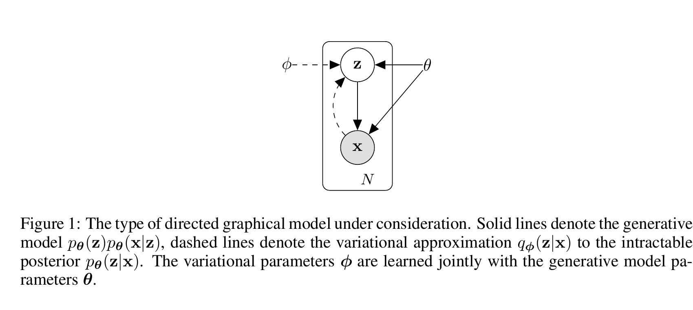

这张图把 VAE 的两条方向放在了一起。实线 $\mathbf z\rightarrow\mathbf x$ 是生成模型：先验产生 $\mathbf z$，decoder 再产生 $\mathbf x$；虚线 $\mathbf x\dashrightarrow\mathbf z$ 是近似推断模型，也就是 encoder 提供的一条计算捷径，它不是在宣称现实世界里“图片导致了隐变量”。外面的方框表示这套过程对数据集中的 $N$ 个样本重复。训练时两条方向一起出现，真正生成时只沿实线从 $\mathbf z$ 走向 $\mathbf x$。

首先假设隐变量的先验是每个方向方差都一样的标准高斯分布：$p(\mathbf z)=\mathcal N(\mathbf z;\mathbf0,\mathbf I).$

我们定义 encoder 接收数据 $\mathbf x$，输出近似后验的均值与对数方差，也就是 $q_\phi(\mathbf z\mid\mathbf x)=\mathcal N\!\left(\mathbf z;\boldsymbol\mu_\phi(\mathbf x),\operatorname{diag}(\boldsymbol\sigma_\phi^2(\mathbf x))\right).$

随后采样 $\boldsymbol\epsilon\sim\mathcal N(\mathbf0,\mathbf I)$，通过$\mathbf z=\boldsymbol\mu_\phi(\mathbf x)+\boldsymbol\sigma_\phi(\mathbf x)\odot\boldsymbol\epsilon$ 得到隐变量。decoder 读入 $\mathbf z$，输出 $p_\theta(\mathbf x\mid\mathbf z)$ 的分布参数。二值数据使用 Bernoulli 分布，连续数据则可以使用高斯分布。

在标准高斯先验下，把前面引用块里的高斯 KL 散度公式代入，可以得到

$$D_\text{KL}\!\left(q_\phi(\mathbf z\mid\mathbf x)\|p(\mathbf z)\right)
=\frac12\sum_{j=1}^J\left(\mu_j^2+\sigma_j^2-\log\sigma_j^2-1\right).$$

因此单个样本的 ELBO 可以写成

$$\mathcal L(\theta,\phi;\mathbf x)
\approx \frac1L\sum_{l=1}^L\log p_\theta(\mathbf x\mid\mathbf z^{(l)})
-\frac12\sum_{j=1}^J\left(\mu_j^2+\sigma_j^2-\log\sigma_j^2-1\right).$$

训练代码通常使用梯度下降，所以会最小化负 ELBO：

$$\mathcal L_\text{VAE-loss}
=\underbrace{-\mathbb E_{q_\phi(\mathbf z\mid\mathbf x)}[\log p_\theta(\mathbf x\mid\mathbf z)]}_{\text{reconstruction loss}}
+\underbrace{D_\text{KL}\!\left(q_\phi(\mathbf z\mid\mathbf x)\|p(\mathbf z)\right)}_{\text{KL loss}}.$$

到这里，我们终于可以把 VAE 的一次训练完整地走一遍：

1. 从数据集中取一个 mini-batch 的真实样本 $\mathbf x$；
2. encoder 输出 $\boldsymbol\mu_\phi(\mathbf x)$ 和 $\log\boldsymbol\sigma_\phi^2(\mathbf x)$；
3. 采样标准高斯噪声 $\boldsymbol\epsilon$，重参数化得到 $\mathbf z=\boldsymbol\mu_\phi(\mathbf x)+\boldsymbol\sigma_\phi(\mathbf x)\odot\boldsymbol\epsilon$；
4. decoder 根据 $\mathbf z$ 输出 $p_\theta(\mathbf x\mid\mathbf z)$ 的参数；
5. 计算重建损失，检查 decoder 能不能从 $\mathbf z$ 还原 $\mathbf x$；
6. 计算 KL loss，约束 $q_\phi(\mathbf z\mid\mathbf x)$ 不要偏离标准高斯先验太远；
7. 两项相加并反向传播，同时更新 encoder 的 $\phi$ 和 decoder 的 $\theta$。

训练是从 $\mathbf x$ 出发，生成则简单得多：

1. 直接从先验采样 $\mathbf z\sim\mathcal N(\mathbf0,\mathbf I)$；
2. 把 $\mathbf z$ 交给 decoder，得到 $p_\theta(\mathbf x\mid\mathbf z)$；
3. 从这个条件分布中采样 $\mathbf x$，或者直接取它的均值作为生成结果。

> **Thinking 生成时还需要 encoder 吗？**
>
> 不需要。encoder 解决的是“给定真实数据 $\mathbf x$，它可能由什么 $\mathbf z$ 生成”的 inference 问题，主要服务于训练、重建和表示学习。
>
> 真正从无到有地生成时，我们已经知道怎样从先验采样 $\mathbf z$，所以只需要 decoder。也正因为如此，训练中的 KL 项十分重要：它让 decoder 在标准高斯先验经常取到的区域都见过足够多的 $\mathbf z$，生成时才能放心地从这个先验出发。

> **VB、SGVB、AEVB、VAE 四个概念都是啥，有什么关系？**
>
> - **VB（Variational Bayes）** 是一类思想：真实后验难算，就用一个可处理的变分分布去近似，并优化变分下界。
> - **SGVB estimator** 是一种估计 ELBO 及其梯度的方法：通过重参数化和 Monte Carlo 采样，把不可直接积分的期望变成可微的随机估计。
> - **AEVB algorithm** 是一套面向大规模独立同分布数据的训练算法：用一个共享的 recognition model/encoder 做摊销推断，再用 SGVB estimator 和 mini-batch 同时学习 $\phi$ 与 $\theta$。
> - **VAE** 是 AEVB 的一个具体神经网络例子：encoder 表示 $q_\phi(\mathbf z\mid\mathbf x)$，decoder 表示 $p_\theta(\mathbf x\mid\mathbf z)$，通常选择标准高斯先验和对角高斯近似后验。
>
> 简单画一下层级关系就是：**VB 是大思想，SGVB 是估计工具，AEVB 是训练算法，VAE 是具体模型。**

到这里再回头读论文摘要开篇的那句话，已经不再那么吓人了：VAE 面对的是连续隐变量模型中难算的后验和边缘似然；它用 $q_\phi(\mathbf z\mid\mathbf x)$、ELBO、重参数化和 mini-batch 训练，把 inference 与 learning 变成了一个可以由神经网络端到端解决的问题。
## II 从 DDPM 到 DDIM

读完 VAE，我们懂得了什么是**隐空间**，学会了当目标分布不可计算的时候如何用数学的方法简化目标（比如ELBO），并在这样一个示例中看到了什么叫采样、什么叫生成。在后面很多地方，我们还会用到 VAE 的思想或者方法。接下来我们开始正式迈入 Diffusion 的世界。

所谓 Diffusion，名字的由来就有一点物理的意味：扩散模型。这里面确实是有物理背景，我们留到后文再去探讨。现在我们从直观上先理解一下扩散模型：对于图片而言，扩散意味着一张干净的图不断加噪声（噪声就是从高斯分布取样的），从 $\mathbf x_0$ 一步步加噪声到 $\mathbf x_1,\mathbf x_2,\dots,\mathbf x_T$，就变得越来越花直到变成乱码。

模型如果学会了给定 $\mathbf x_t$ 和一个噪声，就能输出 $\mathbf x_{t+1}$，那么反过来是不是就能掌握如何去噪，给一个 $\mathbf x_{t+1}$ 就能输出 $\mathbf x_t$ 呢？如果模型具备了这种能力，从一个完全的高斯分布随机噪声开始，模型就可以一步一步输出一个干净图片出来。这种看似“熵减”的不可逆过程，就是 Diffusion 模型实际做的事。

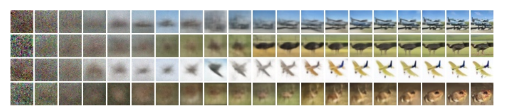

### DDPM
Denoising Diffusion Probabilistic Models（DDPM）[5](#ref-5)是 2020 年 UC Berkeley 团队的工作，发表于 NeurIPS 2020，是整个 Diffusion 家族腾飞的奠基之作。虽然如此，但是论文中的公式推导跳步比较严重，对于数学新手并不友好。于是这里我先结合 [Lil'Log](https://lilianweng.github.io/posts/2021-07-11-diffusion-models/) 把公式推导讲明白，然后我们回过头再去看原论文里提供的其他 insight。

前面说过，我们有前向的加噪过程，也有反向的去噪过程，也就分别对应模型的训练和模型的生成两个阶段。我们先看加噪。
#### forward process
有一张干净图片 $\mathbf x_0$ ，可以给他加**一点**从高斯分布采样的噪声，这样它就会变得杂乱一点。这个 **一点** 是多少呢？所以我们需要人为地事先指定的一个数列$\{\beta_1,\beta_2,\dots,\beta_T\}$作为每一步加噪的强度，一般而言满足$\beta_1<\beta_2<\dots<\beta_T$。所以我们就有了从第$t-1$步到第$t$步的过程：
$$\mathbf {x_t} =\sqrt {1-\beta_t}\mathbf {x_{t-1}}+\sqrt {\beta_t} \mathbf{\epsilon_{t-1}} ,$$
其中 $\epsilon_{t-1} \in \mathcal{N}(\mathbf 0,\mathbf I)$。
> **Thinking 为什么不采用线性插值而是这种根式的插值？**
>
> 主要是为了保证方差的一致性。如果我们假定$\mathbf x_0$的方差为$1$，又已知高斯分布的噪声方差也是$1$，由数学归纳法
>
> $\begin{aligned}\text{Var}(\mathbf x_t)&=\text{Var}(\sqrt {1-\beta_t}\mathbf {x_{t-1}}+\sqrt {\beta_t} \mathbf{\epsilon_{t-1}})\\&= \text{Var}(\sqrt {1-\beta_t}\mathbf {x_{t-1}})+\text{Var}(\sqrt {\beta_t} \mathbf{\epsilon_{t-1}}) \\&=(1-\beta_t)\text{Var}(\mathbf x_{t-1}) + \beta_t \text{Var}(\epsilon_t) \\&=(1-\beta_t)+\beta_t=1\end{aligned}$
>
> 加噪声后的方差总保持是 $1$，这也被称为 Variance Preserving （VP）的扩散过程

为了更方便进行计算，我们令$\alpha_t = 1-\beta_t$，所以上面这个式子就变成了
$$\mathbf {x_t} =\sqrt {\alpha_t}\mathbf {x_{t-1}}+\sqrt {1-\alpha_t} \mathbf{\epsilon_{t-1}} .$$

这是一个马尔科夫链。

> **Tips 什么是马尔科夫链？**
>
> 就是一个随机过程里，每一步状态都只由它的上一个状态决定。
>
> Diffusion 的加噪过程一定要是马尔科夫的吗？在 DDPM 里是，但在 DDIM 等后面我们要介绍的模型里可能就不是哦~

然而我们可能没有意识到的是，上面这个公式有非常好的性质：

$$\begin{aligned}
\mathbf {x_t} &= \sqrt {\alpha_t}\mathbf {x_{t-1}}+\sqrt {1-\alpha_t} \mathbf{\epsilon_{t-1}}\\
&=\sqrt {\alpha_t}\left(\sqrt {\alpha_{t-1}}\mathbf {x_{t-2}}+\sqrt {1-\alpha_{t-1}} \mathbf{\epsilon_{t-2}}\right)+\sqrt {1-\alpha_t} \mathbf{\epsilon_{t-1}} \qquad 把\mathbf x_{t-1}向前迭代一步\\
&=\sqrt {\alpha_t\alpha_{t-1}}\mathbf {x_{t-2}} + \left(\sqrt {\alpha_t(1-\alpha_{t-1})}\mathbf{\epsilon_{t-2}} + \sqrt {1-\alpha_t} \mathbf{\epsilon_{t-1}}\right) \qquad 分组\\
&= \sqrt {\alpha_t\alpha_{t-1}}\mathbf {x_{t-2}} + \sqrt {\alpha_t(1-\alpha_{t-1})+1-\alpha_t}\mathbf{\bar \epsilon_{t-2}} \qquad 两个高斯噪声的和仍为高斯分布，合并后方差为二者的方差和\\
&= \sqrt {\alpha_t\alpha_{t-1}}\mathbf {x_{t-2}} + \sqrt {1-\alpha_t\alpha_{t-1}}\mathbf{\bar \epsilon_{t-2}} \qquad 展开\\
&=\dots\\
&=\sqrt {\alpha_t\alpha_{t-1}\dots\alpha_1}\mathbf {x_{0}} + \sqrt {1-\alpha_t\alpha_{t-1}\dots\alpha_1}\mathbf{\epsilon}
\end{aligned}$$

> **Recap 高斯分布的合并与拆解**
>
> 若
> $$
> x\sim\mathcal N(\boldsymbol\mu_1,\boldsymbol\Sigma_1),
> \qquad
> y\sim\mathcal N(\boldsymbol\mu_2,\boldsymbol\Sigma_2),
> $$
>
> 且 $x$ 与 $y$ 相互独立，则对于常数 $a,b$，
>
> $$
> ax+by
> \sim
> \mathcal N
> \left(
> a\boldsymbol\mu_1+b\boldsymbol\mu_2,,
> a^2\boldsymbol\Sigma_1+b^2\boldsymbol\Sigma_2
> \right).
> $$

这是一个非常有趣的递推式子，这意味着我们加噪其实不需要一步一步加，从$\mathbf x_0$可以一步跳到$\bf x_t$。这里我们定义$\bar \alpha_t =\alpha_t\alpha_{t-1}\dots\alpha_1$，重新定义$\boldsymbol{\epsilon_t}$为这里一步到位加的噪音，我们就有$\mathbf x_t$与$\mathbf x_0$的非常美妙的关系：
$$\mathbf x_t = \sqrt{\bar \alpha_t}\mathbf x_0 + \sqrt{1-\bar \alpha_t}\mathbf \epsilon_t .$$

或者写得稍微高级一点，写成条件分布的PDF（概率密度函数）：
$$q(\mathbf x_t | \mathbf x_0) = \mathcal N(\mathbf x_t;\sqrt{\bar \alpha_t}\mathbf x_0,(1-\bar \alpha_t)\mathbf I).$$
这里的$q$，就可以理解成我们自己设计的真实扩散过程。下文中的$p_\theta$则是模型近似的扩散过程。

> **Tips $\mathcal N(\cdot;\cdot,\cdot)$是什么意思？**
>
> 我们学概率论时知道，高斯分布$\mathcal N(\mathbf{\mu},\mathbf \Sigma)$的两个参数表示期望和协方差矩阵。
>
> 这里在期望和方差前面用分号隔开，加了一个量，表示**要计算概率密度的变量**，也就是在$\mathbf x_t$取值处的概率密度。$\mathcal N(\mathbf{\mu},\mathbf \Sigma)$是一个分布，而$\mathcal N(\mathbf x ;\mathbf{\mu},\mathbf \Sigma)$是一个概率密度函数，因此上面的等式才能成立。

#### reverse process
有了前向过程，倘若我们能够得到$q(\mathbf x_{t-1}|\mathbf x_t)$，那生成 $q(\bf x_0)$ 就从 $\mathcal N(\mathbf 0,\mathbf I)$ 里采个噪音 $\mathbf x_T$，一步步顺着 $q(\mathbf x_{t-1}|\mathbf x_t)$ 往前走就好了。但在生成的过程中，我们拿不到 $q(\mathbf x_{t-1}|\mathbf x_t)$，所以要学习一个模型 $p_\theta(\mathbf x_{t-1}|\mathbf x_t)$ ，去逼近 $q(\mathbf x_{t-1}|\mathbf x_t)$ 。这里的 $\theta$ 表示模型的参数。

我们可以声称 $p_\theta(\mathbf x_{t-1}|\mathbf x_t) = \mathcal N(\mathbf x_{t-1};\mathbf \mu_\theta(\mathbf x_t,t),\mathbf \Sigma_\theta(\mathbf x_t, t))$，目标就是把给定 $(\mathbf x_t,t)$ 时的均值 $\mathbf \mu_\theta(\mathbf x_t,t)$ 和协方差 $\mathbf \Sigma_\theta(\mathbf x_t, t)$ 都学出来。（p.s. 在 DDPM 里，主要是学$\mathbf \mu_\theta(\mathbf x_t,t)$）

但如果 $q(\mathbf x_{t-1}|\mathbf x_t)$ 不可算的话，我们的 $p_\theta(\mathbf x_{t-1}|\mathbf x_t)$ 学习目标怎么设置呢？幸运的是，我们发现如果给 $q(\mathbf x_{t-1}|\mathbf x_t)$ 再加一个条件变量 $\mathbf x_0$ 的话，就可以计算了。计算过程比较繁琐，结论是它也是一个高斯的PDF，如果读者不想仔细看这个繁琐的推导过程，可以跳过下面这一段引用，直接到传送门 **⊛** 的位置。

> **推导 $q(\mathbf{x}_{t-1} \vert \mathbf{x}_t, \mathbf{x}_0)$ 的过程**，主要来自[Lil'Log](https://lilianweng.github.io/posts/2021-07-11-diffusion-models/)，我添加了一些细节
> $$\begin{aligned}
> q(\mathbf{x}_{t-1} \vert \mathbf{x}_t, \mathbf{x}_0)
> &= \frac{q(\mathbf{x}_t,\mathbf{x}_{t-1}, \mathbf{x}_0)}{q(\mathbf{x}_t,\mathbf{x}_0)}\qquad 条件概率公式\\
> &=\frac{q(\mathbf{x}_t \vert \mathbf{x}_{t-1}, \mathbf{x}_0)q(\mathbf{x}_{t-1} \vert \mathbf{x}_0)q(\mathbf x_0)}{q(\mathbf{x}_t \vert \mathbf{x}_0)q(\mathbf x_0)}\qquad 条件概率公式\\
> &=q(\mathbf{x}_t \vert \mathbf{x}_{t-1}, \mathbf{x}_0) \frac{ q(\mathbf{x}_{t-1} \vert \mathbf{x}_0) }{ q(\mathbf{x}_t \vert \mathbf{x}_0) } \qquad 约分\\
> \end{aligned}
> $$
>
> 这里结合前面已经推过的东西（如果忘记了可以往前翻一下）
> 1) $$单步的前向公式 \qquad \mathbf {x_t} =\sqrt {\alpha_t}\mathbf {x_{t-1}}+\sqrt {1-\alpha_t} \mathbf{\epsilon_{t-1}}$$
>
>    $$等价写作 \qquad \begin{aligned}q(\mathbf{x}_t \vert \mathbf{x}_{t-1}, \mathbf{x}_0)&=\mathcal N(\mathbf x_t;\sqrt {\alpha_t}\mathbf {x_{t-1}},(1-\alpha_t)\mathbf I)\\&=\mathcal N(\mathbf x_t;\sqrt {\alpha_t}\mathbf {x_{t-1}},\beta_t\mathbf I)\end{aligned}$$
> 2) $$跳步的前向公式 \qquad \mathbf x_t = \sqrt{\bar \alpha_t}\mathbf x_0 + \sqrt{1-\bar \alpha_t}\mathbf \epsilon_t$$
>    $$\text{PDF} \qquad q(\mathbf x_t | \mathbf x_0) = \mathcal N(\mathbf x_t;\sqrt{\bar \alpha_t}\mathbf x_0,(1-\bar \alpha_t)\mathbf I)$$
> 3) $$跳步的前向公式 \qquad \mathbf x_{t-1} = \sqrt{\bar \alpha_{t-1}}\mathbf x_0 + \sqrt{1-\bar \alpha_{t-1}}\mathbf \epsilon_{t-1}$$
>    $$\text{PDF} \qquad q(\mathbf x_{t-1} | \mathbf x_0) = \mathcal N(\mathbf x_{t-1};\sqrt{\bar \alpha_{t-1}}\mathbf x_0,(1-\bar \alpha_{t-1})\mathbf I)$$
>
> 回顾正态分布的PDF，
> $$\mathcal N(\mathbf x;\mathbf \mu, \mathbf \Sigma) \propto \exp{\left(-\frac{1}{2}\frac{(\mathbf x-\mathbf \mu)^2}{\det{\Sigma}}\right)}=\exp{\left(-\frac{1}{2}\left(\color{red}{\frac{\mathbf x^2}{\det{\Sigma}}}-\color{blue}{2\frac{\mathbf x \cdot \mathbf \mu}{\det{\Sigma}}}\color{black}{+\frac{\mathbf \mu^2}{\det{\Sigma}}}\right)\right)}$$
> 因此，回到刚才的公式，
> $$\begin{aligned}
> q(\mathbf{x}_{t-1} \vert \mathbf{x}_t, \mathbf{x}_0) &=q(\mathbf{x}_t \vert \mathbf{x}_{t-1}, \mathbf{x}_0) \frac{ q(\mathbf{x}_{t-1} \vert \mathbf{x}_0) }{ q(\mathbf{x}_t \vert \mathbf{x}_0) } \\
> &\propto \exp \Big(-\frac{1}{2} \big(\frac{(\mathbf{x}_t - \sqrt{\alpha_t} \mathbf{x}_{t-1})^2}{\beta_t} + \frac{(\mathbf{x}_{t-1} - \sqrt{\bar{\alpha}_{t-1}} \mathbf{x}_0)^2}{1-\bar{\alpha}_{t-1}} - \frac{(\mathbf{x}_t - \sqrt{\bar{\alpha}_t} \mathbf{x}_0)^2}{1-\bar{\alpha}_t} \big) \Big)\\
> &= \exp \Big(-\frac{1}{2} \big(\frac{\mathbf{x}_t^2 - 2\sqrt{\alpha_t} \mathbf{x}_t \color{blue}{\mathbf{x}_{t-1}} \color{black}{+ \alpha_t} \color{red}{\mathbf{x}_{t-1}^2} }{\beta_t} + \frac{ \color{red}{\mathbf{x}_{t-1}^2} \color{black}{- 2 \sqrt{\bar{\alpha}_{t-1}} \mathbf{x}_0} \color{blue}{\mathbf{x}_{t-1}} \color{black}{+ \bar{\alpha}_{t-1} \mathbf{x}_0^2}  }{1-\bar{\alpha}_{t-1}} - \frac{(\mathbf{x}_t - \sqrt{\bar{\alpha}_t} \mathbf{x}_0)^2}{1-\bar{\alpha}_t} \big) \Big) \\
> &= \exp\Big( -\frac{1}{2} \big( \color{red}{(\frac{\alpha_t}{\beta_t} + \frac{1}{1 - \bar{\alpha}_{t-1}})} \mathbf{x}_{t-1}^2 - \color{blue}{(\frac{2\sqrt{\alpha_t}}{\beta_t} \mathbf{x}_t + \frac{2\sqrt{\bar{\alpha}_{t-1}}}{1 - \bar{\alpha}_{t-1}} \mathbf{x}_0)} \mathbf{x}_{t-1} \color{black}{ + C(\mathbf{x}_t, \mathbf{x}_0) \big) \Big)}
> \end{aligned}$$
>
> 其中黑色部分的 $C(\mathbf{x}_t, \mathbf{x}_0)$ 是和 $\mathbf x_{t-1}$ 无关的部分，我们忽略。剩下的红色项与蓝色项一一比对，如果我们设
> $$q(\mathbf{x}_{t-1} \vert \mathbf{x}_t, \mathbf{x}_0) = \mathcal{N}(\mathbf{x}_{t-1}; \color{blue}{\tilde{\boldsymbol{\mu}}}(\mathbf{x}_t, \mathbf{x}_0), \color{red}{\tilde{\beta}_t} \mathbf{I})$$
> 那么
> $$\color{red}\frac{1}{\tilde \beta_t}=\frac{\alpha_t}{\beta_t} + \frac{1}{1 - \bar{\alpha}_{t-1}}$$
> $$\color{blue}\frac{2\mathbf \mu}{\tilde \beta_t}=\frac{2\sqrt{\alpha_t}}{\beta_t} \mathbf{x}_t + \frac{2\sqrt{\bar{\alpha}_{t-1}}}{1 - \bar{\alpha}_{t-1}} \mathbf{x}_0$$
> 做代数变形，简单化简得
> $$\color{red}\tilde{\beta}_t = \frac{1 - \bar{\alpha}_{t-1}}{1 - \bar{\alpha}_t} \cdot \beta_t$$
> $$ \color{blue}\tilde{\boldsymbol{\mu}}_t (\mathbf{x}_t, \mathbf{x}_0)=\frac{\sqrt{\alpha_t}(1 - \bar{\alpha}_{t-1})}{1 - \bar{\alpha}_t} \mathbf{x}_t + \frac{\sqrt{\bar{\alpha}_{t-1}}\beta_t}{1 - \bar{\alpha}_t} \mathbf{x}_0$$
> 但我们由最爱的前向公式知道，$\mathbf x_t$和$\mathbf x_0$也是有关系的，具体来说就是$\mathbf x_t = \sqrt{\bar \alpha_t}\mathbf x_0 + \sqrt{1-\bar \alpha_t}\mathbf \epsilon_t$
>
> 所以用$\mathbf x_t$表示$\mathbf x_0$（反解$\mathbf x_0$）并带回上式，就可以进一步化简$\tilde{\boldsymbol{\mu}}_t (\mathbf{x}_t, \mathbf{x}_0)$：
>
> $$ \begin{aligned} \color{blue}\tilde{\boldsymbol{\mu}}_t(\mathbf{x}_t, \mathbf{x}_0) &= \color{blue}\frac{\sqrt{\alpha_t}(1 - \bar{\alpha}_{t-1})}{1 - \bar{\alpha}_t} \mathbf{x}_t + \frac{\sqrt{\bar{\alpha}_{t-1}}\beta_t}{1 - \bar{\alpha}_t} \frac{1}{\sqrt{\bar{\alpha}_t}}(\mathbf{x}_t - \sqrt{1 - \bar{\alpha}_t}\boldsymbol{\epsilon}_t) \\&= \color{cyan}{\frac{1}{\sqrt{\alpha_t}} \Big( \mathbf{x}_t - \frac{1 - \alpha_t}{\sqrt{1 - \bar{\alpha}_t}} \boldsymbol{\epsilon}_t \Big)}
\end{aligned}$$

**⊛** 结论就是
$$q(\mathbf{x}_{t-1} \vert \mathbf{x}_t, \mathbf{x}_0) = \mathcal{N}(\mathbf{x}_{t-1}; {\tilde{\boldsymbol{\mu}}}(\mathbf{x}_t, \mathbf{x}_0), {\tilde{\beta}_t} \mathbf{I})$$
其中
$$\tilde{\beta}_t = \frac{1 - \bar{\alpha}_{t-1}}{1 - \bar{\alpha}_t} \cdot \beta_t$$
$$\tilde{\boldsymbol{\mu}}_t (\mathbf{x}_t, \mathbf{x}_0)=\frac{1}{\sqrt{\alpha_t}} \Big( \mathbf{x}_t - \frac{1 - \alpha_t}{\sqrt{1 - \bar{\alpha}_t}} \boldsymbol{\epsilon}_t \Big).$$

我们成功算出来了$q(\mathbf x_{t-1}|\mathbf x_t, \mathbf x_0)$。接下来回到主线，既然$q(\mathbf x_{t-1}|\mathbf x_t)$ 不可算但 $q(\mathbf x_{t-1}|\mathbf x_t, \mathbf x_0)$ 可算，我们就可以用后者来训练 $p_\theta(\mathbf x_{t-1}|\mathbf x_t)$ 。（但要注意，训练的时候能看到 $\bf x_0$，推理的时候可没有 $\bf x_0$ 给我们看。）倘若学会这个，我们从高斯分布中采一个样 $\mathbf x_T$，然后通过$p_\theta(\mathbf x_{t-1}|\mathbf x_t)$反复向前走，就能还愿出我们希望的$\mathbf x_0$。另外，我们也可以给出计算路径概率密度和$\mathbf x_0$概率密度的公式如下，这对于我们后面定义损失函数至关重要：
$$p_\theta(\mathbf{x}_{0:T}) = p(\mathbf{x}_T) \prod^T_{t=1} p_\theta(\mathbf{x}_{t-1} \vert \mathbf{x}_t),$$
$$p_\theta(\mathbf x_0)=\int p_\theta(\mathbf{x}_{0:T}) d\mathbf x_{1:T}$$

> **Tips 符号注解**
>
> $\bf x_{0:T}$表示的是 $\bf x_0 \bf x_1 \dots \bf x_T$ 这种连乘，为了方便直接用一个带冒号的角标去写了
>
> $d\mathbf x_{1:T} = d\mathbf x_0 d\mathbf x_1 \dots d\mathbf x_T$，所以上面的积分其实是一个$T$重积分，把 $\bf x_1$ 到 $\bf x_T$ 这些变量全都积掉了，也就是$\bf x_0$的**边缘分布**。

明确了**学习目标**，下一步就是**定义损失函数**了，这样才可以建立**监督信号**。

我们希望最大化真实图片的概率 $p_\theta(\mathbf x_0)$，等价地可以最小化负对数似然 $-\log p_\theta(\mathbf x_0)$。但显然，上面写的这个$T$重积分 $p_\theta(\mathbf x_0)=\int p_\theta(\mathbf{x}_{0:T}) d\mathbf x_{1:T}$ 是不可算的。在这里，DDPM 的思路是像 VAE 一样，给出一个 $-\log p_\theta(\mathbf x_0)$ 的可计算上界，然后转为最小化这个可计算的上界（ELBO）。这一部分同样要陷入较长时间的推导，不感兴趣的读者请直接跳到传送门 **⊛⊛** 的位置。

> **推导可计算上界的过程，主要来自[Lil'Log](https://lilianweng.github.io/posts/2021-07-11-diffusion-models/)，我添加了一些细节**
> $$\begin{aligned}- \log p_\theta(\mathbf{x}_0) &\leq - \log p_\theta(\mathbf{x}_0) + D_\text{KL}(q(\mathbf{x}_{1:T}\vert\mathbf{x}_0) \| p_\theta(\mathbf{x}_{1:T}\vert\mathbf{x}_0) ) \qquad 引入一项非负的\text{KL}散度项\\&= - \log p_\theta(\mathbf{x}_0) + \mathbb{E}_{\mathbf{x}_{1:T}\sim q(\mathbf{x}_{1:T} \vert \mathbf{x}_0)} \Big[ \log\frac{q(\mathbf{x}_{1:T}\vert\mathbf{x}_0)}{p_\theta(\mathbf{x}_{1:T} \vert \mathbf{x}_0) } \Big]  \qquad \text{KL}散度的定义\\&= - \log p_\theta(\mathbf{x}_0) + \mathbb{E}_{\mathbf{x}_{1:T}\sim q(\mathbf{x}_{1:T} \vert \mathbf{x}_0)} \Big[ \log\frac{q(\mathbf{x}_{1:T}\vert\mathbf{x}_0)}{p_\theta(\mathbf{x}_{0:T}) / p_\theta(\mathbf{x}_0)} \Big] \qquad 条件概率公式\\&= - \log p_\theta(\mathbf{x}_0) + \mathbb{E}_{\mathbf{x}_{1:T}\sim q(\mathbf{x}_{1:T} \vert \mathbf{x}_0)} \Big[ \log\frac{q(\mathbf{x}_{1:T}\vert\mathbf{x}_0)}{p_\theta(\mathbf{x}_{0:T})} + \log p_\theta(\mathbf{x}_0) \Big] \qquad 基本代数变形\\&= \mathbb{E}_{\mathbf{x}_{1:T}\sim q(\mathbf{x}_{1:T} \vert \mathbf{x}_0)} \Big[ \log \frac{q(\mathbf{x}_{1:T}\vert\mathbf{x}_0)}{p_\theta(\mathbf{x}_{0:T})} \Big] \qquad 第三项与\mathbf x_{1:T}无关，取期望等于自身，和第一项消掉\end{aligned}$$
>
>这里的推导过程我给每一步都在后面加了中文注释，想必是比较清晰了。如果忘记 KL 散度的定义，可以往前翻一下看看 VAE 的部分。这里期望下面复杂的角标 $\mathbf{x}_{1:T}\sim q(\mathbf{x}_{1:T} \vert \mathbf{x}_0)$ 同样表示的是期望计算对象是 $\mathbf{x}_{1:T}$ （也就是对整个去噪的轨迹），且 $\mathbf{x}_{1:T}$ 服从 $q(\mathbf{x}_{1:T} \vert \mathbf{x}_0)$。
>
> 现在我们得到了
>
> $$- \log p_\theta(\mathbf{x}_0) \leq \mathbb{E}_{\mathbf{x}_{1:T}\sim q(\mathbf{x}_{1:T} \vert \mathbf{x}_0)} \Big[ \log \frac{q(\mathbf{x}_{1:T}\vert\mathbf{x}_0)}{p_\theta(\mathbf{x}_{0:T})} \Big]$$
>
> 两边同时再对 $\mathbf x_0$ 取期望，就有
>
> $$\begin{aligned}- \mathbb E_{\mathbf x_0\sim q(\mathbf{x}_{0})} \log p_\theta(\mathbf{x}_0) &\leq \mathbb E_{\mathbf x_0\sim q(\mathbf{x}_{0})}\mathbb{E}_{\mathbf{x}_{1:T}\sim q(\mathbf{x}_{1:T} \vert \mathbf{x}_0)} \Big[ \log \frac{q(\mathbf{x}_{1:T}\vert\mathbf{x}_0)}{p_\theta(\mathbf{x}_{0:T})} \Big]\\&=\mathbb E_{\mathbf{x}_{0:T}\sim q(\mathbf{x}_{0:T})} \Big[ \log \frac{q(\mathbf{x}_{1:T}\vert\mathbf{x}_0)}{p_\theta(\mathbf{x}_{0:T})} \Big] \\&\overset{\mathrm{def}}{=} L_\text{VLB}\end{aligned}$$
>
> 中间有一个两步期望合并成一步的过程。把它展开就一目了然：
>
> $$\begin{aligned}
> &\mathbb E_{\mathbf x_0\sim q(\mathbf x_0)}\mathbb E_{\mathbf x_{1:T}\sim q(\mathbf x_{1:T}\mid\mathbf x_0)}[f(\mathbf x_{0:T})]\\
> =&\int q(\mathbf x_0)q(\mathbf x_{1:T}\mid\mathbf x_0)f(\mathbf x_{0:T})d\mathbf x_{0:T}\\
> =&\int q(\mathbf x_{0:T})f(\mathbf x_{0:T})d\mathbf x_{0:T}
> =\mathbb E_{\mathbf x_{0:T}\sim q(\mathbf x_{0:T})}[f(\mathbf x_{0:T})].
> \end{aligned}$$
>
> 用到的只有联合分布分解 $q(\mathbf x_{0:T})=q(\mathbf x_0)q(\mathbf x_{1:T}\mid\mathbf x_0)$。先抽一张干净图片、再沿前向过程抽整条噪声轨迹，和直接从它们的联合分布抽一整条轨迹，是同一件事。
>
> 简便起见，期望的角标我们以后就不写 $\cdot \sim q(\cdot)$ 了，这带来了冗余，直接写 $q(\cdot)$，甚至有的时候直接只写一个 $q$，或者括号里的 $\cdot$（如 $\mathbf x_0$） ，请读者不要误会。我们定义 $\mathbb{E}_{q(\mathbf{x}_{0:T})} \Big[ \log \frac{q(\mathbf{x}_{1:T}\vert\mathbf{x}_0)}{p_\theta(\mathbf{x}_{0:T})} \Big]$ 为 $L_\text{VLB}$。后面我们可以说明，它就是我们需要的**可计算的上界**，也就是我们要最小化的损失函数。接下来我们进一步推导这个 $L_\text{VLB}$ 如何计算。
>
> $$\begin{aligned}
> L_\text{VLB}
> &= \mathbb{E}_{q(\mathbf{x}_{0:T})} \Big[ \log\frac{q(\mathbf{x}_{1:T}\vert\mathbf{x}_0)}{p_\theta(\mathbf{x}_{0:T})} \Big] \\
> &= \mathbb{E}_q \Big[ \log\frac{\prod_{t=1}^T q(\mathbf{x}_t\vert\mathbf{x}_{t-1})}{ p_\theta(\mathbf{x}_T) \prod_{t=1}^T p_\theta(\mathbf{x}_{t-1} \vert\mathbf{x}_t) } \Big] \qquad \text{Markov}链的展开\\
> &= \mathbb{E}_q \Big[ -\log p_\theta(\mathbf{x}_T) + \sum_{t=1}^T \log \frac{q(\mathbf{x}_t\vert\mathbf{x}_{t-1})}{p_\theta(\mathbf{x}_{t-1} \vert\mathbf{x}_t)} \Big] \\
> &= \mathbb{E}_q \Big[ -\log p_\theta(\mathbf{x}_T) + \sum_{t=2}^T \log \frac{q(\mathbf{x}_t\vert\mathbf{x}_{t-1})}{p_\theta(\mathbf{x}_{t-1} \vert\mathbf{x}_t)} + \log\frac{q(\mathbf{x}_1 \vert \mathbf{x}_0)}{p_\theta(\mathbf{x}_0 \vert \mathbf{x}_1)} \Big] \qquad 改求和下界\\
> &= \mathbb{E}_q \Big[ -\log p_\theta(\mathbf{x}_T) + \sum_{t=2}^T \log \Big( \frac{q(\mathbf{x}_{t-1} \vert \mathbf{x}_t, \mathbf{x}_0)}{p_\theta(\mathbf{x}_{t-1} \vert\mathbf{x}_t)}\cdot \frac{q(\mathbf{x}_t \vert \mathbf{x}_0)}{q(\mathbf{x}_{t-1}\vert\mathbf{x}_0)} \Big) + \log \frac{q(\mathbf{x}_1 \vert \mathbf{x}_0)}{p_\theta(\mathbf{x}_0 \vert \mathbf{x}_1)} \Big] \qquad \text{Bayes}公式\\
> &= \mathbb{E}_q \Big[ -\log p_\theta(\mathbf{x}_T) + \sum_{t=2}^T \log \frac{q(\mathbf{x}_{t-1} \vert \mathbf{x}_t, \mathbf{x}_0)}{p_\theta(\mathbf{x}_{t-1} \vert\mathbf{x}_t)} + \sum_{t=2}^T \log \frac{q(\mathbf{x}_t \vert \mathbf{x}_0)}{q(\mathbf{x}_{t-1} \vert \mathbf{x}_0)} + \log\frac{q(\mathbf{x}_1 \vert \mathbf{x}_0)}{p_\theta(\mathbf{x}_0 \vert \mathbf{x}_1)} \Big] \\
> &= \mathbb{E}_q \Big[ -\log p_\theta(\mathbf{x}_T) + \sum_{t=2}^T \log \frac{q(\mathbf{x}_{t-1} \vert \mathbf{x}_t, \mathbf{x}_0)}{p_\theta(\mathbf{x}_{t-1} \vert\mathbf{x}_t)} + \log\frac{q(\mathbf{x}_T \vert \mathbf{x}_0)}{q(\mathbf{x}_1 \vert \mathbf{x}_0)} + \log \frac{q(\mathbf{x}_1 \vert \mathbf{x}_0)}{p_\theta(\mathbf{x}_0 \vert \mathbf{x}_1)} \Big]\\
> &= \mathbb{E}_q \Big[ \log\frac{q(\mathbf{x}_T \vert \mathbf{x}_0)}{p_\theta(\mathbf{x}_T)} + \sum_{t=2}^T \log \frac{q(\mathbf{x}_{t-1} \vert \mathbf{x}_t, \mathbf{x}_0)}{p_\theta(\mathbf{x}_{t-1} \vert\mathbf{x}_t)} - \log p_\theta(\mathbf{x}_0 \vert \mathbf{x}_1) \Big] \qquad 第二个求和可以逐项约分\\
> &= \mathbb{E}_q [\underbrace{D_\text{KL}(q(\mathbf{x}_T \vert \mathbf{x}_0) \parallel p_\theta(\mathbf{x}_T))}_{L_T} + \sum_{t=2}^T \underbrace{D_\text{KL}(q(\mathbf{x}_{t-1} \vert \mathbf{x}_t, \mathbf{x}_0) \parallel p_\theta(\mathbf{x}_{t-1} \vert\mathbf{x}_t))}_{L_{t-1}} \underbrace{- \log p_\theta(\mathbf{x}_0 \vert \mathbf{x}_1)}_{L_0} ]
> \end{aligned}$$
> 在这里我们定义：
>
> $$L_T = D_\text{KL}(q(\mathbf{x}_T \vert \mathbf{x}_0) \parallel p_\theta(\mathbf{x}_T))$$
> $$L_t = D_\text{KL}(q(\mathbf{x}_t \vert \mathbf{x}_{t+1}, \mathbf{x}_0) \parallel p_\theta(\mathbf{x}_t \vert\mathbf{x}_{t+1}))$$
> $$L_0 = - \log p_\theta(\mathbf{x}_0 \vert \mathbf{x}_1)$$
>
> 于是，就有
> $$L_\text{VLB} = L_T + L_{T-1} + \dots + L_0$$
>
> 我们看 $L_\text{VLB}$ 为什么可计算。
>
> 第一项 $L_T$，我们知道 $q(\mathbf x_T | \mathbf x_0) = \mathcal N(\mathbf x_T;\sqrt{\bar \alpha_T}\mathbf x_0,(1-\bar \alpha_T)\mathbf I)$，$p_\theta(\mathbf x_T) = \mathcal N(\mathbf x_T; \mathbf 0, \mathbf I)$，两个高斯分布之间的 KL 散度有闭合公式可以直接计算。因此 $L_T$ 可以精确计算。
>
> 中间项 $L_t$，我们前面已经推导过 $q(\mathbf{x}_{t-1} \vert \mathbf{x}_t, \mathbf{x}_0) = \mathcal{N}(\mathbf{x}_{t-1}; {\tilde{\boldsymbol{\mu}}}(\mathbf{x}_t, \mathbf{x}_0), {\tilde{\beta}_t} \mathbf{I})$，其中，$\tilde{\boldsymbol{\mu}}_t (\mathbf{x}_t, \mathbf{x}_0)=\frac{1}{\sqrt{\alpha_t}} \Big( \mathbf{x}_t - \frac{1 - \alpha_t}{\sqrt{1 - \bar{\alpha}_t}} \boldsymbol{\epsilon}_t \Big)$，$\tilde{\beta}_t = \frac{1 - \bar{\alpha}_{t-1}}{1 - \bar{\alpha}_t} \cdot \beta_t$。而后面的$p_\theta(\mathbf x_t | \mathbf x_{t+1}) = \mathcal N(\mathbf x_t; \boldsymbol{\mu}_\theta(\mathbf{x}_{t+1}, t), \boldsymbol{\Sigma}_\theta(\mathbf{x}_{t+1}, t))$ 期望和方差由模型参数给出。有了具体的模型参数，这里的每一个 KL 散度都可以计算。
>
> 最后一项 $L_0$，同样是模型决定的 $p_\theta(\mathbf x_0 | \mathbf x_1) = \mathcal N(\mathbf x_0; \boldsymbol{\mu}_\theta(\mathbf{x}_1, 0), \boldsymbol{\Sigma}_\theta(\mathbf{x}_1, 0))$。
>
> 综上所述，$L_\text{VLB}$ 可以精确计算，也就可以作为我们要最小化的损失函数。

**⊛⊛** 上面的这一大段已经说明了 $L_\text{VLB}$ 可以精确计算，接下来我们希望用它作为监督信号去训练模型。从前面的推导中我们可以看出，中间项 $L_t$ 是与神经网络主要相关的项。（$L_0$ 虽然也相关但是形式和前面的 KL 散度不一样，我们优先考虑 $L_t$。）所以我们可以把 $L_\text{VLB}$ 的最小化问题转化为最小化中间项 $L_t$ 的问题。具体来说，我们可以随机采样一个时间步 $t$，然后计算 $L_t$，并对模型参数进行梯度下降。

回顾 VAE 当时讲解 KL 散度公式的时候，我们给出了两个高斯分布之间的 KL 散度公式。

$$D_{\text{KL}}(p\|q)=\frac{1}{2}\left[\log\frac{\det\boldsymbol\Sigma_q}{\det\boldsymbol\Sigma_p}-d+\operatorname{tr}\left(\boldsymbol\Sigma_q^{-1}\boldsymbol\Sigma_p\right)+(\boldsymbol\mu_q-\boldsymbol\mu_p)^\top\boldsymbol\Sigma_q^{-1}(\boldsymbol\mu_q-\boldsymbol\mu_p)\right]$$

但如果 $p$ 和 $q$ 的方差相同，它们的 KL 散度就会变成
$$D_{\text{KL}}(p\|q)=\frac{1}{2\| \boldsymbol{\Sigma}_q \|_2}\|\boldsymbol\mu_p-\boldsymbol\mu_q\|^2,$$
也就是均值的平方误差（MSE）。所以，当我们固定（假设）$\boldsymbol \Sigma_\theta(\mathbf x_t,t)= \tilde \beta_t \boldsymbol I$ 时，我们可以把 $L_t$ 写成如下形式：（注意[Lil'Log](https://lilianweng.github.io/posts/2021-07-11-diffusion-models/)这里的角标写错了）
$$\begin{aligned}
L_{t-1}
&= D_\text{KL}(q(\mathbf{x}_{t-1} \vert \mathbf{x}_{t}, \mathbf{x}_0) \parallel p_\theta(\mathbf{x}_{t-1} \vert\mathbf{x}_{t})) \\
&=\mathbb{E}_{\mathbf{x}_0, \boldsymbol{\epsilon}_t} \Big[\frac{1}{2 \| \boldsymbol{\Sigma}_\theta(\mathbf{x}_t, t) \|_2} \| \color{blue}{\tilde{\boldsymbol{\mu}}_t(\mathbf{x}_t, \mathbf{x}_0)} - \color{green}{\boldsymbol{\mu}_\theta(\mathbf{x}_t, t)} \|^2 \Big] \\
&= \mathbb{E}_{\mathbf{x}_0, \boldsymbol{\epsilon}_t} \Big[\frac{1}{2  \|\boldsymbol{\Sigma}_\theta \|_2} \| \color{blue}{\frac{1}{\sqrt{\alpha_t}} \Big( \mathbf{x}_t - \frac{1 - \alpha_t}{\sqrt{1 - \bar{\alpha}_t}} \boldsymbol{\epsilon}_t \Big)} - \color{green}{\frac{1}{\sqrt{\alpha_t}} \Big( \mathbf{x}_t - \frac{1 - \alpha_t}{\sqrt{1 - \bar{\alpha}_t}} \boldsymbol{\boldsymbol{\epsilon}}_\theta(\mathbf{x}_t, t) \Big)} \|^2 \Big] \\
&= \mathbb{E}_{\mathbf{x}_0, \boldsymbol{\epsilon}_t} \Big[\frac{ (1 - \alpha_t)^2 }{2 \alpha_t (1 - \bar{\alpha}_t) \| \boldsymbol{\Sigma}_\theta \|_2} \|\boldsymbol{\epsilon}_t - \boldsymbol{\epsilon}_\theta(\mathbf{x}_t, t)\|^2 \Big] \\
&= \mathbb{E}_{\mathbf{x}_0, \boldsymbol{\epsilon}_t} \Big[\frac{ (1 - \alpha_t)^2 }{2 \alpha_t (1 - \bar{\alpha}_t) \| \boldsymbol{\Sigma}_\theta \|_2} \|\boldsymbol{\epsilon}_t - \boldsymbol{\epsilon}_\theta(\sqrt{\bar{\alpha}_t}\mathbf{x}_0 + \sqrt{1 - \bar{\alpha}_t}\boldsymbol{\epsilon}_t, t)\|^2 \Big]
\end{aligned}$$

> **Tips 为什么期望的角标是 $\mathbf{x}_0$ 和 $\boldsymbol{\epsilon}_t$？下文为什么又多了一个 $t$ ？**
>
> 刚才这几行公式，从第一行到第二行可能让人看起来有些疑惑，为什么突然要对$\mathbf x_0$ 和 $\mathbf \epsilon_t$ 取期望？
>
> 严格来讲，对于给定的 $\mathbf x_0$ 和 $\mathbf \epsilon_t$，它们的 KL 散度是一个确定的数值，然而我们训练模型并不能只做这一次加噪结果。我们希望模型做若干次加噪过程，也就是多次取样$\mathbf x_0$，对每一个$\mathbf x_0$ 取多次加噪过程，也就是多个 $\mathbf \epsilon_t$，（回顾 $\mathbf x_t = \sqrt{\bar \alpha_t}\mathbf x_0 + \sqrt{1 - \bar \alpha_t}\mathbf \epsilon_t$），然后对这多次加噪做平均，所以角标自然就会变成 $\mathbf x_0$ 和 $\mathbf \epsilon_t$ 了。
>
> 在下文的简化损失中为什么多了个 $t$ ？其实非常简单。上面的 $L_{t-1}$ 是固定一个时间步的损失，但下文我们连时间步都进行随机采样，所以 $L_{t-1}$ 总共 $T$ 个，全都被吸纳进一个式子，所以角标就多了一个 $t$。

到这里，基本大功告成，DDPM 的损失函数写成了一个非常简单的形式，简单到可以直观理解的 MSE。然而此时，DDPM 论文说了一句话：“实证地，我们发现一个更简单的损失函数更加有效”：
$$\begin{aligned}
L^\text{simple}
&= \mathbb{E}_{t \sim [1, T], \mathbf{x}_0, \boldsymbol{\epsilon}_t} \Big[\|\boldsymbol{\epsilon}_t - \boldsymbol{\epsilon}_\theta(\mathbf{x}_t, t)\|^2 \Big] \\
&= \mathbb{E}_{t \sim [1, T], \mathbf{x}_0, \boldsymbol{\epsilon}_t} \Big[\|\boldsymbol{\epsilon}_t - \boldsymbol{\epsilon}_\theta(\sqrt{\bar{\alpha}_t}\mathbf{x}_0 + \sqrt{1 - \bar{\alpha}_t}\boldsymbol{\epsilon}_t, t)\|^2 \Big]
\end{aligned}$$

好嘛，系数也扔了，时间也可以随机采样，这下变成最简单纯粹的 MSE 即可。这何尝不是一种大道至简？到这里，我们简单总结一下，DDPM 如何进行训练：

1. 令模型输出 $p_\theta(\mathbf x_{t-1}|\mathbf x_t) = \mathcal N(\mathbf x_{t-1};\mathbf \mu_\theta(\mathbf x_t,t),\mathbf \Sigma_\theta(\mathbf x_t, t))$
2. 我们期待模型输出均值 $\mathbf \mu_\theta(\mathbf x_t,t)=\frac{1}{\sqrt{\alpha_t}} \Big( \mathbf{x}_t - \frac{1 - \alpha_t}{\sqrt{1 - \bar{\alpha}_t}} \boldsymbol{\boldsymbol{\epsilon}}_\theta(\mathbf{x}_t, t) \Big)$ 尽可能像$\tilde{\boldsymbol{\mu}}_t(\mathbf{x}_t, \mathbf{x}_0)=\frac{1}{\sqrt{\alpha_t}} \Big( \mathbf{x}_t - \frac{1 - \alpha_t}{\sqrt{1 - \bar{\alpha}_t}} \boldsymbol{\epsilon}_t \Big)$
3. 既然它们前面的形式都一样，那其实只需要学 $\boldsymbol{\epsilon}_\theta(\mathbf{x}_t, t)$ 预测 $\boldsymbol{\epsilon}_t$ 就可以了
4. 用 $\|\boldsymbol{\epsilon}_t - \boldsymbol{\epsilon}_\theta(\mathbf{x}_t, t)\|^2$ 作为监督信号，最小化它，更新模型参数

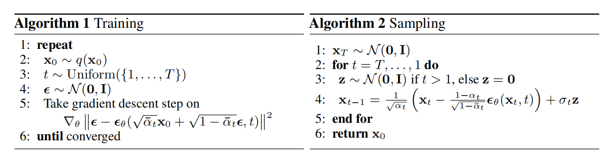

训练过程这下可以看的很明白了，$\mathbf x_0$、$\mathbf \epsilon_t$、$t$都是随机来的，然后套用我们的 simple 版损失函数，用来更新模型参数。

我们再关注一下采样过程（反向去噪过程），DDPM 就可以收工了。我们从 $t=T$ 开始，这时的 $\bf x_T$ 还是一个随机噪声，我们接下来就一步一步地$T\rightarrow T-1 \rightarrow \dots \rightarrow 1\rightarrow 0$向前走，用我们前面推到的去噪公式 $\mathbf x_{t-1}=\frac{1}{\sqrt{\alpha_t}} \Big( \mathbf{x}_t - \frac{1 - \alpha_t}{\sqrt{1 - \bar{\alpha}_t}} \boldsymbol{\epsilon}_\theta(\mathbf x_t,t) \Big) + \color{red}\sigma_t\mathbf z$ 生成 $\mathbf x_{t-1}$，直到 $\bf x_0$。

这里多了一项红色的 $\sigma_t\mathbf z$ 是什么？回顾一下前面的知识，

$$q(\mathbf{x}_{t-1} \vert \mathbf{x}_t, \mathbf{x}_0) = \mathcal{N}(\mathbf{x}_{t-1}; {\tilde{\boldsymbol{\mu}}}(\mathbf{x}_t, \mathbf{x}_0), {\tilde{\beta}_t} \mathbf{I})\qquad \tilde{\boldsymbol{\mu}}_t=\frac{1}{\sqrt{\alpha_t}} \Big( \mathbf{x}_t - \frac{1 - \alpha_t}{\sqrt{1 - \bar{\alpha}_t}} \boldsymbol{\epsilon}_t \Big) \qquad \tilde{\beta}_t = \frac{1 - \bar{\alpha}_{t-1}}{1 - \bar{\alpha}_t} \cdot \beta_t$$

$$p_\theta(\mathbf x_{t-1}|\mathbf x_t) = \mathcal N(\mathbf x_{t-1};\mathbf \mu_\theta(\mathbf x_t,t),\mathbf \Sigma_\theta(\mathbf x_t, t))\qquad {\boldsymbol{\mu}}_\theta=\frac{1}{\sqrt{\alpha_t}} \Big( \mathbf{x}_t - \frac{1 - \alpha_t}{\sqrt{1 - \bar{\alpha}_t}} \boldsymbol{\epsilon}_\theta(\mathbf x_t,t) \Big) \qquad \mathbf \Sigma_\theta=\sigma^2_t\mathbf I$$

所以本质上，我们并不知道 $\mathbf x_{t-1}$ 和 $\mathbf x_{t}$ 的确切关系，而是知道它们的条件高斯分布，所以后面一定会有一个扰动项 $\sigma_t\mathbf z$。在 DDPM 中，扰动项的标准差 $\sigma_t$ 通常就设定为 $\sqrt{\beta_t}$，但也有变体比如 DDIM 对 DDPM 的改造（后文会写到），$\sigma_t$ 就被设定为 $\sqrt{\tilde \beta_t}$。

> **Thinking 前面明明说了向前传递是一个 $T$ 重积分，这里怎么没看到呢？**
>
> 前面的 $T$ 重积分本质是从联合分布对**所有的去噪路径**做积分，得到一个理论值，用来setup损失函数。
>
> 但这里，我们是在采样阶段，也就是顺着一条路径 $T\rightarrow T-1 \rightarrow \dots \rightarrow 1\rightarrow 0$ 向前去噪，所以顺着这一个路径就可以获得 $\mathbf x_T\rightarrow \mathbf x_{T-1} \rightarrow \dots \rightarrow \mathbf x_1\rightarrow \mathbf x_0$。

到这里，DDPM 的前向、后向、训练、采样过程都讲完了。整个过程我们做了两次近似：①用 $q(\mathbf x_{t-1}|\mathbf x_t, \mathbf x_0)$ 代替$q(\mathbf x_{t-1}|\mathbf x_t)$ ②在损失函数中引入了额外的 KL 散度项，从优化原目标转变为优化它的上界。我们 DDPM 先暂时讲到这，有关它的进一步思想、结论，我们放到后面还会再现，让知识形成一个螺旋式上升的效果。

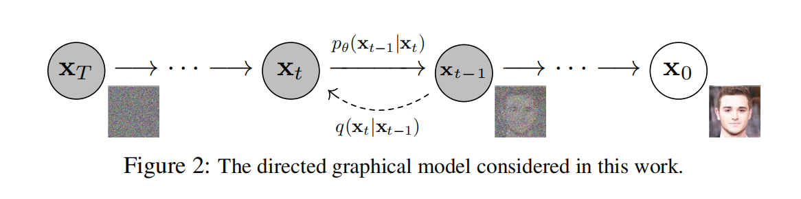

### DDIM
Denoising Diffusion Implicit Models（DDIM）[6](#ref-6)是斯坦福团队在 2020 年提出、发表于 ICLR 2021 的工作。它的动机很简单：DDPM 要一步一步向前去噪，所以每一步都要过一遍很大的神经网络，计算实在是太慢了。要是有一种能够**跳步去噪**的方法，就可以大大加速 Diffusion 过程。

> **重要Tips：** **DDIM论文为了简化，把 $\color{red}\bar \alpha$ 直接用 $\color{green}\alpha$ 代替。** 读者在 DDIM 论文看到 $\alpha$ 时，请记住这就是我们使用的术语 $\bar \alpha=\prod \alpha$。但在这篇讲义里，为了保持一致性，我们还是用 $\bar \alpha$ 来表示。

回顾前文，我们知道
$$\mathbf x_t = \sqrt{\bar \alpha_t}\mathbf x_0 + \sqrt{1-\bar \alpha_t}\boldsymbol \epsilon_t\qquad (1)$$
$$\mathbf x_{t-1} = \sqrt{\bar \alpha_{t-1}}\mathbf x_0 + \sqrt{1-\bar \alpha_{t-1}}\boldsymbol \epsilon_{t-1}\qquad (2)$$
我们希望综合一下这两个式子用以得到一个跳步去噪的公式，请看我操作：

从$(1)$，可以直接把$\mathbf x_0$ 反解出来：
$$\mathbf x_0 = \frac{1}{\sqrt{\bar \alpha_t}} \Big( \mathbf{x}_t - \sqrt{1 - \bar \alpha_t} \boldsymbol{\epsilon}_t \Big) \qquad (3)$$
> **Tips：** 注意这和 DDPM 的去噪公式$\mathbf x_{t-1}=\frac{1}{\sqrt{\alpha_t}} \Big( \mathbf{x}_t - \frac{1 - \alpha_t}{\sqrt{1 - \bar{\alpha}_t}} \boldsymbol{\epsilon}_\theta(\mathbf x_t,t) \Big) + \sigma_t\mathbf z$ 不一样，这只是加噪公式的等价变形。

这样就可以把$(3)$代入$(2)$，得到：
$$\mathbf x_{t-1} = \sqrt{\bar \alpha_{t-1}}\Big[\frac{1}{\sqrt{\bar \alpha_t}} \Big( \mathbf{x}_t - \sqrt{1 - \bar \alpha_t} \boldsymbol{\epsilon}_t \Big)\Big] + \sqrt{1-\bar \alpha_{t-1}}\boldsymbol \epsilon_{t-1}\qquad (4)$$

但还留着两种噪声项 $\mathbf \epsilon_t$ 和 $\mathbf \epsilon_{t-1}$。 DDIM 通过自己的新机制，可以把 $\mathbf \epsilon_{t-1}$ 拆开，拆成 $\mathbf \epsilon_t$ 和另一个随机取样的噪声：

$$\mathbf x_{t-1} = \sqrt{\bar \alpha_{t-1}}\Big[\frac{1}{\sqrt{\bar \alpha_t}} \Big( \mathbf{x}_t - \sqrt{1 - \bar \alpha_t} \boldsymbol{\epsilon}_t \Big)\Big] +  \sqrt{1 - {\bar \alpha}_{t-1} - \sigma_t^2} \boldsymbol \epsilon_t + \sigma_t\boldsymbol{\epsilon} \qquad (5)$$

这样拆开后，它们的总方差仍然是$1-\bar\alpha_{t-1}$。

我们的模型会输出$\boldsymbol \epsilon_\theta(\mathbf x_t,t)$，就用它来代替上面公式里的$\boldsymbol \epsilon_{t}$，于是我们有：
$$\mathbf x_{t-1} = \sqrt{\bar \alpha_{t-1}}\Big[\frac{1}{\sqrt{\bar \alpha_t}} \Big( \mathbf{x}_t - \sqrt{1 - \bar \alpha_t} \boldsymbol{\epsilon}_\theta(\mathbf x_t,t) \Big)\Big] +  \sqrt{1 - {\bar \alpha}_{t-1} - \sigma_t^2} \boldsymbol \epsilon_\theta(\mathbf x_t,t) + \sigma_t\boldsymbol{\epsilon} \qquad (6)$$
或者等价地写成：
$$
q_\sigma(\mathbf{x}_{t-1} \vert \mathbf{x}_t, \mathbf{x}_0)
= \mathcal{N}(\mathbf{x}_{t-1}; \sqrt{{\bar \alpha}_{t-1}} \Big( \frac{\mathbf{x}_t - \sqrt{1 - {\bar \alpha}_t} \boldsymbol \epsilon_\theta(\mathbf{x}_t,t)}{\sqrt{{\bar \alpha}_t}} \Big) + \sqrt{1 - {\bar \alpha}_{t-1} - \sigma_t^2} \boldsymbol \epsilon_\theta(\mathbf{x}_t,t), \sigma_t^2 \mathbf{I})
\qquad (7)$$
如果这里的$\sigma_t^2=\tilde \beta_t=\frac{1 - {\bar \alpha}_{t-1}}{1 - {\bar \alpha}_t} \cdot \beta_t$，那么$(6)$就完全等价于 DDPM 的去噪公式 $\mathbf x_{t-1}=\frac{1}{\sqrt{\alpha_t}} \Big( \mathbf{x}_t - \frac{1 - \alpha_t}{\sqrt{1 - \bar{\alpha}_t}} \boldsymbol{\epsilon}_\theta(\mathbf x_t,t) \Big) + \sigma_t\mathbf z$。

在这时，DDIM 做了一个重要创新：令 $\sigma^2=\eta^2 \cdot \tilde\beta_t$，且 $\eta$ 可调。当 $\eta=1$ 时就退化为 DDPM，而 $\eta=0$ 时就是 DDIM。可以看到，当 $\eta=0$ 时，DDIM 的去噪过程就没有扰动项了，也就是说去噪路径是完全**确定**的了，路上不再添加扰动项，可以直接顺着一条路持续去噪下去。

另外，DDIM 通过上面的推导，获得了允许跳步的计算方式。训练时，我们肯定是让模型把 $1,2,\dots,T$ 这些时间步都学习到，但生成时，我们可以只取一个子序列$1\leq\tau_1<\tau_2<\cdots<\tau_S\leq T$，例如$\tau=(0,100,200,\ldots,1000)$，按照反方向：$x_{1000}\to x_{900}\to x_{800}\to\cdots\to x_0$ 生成。跳步去噪公式如下：

$$\begin{aligned}
q_{\sigma, s < t}(\mathbf{x}_s \vert \mathbf{x}_t, \mathbf{x}_0)
&= \mathcal{N}(\mathbf{x}_{s}; \sqrt{{\bar \alpha}_{s}} \hat{\mathbf x}_0 + \sqrt{1 - {\bar \alpha}_{s} - \sigma_{t\rightarrow s}^2} \boldsymbol \epsilon_\theta(\mathbf{x}_t,t), \sigma_{t\rightarrow s}^2 \mathbf{I})\qquad （s<t）\\
\hat{\mathbf x}_0 &= \frac{\mathbf{x}_t - \sqrt{1 - {\bar \alpha}_t} \boldsymbol \epsilon_\theta(\mathbf{x}_t,t)}{\sqrt{{\bar \alpha}_t}} \\
\sigma_{t\rightarrow s}^2&= \eta^2 \cdot \frac{1 - {\bar \alpha}_{s}}{1 - {\bar \alpha}_t} \cdot \Big(1-\frac{\bar \alpha_t}{\bar{\alpha}_s}\Big) \\

\end{aligned}$$

这样就可以实现跳步生成了。再出示一张论文原图辅助理解：
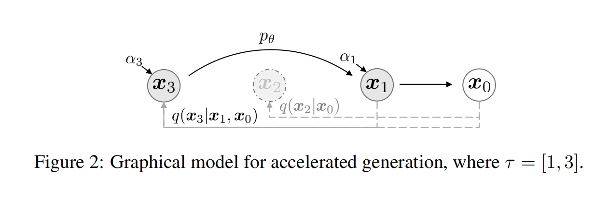

如果读者只想大致了解 DDIM 在做什么，上面的内容已经足够了，可以直接跳到小结部分。但倘若读者和笔者一样不满足于这么粗浅的解释，可能会问如下问题：

1) DDPM 为什么没有反解 $\bf x_0$ 的步骤？
2) 既然 DDIM 可以让 $\eta=0$， DDPM 为什么不能直接令 $\mathbf x_{t-1}=\frac{1}{\sqrt{\alpha_t}} \Big( \mathbf{x}_t - \frac{1 - \alpha_t}{\sqrt{1 - \bar{\alpha}_t}} \boldsymbol{\epsilon}_\theta(\mathbf x_t,t) \Big) + \sigma_t\mathbf z$ 的 $\sigma_t=0$？
3) DDIM 的设定为什么就方便跳步了？

所以接下来，我们回到 DDIM 论文里去找找答案。

### 再探 DDIM
DDPM 里的可计算上界，在 DDIM 论文中稍微变了一下形：

$$
\begin{aligned}
\text{DDPM}\qquad L_\text{VLB} &= L_T + L_{T-1} + \dots + L_0 \\

\text{DDPM}\qquad L_{t-1} &= D_\text{KL}(q(\mathbf{x}_{t-1} \vert \mathbf{x}_{t}, \mathbf{x}_0) \parallel p_\theta(\mathbf{x}_{t-1} \vert\mathbf{x}_{t}))\\
&=\mathbb{E}_{\mathbf{x}_0, \boldsymbol{\epsilon}_t} \Big[\frac{ (1 - \alpha_t)^2 }{2 \alpha_t (1 - \bar{\alpha}_t) \| \boldsymbol{\Sigma}_\theta \|_2} \|\boldsymbol{\epsilon}_t - \boldsymbol{\epsilon}_\theta(\sqrt{\bar{\alpha}_t}\mathbf{x}_0 + \sqrt{1 - \bar{\alpha}_t}\boldsymbol{\epsilon}_t, t)\|^2 \Big] \\
\text{DDIM}\qquad L_\gamma(\epsilon_\theta)&=
\sum_{t=1}^T\gamma_t\mathbb E_{\mathbf x_0,\boldsymbol{\epsilon}_t}
\left[ \|\boldsymbol{\epsilon}_t - \boldsymbol{\epsilon}_\theta(\sqrt{\bar{\alpha}_t}\mathbf{x}_0 + \sqrt{1 - \bar{\alpha}_t}\boldsymbol{\epsilon}_t, t)\|^2\right]\\
&=[L_0+\cdots+L_{T-1}]\Big|_{\boldsymbol{\gamma}}=[L_{\text{VLB}}-L_T]\Big|_{\boldsymbol{\gamma}}
\end{aligned}
$$
无非是把前面的系数用 $\gamma_t$ 替换了，其实本质是一样的。DDIM 论文的核心算法部分明确提出，自己的动机来源于 **注意到 $L_\gamma(\epsilon_\theta)$ 只依赖于 $q(\mathbf x_t | \mathbf x_0)$ 而不需要 $q(\mathbf x_t | \mathbf x_{t-1})$ ，也不需要完整的采样路径 $q(\mathbf x_{1:T} | \mathbf x_0)$。** 换言之，训练目标只需要每一个时刻的边缘分布 $q(\mathbf x_t | \mathbf x_0)$，而不需要联合分布 $q(\mathbf x_{1:T} | \mathbf x_0)$。因此，我们完全可以在保持边缘分布不变的情况下，构造一个新的有更好性质的联合分布。

之前 DDPM 的联合分布是马尔科夫的，也就是
$$q(\mathbf x_{1:T} \vert \mathbf x_0) = \prod_{t=1}^T q(\mathbf x_t | \mathbf x_{t-1})$$
但 DDIM 定义了一种新的非马尔科夫的联合分布，
$$q(\mathbf x_{1:T} \vert \mathbf x_0) = q_\sigma(\mathbf x_T \vert \mathbf x_0) \times \prod_{t=2}^T q_\sigma(\mathbf x_{t-1} | \mathbf x_t,\mathbf x_0)$$
注意这个式子是从$T$向$1$分解的，且条件中保留了真实的 $\mathbf x_0$。正是因为条件中多了 $\mathbf x_0$，DDIM 就不再是 Markov 链了。这里最重要的条件分布：
$$
\begin{aligned}
q_\sigma(\mathbf x_{t-1}\mid \mathbf x_t,\mathbf x_0)&=\mathcal N(\mathbf x_{t-1};\mu_\sigma,\sigma_t^2I) \qquad 满足\\
\mu_\sigma&=\sqrt{\bar \alpha_{t-1}}\mathbf x_0+\sqrt{1-\bar \alpha_{t-1}-\sigma_t^2}\epsilon_t\\
&=\sqrt{\bar \alpha_{t-1}}\mathbf x_0+\sqrt{1-\bar \alpha_{t-1}-\sigma_t^2}\frac{\mathbf x_t-\sqrt{\bar\alpha_t}\mathbf x_0}{\sqrt{1-\bar\alpha_t}} \qquad 换掉\epsilon_t的写法\\
&=\sqrt{\bar \alpha_{t-1}}\frac{1}{\sqrt{\bar \alpha_t}} \Big( \mathbf{x}_t - \sqrt{1 - \bar \alpha_t} \boldsymbol{\epsilon}_t \Big)+\sqrt{1-\bar \alpha_{t-1}-\sigma_t^2}\epsilon_t \qquad 换掉\mathbf x_0的写法\end{aligned}
$$

简单写，就是
$$x_{t-1}
=
\underbrace{\sqrt{\bar \alpha_{t-1}}x_0}_{干净图像部分}

+\underbrace{
\sqrt{1-\bar \alpha_{t-1}-\sigma_t^2}\epsilon_t}_{继承\mathbf x_t 已有的噪声}
+
\underbrace{\sigma_t z_t}_{新噪声}$$

也就是说，我们构造的新联合分布获得了 $\mu_\sigma$ 和 $\sigma_t$ 这两个自由参数，不管 $\sigma_t$ 取值为几，都可以满足后两项噪声的方差为 $1-\bar\alpha_{t-1}$，因此总是满足我们最开始要的那个边缘分布。所以说，是 **联合分布不同导致 $\sigma_t$ 的任意取值自由度**。
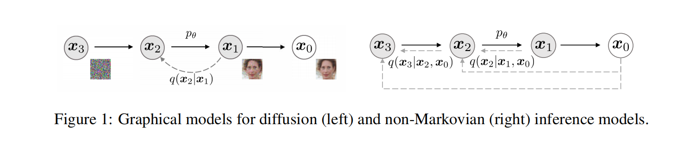
> **Thinking 为什么 DDPM 的 $\sigma_t$ 不能取成零**
>
> 从上面的分析看，我们可以很容易地说明，DDIM 的联合分布可以保证 $\sigma_t$ 取成零仍满足同一个边缘分布 $q_\sigma(\mathbf x_{t-1}\mid\mathbf x_0)=\mathcal N\left(\mathbf x_{t-1};\sqrt{\bar\alpha_{t-1}}\mathbf x_0,(1-\bar\alpha_{t-1})\mathbf I\right)$
>
> 但 DDPM 不行，因为 DDPM 规定的是 $q(\mathbf x_{t-1}\mid\mathbf x_t,\mathbf x_0)=\mathcal N\left(\mathbf x_{t-1};\tilde{\boldsymbol\mu}_t,\tilde\beta_t\mathbf I\right)$，所以它的后验方差 $\tilde\beta_t$ 是由 DDPM 的马尔可夫联合分布决定的，不能直接取成零，否则就不再满足原本的联合分布和边缘分布。
>
> 从公式上看，DDIM 把 $\sigma_t$ 取成零以后，$x_{t-1}=\sqrt{\bar \alpha_{t-1}}x_0+\sqrt{1-\bar \alpha_{t-1}-\sigma_t^2}\epsilon_t+\sigma_t z_t$ 会变成 $x_{t-1}=\sqrt{\bar \alpha_{t-1}}x_0+\sqrt{1-\bar \alpha_{t-1}}\epsilon_t$。但 DDPM 如果扔掉 $\mathbf z$，就相当于变成了$x_{t-1}=\sqrt{\bar \alpha_{t-1}}x_0+\sqrt{1-\bar \alpha_{t-1}-\sigma_t^2}\epsilon_t$，第二项的根号里还留着 $\sigma_t^2$，成了不伦不类的东西。

上述分析可知，我们可以自由调整 $\sigma_t>0$。在去噪采样过程中，如果$\sigma_t>0$，就仍然是一个随机过程，即给定$\mathbf x_t$，去噪路径仍不确定，因为每一次去噪还要加随机扰动项 $\sigma_t \mathbf z$。但如果$\sigma_t=0$，那就是一个确定性过程，采样过程中，从 $\mathbf x_t$ 可以沿着一条确定的路径得到 $\mathbf x_{t-1}$ 直到 $\mathbf x_0$。

可以等效地认为，所有的时刻共享同一个噪声，这里为了区分，我换了一个 epsilon 的写法记作 $\varepsilon$，加噪公式为 $x_t=\sqrt{\alpha_t}x_0+\sqrt{1-\alpha_t}\varepsilon$。

有了这些 settings，我们知道模型输入 $\mathbf x_t$ 和 $t$，我们希望它根据 $x_{t-1}=\sqrt{\bar \alpha_{t-1}}x_0+\sqrt{1-\bar \alpha_{t-1}-\sigma_t^2}\epsilon_t+\sigma_t z_t$ 能预测 $\mathbf x_{t-1}$。然而生成过程中，模型并不知道 $\mathbf x_0$，只能根据 $\mathbf x_t$ 和 $t$ 来预测 $\epsilon_\theta(\mathbf x_t,t)$ 从而用一个 $\hat {\mathbf x_0}$ 近似 $\mathbf x_0$。这里我直接把论文中的公式端上来，请大家品鉴：
$$
\mathbf x_{t-1}
=
\underbrace{
\sqrt{\bar \alpha_{t-1}}
\left(
\frac{
\mathbf x_t-\sqrt{1-\bar \alpha_t}\,\epsilon_\theta(\mathbf x_t,t)
}{
\sqrt{\bar \alpha_t}
}
\right)
}_{\text{``predicted }\mathbf x_0\text{''}}
+
\underbrace{
\sqrt{1-\bar \alpha_{t-1}-\sigma_t^2}\,
\epsilon_\theta(\mathbf x_t,t)
}_{\text{``direction pointing to }\mathbf x_t\text{''}}
+
\underbrace{
\sigma_t\epsilon_t
}_{\text{random noise}}
$$
其实和我们刚才讲的是一样的，对吧？

> **DDPM 为什么没有反解 $\bf x_0$ 的步骤？**
>
> 首先明确，反解 $\bf x_0$ 指的是获得 $\bf x_0$ 和 $\bf x_t$ 的关系。但在 DDPM 里没有这个需求，它的马尔科夫性质保证了它的前向公式 $q(\mathbf{x}_{t-1} \vert \mathbf{x}_t, \mathbf{x}_0) = \mathcal{N}(\mathbf{x}_{t-1}; \frac{1}{\sqrt{\alpha_t}} \Big( \mathbf{x}_t - \frac{1 - \alpha_t}{\sqrt{1 - \bar{\alpha}_t}} \boldsymbol{\epsilon}_t \Big), \frac{1 - \bar{\alpha}_{t-1}}{1 - \bar{\alpha}_t} \cdot \beta_t \mathbf{I})$ 和去噪公式 $\mathbf x_{t-1}=\frac{1}{\sqrt{\alpha_t}} \Big( \mathbf{x}_t - \frac{1 - \alpha_t}{\sqrt{1 - \bar{\alpha}_t}} \boldsymbol{\epsilon}_\theta(\mathbf x_t,t) \Big) + \sigma_t\mathbf z$ 里并没有 $\bf x_0$ 项，也就没必要反解。
>
> DDIM 在这种联合分布的设置下，$x_{t-1}=\sqrt{\bar \alpha_{t-1}}x_0+\sqrt{1-\bar \alpha_{t-1}-\sigma_t^2}\epsilon_t+\sigma_t z_t$，因此前向公式里有 $\bf x_0$，所以一定要反解 $\bf x_0$ 替换成 $\mathbf x_t$ 才有办法计算。
>
> 换言之，并不是因为 DDIM 反解了 $\bf x_0$ 导致它的性质良好可以加速，而是它的性质决定了必须要反解 $\bf x_0$ 才能计算。

现在，我们又要回到那个棘手的问题：该推导损失函数了。。因为 $q_\sigma$ 条件分布现在是一个和 $\sigma$ 有关的量，损失函数必然也和 $\sigma$ 有关，那现在还怎么去优化损失函数？

回顾前面 DDPM 的过程，我们已经把损失函数转化成了一个可计算上界（ELBO）。
$$L_\text{VLB} =\mathbb E_{q(\mathbf{x}_{0:T})} \Big[ \log \frac{q(\mathbf{x}_{1:T}\vert\mathbf{x}_0)}{p_\theta(\mathbf{x}_{0:T})} \Big] $$

DDIM 定义
$$J_\sigma(\epsilon_\theta)=\mathbb E_{q_\sigma(x_{0:T})}\left[\log \frac{q_\sigma(\mathbf{x}_{1:T}\vert\mathbf{x}_0)}{p_\theta(\mathbf{x}_{0:T})}\right]$$

论文正文给出了一个定理，并在附录里提供了它的证明。我没有研究这个定理的证明，直接接受了这个定理：
$$\forall \sigma>0,\quad \exists \gamma>0,C\in\mathbb R,\quad J_\sigma = L_\gamma + C$$

这意味着，无论 $\sigma$ 如何，变分目标仍然是 $L_\text{VLB}$，也就是加权求和的 MSE。所以 DDIM 仍然可以用和 DDPM 相同的损失函数做监督信号。DDIM 还做了进一步简化，假定不同时间 $t$ 的模型参数不共享，那么每个$\gamma_t$就只影响它自己这一项$L_t$，因此
$$\argmin J_\sigma=\argmin L_\gamma = \argmin \sum_t\gamma_tL_t = \argmin \sum_tL_t = \argmin L_{\gamma \equiv1}.$$
论文中把这个$L_{\gamma \equiv1}$写成了$L_{1}$，容易带来混淆，其实它的意思是 $\gamma$ 总取成 $1$，也就等价于 DDPM 里 $L_\text{simple}$ 的设置了。

最后，我们再探讨 DDIM 如何加速，这一部分就可以收尾了。

加速的公式和方法在前面已经写过了，可以往前翻一下回顾。这里我们探讨两个问题：

> **Question1 DDIM 为何允许跳步？**
>
> 因为模型训练时学的并不是“只能从 $t$ 走到 $t-1$ 的一张查找表”，而是在每一个时刻 $t$ 上，根据 $\mathbf x_t$ 预测噪声。只要给定一个被选中的时刻 $\tau_i$，模型就仍然能计算 $\boldsymbol\epsilon_\theta(\mathbf x_{\tau_i},\tau_i)$，进而反解 $\hat{\mathbf x}_0$，再利用 DDIM 的更新式直接构造更早时刻 $\mathbf x_{\tau_{i-1}}$。
>
> 从概率模型的角度看，DDIM 的训练目标只依赖 $q(\mathbf x_t\mid\mathbf x_0)$ 这些边缘分布，而不要求前向过程一定沿着 $1,2,\ldots,T$ 逐点走过。因此，我们可以只选一个子序列 $\tau_1<\tau_2<\cdots<\tau_S=T$，在这些时刻之间定义新的生成过程，仍然复用原来的网络。
>
> 所以，“允许跳步”有两层保证：①模型在被跳到的时刻仍然知道怎样预测　②DDIM 的联合分布与训练目标也允许我们换成更短的采样轨迹。
>
> 它不是把原来的 DDPM 公式粗暴地多走几格，而是为两个相隔更远的噪声等级重新计算一次合法的 DDIM 更新。

> **Question2 既然允许跳步，那为何不一步到位，还要走好几步？**
>
> 允许从 $t$ 跳到 $s$，不等于这个有限步更新在任意跨度下都没有误差。模型只看见一张几乎全是噪声的 $\mathbf x_T$ 时，预测出来的是在当前信息下最合适的去噪方向；它并没有被直接训练成一个“一次前向传播就把纯噪声变成完整图片”的生成器。
>
> 从 ODE 的角度看会更直观。DDIM 的确定性采样近似沿着一条弯曲的连续轨迹前进。一步到位，相当于只在起点看一次方向，就用一条很长的直线代替整条曲线；中途明明已经走到新的位置，却再也不重新询问网络，数值误差自然很大。多保留几个时间步，模型就能在不同噪声等级上反复修正方向：前几步确定大致结构，后几步补上局部细节。
>
> **确定性只表示同一个起点会得到同一个终点，并不表示起点和终点之间是线性关系，更不表示一步数值计算就能精确走完整条轨迹。** 真正的一步生成需要额外的训练方法把多步行为压进一次网络调用，后面讲 Progressive Distillation、Consistency Model 和 DMD 时就会看到这样的做法。

### 回顾 DDPM 和 DDIM

我们再简单回顾一下 DDPM 和 DDIM。

DDIM 相比 DDPM，最大的优势当然是加速了，但是除了加速，还有几个由**确定性**带来的好处。

首先，当 $\eta=0$ 时，采样公式里的随机项消失。只要固定初始噪声 $\mathbf x_T$、采样时间步和模型参数，整条去噪轨迹以及最后的 $\mathbf x_0$ 就全部确定。DDPM 每一步都要重新采一份噪声，所以即使从同一个 $\mathbf x_T$ 出发，也可能生成不同的结果；DDIM 则给初始噪声和生成图片建立了稳定的一一对应关系。

这个性质又带来了更有意义的**隐空间表征**。同一份 $\mathbf x_T$ 分别用 20 步、50 步、100 步 DDIM 生成时，数值误差会让细节有所区别，但图片中的主体、姿态和整体布局通常能够保持一致。换句话说，$\mathbf x_T$ 不再只是采样开始时的一团随机数，它还比较稳定地决定了最终图片的高层语义。借助 DDIM 对应的确定性 ODE，我们也可以把真实图片沿相反方向编码到 $\mathbf x_T$，再从这个隐变量近似重建回来，这甚至可以达到一种编码器的效果。

最后，我们可以在两份初始噪声 $\mathbf x_T^{(a)}$ 和 $\mathbf x_T^{(b)}$ 之间做插值，再把中间的隐变量分别送进同一个确定性生成过程。生成结果往往会在两张图片的语义之间平滑变化，例如人物身份、姿态或场景逐渐过渡，而不是把两张图片的像素生硬叠在一起。DDIM 原论文使用的是球面线性插值（spherical linear interpolation）：普通线性插值会让中间点向高斯空间的原点缩进去，球面插值则沿两点所在高维球面的圆弧移动，使中间隐变量的长度更接近正常高斯样本。这里的关键不是“高斯噪声天然含有语义”，而是确定性生成把相近的隐变量稳定地映射成了相近的生成结果。

我们再通过一张实验数据表格来看一下 DDPM 和 DDIM 的区别

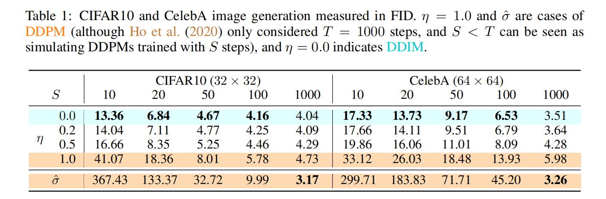

这张表分别在 CIFAR-10 的 $32\times32$ 图片和 CelebA 的 $64\times64$ 人脸图片上比较生成效果。第一行的 $S$ 是**实际采样步数**：模型训练时仍然使用 $T=1000$ 个时间步，生成时只从中选出 $S$ 个时刻。因此 $S$ 越小，采样越快。表中的数值是 FID，衡量生成图片集合与真实图片集合在特征空间中的距离，**越小越好**。

$\eta$ 是前文控制 $\sigma_t$ 的参数。青色的 $\eta=0$ 表示 DDIM，此时没有新噪声，采样完全确定；从 $\eta=0.2,0.5$ 到橙色的 $\eta=1$，每一步加入的新噪声逐渐增多。$\eta=1$ 时，DDIM 的统一采样公式使用 DDPM 后验方差对应的 $\sigma_t$，于是退化为 DDPM。

最下面橙色的 $\hat\sigma$ 也是 DDPM，但它采用 Ho 等人原始 DDPM 实现中用于 CIFAR-10 采样的另一种方差设定。它的随机项标准差比 $\eta=1$ 更大；两行的非随机部分相同，区别主要就是每一步重新注入多少噪声。因此，它们虽然都叫 DDPM，实验效果却并不相同。

先看少步采样。CIFAR-10 上只走 10 步时，DDIM 的 FID 是 $13.36$，$\eta=1$ 的 DDPM 是 $41.07$，而 $\hat\sigma$ 是 $367.43$；CelebA 上也有同样的趋势。步数很少时，每一步跨度都很大，如果还加入较强的新噪声，后面已经没有足够的步骤把这些扰动修正回来。DDIM 不额外注入噪声，因而对短轨迹明显更加稳健。

随着 $S$ 增大，各种设定都有更多机会反复校正，FID 也整体下降。到 1000 步时，差距已经很小，$\hat\sigma$ 甚至略好于 DDIM：CIFAR-10 上是 $3.17$ 对 $4.04$，CelebA 上是 $3.26$ 对 $3.51$。所以这张表支持的结论并不是“DDIM 在任何步数下都胜过 DDPM”，而是：**当计算预算有限、采样轨迹很短时，确定性的 DDIM 能以更少的步骤保留更好的生成质量。** 一个很直观的对照是，CelebA 上 20 步 DDIM 的 FID 为 $13.73$，已经和 100 步、$\eta=1$ 的 DDPM 的 $13.93$ 基本相当。

说到这里，我们顺便补充几个图像生成领域常见的基准（benchmark）和指标（metrics）。

先区分两个词。**Benchmark** 是一整套评测题目，至少包括数据集、图片分辨率、训练/测试划分、是否有条件以及评测协议；**metric** 才是最后计算出来的分数。同一个模型在不同分辨率、不同样本数或不同预处理下得到的 FID，不能只看数字就直接横向比较。

图像生成中常见的 benchmark 包括：

- **CIFAR-10：** 6 万张 $32\times32$ 彩色图片，共 10 个类别，通常用 5 万张训练、1 万张测试。图片很小、训练成本低，因此常被用来快速验证生成方法。
- **CelebA：** 超过 20 万张人脸图片，并带有发色、表情等属性标注。它适合观察模型对人脸结构和属性变化的建模能力，但实验必须写清楚裁剪方式与分辨率；上表使用的是 $64\times64$。
- **ImageNet：** 包含 1000 个类别的大规模自然图片数据集，常见设置有 $64\times64$、$128\times128$ 和 $256\times256$ 的类别条件生成。它同时考验图片质量、类别覆盖和模型容量。
- **LSUN Bedroom / Church：** 以卧室、教堂等场景类别组织的高分辨率图片，适合测试模型能否生成结构复杂的室内外场景。
- **MS-COCO：** 每张图片配有自然语言描述，因此常用于文生图。除了画面质量，还必须检查图片是否真的符合文字；只报告 FID 并不能覆盖这一点。

接下来介绍几个常见指标。它们其实分成两组：PSNR、SSIM、LPIPS 比较的是一张生成图与一张**对应参考图**，常用于重建、超分辨率和图像编辑；IS、FID 比较的是一整批生成样本，更常用于无条件生成。

- **PSNR（Peak Signal-to-Noise Ratio，峰值信噪比）：** 先计算生成图 $\hat{\mathbf x}$ 与参考图 $\mathbf x$ 的均方误差 $\mathrm{MSE}$，再计算 $\mathrm{PSNR}=10\log_{10}(\mathrm{MAX}^2/\mathrm{MSE})$，其中 $\mathrm{MAX}$ 是像素允许的最大值。单位是 dB，越高表示逐像素误差越小。它计算简单，但只认像素是否对齐；一张视觉上自然但位置稍有偏移的图片可能得分很低，而一张偏模糊的平均图反而可能得到不错的分数。
- **SSIM（Structural Similarity，结构相似性）：** 在许多局部窗口里分别比较两张图片的亮度均值、对比度和像素共同变化的结构，再把结果平均。常见取值越接近 $1$ 越相似。它比 PSNR 更符合“结构有没有保住”的直觉，但仍然需要一一对应且对齐的参考图。
- **LPIPS（Learned Perceptual Image Patch Similarity，学习感知图像块相似度）：** 不直接比较像素，而是把两张图送入一个预训练卷积神经网络，取出多层特征，再计算这些特征的加权距离。浅层特征偏纹理，深层特征偏形状与语义，因此 LPIPS 往往比像素误差更接近人的视觉感受。分数越低越相似，但结果会受到所用网络与特征层的影响。
- **IS（Inception Score）：** Inception 是一个在 ImageNet 上训练的图片分类器。把每张生成图送进去，会得到类别分布 $p(y\mid\mathbf x)$。如果单张图清楚，分类器应当很确定，也就是这个分布集中；如果整批图很多样，所有图片平均后的 $p(y)$ 又应覆盖许多类别。IS 用 $\exp(\mathbb E_{\mathbf x}D_{\mathrm{KL}}(p(y\mid\mathbf x)\|p(y)))$ 同时衡量这两点，越高越好。它不看真实图片，只看分类器是否“自信且类别多样”，所以不适合单独判断非 ImageNet 风格的数据，也可能漏掉类别内部的模式坍塌。
- **FID（Fréchet Inception Distance）：** 同样先把真实图片和生成图片送入 Inception 网络，但这次取分类器中间层的特征向量。分别用均值和协方差把两组特征近似成高斯分布，再计算二者的 Fréchet 距离
  $$\mathrm{FID}=\|\boldsymbol\mu_r-\boldsymbol\mu_g\|_2^2+\operatorname{Tr}\!\left(\boldsymbol\Sigma_r+\boldsymbol\Sigma_g-2(\boldsymbol\Sigma_r\boldsymbol\Sigma_g)^{1/2}\right).$$
  均值差反映整体特征偏移，协方差差反映特征的变化范围是否相似，因此 FID 同时会受到生成质量和多样性的影响，越低越好。不过它对样本数量、图片缩放和 Inception 实现都很敏感；只有评测协议相同的 FID 才能公平比较。

## III 几个新话题：条件、梯度与加速
虽然叫做**新话题**，但这里的内容并不是什么可有可无的边角料。CFG、score、SDE、Flow Matching、Consistency Model、DMD 等术语，已经在今天的 Diffusion 文献和工程实践中无处不在。如果只会背 DDPM 的加噪公式和去噪公式，却不知道这些概念，那么读到稍微新一点的工作时，还是很容易寸步难行。

这一节不再把每篇论文从头到尾拆开，而是先抓住主线，把每个工作的核心问题、关键公式、训练与采样讲清楚。Flow Matching 的主线讲完以后，我会像 DDIM 一样再开一个深入入口，把条件速度场、边缘速度场和两个关键结论完整推一遍；只想建立整体认识的读者可以在那里先停下。

### 关于条件生成（CG、CFG）

到目前为止，我们讨论的基本都是无条件生成：从高斯噪声出发，模型最后生成一张像真实数据的图片，但至于它生成猫还是狗、白天还是黑夜，我们没有指定。

可实际使用时，人们通常希望模型听指挥。给一个类别标签 $y=\text{“猫”}$，就生成猫；给一句文本 $y=\text{“一只坐在月球上的柯基”}$，就尽量让图片符合这句话。这就是**条件生成（conditional generation）**，我们希望学习的分布从 $p(\mathbf x)$ 变成了 $p(\mathbf x\mid y)$。

最直接的做法，是把条件 $y$ 也交给去噪网络：

$$\boldsymbol\epsilon_\theta(\mathbf x_t,t)\quad\longrightarrow\quad
\boldsymbol\epsilon_\theta(\mathbf x_t,t,y).$$

训练过程几乎不用改。仍然随机采样 $\mathbf x_0$、$t$ 和 $\boldsymbol\epsilon$，构造

$$\mathbf x_t=\sqrt{\bar\alpha_t}\mathbf x_0+\sqrt{1-\bar\alpha_t}\boldsymbol\epsilon,$$

然后最小化

$$\mathbb E\left[\left\|\boldsymbol\epsilon-\boldsymbol\epsilon_\theta(\mathbf x_t,t,y)\right\|^2\right].$$

区别只是模型除了看带噪图片和时间步，还能看到与原图配对的条件 $y$。但是，仅仅“把条件输入模型”还不是人们常说的 **guidance**。Guidance 做的事情是：在采样时额外推一把，让结果比普通条件生成更强烈地服从 $y$。

#### Classifier Guidance

Classifier Guidance（CG）来自 *Diffusion Models Beat GANs on Image Synthesis*[7](#ref-7)。它的出发点是一条非常朴素的贝叶斯公式：

$$p_t(\mathbf x_t\mid y)\propto p_t(\mathbf x_t)p_t(y\mid\mathbf x_t).$$

两边取对数，再对 $\mathbf x_t$ 求梯度：

$$\nabla_{\mathbf x_t}\log p_t(\mathbf x_t\mid y)
=\nabla_{\mathbf x_t}\log p_t(\mathbf x_t)
+\nabla_{\mathbf x_t}\log p_t(y\mid\mathbf x_t).$$

这里第一项是 Diffusion 模型本身提供的方向，告诉我们“怎样走向更像真实图片的区域”；第二项来自一个分类器，告诉我们“怎样改动当前图片，可以让它更像类别 $y$”。二者加起来，自然就是“既像真实图片、又像指定类别”的方向。

> **Tips 这里的梯度是什么意思？**
>
> $\nabla_{\mathbf x_t}\log p_t(y\mid\mathbf x_t)$ 的求导对象是图片 $\mathbf x_t$，不是模型参数。也就是说，保持分类器不动，问分类器“我应该把当前带噪图片的每一个像素往哪个方向改一点，才能提高类别 $y$ 的概率？”
>
> 这个梯度和图像形状完全一致，每个位置都给出一个修改方向，所以可以直接加到 Diffusion 的去噪方向中。

实际使用时，需要专门训练一个带噪分类器 $p_\phi(y\mid\mathbf x_t,t)$。它不能只是普通的干净图片分类器，因为采样早期的 $\mathbf x_t$ 几乎全是噪声；如果分类器训练时从来没见过这种输入，它给出的梯度就不可靠。

再加一个 guidance scale $w$ 控制这股力量的大小，就有

$$\mathbf s_\text{CG}(\mathbf x_t,t,y)
=\mathbf s_\theta(\mathbf x_t,t)
+w\nabla_{\mathbf x_t}\log p_\phi(y\mid\mathbf x_t,t),$$

其中 $\mathbf s_\theta(\mathbf x_t,t)$ 是模型学到的 score。score 的定义和它与噪声预测的关系，我们会在下一小节完整解释。这里先借用结论

$$\mathbf s_\theta(\mathbf x_t,t)\approx-\frac{\boldsymbol\epsilon_\theta(\mathbf x_t,t)}{\sqrt{1-\bar\alpha_t}},$$

于是 Classifier Guidance 也可以直接写成对噪声预测的修改：

$$\boldsymbol\epsilon_\text{CG}
=\boldsymbol\epsilon_\theta(\mathbf x_t,t)
-w\sqrt{1-\bar\alpha_t}\nabla_{\mathbf x_t}\log p_\phi(y\mid\mathbf x_t,t).$$

注意这里是减号。原因不是分类器在“反向指导”，而是噪声预测和 score 本来就差一个负号。把分类器梯度加到 score 上，等价地就要从噪声预测中减掉它。

$w$ 越大，模型就越坚定地朝分类器确信的方向走，通常会让条件更加明显、单张图片看起来更加“典型”；但代价是样本会集中到少数高置信度区域，生成的多样性下降。Classifier Guidance 的麻烦也很明显：除了 Diffusion 模型，还要多训练一个能处理所有噪声等级的分类器；采样时也需要计算分类器梯度，整套系统复杂了不少。

#### Classifier-Free Guidance

既然分类器的作用只是提供

$$\nabla_{\mathbf x_t}\log p_t(y\mid\mathbf x_t),$$

我们能不能不训练分类器，直接从 Diffusion 模型内部把这个方向找出来？Classifier-Free Guidance（CFG）[8](#ref-8)的答案是可以。再看一遍贝叶斯公式：

$$\begin{aligned}
\nabla_{\mathbf x_t}\log p_t(y\mid\mathbf x_t)
&=\nabla_{\mathbf x_t}\log p_t(\mathbf x_t\mid y)
-\nabla_{\mathbf x_t}\log p_t(\mathbf x_t)\\
&=\mathbf s_\text{cond}(\mathbf x_t,t,y)-\mathbf s_\text{uncond}(\mathbf x_t,t).
\end{aligned}$$

分类器梯度原来就等于“有条件 score 减无条件 score”。只要同一个模型既会做有条件预测，又会做无条件预测，我们直接把二者相减，就得到了条件 $y$ 带来的方向。

怎样让一个模型同时具备这两种能力呢？方法很简单也很巧妙：训练时以一定概率把条件 $y$ 丢掉，换成空条件 $\varnothing$：

$$\boldsymbol\epsilon_\theta(\mathbf x_t,t,\varnothing)\approx\boldsymbol\epsilon_\text{uncond},\qquad
\boldsymbol\epsilon_\theta(\mathbf x_t,t,y)\approx\boldsymbol\epsilon_\text{cond}.$$

文生图模型的 $\varnothing$ 可以理解成空文本；类别条件生成模型的 $\varnothing$ 则可以是一个专门的空类别 token。网络结构和参数仍然只有一套，只是训练中有些样本带条件、有些样本不带条件。

采样时，同一个 $\mathbf x_t$ 分别跑一次有条件预测和无条件预测，再做线性组合：

$$\boldsymbol\epsilon_\text{CFG}
=\boldsymbol\epsilon_\text{uncond}
+w\left(\boldsymbol\epsilon_\text{cond}-\boldsymbol\epsilon_\text{uncond}\right).$$

这个式子非常值得直观理解：

- $\boldsymbol\epsilon_\text{uncond}$ 是“先生成一张合理图片”的基础方向；
- $\boldsymbol\epsilon_\text{cond}-\boldsymbol\epsilon_\text{uncond}$ 是加入条件 $y$ 以后，去噪方向发生的变化；
- 乘上 $w$，就是把这份“条件带来的变化”放大。

当 $w=0$ 时，完全是无条件生成；$w=1$ 时，就是普通的条件模型；$w>1$ 时，我们不再停在条件预测上，而是沿着“无条件 $\rightarrow$ 有条件”的方向继续向前外推，所以条件会更强。

> **Tips：CFG $w$ 的两种记法**
>
> 我们在讲义里使用
> $$\boldsymbol\epsilon_\text{CFG}=\boldsymbol\epsilon_\text{uncond}+w(\boldsymbol\epsilon_\text{cond}-\boldsymbol\epsilon_\text{uncond}),$$
> 所以 $w=1$ 表示普通条件生成。很多工程实现中的 `guidance_scale=7.5`，通常就是这套记法。
>
> CFG 原论文把“超出普通条件预测的额外强度”记作 $w$，所以系数就是比我们的写法刚好少 $1$，即
> $$\boldsymbol\epsilon_\text{CFG}=(1+w)\boldsymbol\epsilon_\text{cond}-w\boldsymbol\epsilon_\text{uncond}.$$
> 所以论文阅读的时候，请读者注意 $w$ 的含义，避免混淆误读。

CFG “classifier-free”，巧妙地用每个时间步的有条件和无条件两次网络预测，取代了一个独立分类器。它用极其简单的训练改动，换来了可以在推理时控制条件服从程度的能力，也成为现代文生图模型最常见的基本组件之一。

### 关于学梯度而不是学噪声

DDPM 的损失函数写得非常直接：给图片加一份噪声 $\boldsymbol\epsilon$，让模型把它预测出来。于是我们很容易形成一个印象：Diffusion 模型就是一个噪声预测器。

这个说法当然没错，但只说了一半。换一个等价视角，DDPM 真正学到的是每一个噪声等级下，数据概率密度的梯度，也就是 **score**。我们这一小节主要看这条主线上的 3 个工作：NCSN 把这件事摆到了台面上，SDE 又把 NCSN、DDPM、随机采样和确定性 ODE 放进了同一个连续时间框架；Flow Matching 则再向前一步，直接学习搬运概率分布的速度场。

#### Score 到底是什么

给定一个概率密度 $p(\mathbf x)$，它的 score 定义为

$$\mathbf s(\mathbf x)=\nabla_{\mathbf x}\log p(\mathbf x).$$

这是一个和 $\mathbf x$ 维度相同的向量。直觉上，它指出了从当前位置出发，往哪个方向稍微走一点，可以让概率密度上升得最快。

> **Thinking 为什么学 $\nabla\log p(\mathbf x)$，而不是直接学 $p(\mathbf x)$？**
>
> 第一，生成时我们往往更关心“接下来往哪里走”，而不是当前位置的概率密度究竟是 $0.001$ 还是 $0.002$。score 直接提供了方向。
>
> 第二，如果一个概率模型只能写成 $p(\mathbf x)=\tilde p(\mathbf x)/Z$，其中归一化常数 $Z$ 很难计算，那么
> $$\nabla_{\mathbf x}\log p(\mathbf x)=\nabla_{\mathbf x}\log\tilde p(\mathbf x)-\underbrace{\nabla_{\mathbf x}\log Z}_{0}.$$
> 对 $\mathbf x$ 求梯度以后，讨厌的归一化常数直接消失了。score 比完整概率密度更容易处理。

但是数据分布有一个麻烦。自然图片虽然处在一个极高维的像素空间里，真正合理的图片却只占其中很薄的一小部分，可以近似认为落在一个低维流形上。离开这层流形以后，很多位置几乎没有训练数据，score 难以估计；在流形本身之外，原始数据密度甚至可能没有良好定义。

#### NCSN：通过 score 的训练方法

NCSN（Noise Conditional Score Network）来自 Song 和 Ermon 2019 年的工作 *Generative Modeling by Estimating Gradients of the Data Distribution*[9](#ref-9)，可以看成与 DDPM 平行发展的一条路线。虽然现在这个训练方法并不主流，但它把 score 的学习问题摆在台面上，值得我们学一下，同时熟悉一下 score 相关的术语。

它的解决办法非常漂亮：既然原始数据分布太薄，就给数据加一点高斯噪声，把它“抹开”。对于某个噪声等级 $\sigma$，令

$$\tilde{\mathbf x}=\mathbf x+\sigma\boldsymbol\epsilon,\qquad
\boldsymbol\epsilon\sim\mathcal N(\mathbf0,\mathbf I).$$

加噪后的边缘分布记作

$$q_\sigma(\tilde{\mathbf x})
=\int p_\text{data}(\mathbf x)\mathcal N(\tilde{\mathbf x};\mathbf x,\sigma^2\mathbf I)d\mathbf x.$$

高斯噪声会让分布在整个空间中都有密度，score 也更容易定义和学习。问题是，我们仍然不知道 $\nabla_{\tilde{\mathbf x}}\log q_\sigma(\tilde{\mathbf x})$ 的真值，怎么给神经网络提供监督信号呢？

幸运的是，条件高斯分布的 score 可以直接算：

$$\begin{aligned}
\nabla_{\tilde{\mathbf x}}\log q_\sigma(\tilde{\mathbf x}\mid\mathbf x)
&=\nabla_{\tilde{\mathbf x}}\log\mathcal N(\tilde{\mathbf x};\mathbf x,\sigma^2\mathbf I)\\
&=-\frac{\tilde{\mathbf x}-\mathbf x}{\sigma^2}
=-\frac{\boldsymbol\epsilon}{\sigma}.
\end{aligned}$$

于是训练目标可以写成 denoising score matching：

$$\mathcal L_\text{NCSN}
=\mathbb E_{\mathbf x,\boldsymbol\epsilon,\sigma}
\left[\lambda(\sigma)
\left\|\mathbf s_\theta(\tilde{\mathbf x},\sigma)+\frac{\boldsymbol\epsilon}{\sigma}\right\|^2\right].$$

其中，$\lambda(\sigma)$ 是不同噪声等级的权重。

用这个目标进行训练，得到一个模型，输入一张带噪图片和当前的 $\sigma$，输出这个噪声等级下的 score。

> **Thinking 我们算出来的是条件分布 $q_\sigma(\tilde{\mathbf x}\mid\mathbf x)$ 的 score，模型要学的却是边缘分布 $q_\sigma(\tilde{\mathbf x})$ 的 score，是不是偷换目标？**
>
> 不是。把边缘分布展开，可以得到
> $$\begin{aligned}
> \nabla_{\tilde{\mathbf x}}\log q_\sigma(\tilde{\mathbf x})
> &=\frac{\int p_\text{data}(\mathbf x)q_\sigma(\tilde{\mathbf x}\mid\mathbf x)
> \nabla_{\tilde{\mathbf x}}\log q_\sigma(\tilde{\mathbf x}\mid\mathbf x)d\mathbf x}
> {q_\sigma(\tilde{\mathbf x})}\\
> &=\mathbb E\left[\left.-\frac{\tilde{\mathbf x}-\mathbf x}{\sigma^2}\right|\tilde{\mathbf x}\right].
> \end{aligned}$$
> 也就是说，对于同一个 $\tilde{\mathbf x}$，把所有可能生成它的干净图片所提供的条件 score 求一个后验平均，恰好就是边缘分布的 score。
>
> MSE 最优解学到的正是监督目标在给定输入下的条件期望，所以用条件高斯 score 做监督，最终学到的就是我们真正想要的边缘 score。这和 DDPM 为什么能从随机噪声监督中学到数据 score，是同一个道理。

NCSN 学会 score 后，使用 **Langevin dynamics** 采样：

$$\mathbf x\leftarrow\mathbf x+ \underbrace{\frac{\eta_i}{2}\mathbf s_\theta(\mathbf x,\sigma_i)}_{\text{score}}+\underbrace{\sqrt{\eta_i}\mathbf z}_{\text{noise}},\qquad
\mathbf z\sim\mathcal N(\mathbf0,\mathbf I).$$

第一项沿 score 往高密度区域走，第二项加入随机扰动，让样本不至于一头扎进某个局部峰值后就再也出不来。理论上，在步长足够小、迭代足够久时，这个随机过程会从目标分布中采样。

但我们不能一开始就直接使用很小的 $\sigma$。随机初始化的点离真实数据流形太远，小噪声分布在这些区域的 score 仍然不可靠。因此 NCSN 采用 **annealed Langevin dynamics**：先从最大的 $\sigma_1$ 开始，此时数据分布被抹得很开，样本容易找到大致方向；然后逐级减小

$$\sigma_1>\sigma_2>\cdots>\sigma_L,$$

每个噪声等级做若干次 Langevin 更新。它很像先用粗地图赶到城市附近，再一层层换成更精细的地图，最后落到真实数据分布上。

#### DDPM 学噪声，为什么等价于学 score

回到我们最熟悉的 DDPM 前向公式：

$$\mathbf x_t=\sqrt{\bar\alpha_t}\mathbf x_0+\sqrt{1-\bar\alpha_t}\boldsymbol\epsilon.$$

给定 $\mathbf x_0$ 时，$\mathbf x_t$ 的条件分布是

$$q(\mathbf x_t\mid\mathbf x_0)
=\mathcal N(\mathbf x_t;\sqrt{\bar\alpha_t}\mathbf x_0,(1-\bar\alpha_t)\mathbf I).$$

对这个高斯分布直接求 score：

$$\begin{aligned}
\nabla_{\mathbf x_t}\log q(\mathbf x_t\mid\mathbf x_0)
&=-\frac{\mathbf x_t-\sqrt{\bar\alpha_t}\mathbf x_0}{1-\bar\alpha_t}\\
&=-\frac{\boldsymbol\epsilon}{\sqrt{1-\bar\alpha_t}}.
\end{aligned}$$

DDPM 最小化

$$\mathbb E\left[\|\boldsymbol\epsilon-\boldsymbol\epsilon_\theta(\mathbf x_t,t)\|^2\right].$$

对于给定的 $\mathbf x_t$，MSE 的最优预测是所有可能噪声的条件平均：$\boldsymbol\epsilon_\theta^*(\mathbf x_t,t)=\mathbb E[\boldsymbol\epsilon\mid\mathbf x_t].$

> **Thinking 一张 $\mathbf x_t$ 在训练时明明对应一份确定的噪声，为什么说模型预测的是平均？**
>
> 在某一次构造训练样本时，我们当然知道所用的 $\mathbf x_0$ 和 $\boldsymbol\epsilon$。但模型只看到 $\mathbf x_t$ 和 $t$，看不到 $\mathbf x_0$。同一个 $\mathbf x_t$ 理论上可以由许多不同的 $\mathbf x_0$ 配上不同噪声得到，模型无法辨认“这一次真正使用的是哪份噪声”。
>
> MSE 在这种信息不足的情况下，会输出所有可能答案的条件均值。这个均值恰好对应边缘分布的 score，所以看似朴素的噪声回归最终学到的是整个带噪数据分布的梯度场。

再利用刚才和 NCSN 完全相同的边缘化关系，就有

$$q_t(\mathbf x_t)=\int p_\text{data}(\mathbf x_0)q(\mathbf x_t\mid\mathbf x_0)d\mathbf x_0.$$

接下来对 $\mathbf x_t$ 求梯度。这里有两个很短但很重要的求导关系：$\nabla\log q=(\nabla q)/q$ 来自对数函数的链式法则；把它移项就有 $\nabla q=q\nabla\log q$。注意整个推导中，求导对象始终是带噪图片 $\mathbf x_t$，积分变量始终是干净图片 $\mathbf x_0$。

$$\begin{aligned}
\nabla_{\mathbf x_t}\log q_t(\mathbf x_t)
&=\frac{\nabla_{\mathbf x_t}q_t(\mathbf x_t)}{q_t(\mathbf x_t)}
&&\qquad \log q_t\text{ 的梯度等于 }\nabla q_t/q_t\\
&=\frac{1}{q_t(\mathbf x_t)}\nabla_{\mathbf x_t}
\int p_\text{data}(\mathbf x_0)q(\mathbf x_t\mid\mathbf x_0)d\mathbf x_0
&&\qquad \text{代入边缘分布 }q_t(\mathbf x_t)\text{ 的定义}\\
&=\frac{1}{q_t(\mathbf x_t)}
\int p_\text{data}(\mathbf x_0)\nabla_{\mathbf x_t}q(\mathbf x_t\mid\mathbf x_0)d\mathbf x_0
&&\qquad \text{把对 }\mathbf x_t\text{ 的梯度移入积分}\\
&=\int\frac{p_\text{data}(\mathbf x_0)q(\mathbf x_t\mid\mathbf x_0)}{q_t(\mathbf x_t)}
\frac{\nabla_{\mathbf x_t}q(\mathbf x_t\mid\mathbf x_0)}{q(\mathbf x_t\mid\mathbf x_0)}d\mathbf x_0
&&\qquad \text{分子分母同乘 }q(\mathbf x_t\mid\mathbf x_0)\\
&=\int\frac{p_\text{data}(\mathbf x_0)q(\mathbf x_t\mid\mathbf x_0)}{q_t(\mathbf x_t)}
\nabla_{\mathbf x_t}\log q(\mathbf x_t\mid\mathbf x_0)d\mathbf x_0
&&\qquad \frac{\nabla q}{q}=\nabla\log q\\
&=\int q(\mathbf x_0\mid\mathbf x_t)
\nabla_{\mathbf x_t}\log q(\mathbf x_t\mid\mathbf x_0)d\mathbf x_0
&&\qquad \text{Bayes 公式识别出后验 }q(\mathbf x_0\mid\mathbf x_t)\\
&=\mathbb E_{q(\mathbf x_0\mid\mathbf x_t)}
\left[\nabla_{\mathbf x_t}\log q(\mathbf x_t\mid\mathbf x_0)\right]
&&\qquad \text{积分写成给定 }\mathbf x_t\text{ 后的条件期望}\\
&=\mathbb E_{q(\mathbf x_0\mid\mathbf x_t)}
\left[-\frac{\mathbf x_t-\sqrt{\bar\alpha_t}\mathbf x_0}{1-\bar\alpha_t}\right]
&&\qquad \text{代入条件高斯分布的 score}\\
&=-\frac{1}{\sqrt{1-\bar\alpha_t}}
\mathbb E[\boldsymbol\epsilon\mid\mathbf x_t]
&&\qquad \mathbf x_t-\sqrt{\bar\alpha_t}\mathbf x_0
=\sqrt{1-\bar\alpha_t}\boldsymbol\epsilon\\
&\approx-\frac{\boldsymbol\epsilon_\theta(\mathbf x_t,t)}{\sqrt{1-\bar\alpha_t}}
&&\qquad \boldsymbol\epsilon_\theta(\mathbf x_t,t)
\approx\mathbb E[\boldsymbol\epsilon\mid\mathbf x_t].
\end{aligned}$$

中间出现的 $q(\mathbf x_0\mid\mathbf x_t)$ 不需要真的算出来。它只是在告诉我们：当模型看到同一个 $\mathbf x_t$ 时，所有可能生成它的 $\mathbf x_0$ 应该按照怎样的权重参与平均。训练时反复采样 $\mathbf x_0$ 和 $\boldsymbol\epsilon$，再用 MSE 回归噪声，就会自动完成这个条件平均。

所以 DDPM 的 noise predictor 只要乘上一个已知系数和负号，就是 score network。**在 DDPM 上，学噪声与学 score 并不是两套模型，只是同一件事的两种描述。**

#### SDE：统一 NCSN、DDPM、随机采样与 ODE

NCSN 使用一串离散噪声等级，DDPM 使用一串离散时间步。二者看起来像两套方法：一个学习 score，再用 Langevin dynamics 采样；另一个学习噪声，再用反向 Markov 链采样。但上一节已经发现，DDPM 的噪声预测其实也给出了 score。这很难不让人怀疑：它们背后是不是同一个连续过程的两种离散写法？

*Score-Based Generative Modeling through Stochastic Differential Equations*[10](#ref-10) 给出的答案是肯定的。论文把有限个噪声等级推广成连续时间 $t\in[0,T]$，用一个随机微分方程（Stochastic Differential Equation，SDE）描述数据如何连续变成噪声，再把这个 SDE 反过来用于生成。

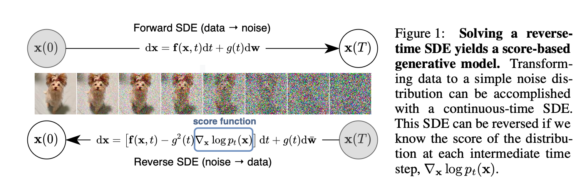

图的上半部分从数据 $\mathbf x(0)$ 出发，不断加入噪声，到 $\mathbf x(T)$ 时接近一个容易采样的高斯分布；下半部分从高斯噪声出发，在 score 的帮助下沿反向 SDE 回到数据。我们先把 SDE 本身讲清楚。

##### SDE 到底是什么

SDE 的全称是 Stochastic Differential Equation，通常翻译成**随机微分方程**。为了知道“随机”两个字究竟多了什么，我们先回忆一下普通的 ODE。

一个 ODE 可以写成 $d\mathbf x=\mathbf f(\mathbf x,t)dt$。它说的是：已经知道当前状态 $\mathbf x$ 和当前时刻 $t$ 以后，函数 $\mathbf f$ 会给出唯一的移动方向。只要初始点相同，后面走出的轨迹也相同。比如一颗小球的位置和速度确定后，如果它只受一个确定的力，那么经典力学方程会决定它接下来怎样运动。

SDE 则在这个确定性运动上再加一份随机扰动。即使两颗粒子从完全相同的位置出发，它们每一小步抽到的随机扰动也不同，最后就可能走出两条不同的轨迹。因此，ODE 通常描述“一条确定曲线怎样走”，SDE 描述的则是“一大群可能的随机曲线按照什么规律走”。

对 Diffusion 而言，$\mathbf x(t)$ 就是一张随时间变化的图片。SDE 的前向过程从干净图片出发，一边按照确定规则改变图片，一边不断加入微小的高斯噪声，最终让图片变成容易采样的高斯噪声。它和 DDPM 的差别主要在时间表示上：DDPM 使用 $0,1,2,\ldots,T$ 这些离散整数步，SDE 使用连续时间 $t\in[0,T]$。

##### 前向 SDE：从数据到噪声

论文给出的前向 SDE 是

$$d\mathbf x=\mathbf f(\mathbf x,t)dt+g(t)d\mathbf w.$$

$\mathbf x(t)$ 不是某一张固定图片，而是一个随时间随机变化的过程；在每个时刻，它的所有可能取值形成一个边缘分布 $p_t(\mathbf x)$。式子右边有两股力量：

- $\mathbf f(\mathbf x,t)dt$ 叫做**漂移（drift）**，它根据当前位置和时间给出一小段确定性的移动；
- $g(t)d\mathbf w$ 叫做**扩散（diffusion）**，$d\mathbf w$ 是一小段布朗运动，负责加入随机扰动，$g(t)$ 控制当前噪声强度。

如果把时间切成一个很小但还不是无穷小的间隔 $\Delta t$，这个 SDE 可以近似读成

$$\mathbf x(t+\Delta t)
\approx\mathbf x(t)+\mathbf f(\mathbf x(t),t)\Delta t
+g(t)\sqrt{\Delta t}\,\mathbf z,\qquad
\mathbf z\sim\mathcal N(\mathbf0,\mathbf I).$$

这下它就不陌生了：当前位置加上一个确定性更新，再加上一份高斯噪声。SDE 只是把这种离散小步更新取 $\Delta t\to0$ 的极限。

> **Question 为什么有时间会有开根号？**
>
> 因为布朗运动累积的是**方差**，而不是标准差。
>
> 先看最熟悉的离散情况。假设我们连续加入 $n$ 份彼此独立的标准高斯噪声 $\mathbf z_k\sim\mathcal N(\mathbf0,\mathbf I)$。它们相加以后，均值仍然是 $\mathbf0$，方差却会从 $1$ 累积成 $n$，也就是 $\mathbf z_1+\cdots+\mathbf z_n\sim\mathcal N(\mathbf0,n\mathbf I)$。方差是 $n$，标准差就是 $\sqrt n$，所以这份合并后的噪声也可以写成 $\sqrt n\,\mathbf z$，其中 $\mathbf z$ 仍是标准高斯噪声。
>
> 布朗运动也是同一件事，只不过把离散步数换成了连续时间。长度为 $\Delta t$ 的一小段布朗增量满足
>
> $$\Delta\mathbf w\sim\mathcal N(\mathbf0,\Delta t\,\mathbf I)
> \quad\Longleftrightarrow\quad
> \Delta\mathbf w=\sqrt{\Delta t}\,\mathbf z,
> \qquad \mathbf z\sim\mathcal N(\mathbf0,\mathbf I).$$
>
> 因此，$g(t)d\mathbf w$ 离散以后才会变成 $g(t)\sqrt{\Delta t}\,\mathbf z$。这里开根号不是某种人为设计，而是因为高斯分布里的缩放系数控制**标准差**：如果希望一小段时间产生的方差正比于 $\Delta t$，噪声前面的标准差就必须正比于 $\sqrt{\Delta t}$。
>
> 这件事还有一个很重要的后果。时间间隔缩短为原来的百分之一时，确定性漂移会缩短为原来的百分之一，随机扰动的典型大小却只会缩短为原来的十分之一。不能把 $d\mathbf w$ 当成普通的 $dt$，否则当时间切得越来越细时，随机项就会以错误的速度消失。

前向过程从 $\mathbf x(0)\sim p_0=p_\text{data}$ 开始。我们事先设计 $\mathbf f$ 和 $g$，让它随着 $t$ 增大逐渐破坏数据结构，并在终点得到一个容易采样的先验 $p_T$，通常近似为高斯分布。

这里要区分**一条样本轨迹**和**一条概率路径**。某一张图片在随机噪声推动下走出的 $\mathbf x(0),\mathbf x(t),\mathbf x(T)$ 是样本轨迹；把无数张图片和无数份噪声都考虑进来，每个时刻得到的整体分布 $p_t$ 才是概率路径。前向 SDE 设计的真正目标，是让整条概率路径从 $p_\text{data}$ 走到 $p_T$。

对于训练，我们还希望知道转移分布 $p_{0t}(\mathbf x(t)\mid\mathbf x(0))$：给定一张干净图片，直接跳到时刻 $t$ 后会服从什么分布。常用 SDE 的漂移是线性的，因此这个转移分布仍然是高斯，可以像 DDPM 一样一步构造任意时刻的带噪图片，不需要真的从 $0$ 模拟到 $t$。

##### 反向 SDE：从噪声到数据

前向加噪很容易，生成却需要反着走。一个重要结论是：扩散过程反过来仍然是一个扩散过程。对于上面的前向 SDE，它的反向时间 SDE 为

$$d\mathbf x=\left[\mathbf f(\mathbf x,t)-g^2(t)\nabla_{\mathbf x}\log p_t(\mathbf x)\right]dt+g(t)d\bar{\mathbf w},\qquad dt<0.$$

$d\bar{\mathbf w}$ 表示时间从 $T$ 向 $0$ 流动时的布朗增量。和前向 SDE 相比，唯一多出来的关键对象就是每个时刻的 score：$\nabla_{\mathbf x}\log p_t(\mathbf x)$。

> **拓展 这里的反向 SDE 是如何推出来的？**
>
> 这是一个数学问题，而不是一个计算机问题，所以我们就不放在正文，在这里大体说一下推导思路，给感兴趣的读者做扩展。
>
> 为了避免一上来就在 $dt<0$ 里绕晕，我们先取一个普通的正数小步长 $\Delta t>0$。记当前时刻的状态为 $\mathbf x$，下一时刻的状态为 $\mathbf y$。把前向 SDE 离散一小步，有
>
> $$\mathbf y
> \approx \mathbf x+\mathbf f(\mathbf x,t)\Delta t
> +g(t)\sqrt{\Delta t}\,\mathbf z,
> \qquad \mathbf z\sim\mathcal N(\mathbf0,\mathbf I).$$
>
> 所以，已知旧位置 $\mathbf x$ 后，新位置 $\mathbf y$ 的条件分布是
>
> $$p(\mathbf y\mid\mathbf x)
> \approx\mathcal N\!\left(
> \mathbf y;
> \mathbf x+\mathbf f(\mathbf x,t)\Delta t,
> g^2(t)\Delta t\,\mathbf I
> \right).$$
>
> 这是“已知过去，预测下一步”。反向生成需要的却是“已经看到下一步的 $\mathbf y$，推测上一步的 $\mathbf x$”。二者由 Bayes 公式联系：
>
> $$p(\mathbf x\mid\mathbf y)
> \propto p(\mathbf y\mid\mathbf x)\,p_t(\mathbf x).$$
>
> 第一项要求 $\mathbf x$ 能通过前向小步走到 $\mathbf y$；第二项则告诉我们，时刻 $t$ 的哪些 $\mathbf x$ 本来就更常见。**反向过程比前向过程多出来的信息，正藏在 $p_t(\mathbf x)$ 里。**
>
> 因为 $\Delta t$ 很小，可能的 $\mathbf x$ 一定离 $\mathbf y$ 很近。令 $\boldsymbol\delta=\mathbf x-\mathbf y$，并在 $\mathbf y$ 附近对对数密度做一阶展开：
>
> $$\log p_t(\mathbf y+\boldsymbol\delta)
> \approx \log p_t(\mathbf y)
> +\nabla_{\mathbf y}\log p_t(\mathbf y)^\top\boldsymbol\delta.$$
>
> 后面这一项里的梯度，正是 score。再把 $\mathbf f(\mathbf x,t)$ 近似为 $\mathbf f(\mathbf y,t)$，将高斯条件分布和上面的密度展开代入 Bayes 公式，可得
>
> $$\begin{aligned}
> \log p(\boldsymbol\delta\mid\mathbf y)
> &\approx
> -\frac{\|\boldsymbol\delta+\mathbf f(\mathbf y,t)\Delta t\|^2}
> {2g^2(t)\Delta t}
> +\nabla_{\mathbf y}\log p_t(\mathbf y)^\top\boldsymbol\delta+C\\
> &=-\frac{1}{2g^2(t)\Delta t}
> \left\|\boldsymbol\delta-\left[-\mathbf f(\mathbf y,t)
> +g^2(t)\nabla_{\mathbf y}\log p_t(\mathbf y)\right]\Delta t\right\|^2+C'.
> \end{aligned}$$
>
> $C,C'$ 都是不依赖 $\boldsymbol\delta$ 的常数，写出来只会干扰视线。第二行只是把第一行关于 $\boldsymbol\delta$ 的二次式配方成了高斯分布。由它可以直接读出：从 $\mathbf y$ 向过去退一小步时，增量 $\mathbf x-\mathbf y$ 的均值是
>
> $$\left[-\mathbf f(\mathbf y,t)
> +g^2(t)\nabla_{\mathbf y}\log p_t(\mathbf y)\right]\Delta t,$$
>
> 方差仍然是 $g^2(t)\Delta t\,\mathbf I$。也就是说，如果用一个向过去增大的新时间变量来写，反向漂移就是 $-\mathbf f+g^2\nabla\log p_t$。换回原来的时间 $t$，此时生成过程从 $T$ 走向 $0$，所以 $dt<0$，便得到正文里的写法：
>
> $$d\mathbf x=\left[\mathbf f(\mathbf x,t)-g^2(t)\nabla_{\mathbf x}\log p_t(\mathbf x)\right]dt
> +g(t)d\bar{\mathbf w},\qquad dt<0.$$
>
> 于是 score 为什么会出现也很清楚了：只知道前向的小步规则 $p(\mathbf y\mid\mathbf x)$，还不足以判断应该回到哪个 $\mathbf x$；Bayes 公式还需要当前整体分布 $p_t(\mathbf x)$。在无穷小的一步里，这份分布信息恰好通过它的对数梯度，也就是 score，进入反向漂移。

这里的正负号很容易看晕。公式括号里虽然是“减去 score”，但生成时 $dt<0$，所以 $-g^2\nabla\log p_t\,dt$ 实际会让样本朝 score 指向的高密度区域移动。

现在只剩下两个实际问题：score 怎样训练，训练好以后怎样生成。

先看训练。常用的前向 SDE 都是线性的，所以给定干净图片 $\mathbf x(0)$ 后，任意时刻的 $\mathbf x(t)$ 都服从一个已知高斯分布。我们把它写成 $p_{0t}(\mathbf x(t)\mid\mathbf x(0))=\mathcal N(\mathbf x(t);\mathbf m_t(\mathbf x(0)),\sigma_t^2\mathbf I)$，其中均值 $\mathbf m_t$ 和标准差 $\sigma_t$ 都由事先设计好的 $\mathbf f$、$g$ 决定。因此训练时不需要真的把 SDE 从 $0$ 模拟到 $t$，只要采一份 $\boldsymbol\epsilon\sim\mathcal N(\mathbf0,\mathbf I)$，就能一步构造 $\mathbf x(t)=\mathbf m_t(\mathbf x(0))+\sigma_t\boldsymbol\epsilon$。

这个高斯的条件 score 也可以直接计算。对它的对数密度关于 $\mathbf x(t)$ 求梯度，就有 $\nabla_{\mathbf x(t)}\log p_{0t}(\mathbf x(t)\mid\mathbf x(0))=-(\mathbf x(t)-\mathbf m_t(\mathbf x(0)))/\sigma_t^2=-\boldsymbol\epsilon/\sigma_t$。于是连续时间的训练目标可以直接写成

$$\mathcal L_\text{SDE}
=\mathbb E\left[
\lambda(t)\left\|
\mathbf s_\theta(\mathbf x(t),t)+\frac{\boldsymbol\epsilon}{\sigma_t}
\right\|^2
\right].$$

一次训练的过程和 DDPM 几乎一样：从数据集采一张 $\mathbf x(0)$，在 $[0,T]$ 中采一个时刻 $t$，再采高斯噪声 $\boldsymbol\epsilon$，一步算出 $\mathbf x(t)$，最后把 $(\mathbf x(t),t)$ 送进网络，让它预测 $-\boldsymbol\epsilon/\sigma_t$。$\lambda(t)$ 只是平衡不同噪声等级的损失大小，不会改变每个时刻的最优答案。

这里监督的是知道原图以后才能计算的**条件 score**，反向 SDE 需要的却是整体带噪分布的**边缘 score**。这个问题在 NCSN 和 DDPM 中都已经遇到过：对于同一张 $\mathbf x(t)$，MSE 会把所有可能原图给出的条件 score 求后验平均，而这个平均恰好等于 $\nabla_{\mathbf x(t)}\log p_t(\mathbf x(t))$。因此，网络训练时虽然使用条件高斯提供的答案，最终学到的仍然是反向 SDE 需要的边缘 score。

生成时就更直接了。先从终点先验采一份 $\mathbf x(T)\sim p_T$，再用网络输出 $\mathbf s_\theta(\mathbf x,t)$ 替换反向 SDE 中未知的真实 score，从 $t=T$ 一步步数值求解到 $t=0$。反向方程中的 $g(t)d\bar{\mathbf w}$ 会在途中继续加入随机扰动，所以即使初始噪声相同，两次反向 SDE 也可能走出不同的轨迹；当求解到 $0$ 时，样本的整体分布便回到 $p_0=p_\text{data}$。

##### Probability Flow ODE：同一条概率路径的确定性走法

反向 SDE 能生成，但它不是唯一的走法。论文还发现，每个 SDE 都对应一个确定性的 **Probability Flow ODE（概率流 ODE）**：

$$d\mathbf x=\left[\mathbf f(\mathbf x,t)-\frac12g^2(t)\nabla_{\mathbf x}\log p_t(\mathbf x)\right]dt.$$

> **推导 Probability Flow ODE 的由来**
>
> 这一部分有点超纲了，感兴趣的读者可以阅读研究一下，不感兴趣的可以直接跳过。
>
> 我们的目标不是让 ODE 逐条复刻 SDE 的随机轨迹——这是不可能的，因为 ODE 从同一个起点出发只会走出一条确定轨迹。真正的目标是让二者在每个时刻拥有相同的**边缘分布** $p_t$。
>
> 所以推导的出发点应该是一个更基础的问题：**前向 SDE 运行一小段时间后，整体概率密度 $p_t(\mathbf x)$ 会怎样变化？**
>
> 先只考虑漂移项 $d\mathbf x=\mathbf f\,dt$。如果某个区域里的样本都沿 $\mathbf f$ 向外流，这个区域的概率密度就会下降；如果周围样本都流进来，密度就会上升。用数学描述这种“流入减去流出”，就是 $\partial_t p_t=-\nabla\cdot(p_t\mathbf f)$。其中 $p_t\mathbf f$ 表示概率以多大的速度流动，散度 $\nabla\cdot$ 衡量一个位置附近的净流出量，前面的负号把净流出换成密度的减少量。
>
> 再只考虑随机项 $d\mathbf x=g(t)d\mathbf w$。在一小段 $\Delta t$ 里，每个样本会加上 $\boldsymbol\delta=g(t)\sqrt{\Delta t}\mathbf z$，其中 $\mathbf z\sim\mathcal N(\mathbf0,\mathbf I)$。因此新位置 $\mathbf x$ 处的密度，是旧分布在周围位置 $\mathbf x-\boldsymbol\delta$ 处的密度对随机扰动求平均，也就是 $p_{t+\Delta t}(\mathbf x)=\mathbb E_{\boldsymbol\delta}[p_t(\mathbf x-\boldsymbol\delta)]$。把括号里的密度在 $\mathbf x$ 附近做二阶展开：
>
> $$p_t(\mathbf x-\boldsymbol\delta)
> \approx p_t(\mathbf x)
> -\nabla p_t(\mathbf x)^\top\boldsymbol\delta
> +\frac12\boldsymbol\delta^\top
> \mathbf H_{p_t}(\mathbf x)\boldsymbol\delta.$$
>
> 这里 $\mathbf H_{p_t}(\mathbf x)$ 叫做**海森矩阵（Hessian matrix）**，也就是把 $p_t$ 关于各个坐标的二阶导数排成一个矩阵。高斯扰动的均值是 $\mathbb E[\boldsymbol\delta]=\mathbf0$，协方差是 $\mathbb E[\boldsymbol\delta\boldsymbol\delta^\top]=g^2(t)\Delta t\,\mathbf I$，所以一阶项平均后消失，二阶项留下 $\frac12g^2(t)\Delta t\,\nabla^2p_t$。这里的 $\nabla^2p_t=\sum_i\partial^2p_t/\partial x_i^2$ 叫做**拉普拉斯算子（Laplacian）**。两边除以 $\Delta t$ 并令 $\Delta t\to0$，随机扩散造成的密度变化就是 $\frac12g^2(t)\nabla^2p_t$。
>
> 把漂移造成的变化和扩散造成的变化相加，就得到前向 SDE 的密度演化方程。它通常叫做 **Fokker–Planck equation**：
>
> $$\begin{aligned}
\frac{\partial p_t(\mathbf x)}{\partial t}
&=-\nabla\cdot\left[p_t(\mathbf x)\mathbf f(\mathbf x,t)\right]
+\frac12g^2(t)\nabla^2 p_t(\mathbf x)
&&\qquad \text{漂移造成流动，随机噪声造成扩散}\\
&=-\nabla\cdot\left[p_t(\mathbf x)\mathbf f(\mathbf x,t)\right]
+\frac12g^2(t)\nabla\cdot\left[p_t(\mathbf x)\nabla_{\mathbf x}\log p_t(\mathbf x)\right]
&&\qquad \nabla p_t=p_t\nabla\log p_t\\
&=-\nabla\cdot\left\{p_t(\mathbf x)
\left[\mathbf f(\mathbf x,t)-\frac12g^2(t)\nabla_{\mathbf x}\log p_t(\mathbf x)\right]\right\}.
&&\qquad \text{提公因式}
\end{aligned}$$
>
> 第二行使用了 $\nabla^2p_t=\nabla\cdot(\nabla p_t)$。又因为 score 是 $\nabla\log p_t$，所以 $\nabla p_t=p_t\nabla\log p_t$。这样，原本由随机噪声造成的“扩散”，就被改写成了一个依赖 score 的确定性概率流动。
>
> 接着考虑一个速度场为 $\mathbf v_t(\mathbf x)$ 的 ODE。它没有随机项，只有概率的流入和流出，所以密度满足连续性方程 $\partial_t p_t=-\nabla\cdot(p_t\mathbf v_t)$。这并不是突然冒出的新规律，正是刚才“漂移怎样搬运概率”的公式，只不过把漂移函数换成了 ODE 的速度。
>
> 我们希望这个 ODE 的密度变化和 SDE 完全相同。与 Fokker–Planck equation 的最后一行对照，只需取 $\mathbf v_t(\mathbf x)=\mathbf f(\mathbf x,t)-\frac12g^2(t)\nabla_{\mathbf x}\log p_t(\mathbf x)$。代回去以后，两条密度演化方程一模一样；只要初始分布相同，它们在任意时刻的边缘分布 $p_t$ 就相同。这便是 Probability Flow ODE 的来路。公式里的 $\frac12$ 也不是经验系数，而是来自高斯扰动二阶展开中的 $\frac12$。

Probability Flow ODE 不需要单独训练一个新模型，因为它和反向 SDE 缺少的是同一个东西：边缘 score $\nabla_{\mathbf x}\log p_t(\mathbf x)$。所以训练阶段完全不变，仍然采 $\mathbf x(0)$、$t$ 和 $\boldsymbol\epsilon$ 构造 $\mathbf x(t)$，用同一个损失训练 $\mathbf s_\theta(\mathbf x(t),t)$。区别只发生在生成时：SDE 把这个 score 代入带随机项的反向方程，ODE 则把它代入上面的确定性速度。

具体来说，ODE 生成仍然从 $\mathbf x(T)\sim p_T$ 开始，然后让时间从 $T$ 走到 $0$。数值求解器做的事情并不神秘：它在当前位置询问一次网络，算出当前速度，再沿这个速度向更早的时刻移动一小步。最简单的 Euler 更新为

$$\mathbf x(t-\Delta t)
\approx\mathbf x(t)-\Delta t
\left[\mathbf f(\mathbf x(t),t)-\frac12g^2(t)\mathbf s_\theta(\mathbf x(t),t)\right].$$

因为 ODE 没有 $d\bar{\mathbf w}$，给定同一个初始噪声和同一个求解器，整条轨迹都是固定的。反向 SDE 则会在每一步继续抽取随机扰动，所以单条样本轨迹并不相同。两者真正共享的是每个时刻的边缘分布 $p_t$：从同一个 $p_T$ 出发并精确求解，它们最终都会得到 $p_0$。

这也解释了为什么两个方程中的 score 系数一个是 $1$，一个是 $\frac12$。反向 SDE 的随机项本身也在改变概率密度，所以需要完整的 $-g^2\nabla\log p_t$；ODE 没有随机扩散，只靠确定性速度搬运概率，用 $-\frac12g^2\nabla\log p_t$ 就能得到相同的密度变化。**因此，SDE 和 Probability Flow ODE 不是两种训练方法，而是同一个 score network 的两种生成方法。**

##### NCSN 与 DDPM 怎样被统一

最后回到这一节最开始的问题。所谓“统一”，不是说 NCSN 和 DDPM 的离散算法一模一样，而是说：把离散噪声等级变成连续时间后，它们分别对应两种不同的前向 SDE；两种 SDE 的反向过程都只缺同一类对象——各自带噪分布在每个时刻的 score。

先看 NCSN。它的加噪公式是 $\tilde{\mathbf x}=\mathbf x_0+\sigma_i\boldsymbol\epsilon$：原图的系数始终是 $1$，只是噪声标准差 $\sigma_i$ 越来越大。把离散的 $\sigma_i$ 换成连续递增的 $\sigma(t)$，并为简化记号令 $\sigma(0)=0$，我们希望时刻 $t$ 的累计噪声方差正好是 $\sigma^2(t)$。SDE 在一小段 $dt$ 中加入的方差是 $g^2(t)dt$，因此取 $\mathbf f=\mathbf0$、$g(t)=\sqrt{\frac{d\sigma^2(t)}{dt}}$。代入前向和反向 SDE 得到

$$\begin{aligned}
\text{前向：}\quad d\mathbf x
&=\sqrt{\frac{d\sigma^2(t)}{dt}}\,d\mathbf w,\\
\text{反向：}\quad d\mathbf x
&=-\frac{d\sigma^2(t)}{dt}\nabla_{\mathbf x}\log p_t(\mathbf x)\,dt
+\sqrt{\frac{d\sigma^2(t)}{dt}}\,d\bar{\mathbf w},
\qquad dt<0.
\end{aligned}$$

这里没有漂移项，所以原图不会被主动缩小；噪声方差则从 $0$ 累积到 $\int_0^t g^2(s)ds=\sigma^2(t)$，恰好复现 $\mathbf x(t)=\mathbf x(0)+\sigma(t)\boldsymbol\epsilon$。因为方差一路增大，这个过程叫做 **Variance Exploding SDE（VE SDE，方差爆炸 SDE）**。NCSN 使用的一串 $\sigma_i$，可以看作在这条连续 VE SDE 上选出的若干离散噪声时刻。

再看 DDPM。它的单步公式是 $\mathbf x_t=\sqrt{1-\beta_t}\mathbf x_{t-1}+\sqrt{\beta_t}\boldsymbol\epsilon$：每一步既缩小旧信号，又补入新的噪声。连续时间里，用 $\beta(t)$ 表示单位时间的加噪速率，并取 $\mathbf f(\mathbf x,t)=-\frac12\beta(t)\mathbf x$、$g(t)=\sqrt{\beta(t)}$。于是

$$\begin{aligned}
\text{前向：}\quad d\mathbf x
&=-\frac12\beta(t)\mathbf x\,dt+\sqrt{\beta(t)}\,d\mathbf w,\\
\text{反向：}\quad d\mathbf x
&=\left[-\frac12\beta(t)\mathbf x-\beta(t)\nabla_{\mathbf x}\log p_t(\mathbf x)\right]dt
+\sqrt{\beta(t)}\,d\bar{\mathbf w},
\qquad dt<0.
\end{aligned}$$

为什么它就是 DDPM 的连续版本？把前向 SDE 离散一个很小的 $\Delta t$，会得到 $\mathbf x(t+\Delta t)\approx(1-\frac12\beta(t)\Delta t)\mathbf x(t)+\sqrt{\beta(t)\Delta t}\mathbf z$。又因为 $\sqrt{1-\beta(t)\Delta t}\approx1-\frac12\beta(t)\Delta t$，只要把 DDPM 的单步噪声量 $\beta_t$ 对应成 $\beta(t)\Delta t$，这个小步更新就正是 DDPM 的加噪公式。

DDPM 中的 $\bar\alpha_t$ 是许多单步保留系数的乘积。时间步趋于连续时，对这个乘积取对数，$\sum_i\log(1-\beta(t_i)\Delta t)\approx-\sum_i\beta(t_i)\Delta t$，右边的求和再变成积分，因此 $\bar\alpha(t)=\exp(-\int_0^t\beta(s)ds)$。原始信号的系数就是 $\sqrt{\bar\alpha(t)}$。

另一方面，每一步缩小旧信号所损失的方差都会被新噪声补回，所以累计噪声方差是 $1-\bar\alpha(t)$。这个 SDE 的任意时刻便满足 $\mathbf x(t)=\sqrt{\bar\alpha(t)}\mathbf x(0)+\sqrt{1-\bar\alpha(t)}\boldsymbol\epsilon$，与 DDPM 的跳步加噪公式完全同形。也正因为总方差保持不变，它叫做 **Variance Preserving SDE（VP SDE，方差保持 SDE）**。而 DDPM 预测的噪声仍可通过 $\mathbf s_\theta(\mathbf x(t),t)\approx-\boldsymbol\epsilon_\theta(\mathbf x(t),t)/\sqrt{1-\bar\alpha(t)}$ 换成反向 SDE 需要的 score。

这两种 SDE 又都各自对应一条 Probability Flow ODE。只需把各自的 $\mathbf f$ 和 $g$ 代入 $\mathbf f-\frac12g^2\nabla\log p_t$，就有

$$\begin{aligned}
\text{VE 对应的 ODE：}\quad d\mathbf x
&=-\frac12\frac{d\sigma^2(t)}{dt}\nabla_{\mathbf x}\log p_t(\mathbf x)\,dt,\\
\text{VP 对应的 ODE：}\quad d\mathbf x
&=\left[-\frac12\beta(t)\mathbf x-\frac12\beta(t)\nabla_{\mathbf x}\log p_t(\mathbf x)\right]dt.
\end{aligned}$$

这两条 ODE 不是随手猜出的采样规则。前面已经证明，对任意给定的 $\mathbf f$ 和 $g$，这样构造出的 Probability Flow ODE 都与对应的连续 SDE 具有相同的边缘分布 $p_t$；这里不过是分别把 VE、VP 的 $\mathbf f$ 和 $g$ 代了进去。

所以统一关系可以精确地说成：**NCSN 的离散噪声等级对应 VE SDE，DDPM 的离散加噪步骤对应 VP SDE；二者学习的都是带噪边缘分布的 score。** 训练好以后，各自的 score network 既能放进对应的反向 SDE 做随机生成，也能放进对应的 Probability Flow ODE 做确定性生成。统一的是连续时间下的概率演化和 score，不是两套离散采样公式的每一个细节。

#### Flow Matching：不再学概率梯度，直接学搬运速度

SDE 的工作把随机采样和确定性 ODE 放进了同一个框架，但它的训练主线仍然是：先学习概率密度的 score，再用
$\mathbf v_t=\mathbf f-\frac12g^2\mathbf s_t$
把 score 换算成 Probability Flow ODE 的速度。Flow Matching[11](#ref-11) 更进一步：采样器最后需要的既然是速度，为什么不直接监督神经网络学习速度？

Probability Flow ODE 已经把生成写成

$$
\frac{d\mathbf x_t}{dt}=\mathbf v_t(\mathbf x_t),
\qquad
\mathbf x_0\sim p_\text{noise},
$$

并希望解到 $t=1$ 时得到 $\mathbf x_1\sim p_\text{data}$。许多噪声点一起沿 ODE 运动时，整团噪声分布便被连续搬运成数据分布。

> **Tips 这里的 $\mathbf x_0$ 为什么又是噪声？**
>
> DDPM 一直把 $\mathbf x_0$ 记作干净数据、$\mathbf x_T$ 记作噪声，因为它先定义数据到噪声的前向过程。Flow Matching 原论文直接从生成方向定义时间：$t=0$ 是噪声，$t=1$ 是数据，所以这里的 $\mathbf x_0$ 是噪声、$\mathbf x_1$ 是真实数据。只是时间记法换了，不是概念发生了矛盾。

我们先看最直观的版本。从数据集取一张图片 $\mathbf x_1$，从标准高斯取一份噪声 $\mathbf x_0$，在二者之间连一条直线：

$$
\mathbf x_t=(1-t)\mathbf x_0+t\mathbf x_1.
$$

当 $t=0$ 时得到噪声 $\mathbf x_0$，当 $t=1$ 时到达数据 $\mathbf x_1$。对时间求导，速度为

$$\frac{d\mathbf x_t}{dt}=\mathbf x_1-\mathbf x_0.$$

这条线上无论走到哪里，速度的方向和大小都不变。因此，只要随机采一个时刻 $t$，我们既能直接构造位置 $\mathbf x_t$，也知道它此刻应该具有的速度 $\mathbf x_1-\mathbf x_0$。于是训练目标可以写成
$$
\mathcal L_\text{CFM}
=\mathbb E
\left[
\left\|
\mathbf v_\theta(\mathbf x_t,t)
-(\mathbf x_1-\mathbf x_0)
\right\|^2
\right].
$$

训练时，每一份样本只需要做下面几件事：

1. 从标准高斯采样噪声 $\mathbf x_0\sim\mathcal N(\mathbf0,\mathbf I)$，从数据集采样 $\mathbf x_1\sim p_\text{data}$；
2. 均匀采样一个时刻 $t\sim\mathcal U[0,1]$；
3. 计算中间位置 $\mathbf x_t=(1-t)\mathbf x_0+t\mathbf x_1$；
4. 把 $(\mathbf x_t,t)$ 输入神经网络，让它输出一个与图片维度相同的速度 $\mathbf v_\theta(\mathbf x_t,t)$；
5. 用 $\mathbf x_1-\mathbf x_0$ 作为监督信号，最小化上面的 MSE。

值得注意的是，训练期间不需要从 $0$ 到 $1$ 真正解一遍 ODE。中间点和监督速度都能一步算出来，这就是论文所说的 **simulation-free training**：训练不依赖一条昂贵的数值模拟轨迹。

生成时才需要真正解 ODE。我们先采一份高斯噪声 $\mathbf x(0)$，然后从 $t=0$ 开始反复询问网络当前位置的速度，并用 Euler、Runge–Kutta 等 ODE 数值求解器更新

$$\mathbf x(t+\Delta t)\approx\mathbf x(t)+\mathbf v_\theta(\mathbf x(t),t)\Delta t.$$

一直积分到 $t=1$，就得到生成图片。训练时成对出现的真实图片 $\mathbf x_1$ 不会在生成时提供给模型；模型只看当前位置和时间。因此，它最终必须学会的是整个人群在 $(\mathbf x,t)$ 处应该怎样移动，而不是死记某一条“噪声到训练图片”的线。

> **Thinking 随机配对的直线会交叉，模型会不会混淆？**
>
> 同一个位置和时刻附近，确实可能经过许多条直线，而且它们指向不同的 $\mathbf x_1$。但 ODE 的速度场在同一个 $(\mathbf x,t)$ 上只能给出一支箭头，所以模型不可能把每一条配对直线都原样记住。
>
> MSE 在这里仍然会做我们已经见过多次的事情：输出所有可能条件速度在给定 $(\mathbf x,t)$ 后的平均，
> $$\mathbf v_\theta^*(\mathbf x,t)
> =\mathbb E[\mathbf x_1-\mathbf x_0\mid\mathbf x_t=\mathbf x,t].$$
> 这支平均箭头不是随便折中。Flow Matching 的关键定理保证，它恰好生成这些条件路径混合后的边缘概率路径。因此交叉不会让目标在数学上失效，只会让边缘速度场可能变得更弯、更难拟合。
>
> 这也提醒我们：训练时画出的直线是**条件轨迹**，模型生成时实际沿着的是平均后的**边缘速度场**，二者不一定还是同一条直线。条件概率路径选得越简单，平均后的速度通常也越容易学习；后面介绍的 OT 条件路径正是论文重点研究的一种选择。

如果只想知道 Flow Matching 怎样训练和生成，到这里已经足够了，**可以直接跳到下一节**。但我们刚才其实接受了一个最关键的结论：用每条配对直线的速度做监督，为什么能学到整个分布的速度？如果想把这件事彻底弄明白，接下来我们回到论文，从条件概率路径开始推。

##### 再探 Flow Matching

首先区分三个很容易混在一起的对象：

- **概率路径（分布）** $p_t(\mathbf x)$ 描述的是整群样本。固定一个时刻 $t$，它告诉我们样本在空间各处怎样分布；
- **速度场** $\mathbf u_t(\mathbf x)$ 描述的是局部规则。给定当前位置 $\mathbf x$ 和时刻 $t$，它返回下一瞬间应该朝哪里移动；
- **流映射** $\boldsymbol\phi_t(\mathbf x_0)$ 描述的是单个起点。它表示从初始点 $\mathbf x_0$ 出发，沿速度场解到时刻 $t$ 后落在哪里。

三者通过 ODE 联系起来：

$$\frac{d}{dt}\boldsymbol\phi_t(\mathbf x_0)
=\mathbf u_t(\boldsymbol\phi_t(\mathbf x_0)),
\qquad
\boldsymbol\phi_0(\mathbf x_0)=\mathbf x_0.$$

第二个式子规定从原地出发，第一个式子规定沿途每一刻都听从速度场。如果初始点 $\mathbf x_0\sim p_0$，经过流映射后有 $\boldsymbol\phi_t(\mathbf x_0)\sim p_t$，我们就说速度场 $\mathbf u_t$ **生成了**概率路径 $p_t$。

假如目标概率路径 $p_t$ 和生成它的真实速度场 $\mathbf u_t$ 都已经知道，事情非常简单：直接用神经网络 $\mathbf v_\theta$ 回归真实速度即可。理想的 Flow Matching 损失是

$$
\mathcal L_\text{FM}
=\mathbb E_{t,\mathbf x\sim p_t}
\|\mathbf v_\theta(\mathbf x,t)-\mathbf u_t(\mathbf x)\|^2.
$$

其中 $t\sim\mathcal U[0,1]$（均匀分布），再从当前分布 $\mathbf x\sim p_t$ 采样。损失为零时，模型速度就等于 $\mathbf u_t$，它解出的 ODE 自然会把 $p_0$ 搬运到 $p_1$。

但这个理想损失暂时还不能计算。它要求我们完成两件事：先从 $p_t$ 采出训练输入 $\mathbf x$，再计算这个位置的正确标签 $\mathbf u_t(\mathbf x)$。问题是，这两个对象都还不知道。

我们手里只有一个装着真实图片的数据集。每次可以从中抽出一张图片 $\mathbf x_1$，却没有真实数据概率密度的解析公式。把这个未知的真实数据密度记作 $q(\mathbf x_1)$：它描述“整个真实图片世界里，各种图片分别有多大可能出现”。数据集允许我们从 $q$ 中取样，却不能让我们对任意一张图片输入 $\mathbf x_1$ 后，直接算出 $q(\mathbf x_1)$ 的数值。

只知道起点是噪声分布、终点是数据分布，也不会自动告诉我们中间的 $p_t$ 应该是什么。同样的两端之间可以设计无数条概率路径：可以走直线，可以先快后慢，也可以绕路。概率路径没有确定下来，生成这条路径的真实速度 $\mathbf u_t$ 自然也没有确定下来。因此，理想损失中的“从 $p_t$ 采样”和“计算 $\mathbf u_t(\mathbf x)$”都无从下手。

Flow Matching 的解决方法不是直接求出未知的整体路径，而是把大问题拆成许多容易的小问题：先从数据集采一张具体图片 $\mathbf x_1$，只为这张图片设计一条容易处理的**条件概率路径** $p_t(\mathbf x\mid\mathbf x_1)$；再把所有真实图片对应的条件路径混合起来，定义整体的边缘路径

$$
p_t(\mathbf x)
=\int p_t(\mathbf x\mid\mathbf x_1)q(\mathbf x_1)d\mathbf x_1.
$$

这个积分的意思是：遍历所有可能的真实图片 $\mathbf x_1$，按照它在真实世界中的概率 $q(\mathbf x_1)$ 加权，再把每条条件路径混合起来。我们依然算不出这个积分在某个 $\mathbf x$ 处的具体密度值，因为 $q(\mathbf x_1)$ 未知；但训练时不需要真的枚举全部图片并计算积分。只要从数据集随机采样 $\mathbf x_1$，就等价于按照 $q(\mathbf x_1)$ 的权重进行 Monte Carlo 采样，也就是用许多次随机抽样近似对整个数据分布求平均。这正是接下来把不可计算的整体目标变成可采样目标的突破口。

论文选择了一族条件高斯路径：

$$
p_t(\mathbf x\mid\mathbf x_1)
=\mathcal N\!\left(
\mathbf x;\boldsymbol\mu_t(\mathbf x_1),
\sigma_t^2(\mathbf x_1)\mathbf I
\right).
$$

这里 $\boldsymbol\mu_t(\mathbf x_1)$ 是均值，$\sigma_t(\mathbf x_1)$ 是标准差。为了让所有条件路径都从同一个标准高斯出发，并在终点集中到各自的真实图片附近，我们设置

$$\boldsymbol\mu_0=\mathbf0,
\quad\sigma_0=1;
\qquad
\boldsymbol\mu_1=\mathbf x_1,
\quad\sigma_1=\sigma_\text{min}.$$

$\sigma_\text{min}$ 是一个很小的正数，所以 $p_1(\mathbf x\mid\mathbf x_1)$ 是以 $\mathbf x_1$ 为中心的窄高斯。把所有 $\mathbf x_1$ 混合以后，$p_1$ 就近似真实数据分布。保留这个很小的标准差，是为了避免终点退化成方差为零的点质量，导致密度和后面的除法不再良好定义。

现在还缺少生成这条高斯路径的速度场。先采 $\mathbf x_0\sim\mathcal N(\mathbf0,\mathbf I)$，再做变换 $$\mathbf x = \boldsymbol\psi_t(\mathbf x_0)=\sigma_t\mathbf x_0+\boldsymbol\mu_t$$，易得它服从刚才设计的高斯$p_t(\mathbf x\mid\mathbf x_1)=\mathcal N\!\left(\mathbf x;\boldsymbol\mu_t(\mathbf x_1),\sigma_t^2(\mathbf x_1)\mathbf I\right)$，因此我们管 $\boldsymbol \psi_t$ 叫做条件流映射。

沿着这条流，某个样本的速度可以直接对时间求导：

$$\begin{aligned}
\frac{d}{dt}\boldsymbol\psi_t(\mathbf x_0)
&=\sigma_t'\mathbf x_0+\boldsymbol\mu_t'
&&\qquad \text{对时间求导}\\
&=\frac{\sigma_t'}{\sigma_t}
(\mathbf x-\boldsymbol\mu_t)+\boldsymbol\mu_t'
&&\qquad \mathbf x_0=\frac{\mathbf x-\boldsymbol\mu_t}{\sigma_t}.
\end{aligned}$$

因此，写成“当前位置 $\mathbf x$ 应该往哪里走”的形式，**条件速度场**就是

$$
\mathbf u_t(\mathbf x\mid\mathbf x_1)
=\frac{\sigma_t'}{\sigma_t}
(\mathbf x-\boldsymbol\mu_t)+\boldsymbol\mu_t'.
$$

撇号表示对 $t$ 求导。$\boldsymbol\mu_t,\sigma_t$ 是我们自己设计的函数，$\mathbf x_1$ 是训练时采到的数据，因此右边每一项都能计算。这样，我们已经**解决了“怎样为单个数据样本构造一条可采样路径和可监督速度”的问题**，即解决了训练问题。

接下来，我们迈入生成部分。我们前面已经探讨了 **条件速度场**，但在生成时，只有当前状态 $\mathbf x$ 和时刻 $t$，并没有一张 $\mathbf x_1$ 可以交给模型。同一个 $(\mathbf x,t)$ 又可能落在许多条条件路径附近，这些路径各自给出的条件速度 $\mathbf u_t(\mathbf x\mid\mathbf x_1)$ 未必相同，但模型在同一个输入上只能输出一支箭头。所以，必须把可能的箭头合成一支只依赖 $(\mathbf x,t)$ 的速度 $\mathbf u_t(\mathbf x)$，也就是把 $\mathbf x_1$ 积掉得到的 **边缘速度场**。

根据 Bayes 公式，某个终点 $\mathbf x_1$ 应占的后验权重是 $q(\mathbf x_1\mid\mathbf x_t=\mathbf x)=\frac{p_t(\mathbf x\mid\mathbf x_1)q(\mathbf x_1)}{p_t(\mathbf x)}$。

因此边缘速度定义为

$$
\begin{aligned}
\mathbf u_t(\mathbf x)
&=\int
\mathbf u_t(\mathbf x\mid\mathbf x_1)
\frac{p_t(\mathbf x\mid\mathbf x_1)q(\mathbf x_1)}
{p_t(\mathbf x)}
d\mathbf x_1\\
&=\mathbb E[
\mathbf u_t(\mathbf x\mid\mathbf x_1)
\mid\mathbf x_t=\mathbf x].
\end{aligned}
$$

得到的这个条件期望非常直观：固定模型真正看到的 $(\mathbf x,t)$，再把所有可能的终点所给出的条件速度按照后验概率加权平均。训练数据里有 $\mathbf x_1$，所以我们能构造条件速度作为监督；生成时没有 $\mathbf x_1$，模型输出的则是许多训练样本平均出来的边缘速度。**条件速度是训练时可计算的答案，边缘速度才是生成时真正使用的向量场。**

可是，这支后验平均出来的速度真的会生成混合后的边缘路径吗？答案藏在**连续性方程**里。对于任何只负责搬运粒子、不凭空创造或删除概率的 ODE，密度与速度满足

$$\frac{\partial p_t(\mathbf x)}{\partial t}
+\nabla\cdot[p_t(\mathbf x)\mathbf u_t(\mathbf x)]=0.$$

每一条条件路径及其条件速度都满足这个方程。现在对所有 $\mathbf x_1$ 混合：

$$
\begin{aligned}
\frac{\partial p_t(\mathbf x)}{\partial t}
&=\int
\frac{\partial p_t(\mathbf x\mid\mathbf x_1)}{\partial t}
q(\mathbf x_1)d\mathbf x_1\\
&=-\nabla\cdot
\int p_t(\mathbf x\mid\mathbf x_1)
\mathbf u_t(\mathbf x\mid\mathbf x_1)
q(\mathbf x_1)d\mathbf x_1\\
&=-\nabla\cdot[p_t(\mathbf x)\mathbf u_t(\mathbf x)].
\end{aligned}
$$

第一行把边缘路径的定义代入；第二行对每条条件路径使用连续性方程；第三行则根据边缘速度的定义，把积分整体识别为 $p_t(\mathbf x)\mathbf u_t(\mathbf x)$。最后一行正是边缘路径自己的连续性方程。

这个连等意味着：

$$p_t(\mathbf x)\mathbf u_t(\mathbf x)
=\int p_t(\mathbf x\mid\mathbf x_1)
\mathbf u_t(\mathbf x\mid\mathbf x_1)
q(\mathbf x_1)d\mathbf x_1.$$

等号右边把每条条件路径的概率流 $p_t(\mathbf x\mid\mathbf x_1)\mathbf u_t(\mathbf x\mid\mathbf x_1)$ 按照 $q(\mathbf x_1)$ 加起来，等号左边则是边缘路径的概率流 $p_t(\mathbf x)\mathbf u_t(\mathbf x)$。因此，倒数第二行中的“所有条件概率流之和”，正好可以替换成最后一行的“边缘概率流”。

所以论文第一个关键结论是：**把条件速度场按照后验权重平均成边缘速度场以后，所有条件路径混合成的边缘路径仍然满足同一个连续性方程；因此，这个边缘速度场确实生成了这条边缘路径。** 这也正式回答了前面的“直线交叉”问题。

> **Thinking 连续性方程的物理直觉**
>
> 电荷守恒写作 $\partial_t\rho+\nabla\cdot\mathbf J=0$，其中 $\rho$ 是电荷密度，$\mathbf J=\rho\mathbf v$ 是电流密度。一个区域内电荷增加，只能是因为流进来的比流出去的多。
>
> 把 $\rho$ 换成概率密度 $p_t$，把电荷流换成概率流 $p_t\mathbf u_t$，就得到
> $\partial_t p_t+\nabla\cdot(p_t\mathbf u_t)=0$。
> $\nabla\cdot(p_t\mathbf u_t)>0$ 表示当前位置附近净流出，密度随时间下降；小于零则表示净流入，密度上升。ODE 不创造概率，只负责搬运概率。

第一个结论证明了边缘速度是对的，却没有让它变得可计算：它的定义仍然含有整个数据分布上的积分。于是论文不直接训练 $\mathbf v_\theta$ 拟合 $\mathbf u_t(\mathbf x)$，而是使用 **Conditional Flow Matching（条件 Flow Matching，CFM）**：

$$
\mathcal L_\text{CFM}
=\mathbb E
\|\mathbf v_\theta(\mathbf x,t)
-\mathbf u_t(\mathbf x\mid\mathbf x_1)\|^2.
$$

这个损失可以直接 Monte Carlo 估计：采 $t$、$\mathbf x_1$ 和 $\mathbf x_0$，用条件流映射得到 $\mathbf x$，再计算已经知道的条件速度。它和理想的边缘损失为什么等价呢？把平方展开：

$$\begin{aligned}
\mathcal L_\text{CFM}
&=\mathbb E\|\mathbf v_\theta\|^2
-2\mathbb E[\mathbf v_\theta^\top\mathbf u_t(\mathbf x\mid\mathbf x_1)]
+\mathbb E\|\mathbf u_t(\mathbf x\mid\mathbf x_1)\|^2\\
&=\mathbb E\|\mathbf v_\theta\|^2
-2\mathbb E\!\left[\mathbf v_\theta^\top
\mathbb E[\mathbf u_t(\mathbf x\mid\mathbf x_1)\mid\mathbf x,t]\right]
+\mathbb E\|\mathbf u_t(\mathbf x\mid\mathbf x_1)\|^2
&&\qquad \text{先固定模型实际看见的 }(\mathbf x,t)\\
&=\mathbb E\|\mathbf v_\theta\|^2
-2\mathbb E[\mathbf v_\theta^\top\mathbf u_t(\mathbf x)]
+\mathbb E\|\mathbf u_t(\mathbf x\mid\mathbf x_1)\|^2.
&&\qquad \text{条件速度的后验均值就是边缘速度}
\end{aligned}$$

这里最关键的是中间的交叉项。给定 $(\mathbf x,t)$ 后，网络输出 $\mathbf v_\theta(\mathbf x,t)$ 已经固定，可以移到里面那层条件期望之外；剩余条件速度的平均，根据前面的定义正是 $\mathbf u_t(\mathbf x)$。

还记得理想的 Flow Matching 损失是

$$
\mathcal L_\text{FM}
=\mathbb E_{t,\mathbf x\sim p_t}
\|\mathbf v_\theta(\mathbf x,t)-\mathbf u_t(\mathbf x)\|^2.
$$

$\mathcal L_\text{FM}$ 展开后，前两项完全相同，只有最后一项是 $\mathbb E\|\mathbf u_t(\mathbf x)\|^2$。因此

$$
\mathcal L_\text{CFM}
=\mathcal L_\text{FM}
+\underbrace{
\mathbb E\|\mathbf u_t(\mathbf x\mid\mathbf x_1)\|^2
-\mathbb E\|\mathbf u_t(\mathbf x)\|^2
}_{\text{与 }\theta\text{ 无关}}.
$$

最后两项都不含模型参数 $\theta$，所以两种损失虽然数值不一定相同，对 $\theta$ 的梯度却完全相同，最优模型也相同。这是论文第二个关键结论：**不用算出边缘速度，只用可计算的条件速度做 MSE 监督，就能获得直接回归边缘速度时相同的训练方向。**

讲到这里，我们还没有规定 $\boldsymbol\mu_t$ 和 $\sigma_t$ 必须怎样变化。这份自由度很重要：Flow Matching 不只支持直线路径，也可以把前面 SDE 的 diffusion 概率路径原样拿来。

例如，把 VE SDE 从噪声到数据的方向写成条件路径，可以令 $\boldsymbol\mu_t=\mathbf x_1$，并让标准差 $\sigma_t$ 随 $t$ 从一个很大的噪声尺度缩小到接近 $0$。代入一般公式，条件速度为

$$\mathbf u_t(\mathbf x\mid\mathbf x_1)
=\frac{\sigma_t'}{\sigma_t}(\mathbf x-\mathbf x_1).$$

生成方向上 $\sigma_t'<0$，这支速度会把散落在 $\mathbf x_1$ 周围的点逐渐收向 $\mathbf x_1$。

对于 VP SDE，我们先把上一节数据到噪声的时间区间归一化为 $s\in[0,1]$。在这个前向时间里，$s=0$ 是数据端，此时还没有加入噪声，所以累计信号保留比例 $\bar\alpha(0)=1$；$s=1$ 是噪声端，此时 $\bar\alpha(1)$ 已经接近 $0$。因此，条件分布的均值和标准差分别是 $\sqrt{\bar\alpha(s)}\mathbf x_1$ 与 $\sqrt{1-\bar\alpha(s)}$。Flow Matching 使用的是噪声到数据的生成方向，所以令前向时间 $s=1-t$，再让生成时间 $t$ 从 $0$ 走到 $1$。于是条件路径可以写成

$$\boldsymbol\mu_t
=\sqrt{\bar\alpha(1-t)}\,\mathbf x_1,
\qquad
\sigma_t=\sqrt{1-\bar\alpha(1-t)}.$$

这里要特别注意，$\bar\alpha(1-t)$ 表示把 $1-t$ 作为输入，去查询函数 $\bar\alpha(\cdot)$ 的取值，并不是用 $\bar\alpha$ 乘上 $1-t$。所以当 $t=1$、$1-t=0$ 时，得到的是 $\bar\alpha(0)=1$，而不是 $0$。

这样再看两个端点就很清楚了。当 $t=0$ 时，$1-t=1$，对应前向扩散的噪声端：$\bar\alpha(1)\approx0$，所以 $\boldsymbol\mu_0\approx\mathbf0$、$\sigma_0\approx1$，条件分布接近标准高斯。当 $t=1$ 时，$1-t=0$，对应没有加噪的数据端：$\bar\alpha(0)=1$，所以 $\boldsymbol\mu_1=\mathbf x_1$、$\sigma_1=0$，条件分布最终收拢到目标图片 $\mathbf x_1$。也就是说，生成过程中从接近 $0$ 增长到 $1$ 的是信号系数 $\sqrt{\bar\alpha(1-t)}$，均值向量 $\boldsymbol\mu_t$ 则从零向量移动到 $\mathbf x_1$。把这两个函数代入条件速度通式，就得到 VP diffusion path 对应的确定性速度。

这说明 Flow Matching 并没有否定 Diffusion：使用 diffusion path 时，它和 score matching 描述同一条概率路径，只是监督对象不同。score matching 先学习 $\nabla\log p_t$，再换算出 Probability Flow ODE 的速度；Flow Matching 直接回归这支速度。

更关键的是，Flow Matching 允许我们离开 diffusion path，主动选择更简单的概率路径：令均值从 $\mathbf0$ 线性移动到 $\mathbf x_1$，标准差从 $1$ 线性缩小到 $\sigma_\text{min}$：

$$
\boldsymbol\mu_t=t\mathbf x_1,
\qquad
\sigma_t=1-(1-\sigma_\text{min})t.
$$

代入仿射流映射，得到

$$
\boldsymbol\psi_t(\mathbf x_0)
=[1-(1-\sigma_\text{min})t]\mathbf x_0+t\mathbf x_1,
\qquad
\frac{d\boldsymbol\psi_t}{dt}
=\mathbf x_1-(1-\sigma_\text{min})\mathbf x_0.
$$

给定一对 $(\mathbf x_0,\mathbf x_1)$ 后，导数不再含 $t$，所以这颗粒子会沿直线匀速前进。当 $\sigma_\text{min}=0$ 时，终点恰好是 $\mathbf x_1$，也就完全回到主线中的 $\mathbf x_t=(1-t)\mathbf x_0+t\mathbf x_1$ 和速度 $\mathbf x_1-\mathbf x_0$。当 $\sigma_\text{min}>0$ 时，终点是 $\mathbf x_1+\sigma_\text{min}\mathbf x_0$，也就是落在 $\mathbf x_1$ 附近的一小团高斯中。

如果希望速度场只接收当前位置 $\mathbf x$ 而不显式接收初始噪声，就从 $\mathbf x=\boldsymbol\psi_t(\mathbf x_0)$ 反解 $\mathbf x_0$，得到

$$
\mathbf u_t(\mathbf x\mid\mathbf x_1)
=\frac{\mathbf x_1-(1-\sigma_\text{min})\mathbf x}
{1-(1-\sigma_\text{min})t}.
$$

这支速度在分母中出现 $1-(1-\sigma_\text{min})t$。保留 $\sigma_\text{min}>0$ 时，即使 $t=1$ 分母也不会为零；主线为了直观取 $\sigma_\text{min}=0$，训练又几乎不会刚好抽中连续区间的端点 $t=1$，所以直接使用样本形式 $\mathbf x_1-\mathbf x_0$ 仍然没有问题。

论文称这条路径为**最优传输（Optimal Transport，OT）条件路径**。这里的“最优”有明确对象：在起点标准高斯 $\mathcal N(\mathbf0,\mathbf I)$ 与终点窄高斯 $\mathcal N(\mathbf x_1,\sigma_\text{min}^2\mathbf I)$ 之间，上面的仿射插值是二阶 Wasserstein 距离下的最优传输位移插值。直觉上，它不绕路、不回头，每个固定初始粒子都沿直线匀速移动。

> **Tips 二阶 Wasserstein 距离在这里衡量什么？**
>
> 可以把一个分布想成一堆沙土，把另一个分布想成目标地形。我们需要决定每一份沙土搬到哪里，并把“质量 $\times$ 搬运距离的平方”加起来；所有搬运方案中的最小平均代价，就对应二阶 Wasserstein 距离的平方。所谓 OT map，就是达到这个最小代价的搬运方案。这里不需要真的计算这个距离，只需知道直线仿射流对这两个高斯而言恰好是最省二次搬运代价的方案。

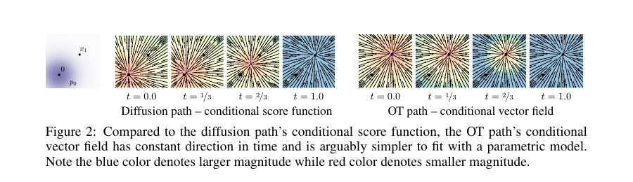

这张图固定了右上角的数据点 $\mathbf x_1$，展示四个时刻的监督场。左侧是 diffusion path 的**条件 score**，右侧是 OT path 的**条件速度场**；箭头给出方向，蓝色表示模长较大，红色表示较小。注意左右画的不是同一种数学对象，不能直接比较某一支箭头谁“走得更快”，这里主要看它们随时间和空间变化的复杂程度。

右侧在各个时刻的箭头基本保持同一方向，只是不同位置的长度按一个简单规律变化，对应粒子沿直线前往 $\mathbf x_1$ 附近。左侧的 diffusion 条件 score 会随着噪声尺度改变，方向和大小的变化更加复杂。监督目标越规整，神经网络通常越容易拟合；生成轨迹越少绕路，ODE 求解器也更有机会用较少步数走完。

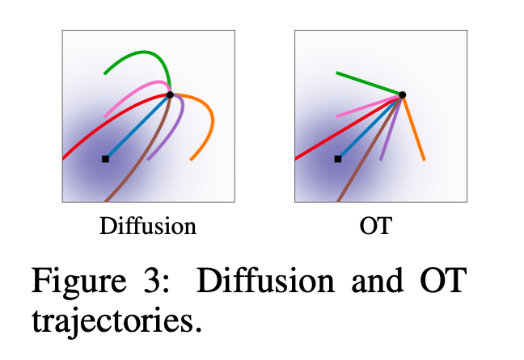
这张图也展现了 Diffusion 和 OT 的不同路径，后者是很明显的直线。
> **Tips 条件路径是 OT，不代表边缘流一定是全局 OT**
>
> 每个固定 $\mathbf x_1$ 的两个条件高斯之间走的是最优传输；把不同 $\mathbf x_1$ 的条件路径混合，再对相交处的速度做后验平均以后，边缘速度会发生改变。论文没有声称最终边缘流必然是 $p_\text{noise}$ 到 $p_\text{data}$ 的全局最优传输解。**条件路径是 OT，不等于整个生成模型求出了全局 OT。**

到这里，训练和生成可以完整回顾为：选择条件路径并写出条件速度；随机采数据、噪声和时刻，直接构造中间点与速度目标；第一个关键结论保证条件速度的后验平均生成边缘路径，第二个关键结论保证条件 MSE 与理想的边缘速度回归具有相同梯度；生成时从高斯出发，沿网络学到的边缘速度解 ODE 到 $t=1$。

score 与 velocity 都是在每个位置输出箭头，但含义不同。score $\nabla\log p_t$ 指向密度上升最快的方向；velocity 描述概率质量为了沿指定路径演化应该怎样移动。Diffusion 先学 score 再算一种特定 velocity，Flow Matching 直接监督 velocity，并允许自由选择概率路径。这就是它比“学梯度”又向前走了一步的地方。

### 关于蒸馏和加速

DDIM 已经告诉我们，同一个模型不一定非要走满训练时的全部时间步；换一个确定性采样器、跳过一些中间点，也可以显著提速。SDE/ODE 视角又带来了大量更高阶的数值 solver。

但这类方法本质上是在问：**不重新训练模型，怎样更聪明地解同一条轨迹？** 蒸馏问的是另一个问题：**能不能让一个学生模型直接学会老师走很多步才得到的结果？** 接下来介绍的 Progressive Distillation、Consistency Models 和 DMD，分别给出了三种很有代表性的答案。

#### Progressive Distillation：老师走两步，学生学一步

*Progressive Distillation for Fast Sampling of Diffusion Models*[12](#ref-12)使用确定性的 DDIM sampler 作为老师。它的核心目标一句话就能说明白：

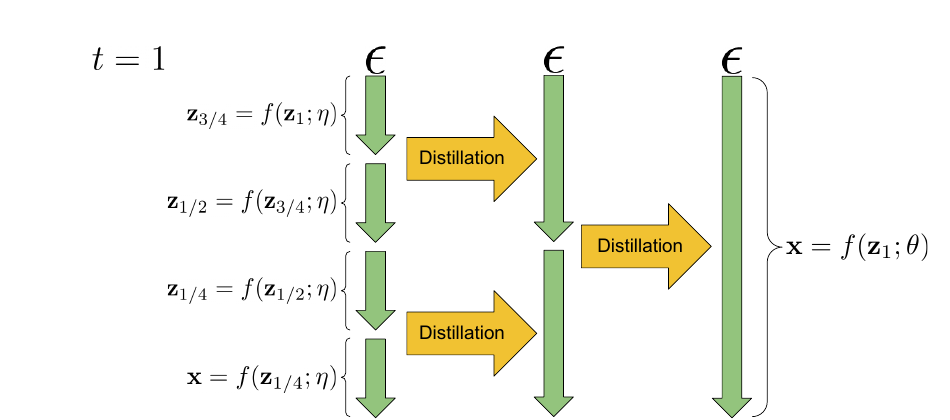

**从同一个 $\mathbf x_t$ 出发，让学生的一次 DDIM 更新，尽可能等于老师的两次 DDIM 更新。**

为了看清它怎样构造监督信号，我们换一套临时记号：

$$\mathbf x_t=a_t\mathbf x_0+b_t\boldsymbol\epsilon,\qquad
a_t=\sqrt{\bar\alpha_t},\quad b_t=\sqrt{1-\bar\alpha_t}.$$

如果模型在 $\mathbf x_t$ 处预测干净图片 $\hat{\mathbf x}_0$，确定性 DDIM 从 $t$ 跳到更干净的时刻 $s<t$ 可以写成

$$\mathbf x_s
=a_s\hat{\mathbf x}_0+\frac{b_s}{b_t}\left(\mathbf x_t-a_t\hat{\mathbf x}_0\right).$$

括号里是根据 $\hat{\mathbf x}_0$ 反解出的噪声部分，整个式子就是在新时刻 $s$ 重新组合“预测的干净图”和“沿用的噪声”。

老师先从 $t$ 走到中点 $u$，再从 $u$ 走到 $s$，得到结果 $\mathbf x_s^\text{teacher}$。学生只允许从 $t$ 一步走到 $s$。那么学生应该预测什么样的 $\hat{\mathbf x}_0$，才能让上面的单步公式恰好等于老师的终点？直接反解：

$$\tilde{\mathbf x}_0
=\frac{\mathbf x_s^\text{teacher}-\frac{b_s}{b_t}\mathbf x_t}
{a_s-\frac{b_s}{b_t}a_t}.$$

这就是学生的蒸馏目标。训练学生去预测 $\tilde{\mathbf x}_0$，等价于训练它用一步复现老师的两步。

> **Thinking 为什么不直接让学生预测真实的 $\mathbf x_0$？**
>
> 蒸馏的目标不是重新教一遍“怎样从带噪图片恢复原图”，而是压缩老师的**采样行为**。老师的两次有限步 DDIM 更新只是对 ODE 轨迹的一次数值近似，终点未必等于使用真实 $\mathbf x_0$ 代入单步公式的结果。
>
> 更关键的是，给定严重带噪的 $\mathbf x_t$，真实 $\mathbf x_0$ 并不唯一，普通回归容易得到许多可能答案的平均；老师的确定性两步输出却是固定的，能给学生一个更加尖锐、明确的监督目标。

训练出一个需要 $N/2$ 步的学生后，让它成为新老师，再训练一个只需 $N/4$ 步的学生。如此反复：

$$N\rightarrow\frac N2\rightarrow\frac N4\rightarrow\cdots\rightarrow4.$$

这就是 “Progressive” 的含义。每一轮只要求学生把两步压成一步，任务没有难到一步跨越整条轨迹；多轮之后，采样步数却可以指数级下降。

#### Consistency Models：同一条轨迹上的点，都应该回到同一个终点

Progressive Distillation 仍然围绕“一步模仿两步”展开。Consistency Models[13](#ref-13)换了一个更加整体的目标。

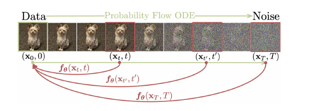

> **Recap Probability Flow ODE**
>
> 前面我们从一个前向 SDE
> $d\mathbf x=\mathbf f(\mathbf x,t)dt+g(t)d\mathbf w$
> 推出了确定性的 Probability Flow ODE：
> $$\frac{d\mathbf x_t}{dt}
> =\mathbf f(\mathbf x_t,t)-\frac12g^2(t)\nabla_{\mathbf x_t}\log p_t(\mathbf x_t).$$
> 它和 SDE 经过相同的每时刻边缘分布，但不再加入随机噪声。把真实 score 换成预训练网络 $\mathbf s_\phi$ 后，右边就是一个可以数值计算的速度场。
>
> 由于这是一条确定性 ODE，同一条轨迹上的任何位置都对应同一个数据端点：从较吵的时刻向回积分，只要沿着这条轨迹走，最后都会回到同一张干净图片。Consistency Model 正是要把这个“沿轨迹走很多步才能知道的共同终点”压进一次网络调用。

考虑从数据到噪声的 Probability Flow ODE。把预训练 score model 代入前面推导的速度

$$\mathbf v_\phi(\mathbf x,t)
=\mathbf f(\mathbf x,t)-\frac12g^2(t)\mathbf s_\phi(\mathbf x,t),$$

就得到一条由老师决定的确定性 ODE：$d\mathbf x_t/dt=\mathbf v_\phi(\mathbf x_t,t)$。$\mathbf f,g$ 来自已知的前向 SDE，$\mathbf s_\phi$ 是冻结老师估计的 score，所以右边每一项都可以计算。沿这条 ODE 从数据端向噪声端积分，同一条轨迹上的 $\mathbf x_{t_1},\mathbf x_{t_2},\dots,\mathbf x_T$ 虽然噪声程度不同，却都对应同一个数据端起点 $\mathbf x_\epsilon$。

> **Tips 干净起点的表示**
>
> 理论上我们想回到 $t=0$ 的干净数据，前面都把它记作 $\mathbf x_0$。但实践中，score 和 ODE 系数在 $t=0$ 附近容易出现数值问题，所以求解在一个很小的正数 $\epsilon$ 处停止。$\mathbf x_\epsilon$ 仍带有极少量噪声，但可以视为生成结果。
>
> 这里的 $\epsilon$ 是接近零的**时间**，不是 DDPM 里那份随机噪声 $\boldsymbol\epsilon$。

Consistency Model 学习一个函数 $f_\theta(\mathbf x_t,t)\approx\mathbf x_\epsilon,$

并要求同一条轨迹上的任意两点输出一致：

$$f_\theta(\mathbf x_t,t)=f_\theta(\mathbf x_s,s),\qquad \mathbf x_t,\mathbf x_s\text{ 在同一条 ODE 轨迹上}.$$

这就是 **self-consistency property**。同时还要满足边界条件

$$f_\theta(\mathbf x_\epsilon,\epsilon)=\mathbf x_\epsilon,$$

也就是已经到达终点时，模型不能再把图片改掉。论文把模型参数化为

$$f_\theta(\mathbf x,t)
=c_\text{skip}(t)\mathbf x+c_\text{out}(t)F_\theta(\mathbf x,t),$$

并令 $c_\text{skip}(\epsilon)=1$、$c_\text{out}(\epsilon)=0$。代入 $t=\epsilon$ 时，网络项自动消失，输出恰好等于输入，所以边界条件不必依靠训练“碰巧学会”。

在 Consistency Distillation 中，先把时间区间离散为 $\epsilon=t_1<t_2<\cdots<t_N=T$。从数据集采一张 $\mathbf x$，再按照前向扰动核采出较晚时刻的 $\mathbf x_{t_{n+1}}$。比如 NCSN 风格的加噪： $\mathbf x_{t_{n+1}}=\mathbf x+t_{n+1}\mathbf z$，其中 $\mathbf z\sim\mathcal N(\mathbf0,\mathbf I)$。

接着，让预训练 score model 和 ODE solver 从 $t_{n+1}$ 向更干净的 $t_n$ 走一个数值步。用 $\Phi(\mathbf x,t;\phi)$ 表示求解器根据冻结老师 $\phi$ 算出的速度估计，则

$$\hat{\mathbf x}_{t_n}^{\,\phi}
=\mathbf x_{t_{n+1}}
+(t_n-t_{n+1})\Phi(\mathbf x_{t_{n+1}},t_{n+1};\phi).$$

这个式子就是最普通的“新位置 $=$ 旧位置 $+$ 时间长度 $\times$ 速度”。$\Phi(\mathbf x_{t_{n+1}},t_{n+1};\phi)$ 是老师和数值求解器在当前位置算出的速度；由于 $t_n<t_{n+1}$，时间长度 $t_n-t_{n+1}$ 为负，所以更新方向是从较吵的 $t_{n+1}$ 退回较干净的 $t_n$。

帽子 $\hat{\ }$ 表示它是求解器走一个有限步得到的近似位置，上标 $\phi$ 表示这个位置由冻结的老师构造。它不是重新从干净图片独立加噪得到的另一份样本，而是从 $\mathbf x_{t_{n+1}}$ 沿老师的 ODE 走出来的，因此二者近似位于同一条轨迹上。

既然在同一条轨迹上，它们就应该对应同一个数据端点。训练目标于是写成

$$\mathcal L_\text{CD}
=\mathbb E\left[\lambda(t_n)d\left(
f_\theta(\mathbf x_{t_{n+1}},t_{n+1}),
f_{\theta^-}(\hat{\mathbf x}_{t_n}^{\,\phi},t_n)
\right)\right],$$

先看距离函数 $d$ 里的两个输出。左边把较吵的点 $(\mathbf x_{t_{n+1}},t_{n+1})$ 交给正在训练的模型；右边把老师刚构造出的较干净相邻点 $(\hat{\mathbf x}_{t_n}^{\,\phi},t_n)$ 交给目标模型。两个输入虽然噪声程度不同，却来自同一条 ODE 轨迹，所以它们都应该回答同一个终点 $\mathbf x_\epsilon$，损失 $d$ 就惩罚两个答案之间的差异。

$\lambda(t_n)>0$ 用来平衡不同时间段的损失尺度。左边的参数 $\theta$ 正常接收梯度；右边的 $\theta^-$ 停止梯度，只充当一份相对稳定的参考答案。它不会直接被这次损失拉着跑，而是通过指数滑动平均
$\theta^-\leftarrow\mu\theta^-+(1-\mu)\theta$
缓慢跟随学生。否则等号两边的网络在同一步里一起剧烈变化，模型就像一边答题一边改答案，监督信号会非常不稳定。

训练只比较相邻时刻，但许多相邻约束会首尾相接，形成
$f(\mathbf x_T,T)=f(\mathbf x_{t_{N-1}},t_{N-1})=\cdots=f(\mathbf x_\epsilon,\epsilon)=\mathbf x_\epsilon$。
最后一项被边界条件牢牢固定为真实的 $\mathbf x_\epsilon$，所以模型不能靠“无论输入什么都输出同一个任意常数”来让前面的等式成立。老师走很多步才能体现的轨迹信息，就这样被拆成大量容易学习的相邻一致性约束。

一旦学会这件事，一步生成就非常自然：从噪声 $\mathbf x_T$ 出发，直接计算

$$\hat{\mathbf x}_\epsilon=f_\theta(\mathbf x_T,T).$$

如果愿意多花一些计算，还可以把一次输出重新加到某个中间噪声等级，再调用 $f_\theta$ 精修。于是同一个 Consistency Model 既支持一步生成，也支持用更多步数换取更高质量。

> **Consistency Model 一定需要一个 Diffusion 老师吗？**
>
> 不一定。论文给出两种训练方式：Consistency Distillation 使用预训练 score model 构造相邻 ODE 点；Consistency Training 则直接从真实数据和共享噪声构造相邻噪声等级的样本，不依赖预训练老师。
>
> 因此 Consistency Model 既可以是一种蒸馏方法，也可以被看成一类独立的一步生成模型。它真正的定义不是“被哪个老师教出来”，而是同轨迹各点映射到同一终点的一致性。

#### DMD：不要求逐样本模仿，只要求学生分布像老师

Progressive Distillation 让学生复现老师走两步后的落点，Consistency Distillation 让同一条老师轨迹上的点指向同一个终点。它们都在利用老师给出的样本对应关系。DMD（Distribution Matching Distillation）[14](#ref-14) 则换了一个目标：学生不必复刻“这份噪声经过老师以后必须变成哪一张图”，只要学生生成出来的整批图片和老师生成出来的整批图片服从同一个分布即可。

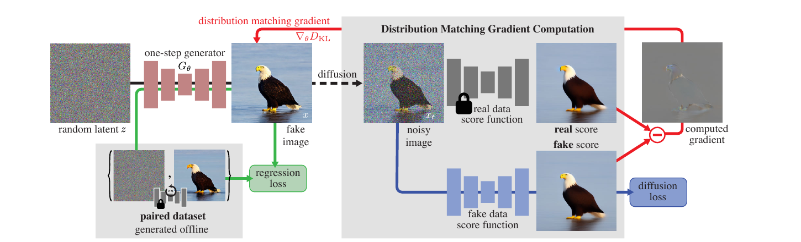

设一步学生为 $\mathbf x=G_\theta(\mathbf z)$，其中 $\mathbf z\sim\mathcal N(\mathbf0,\mathbf I)$。它只做一次神经网络前向计算，就把噪声变成图片。学生输出形成的分布记作 $p_\text{fake}$，多步老师的输出分布记作 $p_\text{real}$。这里的 real 和 fake 只是沿用了生成模型中的叫法：real 指希望学生匹配的老师分布，并不表示每张图都直接来自真实数据集。

DMD 希望缩小反向 KL 散度

$$D_\text{KL}(p_\text{fake}\|p_\text{real})
=\mathbb E_{\mathbf x\sim p_\text{fake}}
\left[\log p_\text{fake}(\mathbf x)-\log p_\text{real}(\mathbf x)\right].$$

如果这个 KL 足够小，学生就不能只生成“看起来不错”的图片，而要在整体上把概率质量放到老师会生成的区域。麻烦是，$G_\theta$ 只告诉我们怎样从噪声采样，并没有给出 $p_\text{fake}(\mathbf x)$ 的密度公式；老师分布的密度也同样难算。好在训练生成器并不需要先得到 KL 的具体数值，只需要知道：参数 $\theta$ 改一点，KL 会朝哪个方向变化。

记两个分布的 score 为 $\mathbf s_\text{fake}(\mathbf x)=\nabla_{\mathbf x}\log p_\text{fake}(\mathbf x)$ 和 $\mathbf s_\text{real}(\mathbf x)=\nabla_{\mathbf x}\log p_\text{real}(\mathbf x)$。对 $\mathbf x=G_\theta(\mathbf z)$ 使用链式法则，可以把 KL 对生成器参数的梯度写成

$$\nabla_\theta D_\text{KL}
=\mathbb E_{\mathbf z}
\left[
\left(\mathbf s_\text{fake}(\mathbf x)-\mathbf s_\text{real}(\mathbf x)\right)
\frac{\partial G_\theta(\mathbf z)}{\partial\theta}
\right].$$

> **推导 KL 的梯度为什么是两个 score 之差**
>
> 先把从 $p_\text{fake}$ 采样改写成先采 $\mathbf z$，再令 $\mathbf x=G_\theta(\mathbf z)$：
>
> $$D_\text{KL}
> =\mathbb E_{\mathbf z}\!\left[
> \log p_\text{fake}(G_\theta(\mathbf z))
> -\log p_\text{real}(G_\theta(\mathbf z))
> \right].$$
>
> 对 $\theta$ 求梯度时，$\log p_\text{fake}(G_\theta(\mathbf z))$ 有两种变化来源：一方面，分布 $p_\text{fake}$ 本身会随生成器变化；另一方面，送进对数密度的图片 $\mathbf x=G_\theta(\mathbf z)$ 也会移动。把二者分开：
>
> $$\begin{aligned}
> \nabla_\theta D_\text{KL}
> =\mathbb E_{\mathbf z}\Bigg[
> &\left.\frac{\partial}{\partial\theta}
> \log p_\text{fake}(\mathbf x)\right|_{\mathbf x\text{ 固定}}\\
> &+\left(
> \nabla_{\mathbf x}\log p_\text{fake}(\mathbf x)
> -\nabla_{\mathbf x}\log p_\text{real}(\mathbf x)
> \right)
> \frac{\partial G_\theta(\mathbf z)}{\partial\theta}
> \Bigg].
> \end{aligned}$$
>
> 第一行看起来最难处理，但它在整个学生分布上的期望恰好为零：
>
> $$\begin{aligned}
> \mathbb E_{\mathbf x\sim p_\text{fake}}
> \left[
> \left.\partial_\theta\log p_\text{fake}(\mathbf x)\right|_{\mathbf x\text{ 固定}}
> \right]
> &=\int p_\text{fake}(\mathbf x)
> \frac{\partial_\theta p_\text{fake}(\mathbf x)}
> {p_\text{fake}(\mathbf x)}d\mathbf x\\
> &=\partial_\theta\int p_\text{fake}(\mathbf x)d\mathbf x
> =\partial_\theta 1=0.
> \end{aligned}$$
>
> 剩下两项都是对数密度关于图片 $\mathbf x$ 的梯度，按照 score 的定义，分别就是 $\mathbf s_\text{fake}$ 和 $\mathbf s_\text{real}$。代回去便得到正文中的 score 差公式。这里省略了交换求导与积分所需的常规正则条件，重点是看清 score 并非额外猜出来的量，而是对 KL 求导后自然出现的。

注意，公式写的是 KL 的梯度；梯度下降真正采用的是它的反方向，所以生成图片接收到的方向是 $\mathbf s_\text{real}-\mathbf s_\text{fake}$。$\mathbf s_\text{real}$ 把学生样本拉向老师分布的高密度区域；而 $\mathbf s_\text{fake}$ 指向学生自己已经堆得很密的区域，减去它会抑制样本继续向这些区域拥挤。只使用 real score 容易把许多样本都拉向最近的一个峰，加入 fake score 才能同时表达“像老师”和“别全挤在一起”。

这一步把“需要两个概率密度”化成了“需要两个 score”，但干净图片上的 score 仍然不好获得。老师分布和学生分布都集中在高维空间里很薄的区域，两者甚至可能几乎不重叠；在学生样本所在的位置，老师密度可能接近零，$\nabla\log p_\text{real}$ 就会非常不稳定。DMD 沿用 NCSN 和 SDE 中已经见过的办法：先把两个分布都加噪抹开，再比较它们的 score。

具体来说，先由学生生成 $\mathbf x=G_\theta(\mathbf z)$，随机选一个噪声时刻 $t$，再构造 $\mathbf x_t=\alpha_t\mathbf x+\sigma_t\boldsymbol\epsilon$，其中 $\boldsymbol\epsilon\sim\mathcal N(\mathbf0,\mathbf I)$。把老师图片按同样规则加噪，得到 $p_{\text{real},t}$；把学生图片加噪，得到 $p_{\text{fake},t}$。二者在噪声的平滑作用下更容易重叠，Diffusion denoiser 也恰好能够提供这些带噪分布的 score。

> **Recap 为什么从 denoiser 的干净图预测得到带噪 score**
>
> 给定加噪前的图片 $\mathbf x$，条件分布是 $q_t(\mathbf x_t\mid\mathbf x)=\mathcal N(\mathbf x_t;\alpha_t\mathbf x,\sigma_t^2\mathbf I)$，所以条件 score 可以直接算出：
>
> $$\nabla_{\mathbf x_t}\log q_t(\mathbf x_t\mid\mathbf x)
> =-\frac{\mathbf x_t-\alpha_t\mathbf x}{\sigma_t^2}.$$
>
> denoiser 只能看到 $(\mathbf x_t,t)$，看不到真正的 $\mathbf x$。如果用 MSE 训练它预测加噪前的图片，最优输出就是 $\boldsymbol\mu^*(\mathbf x_t,t)=\mathbb E[\mathbf x\mid\mathbf x_t]$。再使用 NCSN 中已经证明过的结论——边缘 score 等于条件 score 的后验平均——便有
>
> $$\begin{aligned}
> \mathbf s(\mathbf x_t,t)
> &=\mathbb E\left[
> \left.-\frac{\mathbf x_t-\alpha_t\mathbf x}{\sigma_t^2}
> \right|\mathbf x_t
> \right]\\
> &=-\frac{\mathbf x_t-\alpha_t
> \boldsymbol\mu^*(\mathbf x_t,t)}{\sigma_t^2}.
> \end{aligned}$$
>
> 因此，一个能预测干净图片的 denoiser $\boldsymbol\mu(\mathbf x_t,t)$，就能通过 $\mathbf s(\mathbf x_t,t)\approx-[\mathbf x_t-\alpha_t\boldsymbol\mu(\mathbf x_t,t)]/\sigma_t^2$ 换算成相应带噪分布的 score。

real score 比较容易解决：老师分布固定不变，直接冻结预训练 Diffusion 老师 $\boldsymbol\mu_\text{real}$，就能得到 $\mathbf s_\text{real}(\mathbf x_t,t)$。fake score 更麻烦，因为学生参数一直变化，它产生的 $p_\text{fake}$ 也跟着变化。DMD 因此复制出另一个 denoiser $\boldsymbol\mu_\text{fake}$，不断用学生刚生成的图片训练它，使它追踪学生此时的分布，再换算出 $\mathbf s_\text{fake}(\mathbf x_t,t)$。

fake denoiser 的训练目标仍然只是普通去噪：$\mathcal L_\text{fake}=\mathbb E[\|\boldsymbol\mu_\text{fake}(\mathbf x_t,t)-\operatorname{stopgrad}(\mathbf x)\|^2]$。$\operatorname{stopgrad}(\mathbf x)$ 的数值就是学生图片，但这项损失的梯度不会穿过 $\mathbf x$ 传回生成器。否则学生可能为了让 fake denoiser 更容易答题而改变输出，而这一步真正要做的只是更新一张“学生分布地图”。

> **Thinking 为什么不能直接让一步生成器提供 fake score？**
>
> $G_\theta$ 的能力是输入一份噪声 $\mathbf z$，输出一张样本 $\mathbf x$。fake score 问的却是另一件事：给定空间中的任意带噪位置 $\mathbf x_t$，学生生成的整群图片在这里怎样分布，概率密度上升最快的方向在哪里。
>
> 生成器对参数的导数 $\partial G_\theta/\partial\theta$ 只能说明“参数变化会怎样移动这一次生成的样本”，既不是 $p_\text{fake}(\mathbf x_t)$，也不是它关于 $\mathbf x_t$ 的梯度。fake denoiser 通过反复观察许多学生样本及其带噪版本，才有机会估计整群样本形成的概率场。它只在蒸馏训练中提供梯度，生成时不会参与。

把两个带噪 score 代回 KL 梯度，并注意 $\partial\mathbf x_t/\partial\mathbf x=\alpha_t$，生成器接收到的分布匹配梯度为

$$\nabla_\theta\mathcal L_\text{DM}
\approx\mathbb E\left[
w_t\alpha_t
\left(\mathbf s_\text{fake}(\mathbf x_t,t)-\mathbf s_\text{real}(\mathbf x_t,t)\right)
\frac{\partial G_\theta(\mathbf z)}{\partial\theta}
\right].$$

这里的 $\alpha_t$ 来自加噪公式的链式法则：生成器先改变干净图片 $\mathbf x$，这份改变传到 $\mathbf x_t$ 时会被乘上 $\alpha_t$。$w_t$ 用来平衡不同噪声等级的梯度尺度。两个 denoiser 必须观察同一个 $(\mathbf x_t,t)$，这样 score 之差才是在同一位置、同一噪声程度下比较两张分布地图，而不是拿两个不同地点的方向相减。

只有 distribution matching 仍然不够稳。反向 KL 的期望只在学生已经生成的样本上计算；如果学生从来没有覆盖老师的某个模式，那个缺失区域就很难主动出现在期望里。因此，学生可能已经让生成结果很逼真，却仍然漏掉老师会生成的一部分内容。

DMD 为此预先建立一个小型配对数据集 $\mathcal D=\{(\mathbf z,\mathbf y)\}$：对每份固定噪声 $\mathbf z$，用确定性的多步老师生成对应图片 $\mathbf y$，再加入回归损失

$$\mathcal L_\text{reg}
=\mathbb E_{(\mathbf z,\mathbf y)\sim\mathcal D}
[\ell(G_\theta(\mathbf z),\mathbf y)],$$

其中 $\ell$ 使用 LPIPS 感知距离。它不要求学生逐像素复制老师，而是把同一份噪声大致锚定到老师给出的主体、布局和大尺度结构上，提醒学生不要漏掉老师分布中的重要模式。distribution matching 负责让整批图片的局部统计和真实感接近老师，regression 负责提供更稳定的样本对应和模式覆盖，二者解决的不是同一个问题。

一次训练迭代中，先由学生生成图片并加噪；冻结的 real denoiser 和在线更新的 fake denoiser 在同一个 $\mathbf x_t$ 上给出两个 score，用它们的差更新一步生成器；fake denoiser 再用学生图片上的普通去噪损失跟上学生分布；配对数据则另外提供 regression loss。训练结束以后，这些辅助组件都可以丢开，推理只需采一份 $\mathbf z$ 并调用一次 $G_\theta(\mathbf z)$。多步老师的知识最终被压进了这一次前向传播。

到这里，一言以蔽之：

- **Progressive Distillation：** 老师走两步，学生学会一步走到同一个位置；
- **Consistency Models：** 同一条 ODE 轨迹上的所有位置，都映射到同一个干净终点；
- **DMD：** 不执着于每个噪声与每张图片的一一对应，只要求学生的整体生成分布匹配老师。

## IV 小结与回顾：如何多视角理解扩散模型

在进入下一个板块以前，让我们先停一下。到这里，我们已经遇到了 DDPM、DDIM、NCSN、SDE、Flow Matching 和几种蒸馏方法。它们的公式长得并不一样，但很多时候只是在用不同语言描述同一件事：怎样从一个简单分布出发，逐渐得到复杂的数据分布。

下面不再引入新方法，而是换几个视角重新整理已经学过的内容。同一个概念如果能从公式、向量场、微分方程、分布、物理和信息六个方向都说通，才算真正变成了自己的理解。

### 数学视角

#### 1. 从公式获得直觉

先看 DDPM。把 $\alpha_t$ 理解为 **单步信号保留比例**，把 $\beta_t=1-\alpha_t$ 理解为 **单步噪声比例**，就很容易读懂单步加噪公式

$$\mathbf x_t=\sqrt{\alpha_t}\mathbf x_{t-1}
+\sqrt{1-\alpha_t}\boldsymbol\epsilon_t.$$

这里为什么都要开根号？因为 $\alpha_t$ 和 $1-\alpha_t$ 分配的是**方差**，而乘在随机变量前面的系数控制的是标准差；系数平方以后才是方差。因此两部分的方差比例相加恰好为 $\alpha_t+(1-\alpha_t)=1$。

$\bar\alpha_t=\prod_{i=1}^t\alpha_i$ 可以理解为从 $0$ 到 $t$ 的 **累计信号保留比例**，$1-\bar\alpha_t$ 则是**累计噪声比例**。于是跳步加噪公式也很自然：

$$\mathbf x_t=\sqrt{\bar\alpha_t}\mathbf x_0
+\sqrt{1-\bar\alpha_t}\boldsymbol\epsilon.$$

反向一步的公式是

$$\mathbf x_{t-1}
=\frac{1}{\sqrt{\alpha_t}}
\left(
\mathbf x_t-\frac{1-\alpha_t}{\sqrt{1-\bar\alpha_t}}
\boldsymbol\epsilon_\theta(\mathbf x_t,t)
\right)
+\sigma_t\mathbf z.$$

可以用下面的方式去理解它。$\boldsymbol\epsilon_\theta$ 是一个累积噪声，把它除以累计噪声比例再乘上单步噪声比例，就转换成为了一个单步噪声，这份噪声修正从 $\mathbf x_t$ 中扣掉，再除以 $\sqrt{\alpha_t}$ 这一单步信号保留比例，就能基本得到前一步的干净均值。

DDIM 仍然使用同一个噪声预测器，但它更喜欢先从当前 $\mathbf x_t$ 反解一份干净图预测：

$$\hat{\mathbf x}_0
=\frac{\mathbf x_t-\sqrt{1-\bar\alpha_t}\,
\boldsymbol\epsilon_\theta(\mathbf x_t,t)}
{\sqrt{\bar\alpha_t}}.$$

这个式子的理解按照上面可如法炮制，但就算没有这种辅助理解应该也不难记忆。

如果想跳步，从时刻 $t$ 跳到更早时刻 $s<t$，统一更新式可以写成

$$\mathbf x_s
=\sqrt{\bar\alpha_s}\hat{\mathbf x}_0
+\sqrt{1-\bar\alpha_s-\sigma_{t\to s}^2}\,
\boldsymbol\epsilon_\theta(\mathbf x_t,t)
+\sigma_{t\to s}\mathbf z.$$

第一项把预测的干净图按时刻 $s$ 应有的信号强度放回去；第二项加的噪声是由 $t$ 的噪声出发，配上 $s$ 应有的系数并扣除掉 $t\rightarrow s$ 的部分；第三项是这一步额外抽取的新噪声。后两项的方差系数平方相加为 $1-\bar\alpha_s$，所以新状态仍具有时刻 $s$ 应有的总噪声量。

SDE 把离散的“走一步”缩小成连续时间中的“走一个无穷小步”。它的前向形式和反向形式是

$$\begin{aligned}
\text{前向：}\quad d\mathbf x
&=\mathbf f(\mathbf x,t)dt+g(t)d\mathbf w,\\
\text{反向：}\quad d\mathbf x
&=\left[\mathbf f(\mathbf x,t)
-g^2(t)\nabla_{\mathbf x}\log p_t(\mathbf x)\right]dt
+g(t)d\bar{\mathbf w},\qquad dt<0.
\end{aligned}$$

$\mathbf f\,dt$ 是这一小段时间中确定的漂移，$g\,d\mathbf w$ 是布朗运动带来的随机扰动。$g^2(t)$ 是单位时间累计的噪声方差。反向公式中的 score $\nabla\log p_t$ 提供“哪里更像时刻 $t$ 的数据”的方向，$g^2$ 则把这份方向换算成足以抵消相应扩散强度的修正。虽然括号里写着减号，但反向生成时 $dt<0$，所以这一项实际把样本推向高密度区域。

同一个 score 还可以构造 Probability Flow ODE：

$$d\mathbf x
=\left[\mathbf f(\mathbf x,t)
-\frac12g^2(t)\nabla_{\mathbf x}\log p_t(\mathbf x)\right]dt.$$

它没有随机项，只靠确定性速度搬运概率。这里的 $\frac12$ 不是随手调出的超参数，而是来自随机扩散对概率密度造成的变化：SDE 的随机项已经承担了一半相应的概率流动，改成完全确定的 ODE 后，用上面这支速度便能保持相同的边缘分布演化。

Flow Matching 索性直接学习 ODE 速度。最简单的直线路径是

$$\mathbf x_t=(1-t)\mathbf x_0+t\mathbf x_1,
\qquad
\frac{d\mathbf x_t}{dt}=\mathbf x_1-\mathbf x_0,$$

其中 $\mathbf x_0$ 是噪声，$\mathbf x_1$ 是数据。$1-t$ 和 $t$ 是两端的插值权重：前者从 $1$ 降到 $0$，后者从 $0$ 升到 $1$，所以样本从噪声匀速走向数据。更一般的条件高斯路径可以写成 $\mathbf x_t=\boldsymbol\mu_t(\mathbf x_1)+\sigma_t\mathbf x_0$，相应条件速度为

$$\mathbf u_t(\mathbf x\mid\mathbf x_1)
=\boldsymbol\mu_t'
+\frac{\sigma_t'}{\sigma_t}
(\mathbf x-\boldsymbol\mu_t).$$

$\boldsymbol\mu_t'$ 负责移动整团分布的中心，$\sigma_t'/\sigma_t$ 则负责让样本相对中心扩张或收缩。生成方向上如果 $\sigma_t'<0$，第二项就会把散开的噪声云向中心收拢。训练时用可计算的条件速度做监督，MSE 再把许多可能的条件速度平均成模型实际使用的边缘速度。

把这些公式放在一起看，DDPM 和 DDIM 学的是噪声，NCSN 和 SDE 把它解释成 score，Probability Flow ODE 再把 score 换成速度，Flow Matching 则直接学速度。它们的网络输出不同，最后都要回答同一个问题：**样本处在这个位置和噪声程度时，下一小步应该怎样走？**

#### 2. 从向量场理解

向量场可以理解成给空间中的每个位置都插上一支箭头。箭头的方向表示应该往哪里走，长度表示应该走得多快。模型每次只需要看当前的 $\mathbf x_t$ 和 $t$，输出这里的噪声、score 或速度；采样器再把它翻译成一次位置更新。反复查询新的位置，许多局部小箭头就连成了一条完整的生成轨迹。

DDPM 表面上输出噪声，但去噪公式会把噪声预测换成从 $\mathbf x_t$ 到 $\mathbf x_{t-1}$ 的更新。SDE 的 score 给出概率密度上升方向，再和已知的 $\mathbf f,g$ 合成反向漂移。Flow Matching 最直接，网络输出本身就是速度箭头。因而“学噪声”“学 score”和“学速度”放在向量场中，本质是一回事。

下面的可视化例子把 DDPM 与 DDIM 的去噪过程放在了一起。真实图片空间太高维，无法直接画出来，所以图中把数据分布简化成平面上的八团模式。

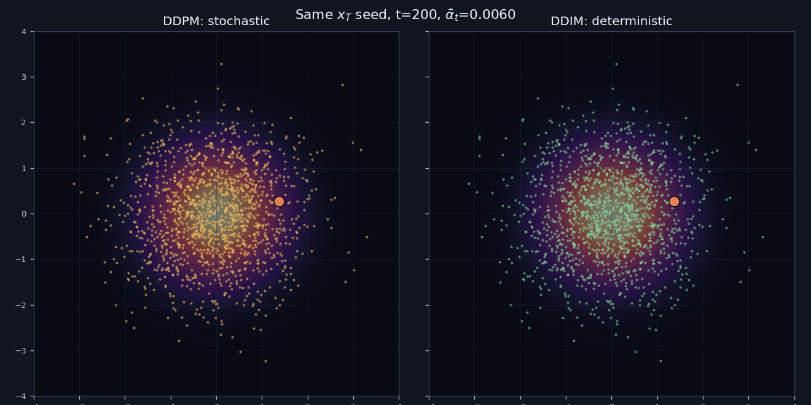

两侧彩色热力背景表示时刻 $t$ 的目标概率密度：亮的地方密度高，暗的地方密度低。大量小点表示这个时刻的一批样本；随着 $t$ 从较大的噪声时刻降到 $0$，原本挤在中央、近似高斯的一团点逐渐分裂，并落到八个数据模式上。标题中的 $\bar\alpha_t$ 是累计信号保留比例：它从接近 $0$ 增长到 $1$，说明画面从噪声端回到了数据端。

橙色大点专门追踪其中一份初始噪声，白线记录它已经走过的路径，白色箭头表示连续几步的移动方向。左右两边使用相同的 $\mathbf x_T$ 起点。左边的 DDPM 每一步除了按模型给出的方向去噪，还会重新加入随机扰动，所以路径不断抖动、转折，即使固定同一个起点，重跑一次也可能落到别的模式。右边的 DDIM 不加入新噪声，当前位置一旦确定，下一步也随之确定，所以轨迹平滑得多；固定起点、时间步和模型后，重跑会得到同一条路径和同一个终点。

这张图还提醒我们不要把“向量场”误解成“从起点直接画一根箭头指向最终图片”。早期样本几乎是噪声，模型只能给出此处最合理的局部方向；走到新位置以后，箭头也会改变。无论 DDPM 还是 DDIM，生成都是沿途不断重新询问方向，而不是在第一步就知道完整终点。

#### 3. 从 SDE / ODE 理解

从微分方程视角看，扩散模型的训练和生成可以分得很清楚。先人为规定一条数据到噪声的前向 SDE，也就是规定 $\mathbf f$ 和 $g$；由于常见线性 SDE 的任意时刻转移分布是已知高斯，训练时可以直接把干净图片一步加噪到随机时刻 $t$，让网络学习这个时刻的 score。训练并不需要真的数值模拟完整 SDE。

生成才是求解微分方程。反向 SDE 从简单先验 $p_T$ 出发，把学到的 score 填进反向漂移，再由数值求解器从 $T$ 走到 $0$；Probability Flow ODE 使用同一个 score network，只是去掉随机项并把 score 系数改成 $\frac12$。Flow Matching 也在生成时解 ODE，只是速度已经由网络直接给出，不再经过 score 换算。

SDE 和 ODE 最容易混淆的一点，是“分布相同”不等于“轨迹相同”。反向 SDE 从同一个起点出发仍会受到沿途新噪声影响，可以走出许多随机轨迹；ODE 从同一个起点出发只有一条确定轨迹。在 score 完全准确、方程也被精确求解的理想条件下，它们相同的是每个时刻整批样本形成的边缘分布 $p_t$，不是每一个样本的去噪路线。

DDPM 可以看作反向 VP SDE 的一种离散采样方式，确定性 DDIM 则可以从连续极限下的 ODE 角度理解。采样步数减少时，问题也就变成了数值求解的精度问题：每一步跨度越大，对弯曲轨迹的近似越粗；高阶求解器、重新设计时间步或蒸馏，都是在减少网络调用的同时尽量控制这种误差。

#### 4. 从分布理解

单看一张样本的轨迹，很容易误以为生成模型的任务是“把这团噪声还原成某一张早已确定的图片”。其实无条件生成中没有一张藏在噪声背后的标准答案。模型真正要做的是把容易采样的先验分布 $p_\text{noise}$ 搬成复杂的数据分布 $p_\text{data}$。

因此，中间时刻最重要的对象是概率路径 $\{p_t\}$：固定 $t$，看无数样本此刻整体怎样分布。连接相同的起点分布和终点分布可以有无数条概率路径，正如两个城市之间可以有许多条道路。DDPM 先规定一条离散 Markov 加噪路径；DDIM 保留相同的单时刻边缘分布，却换了一种联合分布和采样路径；SDE 把概率路径放进连续时间；Flow Matching 则允许我们主动选择 diffusion path 或更直的 OT 条件路径。

这里还要再区分条件路径和边缘路径。训练 Flow Matching 时，可以先为某一张具体终点图片 $\mathbf x_1$ 构造一条简单条件路径；把所有 $\mathbf x_1$ 的条件路径按照数据概率混合，才是模型必须生成的边缘路径。神经网络没有在生成时偷看到目标图片，它学到的是许多条件速度在给定当前位置后的后验平均。

DMD 又把分布视角推得更彻底：它甚至不要求学生沿着老师的轨迹走，也不要求同一份噪声严格生成老师的同一张图，而是直接让学生终点分布匹配老师终点分布。由此可见，轨迹只是实现分布搬运的一种工具，**生成模型最终接受检验的对象始终是整批样本形成的分布。**

### 物理视角

“Diffusion”这个名字来自物理中的扩散。想象把一滴墨水滴进静止的水里。大量墨水分子不断受到周围水分子的无规则碰撞，单个分子的轨迹弯弯曲曲、无法预测，这种连续随机运动可以用布朗运动描述；但从整体看，墨水会从高浓度区域逐渐散向低浓度区域，最后越来越均匀。

SDE 中的 $d\mathbf w$ 正是在数学上表示布朗运动。只保留随机项 $d\mathbf x=g(t)d\mathbf w$ 时，每个粒子都在随机抖动，整群粒子的概率密度则逐渐摊平，并满足热方程一类的扩散规律。DDPM 每一步加入独立高斯噪声，就是这件事的离散版本；VP SDE 还同时缩小原信号，使整体方差保持在合适尺度。

但物理中的墨水不会仅靠“把时间倒放”就自动聚回一滴。随机碰撞已经丢失了原来往哪里走的信息，简单地继续抽随机噪声只会让它更散。生成模型之所以能反向，是因为它额外学到了每个时刻的 score，也就是整群样本的概率密度地图。score 告诉反向过程哪些方向通往更高密度区域，相当于为每个正在乱动的粒子补上一股有组织的漂移，才有可能让高斯噪声逐渐聚成数据分布。

从热力学直觉看，前向过程不断破坏结构、提高不确定性；反向生成则从无序噪声中形成有结构的图片。不过这并不违反热力学第二定律：Diffusion 模型不是一个封闭的物理系统，反向过程使用了训练数据中学到的信息，也消耗外部计算。物理扩散提供的是非常有用的数学类比，而不是说神经网络真的让现实世界中的热扩散自然倒流。

### 信息论视角

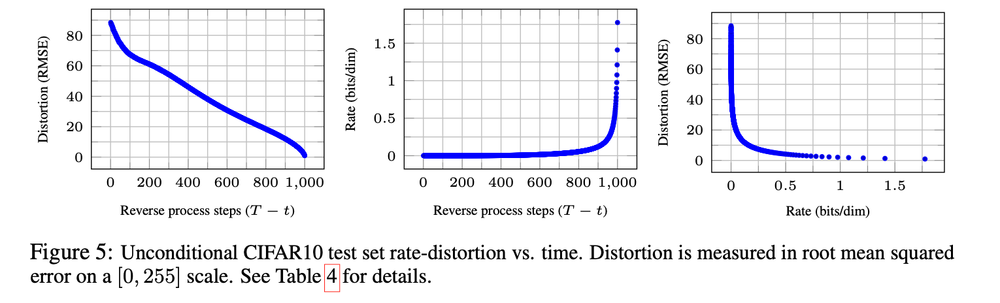

信息论关心一个经典问题：如果只能发送有限数量的信息，接收方最多能把原数据恢复到多准确？已经发送的信息量叫做 **rate**，恢复结果与原数据之间的误差叫做 **distortion**。通常 rate 越高，接收方知道得越多，distortion 就越低。

DDPM 的反向过程可以被解释成一种渐进式有损解码。发送方不是一次把 $\mathbf x_0$ 的全部信息交给接收方，而是按照 $\mathbf x_T,\mathbf x_{T-1},\ldots,\mathbf x_0$ 的顺序逐步补充信息。接收方只拿到中间状态 $\mathbf x_t$ 时，就已经可以用噪声预测器形成一份当前最合理的重建：

$$\hat{\mathbf x}_0
=\frac{\mathbf x_t-\sqrt{1-\bar\alpha_t}\,
\boldsymbol\epsilon_\theta(\mathbf x_t,t)}
{\sqrt{\bar\alpha_t}}.$$

随着更多反向信息到达，$\mathbf x_t$ 中保留的原图信息越来越多，$\hat{\mathbf x}_0$ 也越来越准确。原始 DDPM 论文[5](#ref-5)把变分下界中的中间 KL 项 $L_1+\cdots+L_T$ 解释成 rate，把最后重建数据的 $L_0$ 解释成 distortion。图里的 rate 单位是 bits/dim，表示平均每个数据维度累计接收了多少比特；distortion 使用原图与 $\hat{\mathbf x}_0$ 的 RMSE，并按 $[0,255]$ 的像素范围计量。这里的 rate 不是网络运行速度，也不是“走了多少个去噪步”。

左图画的是反向步骤增加时 distortion 怎样下降。一开始几乎没有原图信息，重建误差很大；随后模型先迅速确定大尺度结构，误差不断下降。中图画累计 rate：前面许多反向步骤增加的信息量很少，靠近数据端时 rate 才明显上升。右图把时间轴消掉，直接画 rate-distortion 曲线。它在低 rate 区域下降得非常陡，说明只用少量信息就能显著改善重建；再投入大量比特，主要是在把已经较小的误差继续压低。

这和我们观察生成过程的经验一致：去噪早期先出现类别、轮廓、姿态和大致颜色，后期才补纹理、边缘和精确像素。换句话说，决定“这是一只面朝左的狗”的少量高层信息很早就能传到，完全还原毛发、背景颗粒和肉眼难以察觉的像素差异则需要更多信息。DDPM 论文在 CIFAR-10 上发现，超过一半的无损编码长度用于描述几乎不可感知的细节，这也解释了为什么它的生成质量很好，严格的无损似然却未必占优。

> **Tips 这是一种解释，不等于 DDPM 天然就是实用压缩软件**
>
> 上面的 rate 来自变分目标和理想编码过程。原论文使用的渐进编码还依赖高维情况下并不实用的编码假设，所以它首先是一种理解 Diffusion 的理论视角。它告诉我们模型按怎样的顺序恢复信息，却不表示把普通 DDPM 直接运行一遍就能得到高效的图片压缩器。

从这个视角看，扩散生成很像逐层解压：初始噪声几乎没有指定某张图片的细节，反向过程不断注入模型从数据分布中学到的结构信息，先确定“画什么”，再决定“具体长什么样”。而条件生成又是在这条信息流中额外加入文本、类别等条件，让模型更早、更坚定地确定应该恢复哪一类语义。
## V 架构和实践

到这里，我们已经花了很大力气理解 Diffusion 在数学上究竟在做什么。但是如果只看公式，会产生一个很自然的错觉：好像只要把 $\boldsymbol\epsilon_\theta(\mathbf x_t,t)$ 写出来，剩下的事情就全解决了。

但在工程上，这个 $\boldsymbol\epsilon_\theta$ 到底怎么通过模型得到也同等重要。接下来我们来关注一下工程上的模型架构设计。

### U-Net

Diffusion 早期最常用的噪声预测器是 U-Net[15](#ref-15)。原始 U-Net 是为图像分割设计的：输入一张图片，输出一张同样具有空间结构的分割图。Diffusion 虽然把“分割类别”换成了“预测每个位置的噪声”，但二者有一个共同要求：网络不但要理解整张图里有什么，还必须为每一个空间位置给出答案。因此，U-Net 天然适合这种“输入一张图，输出另一张对齐的图”的任务。

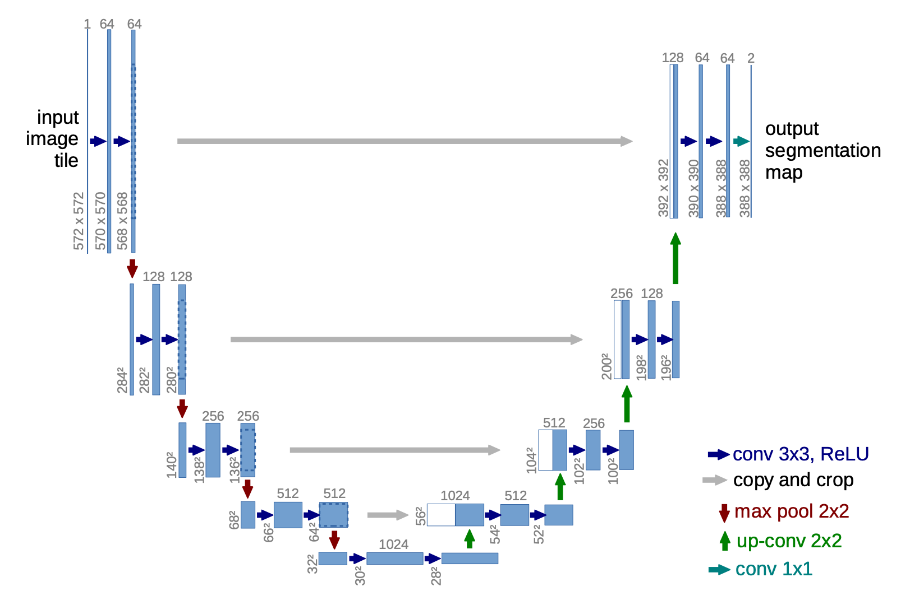

先学会读这张图。每个蓝色长方体都是一组特征图：长方体的高和宽表示空间尺寸，写在上方的数字表示通道数。原图是 $572\times572$ 的单通道灰度图，所以入口处只有 $1$ 个通道。经过第一层 $3\times3$ 卷积以后，网络用 $64$ 个卷积核提取特征，于是输出有 $64$ 个通道；每个通道可以理解为一种不同的检测结果，例如边缘、亮暗变化或某种局部纹理。

> **Recap CNN里的卷积核大小、空间尺寸和通道数**
>
> 这是基础的神经网络概念，如果不清楚，可参考我写的 [人工智能导论文档](https://aoraku.github.io/#doc/cst-notes-cst-notes-intro-ai-review-index)。

图中的蓝色箭头表示连续做两次 $3\times3$ 卷积和激活。原始 U-Net 没有在边缘补零，所以一次 $3\times3$ 卷积会让高和宽各减少 $2$：$572\rightarrow570\rightarrow568$。红色箭头是 $2\times2$ 最大池化，它把相邻四个位置合成一个位置，于是 $568\rightarrow284$，空间尺寸减半。进入下一层以后，通道数则从 $64$ 增加到 $128$。沿左半边继续下去，空间尺寸越来越小，通道数越来越多，最底部最终得到 $28\times28\times1024$ 的特征。

为什么要一边缩小图片，一边增加通道？缩小空间尺寸以后，一个底层位置能够间接看到原图中更大的范围。最上层的特征可能只知道“这里有一条斜边”，更深的特征则可以把许多边、纹理和颜色组合起来，判断“这里像一只眼睛”甚至“整片区域像一张脸”。增加通道数，则是给网络更多位置保存这些复杂概念。左半边因此叫做**下采样路径**：它逐渐牺牲精确位置，换取更大的观察范围和更强的语义理解。

图底部之后开始向右走。绿色箭头是 $2\times2$ 的上卷积，也可以理解成可学习的上采样：空间尺寸扩大一倍，通道数减少一半。随后，灰色箭头把左边同一层的特征复制过来，与右边特征沿通道维拼接。以最底下的一层为例，右边先得到 $56\times56\times512$ 的特征，左边也送来 $512$ 个通道，拼接后暂时变成 $1024$ 个通道，再经过两次卷积整理回 $512$ 个通道。

这条横着跨过 U 形结构的连接叫做 **skip connection（跳跃连接）**。只靠最底部的低分辨率特征，网络也许知道“这里应该是一张脸”，却很难恢复眼角究竟落在哪个像素。跳跃连接把尚未丢失的边缘、轮廓和位置直接送到上采样路径，让右边同时拿到两种信息：底部告诉它“画什么”，横线告诉它“具体画在哪里”。

> **Question 为什么图里的 skip connection 还要先 crop？**
>
> 原始 U-Net 的卷积不补零，左边每做一次卷积，特征图都会变小；右边上采样得到的特征因此比左边早先保存的特征更小，二者不能直接拼接。灰色箭头旁的 crop 就是把左边特征的外围裁掉，只保留大小相同的中央区域。现代 Diffusion U-Net 通常会使用 padding 保持尺寸，未必需要这一步。crop 是原始 U-Net 实现造成的尺寸处理，不是 U-Net 思想本身不可缺少的一部分。

右半边的卷积不断把拼接后的信息融合，最终得到 $388\times388\times64$ 的特征。最后一层 $1\times1$ 卷积不再观察邻居，只在每个位置把 $64$ 个特征重新组合成 $2$ 个类别分数，于是输出一张 $388\times388$ 的分割结果。这里的 $2$ 是原论文分割任务的类别数，与 Diffusion 没有直接关系。

把这套骨架搬到 Diffusion 以后，网络的输入不再只是图片，而是带噪图像 $\mathbf x_t$、当前时刻 $t$，以及可能存在的文字或类别条件。若我们训练的是最基础的 DDPM 噪声预测器，网络输出 $\boldsymbol\epsilon_\theta(\mathbf x_t,t)$，形状与 $\mathbf x_t$ 相同：输入的每个位置有几个通道，预测噪声通常也有几个通道。某些 DDPM 还同时学习反向方差，输出通道会相应增加，但那是输出参数化的区别，不会改变 U-Net 的主干逻辑。

真正的 Diffusion U-Net 也不会原封不动地照搬 2015 年的分割网络。最常见的改造有三类。第一，普通的两层卷积会被 residual block（残差块）取代：block 不必重新生成全部特征，只学习一个修正量，再把它加回原输入，因此很深的网络也更容易训练。第二，时刻 $t$ 会先变成一个 time embedding，再送进各层 block；否则同一张网络无法分清眼前是几乎纯噪声的 $\mathbf x_T$，还是只剩少量噪声的 $\mathbf x_1$。第三，在部分分辨率上加入 self-attention，让相隔很远的位置能够直接交流；做文生图时，还可以加入 cross-attention 读取文字。

一次完整前向传播因此可以概括为：$\mathbf x_t$ 从左边进入，下采样路径逐渐提取全局结构；底部在低分辨率上整合整张图的信息；上采样路径结合 skip connection 恢复空间细节；最后输出一张与 $\mathbf x_t$ 对齐的噪声图。每个去噪步骤都会重新运行这套网络，只是输入的 $\mathbf x_t$ 和时刻 $t$ 不同。

U-Net 的核心优势也就很清楚了：卷积擅长提取局部纹理，下采样负责扩大观察范围，跳跃连接负责保留位置，最后又能自然回到原来的二维网格。它并不是因为名字里有一个 U 才适合 Diffusion，而是因为去噪恰好同时需要**全局理解**和**逐位置输出**。

### LDM

DDPM 直接在像素空间里去噪。对一张 $1024\times1024$ 的 RGB 图片来说，网络每一步都要处理三百多万个颜色数值，再把这个步骤重复几十乃至上千次，计算量很快就会失控。Latent Diffusion Model（LDM）[16](#ref-16)的核心想法非常朴素：**不要在原图上反复去噪，先把图片压成一张更小的特征图，再在这张特征图上做 Diffusion。**

> **Latent 是什么？**
>
> 在最开始讲 VAE 时，我们把 latent 叫做隐变量：它不是直接可见的像素，而是网络为了描述图片学出的一组内部表示。这里的 latent 也是同一个意思，不过它不是把整张图压成一个孤零零的向量，而通常仍是一张有高、有宽、有通道的特征图。因此 latent 上的左上角仍大致对应原图左上区域，卷积和 U-Net 依然可以利用空间结构。
>
> 以常见的 Stable Diffusion 为例，$512\times512\times3$ 的图片可以被压成大约 $64\times64\times4$ 的 latent。这个例子说明的是“空间网格大幅缩小”，不是说所有 LDM 都固定使用这组尺寸。

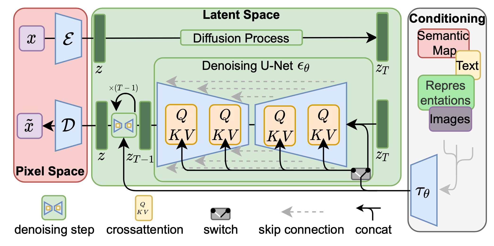

这张图需要分成两个阶段看。左上角的 $\mathcal E$ 和 $\mathcal D$ 是一套提前训练的 autoencoder。编码器 $\mathcal E$ 输入真实图片 $\mathbf x$，输出 latent $\mathbf z=\mathcal E(\mathbf x)$；解码器 $\mathcal D$ 输入 $\mathbf z$，输出重建图片 $\tilde{\mathbf x}=\mathcal D(\mathbf z)$。这一阶段的目标是让重建图片看起来尽量像原图，同时用轻度的 KL 正则或向量量化约束 latent，避免表示空间变得毫无规律。

这里的压缩不是普通 JPEG 那种手工规则，而是网络自己学习“哪些信息值得保存”。像素中有大量人眼几乎察觉不到的高频变化，若让 Diffusion 每一步都精确处理它们会非常浪费。autoencoder 负责先去掉一部分这类冗余，同时尽量保留物体轮廓、布局、颜色和纹理等影响观感的信息。LDM 把这一步称作感知压缩：压缩后不要求每个像素无损复原，但要求人看起来仍然像同一张图。

autoencoder 训练好以后会被冻结，真正的生成模型才开始训练。对一张训练图片，先用 $\mathcal E$ 得到干净 latent $\mathbf z_0$，再像 DDPM 一样采样时刻 $t$ 和噪声，把它变成 $\mathbf z_t$。图中央的 U-Net 输入 $\mathbf z_t$、$t$ 和条件，输出 latent 空间里的噪声预测。除了把 $\mathbf x_t$ 换成了 $\mathbf z_t$，训练目标与前面讲过的 DDPM 没有本质区别。

生成时则从一张随机 latent 噪声 $\mathbf z_T$ 出发。U-Net 在绿色的 latent space 中反复去噪，得到 $\mathbf z_{T-1},\ldots,\mathbf z_0$；直到全部采样结束，才调用一次解码器 $\mathcal D$，把最终 $\mathbf z_0$ 还原成像素图片。假如编码器让高和宽都缩小 $f$ 倍，latent 的空间位置数就缩小到原来的 $1/f^2$。这份节约会作用于每一次昂贵的去噪网络调用，而解码器只在最后运行一次。

图右边是条件进入 U-Net 的方式。类别、文字、语义分割图甚至另一张图片，都可以先经过各自的条件编码器 $\tau_\theta$，变成网络容易使用的表示。空间条件有时可以缩放后直接与 latent 拼接；文字则通常是一串 token，适合通过 cross-attention 送入 U-Net。

> **Tips cross-attention 到底在做什么？**
>
> U-Net 某一层的每个图像位置先产生一个 query，可以理解为它在问：“我这里应该关注条件里的什么？”文字 token 产生 key 和 value：key 帮助网络判断哪个词与这个位置最相关，value 携带那个词真正要送过来的信息。于是画面中不同位置可以读取不同词，而不是把整句话粗暴压成一个向量后平均广播。
>
> 例如 prompt 是“戴红帽子的狗站在蓝色汽车旁边”，狗头附近的图像位置可以更多读取“红帽子”，汽车附近则更多读取“蓝色汽车”。query、key、value 只是实现这种按位置查找的三组向量，不是三种新的图片。

因此，LDM 不是一个单独的新去噪公式，而是一套清晰的分工：autoencoder 负责把像素空间变成更便宜、仍有空间结构的 latent space；U-Net 负责学习真实 latent 的分布；条件编码器和 cross-attention 负责告诉 U-Net 应该生成什么。它的能力不仅限于文生图。只要换掉条件表示，同一框架还可以做超分辨率、修复、语义图生成等任务。

这套设计的代价也来自第一阶段。Diffusion 只能生成 autoencoder 表示得出来的东西；若编码器已经丢掉细小文字、精确线条或极细纹理，后面的 U-Net 再强也无法从一个不存在的信息中恢复它们。因此，latent 压得越小，采样越便宜，但重建上限也越低。LDM 真正寻找的是计算量与感知质量之间的平衡点。

> **Recap LDM 和 VAE 的关系**
>
> LDM 的第一阶段继承了 VAE 的“编码到 latent、再从 latent 解码”的思路，也常被工程代码直接称为 VAE。但生成时并不是从 VAE 预设的简单先验里随便采一个 $\mathbf z$ 就结束了。autoencoder 在这里主要充当压缩器和解压器，Diffusion 才负责学习“真实图片的 latent 究竟怎样分布”。一句话说：**VAE 决定在哪个空间生成，Diffusion 决定在这个空间里生成什么。**

### unCLIP / DALL·E 2

LDM 先把图片压到便宜的空间里，而 DALL·E 2 使用的 unCLIP[17](#ref-17)还做了另一层拆分：先决定图片在语义上应该是什么，再把这份语义决定画成具体像素。为了做到这一点，它借用了 CLIP 的图文共同表示空间。

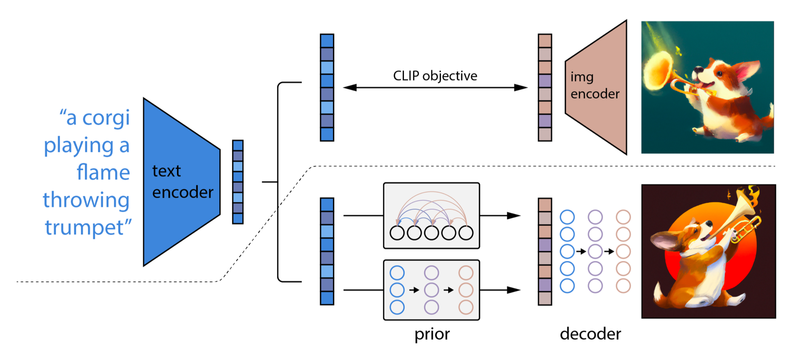

先看虚线上方，这一部分画的是 CLIP 怎样训练。CLIP 有两个编码器：text encoder 输入文字，输出文字 embedding $\mathbf z_t$；image encoder 输入图片，输出图片 embedding $\mathbf z_i$。训练会让配对图文的两个 embedding 靠近，让不配对的图文远离。训练结束后，“一只戴墨镜的柯基”和相应图片会落在语义空间中相近的位置。

unCLIP 训练 prior 和 decoder 时，图中的 CLIP 会被冻结。它不再跟着生成模型一起改变，只负责稳定地把训练文字和训练图片转换成 $\mathbf z_t$ 与 $\mathbf z_i$。虚线下方才是生成链路，由 prior 和 decoder 两块组成。

第一块是 **prior**。它输入 prompt 的文字表示，输出一个可能的 CLIP 图片 embedding。换句话说，它学习的是“给定这句话，合理图片的语义表示可能落在哪里”。论文比较了自回归 prior 和 diffusion prior；DALL·E 2 最终采用的 diffusion prior，会先从图片 embedding 空间中的噪声出发，再在文字条件下把噪声逐步去成 $\mathbf z_i$。这里扩散的是一个语义 embedding，而不是一张像素图片。

为什么不能跳过 prior，直接把 $\mathbf z_t$ 当作 $\mathbf z_i$？因为两个编码器虽然把图文放在共同空间里，输出分布仍不相同；更重要的是，一句话对应的合理图片并不唯一。prior 不是多走一道无用步骤，而是在显式学习这份一对多的不确定性。每次采样得到不同的 $\mathbf z_i$，可以先决定不同的构图、风格或视觉细节方向。

第二块是 **diffusion decoder**。它输入带噪图片 $\mathbf x_t$、扩散时刻 $t$、prior 产生的图片 embedding $\mathbf z_i$，并且还可以读取文字条件，输出当前图片里的噪声预测。这个 decoder 以 $64\times64$ 为基础分辨率：它的任务不是继续猜“prompt 大概是什么意思”，而是把已经选定的 CLIP 图片语义变成一张具体的低分辨率图片。

这里所说的“把 CLIP image encoder 倒过来”只是直觉。image encoder 把许多视觉细节压进一个语义 embedding，同一个 embedding 附近可以对应许多不同图片，因此不存在一个确定的数学逆函数。diffusion decoder 学到的是条件分布：给定同一个 $\mathbf z_i$，从不同初始噪声出发仍可以画出多张语义和风格相近、细节不同的图片。这也是 unCLIP 这个名字中 “un” 的真正含义。

最后还有两级 diffusion 超分辨率模型，分别把 $64\times64$ 放大到 $256\times256$，再放大到 $1024\times1024$。每一级输入一张低分辨率条件图和一张当前分辨率的带噪图，输出高分辨率噪声预测；反复去噪后得到更清晰的图片。DALL·E 2 的超分模型不再依赖 caption，而是专心根据低分辨率图恢复细节。训练时还会故意对低分辨率条件做轻微模糊或退化，让超分模型能够承受前一级生成图中的瑕疵。

把完整生成过程串起来，就是

$$
\text{prompt}
\longrightarrow \mathbf z_t
\longrightarrow \text{prior 采样 }\mathbf z_i
\longrightarrow 64^2\text{ 图片}
\longrightarrow 256^2
\longrightarrow 1024^2.
$$

这套显式语义中间层还带来了文生图之外的能力。若输入一张已有图片，可以直接用冻结的 CLIP image encoder 得到 $\mathbf z_i$，跳过 prior，再让 decoder 从不同噪声出发，就会得到保留主体语义和风格、但改变非关键细节的 image variations。对两个图片 embedding 做插值再解码，则会得到两张图之间平滑过渡的结果。之所以这些操作自然，是因为“图片是什么”已经被单独放进了一个可操作的 CLIP 空间。

### Imagen

Imagen[18](#ref-18)也使用级联 Diffusion，但它没有“文字 embedding $\rightarrow$ 图片 embedding”的 prior。它选择让一个很强的语言模型直接理解 prompt，再让三套图像 Diffusion 从低分辨率到高分辨率逐级完成绘制。

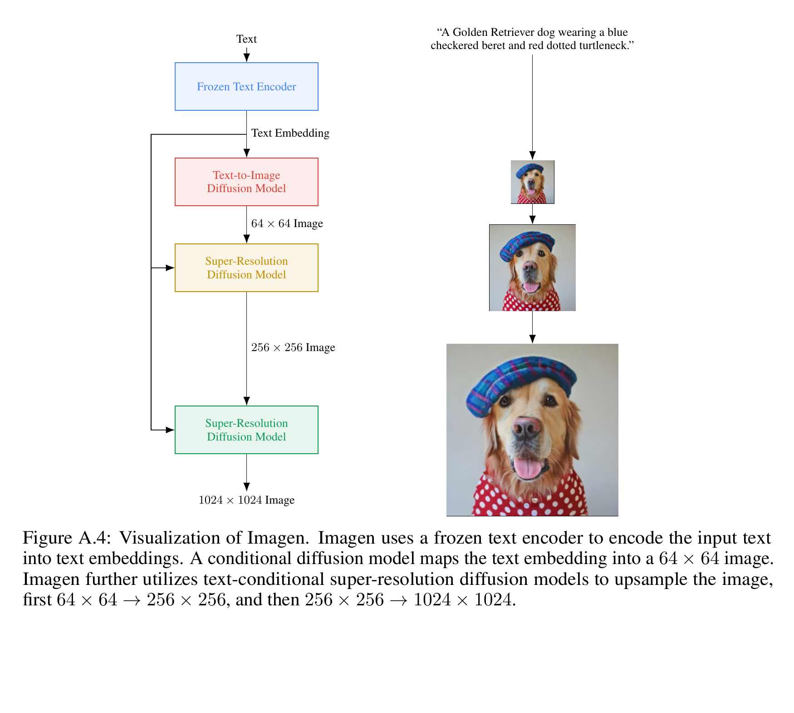

最上方是冻结的 T5-XXL text encoder。它输入经过分词的 prompt，输出一串上下文化的文字 token；“上下文化”表示同一个词会根据前后文得到不同表示。例如 “orange” 在“an orange on a plate”和“an orange car”中不应该被理解成同一件东西。T5 原本只在大规模纯文本上训练，却已经学会了语法、指代、数量和词语组合关系。Imagen 的关键判断是：文生图首先必须把句子读懂，而这种语言能力不一定非要从较小的图文配对数据中重新学习。

第一套 base diffusion model 输入一张 $64\times64$ 的带噪图、时刻 $t$ 和 T5 的文字序列，输出同样为 $64\times64$ 的噪声预测。它的主干仍是 U-Net：pooled text embedding 会和 time embedding 合并，作为全局条件注入各层；完整的文字 token 序列则通过多层 cross-attention 被不同图像位置读取。采样结束后得到一张 $64\times64$ 图片。它不够清晰，却已经决定了主体、数量、相对位置、大致颜色和整体构图。

第二套模型负责 $64\rightarrow256$。训练时，它输入一张真实高分辨率图加噪后的 $256\times256$ 状态，同时把对应的 $64\times64$ 低分辨率图和文字作为条件，输出 $256\times256$ 的噪声预测。生成时，低分辨率条件换成第一级的输出，模型从 $256\times256$ 噪声中逐步恢复出更清楚的图。

第三套模型用相同的逻辑完成 $256\rightarrow1024$：概念上，它输入当前高分辨率的带噪状态、上一层的 $256\times256$ 图片、时刻与文字，输出高分辨率噪声预测。为了节省训练计算，论文并没有每次都在完整 $1024\times1024$ 网格上训练，而是从目标图中裁出 $256\times256$ 区域，并配上对应的 $64\times64$ 低分辨率区域；推理时再利用卷积网络可以处理任意空间尺寸的特点，把同一模型应用到完整的 $256\rightarrow1024$ 放大。最终，三套模型依次运行，才得到一张 $1024\times1024$ 图片。三套 U-Net 分别训练，各自只解决自己分辨率上的问题。

> **Question 超分模型为什么还要读 prompt？看低分辨率图片不够吗？**
>
> 低分辨率图已经决定了大结构，却可能根本装不下小字、细纹理或很小的物体。若超分模型只会机械放大，它只能猜测这些缺失内容。继续提供 prompt，相当于在补细节时再提醒它：“这里不是随便一块红色，而是红色领结”“牌子上还应该有一行字”。因此 Imagen 的两级超分模型都是 text-conditional，而不是普通插值算法。

超分模型还面对一个训练与推理的不一致。训练时可以用真实图片缩小后得到很干净的低分辨率条件；推理时拿到的却是前一级模型生成的图片，里面可能有模糊、错边或小伪影。Imagen 会在训练中随机给低分辨率条件加入一定程度的高斯噪声，并把噪声强度也告诉网络。这叫做 **noise conditioning augmentation**：让模型提前见过“不太完美的上一级输出”，学会一边放大，一边修正其中的小错误。

后两级使用的 Efficient U-Net 也不是简单把普通 U-Net 做大。它把更多 residual block 放在低分辨率层，因为那里空间位置少，增加通道和深度更省计算；同时调整下采样、上采样与卷积的先后顺序，让高分辨率阶段少做昂贵操作。核心原则仍然是 U-Net 的多尺度与跳跃连接，只是把参数预算更多放到便宜而语义集中的低分辨率区域。

Imagen 的另一个工程设计是 dynamic thresholding。CFG 很强时，模型预测的干净图可能超出训练图片的正常数值范围，反复迭代后就会产生过曝和颜色饱和。dynamic thresholding 会在每一步根据当前样本的像素绝对值分位数选一个阈值，先把极端值裁住，再整体缩放回正常范围。它不是新的生成模型，而是一道防止强引导把采样数值推坏的保护措施。

unCLIP 与 Imagen 都把难题拆成多级，但拆法不同。unCLIP 先在 CLIP 空间采出一个图片语义 embedding，再把它解码成图；Imagen 不预测图片 embedding，而让 T5 的文字序列直接条件化所有图像模型。前者得到一个便于做图片 variation 和语义插值的中间空间，后者的系统更直接，并把很大一部分能力押在语言理解与级联绘制上。

> **Thinking 为什么高分辨率总是多级生成？为什么不一级做出来？**
>
> 虽然高分辨率不是只能分级生成，但一级模型必须同时解决两种尺度完全不同的问题：先决定“画面里有什么、各自放在哪里”，再决定“毛发怎样排列、边缘是否锐利、文字每一笔怎么写”。如果直接在 $1024\times1024$ 上从纯噪声开始，U-Net 从第一步起就要保存和处理一百多万个像素，计算与显存都会急剧增加；与此同时，大量算力会被花在高频细节上，反而让更重要的整体构图变难学习。
>
> 多级生成先用低分辨率模型确定语义和布局，再让超分模型在已有结构上补细节，相当于把一道同时考“构图”和“精修”的难题拆成两道目标更单纯的题。后一级仍然读取 prompt，是因为低分辨率图并没有保存所有语义细节。代价则是系统里要训练和运行多个模型，而且前一级画错的大结构通常很难被后一级彻底纠正。LDM 提供了另一条路线：不在像素空间分级，而是先用 autoencoder 把高分辨率图片压到较小的 latent，再由一个生成模型完成主要工作。因此，“级联”是高分辨率生成中很有效的工程选择，并不是理论上唯一的答案。
## VI Transformer + Diffusion

之前的架构如 U-Net 主要还在用卷积等结构。但随着数据和算力增大，人们自然会问：既然 Transformer 已经在语言和视觉任务中展示了强大的能力，能不能干脆把 Diffusion 的主干也换成 Transformer？

答案就是 DiT。再往后，MMDiT 又进一步改变了图文条件的融合方式；Stable Diffusion 3 则实现了更好的融合形成了优秀的工程系统。如今，DiT 和 MMDiT 已经成为生成模型的主流，取代了 U-Net 的核心地位。

> **LDM 里也有 cross attentionion，为什么它不是 DiT？**
>
> 判断一个模型是不是 DiT，看的是承担主要去噪计算的 **backbone（主干网络）**，而不是里面有没有 attention。LDM 的主干仍然是 U-Net：特征沿着下采样路径缩小，再沿上采样路径放大，中间依靠卷积、residual block 和 skip connection 处理图像。cross-attention 只是插在部分 U-Net block 里的条件读取模块，负责把文字送进来。
>
> DiT 则把带噪 latent 切成 token，主要计算从头到尾由一串 Transformer block 完成，不再依赖 U 形的多尺度卷积主干。self-attention、MLP、LayerNorm 和 residual connection 才是网络反复堆叠的主体。因此，**cross-attention 说明模型怎样读取条件，DiT 说明模型用什么主干处理带噪图像**；这是两条不同的分类标准。

### DiT

Diffusion Transformer（DiT）[19](#ref-19)没有改掉 DDPM 的加噪过程和训练目标。它替换的是里面那张噪声预测网络：同一个 $\boldsymbol\epsilon_\theta(\mathbf x_t,t)$，过去由 U-Net 计算，DiT 改用 Transformer 计算。

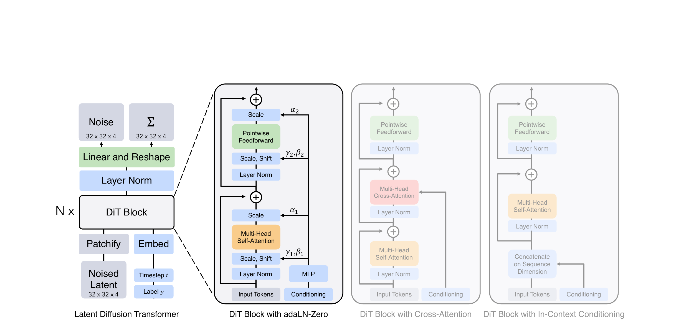

先看整幅图最左边的完整架构。图的入口已经是 $32\times32\times4$ 的 noised latent，所以没有重复画前面的 VAE：一张 $256\times256\times3$ 图片先经过冻结的 VAE encoder，变成 $32\times32\times4$ 的 latent，再加噪得到图中的输入。VAE 负责压缩，DiT 只负责 latent 空间里的去噪，所以“latent diffusion”和“Transformer backbone”并不冲突。

Transformer 不能直接把一张三维特征图当作序列，于是入口处先做 **patchify**。假设 patch 大小是 $p\times p$，网络就把 latent 网格切成许多互不重叠的小方块；每个小方块展平成一串数，再通过线性层投影成一个 $d$ 维 token。若 latent 是 $32\times32\times4$ 且 $p=2$，每个 patch 含有 $2\times2\times4=16$ 个数，一共会得到 $(32/2)^2=256$ 个图像 token。

切成 token 后，网络还要加入位置编码。原因与普通 Transformer 一样：self-attention 本身只看到一堆向量，不知道哪个 token 来自左上角、哪个来自右下角。位置编码把原来的二维位置告诉网络，让它能够区分空间关系。

> **Tips 这张图里怎么没看到位置编码？**
>
> 因为这张图重点比较的是主干和条件注入方式，位置编码被省略了。实际进入第一个 DiT block 前，patch embedding 会与固定的二维正余弦位置编码相加。它不需要在每个 block 里重复画：位置已经写进 token，随后会沿 residual connection 一直向后传递。这里的“固定”是说这些位置向量不参与训练，不是说所有位置都得到同一个向量；左上、右下等不同 patch 仍然对应不同编码。

与此同时，扩散时刻 $t$ 和类别标签 $y$ 分别经过 embedding。它们究竟怎样进入 block，正是图右边要比较的三种方案；最终采用的 adaLN-Zero 会把二者合成全局条件。图像 token 连续经过 $N$ 个 DiT block。每个 block 的主体与普通 Transformer 很接近：LayerNorm 先整理每个 token 的数值，self-attention 让所有图像 patch 互相交换信息，MLP 再独立处理每个 token，两个子层外都有 residual connection。U-Net 通过反复缩放特征图来获得全局视野；DiT 的 self-attention 则让任意两个 patch 在一层里就能直接建立联系。

最后，网络要把 token 重新变回一张 latent。每个 token 经过 LayerNorm 和线性层，输出 $p\times p\times2C$ 个数，其中 $C=4$ 是输入 latent 的通道数。前 $C$ 个通道用于预测噪声，后 $C$ 个通道用于学习反向过程的对角协方差。再把所有小块按照原位置拼回去，就得到图左上方两张 $32\times32\times4$ 输出。若采用只预测噪声的简化实现，最后也可以只输出 $p\times p\times C$；这里的 $2C$ 来自原论文同时预测噪声与方差的设置。

整幅图右边比较了三种把 $t$ 和 $y$ 送进 Transformer block 的方法。从左到右依次是 adaLN-Zero、cross-attention 和 in-context conditioning。论文实验中第一种最好。要理解这个结果，先注意这里的条件只有两个**全局向量**：当前是第几个噪声时刻、图片属于哪个类别。它们不像一整段 prompt 那样，需要不同图像位置查找不同单词。

最右边的 in-context conditioning 最接近原始 Transformer 的做法：把 $t$ 和 $y$ 当作两个额外 token，拼到图像 token 序列中，所有 token 一起做 self-attention。它的优点是完全不用修改标准 block；问题是条件只占长序列中的两个位置。每个图像 token 必须先学会主动关注这两个 token，条件影响才能传开。可时刻 $t$ 明明应该无条件地影响每一层、每一个位置，这种“把提示牌放进人群，等所有人自己去看”的传递方式不够直接。

中间的 cross-attention 会在 self-attention 后增加一整层跨注意力：图像 token 作为 query，$t$ 和 $y$ 作为 key、value。它确实比最右边更明确地让每个图像 token 读取条件，但为了两个全局向量专门增加一次 attention、一次输出投影和一条残差分支，计算与参数都更高；原论文估计额外计算约为 $15\%$。cross-attention 最擅长的是“从一长串条件中按位置检索不同内容”，而这里没有那么多内容可检索，因此能力没有被充分利用。

第一种 adaLN-Zero 先把 $t$ 和 $y$ 的 embedding 相加，再用一个小 MLP 为每个 block 产生 LayerNorm 的缩放 $\gamma$、平移 $\beta$ 和 residual gate $\alpha$。缩放和平移会直接作用在所有图像 token 上，相当于告诉整层网络：“在当前噪声时刻和类别下，应该用什么方式解释这些特征。”它既不要求 token 自己寻找条件，也不需要额外做一遍 cross-attention，因而对这种短小、全局的条件更直接、更省计算。

> **Tips adaLN-Zero这个名字是什么意思？**
>
> adaLN 是 **adaptive LayerNorm（自适应层归一化）**。普通 LayerNorm 对所有样本使用同一套可学习缩放和平移；adaLN 则根据当前的 $t$ 和类别 $y$，临时生成这一层要用的缩放与平移。因此，同一组图像 token 在不同噪声时刻、不同类别下，会被以不同方式送入 attention 和 MLP。“adaptive”说的正是 LayerNorm 的参数会随条件改变。
>
> Zero 对应一个很重要的初始化。attention 和 MLP 两条残差分支各有一个 gate，控制该分支的输出应该加回多少；产生 gate 的最后一层会被初始化为零。训练刚开始时，每个 DiT block 因此近似恒等映射，输入可以原样通过，随后网络再逐渐学会每个分支应该贡献多少。深层 Transformer 不必一上来就承受许多随机残差的叠加，训练会更稳定。论文的对照实验表明，adaLN-Zero 在整个训练过程中都优于另外两种条件方案。

DiT 证明 U-Net 的卷积归纳偏置并非不可替代。模型越大、训练计算越多、patch 越小，DiT 的生成质量会呈现清晰的扩展趋势。统一的 Transformer 主干也更容易继承大模型训练中的成熟经验。它的代价则是 token 数一多，self-attention 会迅速变贵；因此原论文先在 VAE latent 上工作，而不是直接把高分辨率像素切成海量 token。

### MMDiT

DiT 原论文主要研究类别条件生成，$t$ 和 $y$ 都可以压成全局向量。文生图更麻烦：prompt 是一串文字 token，带噪图像也是一串图像 token，两种信息不仅长度不同，含义也完全不同。普通 LDM 的 cross-attention 让图像去读取一份固定的文字表示，信息流主要是“文字告诉图像该画什么”；文字表示本身却不会根据当前画面更新。

MMDiT（Multimodal Diffusion Transformer，多模态扩散 Transformer）[41](#ref-41)改变的正是这层关系。它为文字和图像保留两条可学习的分支，再把两边的 query、key、value 放进同一次 attention，让图像能够读取文字，文字也能够看到图像。下面这张图来自专门分析 MM-DiT 架构的论文，我们先看中间最重要的 (b)，再用另外三幅图理解它和其他结构的区别。

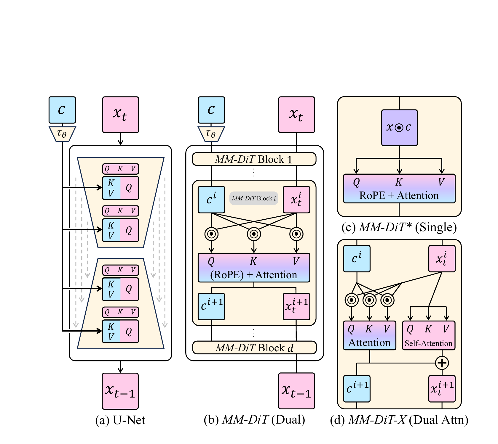

图中蓝色表示文字，粉色表示图像。最左边的 $c$ 是文本编码器产生的文字表示，$\mathbf x_t$ 是时刻 $t$ 的带噪图像表示。为了让图保持清楚，它只画了 attention 的主干，没有把 LayerNorm、条件调制、MLP 和 residual connection 全部画出来；这些模块并没有消失，只是此图专门回答“图像与文字怎样进入 attention”这个问题。

先看 (a) 中的 U-Net。粉色图像特征在 U 形主干里流动，self-attention 负责图像位置之间的交流；蓝色文字则在若干 cross-attention 层提供 key 和 value，让图像 query 去读取。两种 attention 是先后分开的，而且文字主要充当被查询的条件。图中的文字线一直保持在网络外侧，也正是在强调：U-Net 每一层更新的是图像特征，不会把 cross-attention 输出再变成一套新的文字 token 送往下一层。

中间的 (b) 才是标准的双流 MM-DiT。进入第 $i$ 个 block 时，左边有文字序列 $\mathbf c^i$，右边有图像序列 $\mathbf x_t^i$；上标 $i$ 表示第几个 Transformer block，下标 $t$ 才表示扩散时刻。这个 block 输出更新后的 $\mathbf c^{i+1}$ 与 $\mathbf x_t^{i+1}$，二者继续一起进入下一个 block。一直经过 $d$ 个 block 后，模型只用最终图像分支产生 $\mathbf x_{t-1}$ 或速度预测，文字分支则在中间负责持续参与计算。

> **Tips $\odot$ 是什么意思**
>
> 在这张架构图里，$\odot$ 表示沿 token 维把两组序列**拼接**起来，不是逐元素相乘。比如图像有 $N_\text{img}$ 个 query，文字有 $N_\text{txt}$ 个 query，经过这个符号后就得到 $N_\text{img}+N_\text{txt}$ 个 query。需要特别小心：$\odot$ 在许多数学文章里确实常表示逐元素乘法，但在这里并不是哦。

文字 token 与图像 token 的数量可以不同，但进入 attention 前必须具有相同的隐藏维度。假设图像共有 $N_\text{img}$ 个 token，文字共有 $N_\text{txt}$ 个 token，每个 token 都是 $d$ 维。图像分支使用自己的线性层得到 $Q_\text{img},K_\text{img},V_\text{img}$，文字分支则用另一套参数得到 $Q_\text{txt},K_\text{txt},V_\text{txt}$。之所以分开，是因为“一个带噪图像区域”和“一个词的语义”不是同一种输入，没必要强迫它们使用完全相同的投影规则。

接下来才是 joint attention（联合注意力）的关键。两边的 Q/K/V 分别沿 token 维拼接：

$$
Q=[Q_\text{img};Q_\text{txt}],\qquad
K=[K_\text{img};K_\text{txt}],\qquad
V=[V_\text{img};V_\text{txt}].
$$

拼接后，$Q,K,V$ 都有 $N_\text{img}+N_\text{txt}$ 个 token。模型不再做“一次图像 self-attention，再做一次文字 cross-attention”，而是直接对这个联合序列做一次标准 attention。因为 query 和 key 都由图像、文字两部分组成，attention 权重矩阵自然可以切成四块：

$$
\operatorname{softmax}\!\left(\frac{QK^\top}{\sqrt d}\right)
=
\begin{bmatrix}
A_\text{I2I} & A_\text{T2I}\\
A_\text{I2T} & A_\text{T2T}
\end{bmatrix}.
$$

矩阵的上半行来自图像 query，下半行来自文字 query；左半列是图像 key，右半列是文字 key。因此四块分别表示：

- $A_\text{I2I}$：图像 query 查看图像 key，相当于图像内部的 self-attention，主要协调空间结构；
- $A_\text{T2I}$：图像 query 查看文字 key，把文字信息送到图像，也就是传统 cross-attention 最熟悉的方向；
- $A_\text{I2T}$：文字 query 查看图像 key，让文字状态读取当前画面，这是传统 U-Net 中通常没有的反向信息流；
- $A_\text{T2T}$：文字 query 查看文字 key，让文字 token 在生成主干内部继续互相整理语义。

这四块并不是四次互不相干的 attention。softmax 是对联合矩阵的每一整行计算的。对于某个图像 query 来说，所有图像 key 和所有文字 key 会放在同一行里竞争注意力；它既可以把大部分权重放在其他图像位置，也可以把权重交给某几个文字 token。也正因为在同一个 softmax 中竞争，joint attention 不等于把 self-attention 和 cross-attention 的结果随便相加。

乘上联合的 $V$ 后，输出也会自然分成图像与文字两部分：

$$
\begin{aligned}
H_\text{img}
&=A_\text{I2I}V_\text{img}+A_\text{T2I}V_\text{txt},\\
H_\text{txt}
&=A_\text{I2T}V_\text{img}+A_\text{T2T}V_\text{txt}.
\end{aligned}
$$

第一行说，更新后的图像信息同时来自其他图像 token 和文字 token；第二行说，更新后的文字信息也同时来自图像和文字。随后，$H_\text{img}$ 与 $H_\text{txt}$ 按原来的 token 数拆开，分别经过图像分支和文字分支自己的输出投影、residual connection 与 MLP，得到下一层的 $\mathbf x_t^{i+1}$ 和 $\mathbf c^{i+1}$。到这里，一个双流 MMDiT block 的输入和输出才真正闭环。

> **Tips RoPE是什么？**
>
> RoPE 是 **Rotary Position Embedding（旋转位置编码）**。先回忆位置编码为什么存在：self-attention 如果只拿到一组 token，本身并不知道谁在左边、谁在右边。即使把两块图像 patch 对调，只要 token 内容一起对调，attention 的计算规则也不会察觉空间顺序。因此，模型必须在计算注意力时得到位置信息。
>
> 普通绝对位置编码会给每个 token 直接加上一条“我是第几个位置”的向量。RoPE 的做法不同：token 仍然先通过线性层得到 Q、K、V，但在计算 $QK^\top$ 以前，把 Q 和 K 的每两个数看成平面上的一个小箭头，再按照该 token 的位置旋转一定角度。位置越不同，旋转角度也越不同。旋转只改变箭头朝向，不改变长度，所以内容信息不会因为位置很大就被无限放大。
>
> 关键在于，attention 比较的是旋转后的 Q 与 K 的点积。若一个 query 在位置 $m$，一个 key 在位置 $n$，两边都旋转以后，它们的点积主要取决于两次旋转的角度差，也就是 $m-n$。于是模型不只知道“这是第 20 个 token”，还很自然地知道“它与另一个 token 相隔多远、位于哪个相对方向”。不同的数对会使用不同旋转速度：转得快的更敏感于相邻位置，转得慢的可以描述较远距离，多种尺度合起来便能覆盖局部与全局关系。
>
> 图像是二维的，所以实际模型还要分别处理横坐标和纵坐标，让 attention 能区分“向右三格”和“向下三格”。RoPE 通常只旋转 Q 与 K，因为这两者决定“应该关注谁”；V 保存被取回的内容，不负责比较位置。它也没有额外创造一种 attention，后面的 I2I、T2I、I2T、T2T 仍是同一次联合 attention，只是 Q 和 K 在做点积前已经带上了位置信息。

图 (c) 可以帮助我们进一步分清“联合 attention”和“双流参数”。MM-DiT* 先把图像、文字 token 拼成一条序列，再用完全相同的一套 Q/K/V 和 MLP 处理所有 token，所以它是**单流**结构；Flux.1 的后半段就使用了这类 block。它同样可以做全 attention，但不再为两种模态保留独立权重，参数更省，代价是模态差异只能由 token 内容本身来区分。

图 (d) 的 MM-DiT-X 仍有文字、图像两条分支，却给图像另外加了一次显式 self-attention。joint attention 继续负责图文交流，额外的图像 self-attention 则专门加强图像内部的空间关系。SD3.5-M 的前若干层采用了这种设计。图里出现的 RoPE 是旋转位置编码：它在计算点积前把位置信息写入 Q 和 K，不会改变上面“四块 attention”的逻辑；不同 MM-DiT 模型也可能采用其他位置编码。

这篇分析论文还给四块矩阵提供了很直观的经验解释：I2I 中能看到明显的空间与几何结构，作用很像 U-Net 的 self-attention；T2I 更容易形成“某个文字 token 对应哪些图像区域”的关系，作用很像 cross-attention。I2T 则让文字表示反过来感知当前画面，T2T 维持文字内部关系。它们不是四个额外训练目标，而是同一次 full attention 从不同输入、输出方向切出来的四个区域。

MMDiT 的能力和代价都来自这里。双向更新让复杂 prompt 不再只是网络外部的一份静态说明书，而能在每一层根据当前画面重新组织；对象属性、空间关系和图片文字因此有更多机会被逐层校正。但 attention 的序列长度变成 $N_\text{img}+N_\text{txt}$，矩阵大小随其平方增长。高分辨率会带来大量图像 token，再加上数百个文字 token，joint attention 的显存和计算自然比短条件下的 DiT 更昂贵。

### Stable Diffusion 3

Stable Diffusion 3（SD3）[20](#ref-20)把前面的几条路线接成了一套完整系统：autoencoder 决定在哪个 latent space 中生成，三个冻结文本编码器负责理解 prompt，MMDiT 负责在每个时刻计算速度，Rectified Flow / Flow Matching 则规定训练样本和生成轨迹怎样构造。

在深入看图以前，先把 SD3 的一次网络调用说清楚。它有三类真正的输入：当前的带噪 latent $\mathbf x_t$、保留每个词细节的文字序列 $\mathbf c$、融合 timestep 与整句语义的全局向量 $\mathbf y$。经过许多层 MMDiT 后，网络只输出一张与 $\mathbf x_t$ 同形状的 latent 速度。文字不会被解码成句子，它只在网络内部帮助图像分支计算这支速度。

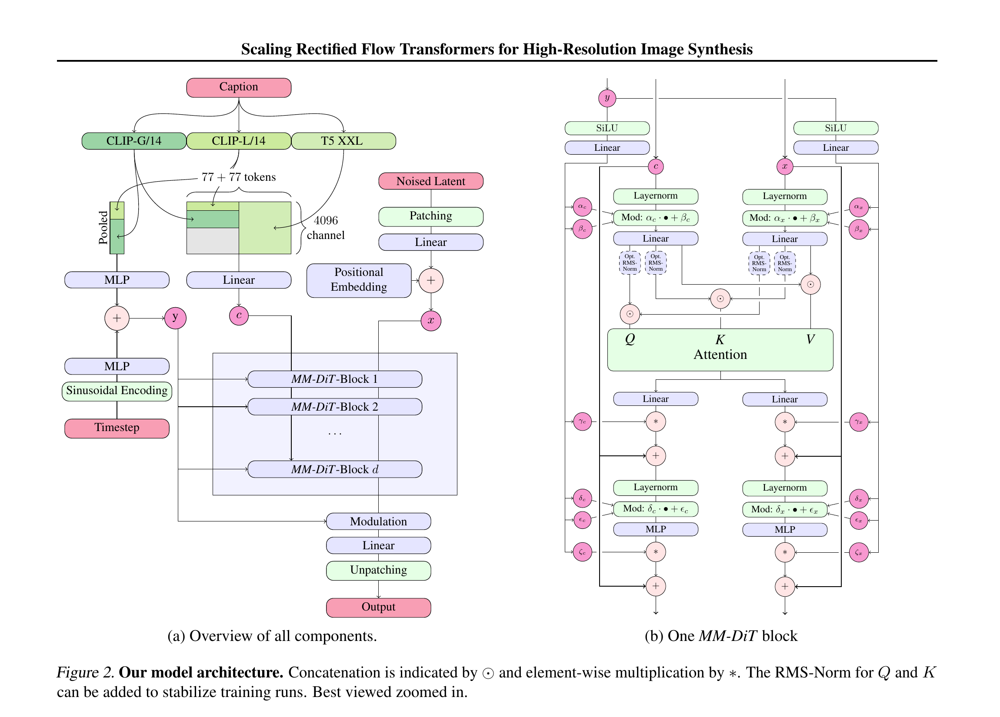

这张图左半边是整个系统，右半边把一个 MMDiT block 放大。我们先沿左图把三路输入构造出来，再进入右图逐根看它们怎样流动。

**第一路是全局条件 $\mathbf y$。** 同一个 caption 会分别输入 CLIP-L/14、OpenCLIP bigG/14 和 T5-XXL。三个文本编码器在 SD3 训练时都被冻结，它们只负责提供稳定的文字特征。两套 CLIP 各自输出一个 pooled embedding，也就是把整句话压成一个向量：CLIP-L 是 $768$ 维，CLIP-G 是 $1280$ 维，二者沿通道拼成 $2048$ 维，再经过一个 MLP。

> **Question 为什么需要两套 CLIP？他们分别擅长什么？T5XXL又是什么？这些token是怎么拼接起来的？**
>
> CLIP-L/14 与 OpenCLIP bigG/14 不是同一模型被切成两半，而是两套独立训练的图文编码器。它们都见过大量“图片—文字”配对数据，目标都是让匹配的图片与文字在特征空间中靠近，因此很擅长抓住能对应到视觉内容的词，例如物体、颜色和风格。两者的模型规模、训练数据与训练方式不同：bigG 更大，能够提供容量更高的表示；CLIP-L 则提供另一套已经验证过的视觉语义表示。与其武断地规定一套只管物体、另一套只管风格，不如把它们理解成从两个不同视角阅读同一句 prompt。SD3 把二者合起来，是为了利用互补信息。
>
> T5-XXL 来自纯文字的 T5 语言模型家族，XXL 表示这是其中非常大的版本。它不靠图片—文字对齐训练，而是专门从大规模文本中学习语言，因此更擅长保留句法、修饰关系和较复杂的描述。CLIP 回答“哪些文字容易对应到视觉概念”，T5 则补充“这句话内部究竟怎样组织”；三套编码器一起使用，比只让一套 CLIP 独自承担所有语言理解更稳。
>
> “拼接 token”还要分清两个方向。两套 CLIP 对同一句话都产生 $77$ 个位置一一对应的 token，所以先把第一个 CLIP token 与第一个 OpenCLIP token 的特征接在一起，把第二个与第二个接在一起；token 数仍是 $77$，只是每个 token 变宽到 $2048$ 维。补零到 $4096$ 维以后，它才与 T5 token 具有相同宽度。接着再把整条 CLIP 序列放在整条 T5 序列后面，token 数由 $77$ 变成 $154$。前一次是沿**通道维**拼接，后一次是沿 **token 维**拼接，不能混为一件事。

扩散时刻 $t$ 走另一条小支路。它先经过正余弦编码，把一个标量时刻展开成一组周期不同的数，再通过另一个 MLP。时间向量与 pooled text 向量相加，得到图中的 $\mathbf y$。所以 $\mathbf y$ 同时回答两个全局问题：这句话整体在说什么，当前输入又处于多强的噪声中。它不会作为一个普通 token 加入序列，而是给每个 MMDiT block 产生缩放、平移和门控参数。

**第二路是逐词条件 $\mathbf c$。** pooled embedding 很适合表达整句大意，却会压掉“哪个词修饰哪个物体”这类细节，所以 SD3 还保留文本编码器的 token-level 输出。CLIP-L 与 CLIP-G 各有 $77$ 个 token；两套 CLIP 的对应 token 先沿通道维拼接，得到 $77\times2048$ 的序列，再在通道末尾补零到 $4096$ 维。T5-XXL 另给出一条 $77\times4096$ 的序列。最后，两组序列沿 token 维首尾拼接，得到 $154\times4096$ 的 context，再经过线性层投影到 MMDiT 的隐藏维度，成为最初的 $\mathbf c^0$。

> **Question 为什么要同时保留 $\mathbf y$ 和 $\mathbf c$？**
>
> $\mathbf y$ 是把整句文字压缩后的一个全局向量，并且还融合了 timestep。它不会保留“red”是第几个词、“hat”又是第几个词，而是直接为整个 block 产生缩放、平移和 gate，适合告诉所有 token：“这句话整体要画什么，现在又应该以哪种噪声阶段的方式处理。”这条路线短而直接，保证每一层都无法忽略全局条件。
>
> $\mathbf c$ 则保留一整排逐词 token，并进入 joint attention。某块图像 patch 可以重点读取“red hat”，另一块可以读取“snowy mountain”；文字 token 还会根据当前图像状态逐层更新。它适合保存对象、属性和关系，却不如 $\mathbf y$ 那样直接控制整个 block 的工作状态。
>
> 因此二者不是把同一句话无意义地复制两遍，而是在两个不同位置承担两种职责：$\mathbf y$ 控制“这一层整体怎样算”，$\mathbf c$ 提供“每个位置具体该查哪条语义”。可以把 $\mathbf y$ 理解为总导演反复广播的全局指令，把 $\mathbf c$ 理解为每个镜头仍可逐条核对的拍摄要求。只留下 $\mathbf y$，细粒度词语关系容易在压缩时丢失；只留下 $\mathbf c$，全局条件与时间信息又必须绕过 attention 才能慢慢传到所有位置。

**第三路是图像 token $\mathbf x$。** 训练图片先由 autoencoder encoder 压进 latent space，高和宽各缩小 $8$ 倍。SD3 的大模型最终选择 $16$ 通道 latent，提高 autoencoder 能保留的细节上限。Rectified Flow 在这张数据 latent 与高斯噪声之间采出时刻 $t$ 的中间状态，得到图中的 noised latent。

noised latent 仍是一张二维特征图，必须先变成 Transformer 序列。SD3 把它切成 $2\times2$ patch，每个 patch 展平后通过线性层变成一个图像 token，再加入位置编码。以 $1024\times1024$ 图片为例，空间压缩 $8$ 倍后是 $128\times128$ latent；再按 $2\times2$ patch 切分，就得到 $64\times64=4096$ 个图像 token。patchify 改变的是排列方式和隐藏维度，不会把四个相邻 patch 混成一个最终像素；网络输出后还会通过 unpatching 恢复原来的 latent 网格。

现在三路输入都准备好了：$\mathbf y$ 是一个全局向量，$\mathbf c^0$ 是文字序列，$\mathbf x^0$ 是带噪图像序列。接下来把注意力放到右边的一个 MMDiT block。

block 顶部先分别对 $\mathbf c^i$ 和 $\mathbf x^i$ 做 LayerNorm。$\mathbf y$ 经过 SiLU 和线性层后，为文字流产生 $\alpha_c,\beta_c$，为图像流产生 $\alpha_x,\beta_x$。它们把归一化结果变成 $\alpha\odot\operatorname{LN}(\cdot)+\beta$。同一个全局条件会同时控制两条流，但文字与图像使用不同参数，因为两种表示需要的缩放和平移未必相同。

调制后的文字、图像特征分别通过自己的线性层，产生两套 Q/K/V。图中线性层旁边可选的 RMS-Norm 只归一化 Q 与 K，防止大模型中点积数值过大、softmax 过度饱和。随后，圆圈里的 $\odot$ 表示沿 token 维拼接：两边的 Q 合成联合 Q，K 与 V 也同样合并，再做上一节讲过的 full attention。这里会同时产生 I2I、T2I、I2T 和 T2T 四类关系。

attention 输出按文字、图像各自的 token 数重新拆开，分别通过两套输出线性层。$\gamma_c$ 与 $\gamma_x$ 是 attention residual gate：它们决定本层 attention 的修正量应该以多大强度加回原来的 $\mathbf c^i$ 和 $\mathbf x^i$。因此，attention 结束后两条流仍保持各自长度与隐藏维度，只是内容已经交换过一次。

接下来两条流各自再做一次 LayerNorm。$\mathbf y$ 产生的 $\delta_c,\epsilon_c$ 与 $\delta_x,\epsilon_x$ 负责第二次缩放和平移，随后进入各自的 MLP。MLP 输出又分别乘上 $\zeta_c,\zeta_x$ 两个 gate，再加回残差主线，最终得到 $\mathbf c^{i+1}$ 和 $\mathbf x^{i+1}$。右图中看起来很多的希腊字母，其实只承担两种职责：$\alpha,\beta,\delta,\epsilon$ 改变归一化后特征的尺度和中心，$\gamma,\zeta$ 控制 attention、MLP 两条残差分支应该贡献多少。

> **Recap 一个 SD3 MMDiT block 到底做了什么**
>
> 输入是本层文字 token $\mathbf c^i$、图像 token $\mathbf x^i$ 和全局条件 $\mathbf y$。第一阶段分别归一化并由 $\mathbf y$ 调制，再做一次联合 attention，让图文双向交流；第二阶段再分别归一化、调制并通过各自的 MLP。输出仍是同样两条序列 $\mathbf c^{i+1}$ 与 $\mathbf x^{i+1}$，所以很多 block 可以首尾相接。外部文本编码器虽然被冻结，MMDiT 内部的文字状态仍在每一层更新。

经过 $d$ 个 block 后，文字分支已经完成任务，不需要产生任何文字输出。最终图像 token 经过图左下角的 Modulation 与 Linear：全局条件再调制一次图像特征，线性层把每个 token 映射回一个 $2\times2$ latent patch 应有的数值，unpatching 则把所有 patch 摆回二维网格。最终输出与输入 noised latent 形状相同，但它表示的是 Rectified Flow 的速度，而不是一张直接可看的 RGB 图片。

这也把 SD3 的训练流程串了起来。训练时从数据集中取图片与 caption：图片经 autoencoder 得到数据 latent，caption 经三个文本编码器得到 $\mathbf y$ 与 $\mathbf c^0$；再采高斯噪声和时刻 $t$，一步构造中间 latent。MMDiT 输入“中间 latent、$t$、prompt”，输出同形状速度，用可直接计算的条件速度做监督。这里不需要在训练期间真的从噪声积分到图片。

SD3 还使用 logit-normal timestep sampling，让中间时刻比两端更常被抽到。它只改变训练时“哪些噪声程度的题目出现得更多”，不会改变网络的三路输入和 block 结构。模型仍在每个被抽到的 $t$ 上接收一张中间 latent，并预测对应速度。

生成时，三个文本编码器只需先运行一次，得到当前 prompt 的初始 $\mathbf y$ 与 $\mathbf c^0$。图像端从高斯 latent 噪声开始，ODE 求解器在每一步把当前 latent 和时刻送入 MMDiT；MMDiT 每次前向传播都会在内部重新生成 $\mathbf c^1,\ldots,\mathbf c^d$ 与图像状态，返回当前速度。求解器沿速度更新 latent，走到数据端以后，再调用一次 autoencoder decoder 得到 RGB 图片。

SD3 的能力并不来自某一个孤立模块。多文本编码器决定 prompt 能否被充分理解；$\mathbf y$ 与 $\mathbf c$ 两条条件路线分别保留全局和局部信息；MMDiT 让图文在每一层双向更新；$16$ 通道 latent 提高可重建细节的上限；Rectified Flow 决定网络学习怎样的速度。把整条链路连起来，才能解释它为什么比“给普通 DiT 随便接一个文本 embedding”强得多。

> **Recap 把模型架构和生成方法分开**
>
> U-Net、DiT、MMDiT 回答的是：输入带噪状态和条件以后，网络内部怎样计算，最后输出什么。DDPM、DDIM、SDE、Flow Matching 回答的是：怎样制造训练输入、监督网络学什么、生成时怎样从噪声走回数据。LDM 又回答“在哪个空间里走”。SD3 的主干是 MMDiT，训练目标是 Rectified Flow，运行空间是 autoencoder latent；三个名称描述的是同一系统的不同侧面。

## VII Edit Model

所谓编辑模型，就是输入不再只有一句 prompt，而是还有一张已经存在的图片 $\mathbf x_\text{src}$。模型要按照新的要求修改其中一部分，同时尽量保留其余内容。本质上说，编辑就是一种更加定制化的生成：我们不再允许模型从头自由发挥，而是给它一张具体的图片，要求结果既符合新条件，又仍然是“这张图改出来的”。

读者可能会觉得，生成整张图片都做到了，只调整其中一部分岂不是更简单？其实恰恰相反。普通文生图只要生成一张合理的猫就可以，猫的姿势、背景和毛发细节都可以由模型自己决定；可如果指令是“把这只猫变成老虎”，模型既要改掉猫的外观，又要保留原来的姿势、镜头、背景，甚至阴影和遮挡关系。**生成只要求结果合理，编辑却同时要求指定内容发生变化、其余内容保持一致。** 后一种约束反而更强。

Diffusion 的反向过程每一步都会重新预测整张图，prompt 中一个词的变化也可能让整条生成轨迹逐渐分叉，最后连构图都一起改变。因此，编辑方法始终要面对两个问题：怎样把原图放进生成过程，以及怎样在加入新条件的同时保护不该变化的内容。下面选取四个非常典型的工作。它们并不是一条严格前后相继的路线：有的控制原图保留多少，有的控制文字对应哪些区域，有的负责准确重建真实图片，还有的直接学习编辑指令。它们侧重不同，实际使用时也可以互相组合。

### SDEdit：先破坏一部分，再重新生成

SDEdit[21](#ref-21)的想法非常直接。既然 Diffusion 会把噪声逐渐还原成自然图片，我们就不从纯噪声开始，而是先给原图加一部分噪声，再让模型在新条件下接管后面的去噪过程。设加噪停止在时刻 $t_0$，得到

$$\mathbf x_{t_0}=\sqrt{\bar\alpha_{t_0}}\mathbf x_\text{src}+\sqrt{1-\bar\alpha_{t_0}}\boldsymbol\epsilon.$$

这里的 $\mathbf x_\text{src}$ 是原图，$\boldsymbol\epsilon$ 是随机高斯噪声。接下来不再继续加噪，而是把 $\mathbf x_{t_0}$ 当作反向过程的起点，在目标 prompt 下从 $t_0$ 去噪到 $0$。加噪抹掉了一部分原图细节，给新条件留下修改空间；没有被噪声完全破坏的结构，则会继续影响最终结果。

$t_0$ 因此自然成了编辑强度的旋钮。$t_0$ 较小时，原图保留的信息很多，结果与原图很像，但模型可能根本改不动；$t_0$ 较大时，模型有更大的自由度执行新条件，却可能连主体身份和构图一起重画。SDEdit 不需要为每种编辑重新训练模型，草图、涂抹图和真实照片都能作为起点，但它只能用一个噪声强度粗略控制“改多少”，还不知道哪些区域或关系必须保持不变。

### Prompt-to-Prompt：词可以换，空间关系尽量不换

如果编辑只是把 prompt 中的一个词换掉，我们通常不只关心“总共改了多少”，而是希望文字变化发生在正确的位置。例如把 “a dog sitting on a bench” 改成 “a cat sitting on a bench” 时，理想结果是主体从狗变成猫，长椅、背景和拍摄角度都不要动。可文生图模型重新读一遍 prompt 后，很可能把整张图重新安排一次。

Prompt-to-Prompt[22](#ref-22)注意到，LDM 的 cross-attention 中已经藏着一份空间对应关系。图像不同位置会对不同文字 token 分配注意力，所以 “dog” 的 attention map 往往覆盖主体，“bench” 则主要对应长椅。它们不一定是精确的分割图，却大致记录了每个词在画面中负责哪里。

若用 $A_t(\text{word})$ 表示时刻 $t$ 某个单词的 attention map，那么把 dog 换成 cat 时，最核心的操作可以简单写成

$$
\mathbf x_T^\text{target}=\mathbf x_T^\text{source},
\qquad
A_t^\text{target}(\text{cat})
\leftarrow
A_t^\text{source}(\text{dog}).
$$

第一项让两条生成过程从同一份噪声出发，第二项则把 dog 原本占据的位置交给新的 cat。实际方法只会在选定的去噪阶段注入这些 attention map，并不是把整条生成过程完全锁死。

因此，Prompt-to-Prompt 会让原 prompt 和修改后的 prompt 沿着同一份初始噪声生成，并在目标分支的部分去噪步骤中复用原分支的 cross-attention map。被替换的词可以带来新语义，没有修改的词则尽量沿用原来的空间对应。这样，模型不是把原图像素锁死，而是把“哪个词占据哪个位置”这副骨架保留下来。

这种方法不需要训练新的编辑模型，只是在采样过程中控制 attention。它特别适合替换单词、增删描述和调节某个词的影响强度。它最自然的使用对象是模型自己用原 prompt 生成的图片，因为我们知道图片来自哪份噪声，也能保存完整的生成过程。对于外部真实照片，则通常还要配合 inversion，先为照片找到相应的生成轨迹。

### Null-text Inversion：先让真实图片能够被准确重建

真实图片编辑中有一个相对独立的基础问题：模型还没有开始修改，就必须先能重建原图。这里可以利用前面 DDIM 讲过的确定性。DDIM 在固定初始噪声、时间步和模型以后，会沿一条确定轨迹生成图片；把方向反过来，我们也可以从一张图片出发，逐步求出它对应的带噪 latent。这叫做 **inversion（反演）**。只要反演足够准确，我们便能把真实图片编码回噪声端，再从那里重新生成或进行编辑。

可普通 DDIM inversion 往往不能精确重建真实图片。原因并不神秘：噪声预测网络本来就有误差，真实图片也未必恰好位于模型能够表示的某条轨迹上；再加上 CFG 会放大有条件预测与无条件预测之间的差异，反演得到的轨迹重新走回来时，误差会一步步积累。编辑还没开始，人物五官和背景细节可能就已经变了。

Null-text Inversion[42](#ref-42)先用普通 DDIM inversion 得到一条大致轨迹，把每一步的 latent 当作重建时希望回到的参考点。接着从噪声端往图片端走，在每个时刻都固定模型参数和原 prompt，只调整这一时刻的空文本 embedding。它所调整的位置，正是前文已经见过的 CFG 无条件分支：

$$
\boldsymbol\epsilon_\text{CFG}
=\boldsymbol\epsilon_\theta(\mathbf x_t,t,\varnothing_t)
+w\left[
\boldsymbol\epsilon_\theta(\mathbf x_t,t,\mathbf c_\text{src})
-\boldsymbol\epsilon_\theta(\mathbf x_t,t,\varnothing_t)
\right].
$$

这里唯一的新记号是 $\varnothing_t$：它表示第 $t$ 步使用的空文本 embedding。原图描述 $\mathbf c_\text{src}$ 和模型 $\theta$ 都保持不变；算法只微调 $\varnothing_t$，直到这一步去噪能够尽量回到参考轨迹中的下一点。每个时刻分别调整一次，就能逐步抵消重建误差。所以 Null-text 不是删除 prompt，而是借 CFG 本来就存在的无条件分支来校正轨迹。

Null-text Inversion 主要解决的是“怎样把真实图片放进模型并尽量还原回来”，并不限定后面必须采用哪一种编辑方式。它经常与 Prompt-to-Prompt 配合，也可以作为其他基于反演的编辑方法的起点。这里要分清两个目标：inversion 负责守住原图，目标 prompt、attention 控制或其他条件才负责决定具体改什么。

### InstructPix2Pix：直接学会执行编辑指令

还有一类工作关心的不是某一次采样应该怎样操作，而是能否直接训练出一个理解编辑命令的模型。我们给它一张图，再说“把天空改成日落”“让它变成水彩画”，希望模型自己判断该改哪里、该保留哪里。InstructPix2Pix[23](#ref-23)便把编辑写成了一个可以学习的条件生成任务。

训练这种模型需要“原图、编辑指令、编辑后图片”三元组，但互联网上几乎没有大规模现成数据。InstructPix2Pix 的关键贡献之一，就是利用已有模型制造训练数据：先让语言模型根据原始描述生成一条合理的编辑指令和修改后的描述，再用 Prompt-to-Prompt 生成尽量保持布局一致的编辑前后图片。这样便能自动得到大量三元组，而不需要人工逐张修图。

模型结构则在 Stable Diffusion 上增加一条原图条件。原图先经过 VAE encoder 变成 $\mathbf z_\text{src}$，编辑后目标图的带噪 latent 仍记作 $\mathbf z_t$。回顾普通 Diffusion 的噪声预测器是 $\boldsymbol\epsilon_\theta(\mathbf z_t,t)$；InstructPix2Pix 只是把它扩成 $\boldsymbol\epsilon_\theta(\mathbf z_t,t,\mathbf c_\text{edit},\mathbf z_\text{src})$。新增的两个输入分别告诉模型“文字要求怎样修改”和“原图长什么样”。训练时依然让它预测目标图中实际加入的噪声，使用的还是前文熟悉的 MSE，不需要另起一套损失函数。

采样时，InstructPix2Pix 会分别计算“什么条件都不给”“只给原图”“原图和指令都给”三种噪声预测。图像 guidance 放大“只给原图”相对“什么都不给”造成的变化，因此控制结果有多贴近原图；文字 guidance 放大“原图和指令都给”相对“只给原图”造成的变化，因此控制模型执行指令的力度。这就是普通 CFG 的同一个思路，只是把一条条件方向拆成了原图与文字两条，不必再引入一套新的公式。InstructPix2Pix 不需要为每张图片单独优化，能够处理许多自然语言指令，但其能力也受合成训练数据限制：训练数据里很少出现的操作，模型自然不一定理解得好。

这四个工作观察编辑问题的角度并不相同。SDEdit 用噪声强度控制原图还剩多少信息；Prompt-to-Prompt 直接操作文字与空间位置的对应关系；Null-text Inversion 关注真实图片能否被准确放回生成轨迹；InstructPix2Pix 则通过成规模的训练数据，让模型直接学习原图与编辑指令之间的条件关系。它们不是谁取代谁，也不一定单独使用，却都在处理编辑最核心的矛盾：**既要让新条件真正生效，又要证明最终结果仍然来自同一张原图。**

## VIII Video Generation

视频并不是“多生成几张图片”这么简单。单张图片只要自身合理就够了，视频却额外要求不同帧之间彼此一致：同一个人不能下一帧突然换脸，向右滚动的球不能毫无原因出现在左边，镜头移动以后，被遮住的背景也不能随意重画。如果独立调用图像模型生成每一帧，暂停在任何一帧看都可能很漂亮，播放起来却会不断闪烁、变形和凭空增减物体。

因此，视频生成仍然是一种条件生成，只是它要生成的对象从一张图片变成了一整段时空数据。下面会沿着 VDM、Make-A-Video、Imagen Video、Video LDM 和 Sora 几个代表性工作，看图像领域已经成熟的 U-Net、级联 Diffusion、LDM 与 DiT 怎样一步步获得时间建模能力。部分架构图与材料也参考了 Lilian Weng 对视频 Diffusion 的整理[43](#ref-43)。

### 在进入模型之前：视频 Diffusion 到底在生成什么

为了避免和扩散时刻 $t$ 混淆，下面用 $F$ 表示一段视频包含的帧数。一段 RGB 视频可以写成 $\mathbf x_0\in\mathbb R^{F\times H\times W\times C}$：$F$ 是帧数，$H,W$ 是每一帧的高和宽，$C=3$ 是颜色通道数。图片只有 $H\times W\times C$ 三个轴，视频只是多了一个帧轴；可正是这一个轴，让模型除了学“每一帧画什么”，还必须学“相邻帧怎样变化”。

DDPM 的加噪公式不需要重新发明。把整段视频看成一个更大的张量，仍然有

$$
\mathbf x_t
=\sqrt{\bar\alpha_t}\mathbf x_0
+\sqrt{1-\bar\alpha_t}\boldsymbol\epsilon,
\qquad
\boldsymbol\epsilon\sim\mathcal N(\mathbf 0,\mathbf I).
$$

这里的乘法会逐元素作用到所有帧、所有像素。训练时随机抽一个扩散时刻 $t$，一次给整段干净视频 $\mathbf x_0$ 加噪，网络输入带噪视频 $\mathbf x_t$、时刻 $t$ 和文字等条件，输出与视频形状对应的去噪结果。和 DDPM 一样，网络可以预测噪声、干净视频或后面会遇到的 $v$；这些参数化可以相互换算，并不改变网络必须同时处理整段视频这件事。

生成时也不是先完整生成第一帧，再完整生成第二帧。模型先采样一整块视频噪声 $\mathbf x_T\in\mathbb R^{F\times H\times W\times C}$，然后每一步都联合更新其中的所有帧，直到得到整段 $\mathbf x_0$。如果模型内部存在跨帧模块，那么它在修正第 8 帧的一张脸时，可以同时参考第 7 帧和第 9 帧，而不是只根据第 8 帧自己猜。

> **Tips 视频里有两种完全不同的“时间”**
>
> 帧位置表示视频内容中的先后顺序，例如第 $f=8$ 帧发生在第 $f=7$ 帧之后；扩散时刻 $t$ 表示当前加了多少噪声，例如 $t=T$ 时整段视频接近纯噪声，$t=0$ 时接近干净视频。一次去噪会更新所有帧，所以“第 8 帧”与“第 8 个去噪步骤”没有任何必然关系。后文出现 temporal layer 时，它处理的是帧之间的关系；time embedding 告诉网络的则是扩散噪声强度。

> **Question 为什么不能让同一个图像 Diffusion 逐帧生成，再把图片连起来？**
>
> 图像模型没有被要求让两次采样共享人物身份和场景状态。即使两帧使用同一个 prompt，“穿红衣服的人向前走”仍然对应无数张合理图片；两次独立采样很可能选择不同的脸、衣服纹理、背景细节和人物位置。视频模型真正增加的不是“会画更多图片”，而是让第 $f$ 帧的决定受到其他帧约束，从许多单帧都合理的答案中，选出能够共同组成一段运动的那一组。

理解了共同的加噪和采样对象，剩下的架构问题便很明确：怎样让网络既会处理每一帧的空间内容，又能让不同帧交换信息，同时还不能让计算量随 $FHW$ 失控。

### Video Diffusion Models：把图像 U-Net 扩成时空 U-Net

Video Diffusion Models（VDM）[24](#ref-24)给出了一个很直接的答案：保留图像 Diffusion 已经验证有效的 U-Net 骨架，再在其中加入专门处理帧轴的模块。它不是把几十张图交给几十个互不相干的 U-Net，而是用一套 3D U-Net 联合处理固定长度的视频块。

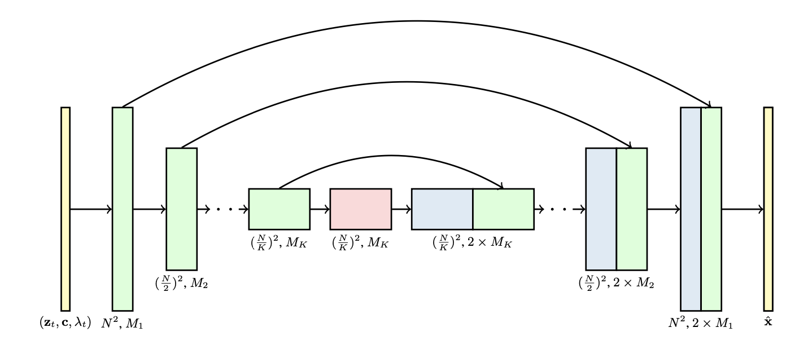

先从整张图的输入输出看起。左下角输入 $(\mathbf z_t,\mathbf c,\lambda_t)$：$\mathbf z_t$ 是带噪视频，$\mathbf c$ 是文字等条件，$\lambda_t$ 是当前信噪比的另一种写法，本质上仍然是在告诉网络扩散时刻。右下角的 $\hat{\mathbf x}$ 是网络预测的干净视频估计。这里用 $\mathbf z_t$ 和 $\hat{\mathbf x}$ 是原论文的记号；若换成我们熟悉的“输入 $\mathbf x_t$、输出 $\boldsymbol\epsilon_\theta$”，U-Net 主体不会因此改变。

图中每个长方体都不再是一张 $H\times W\times C$ 的图片特征，而是一段 $F\times H\times W\times C$ 的视频特征。沿 U 形左边向下走，空间尺寸 $H,W$ 逐级减半、通道数增加；沿右边向上走，空间尺寸逐级恢复，并通过蓝色 skip connection 取回左边保存的位置细节。这部分正是我们在 U-Net 中探讨过的下采样、上采样与跳跃连接。值得注意的是，图里的下采样只缩小空间，不缩短视频：帧数 $F$ 从入口到出口保持不变。网络是在同一组帧上逐渐扩大空间感受野，不是在下采样时把某些帧丢掉。

真正的新设计发生在每一级特征内部。VDM 把空间处理和时间处理分开进行。原来图像 U-Net 的 $3\times3$ 二维卷积，被写成 $1\times3\times3$ 的三维卷积；第一个 $1$ 表示卷积核只看当前帧，后面的 $3\times3$ 才在帧内观察相邻像素。因此，这一步可以完全继承图像卷积的工作方式：同一套卷积核分别处理每一帧，提取边缘、纹理、物体部件和空间布局。

空间 attention 也仍然只在一帧内部进行。实现时可以暂时把 $F$ 帧并入 batch，于是普通二维模块看到的是 $B\!\times\!F$ 张图片。它负责回答“这一帧的狗、草地和天空分别在哪里”，但还没有让第 1 帧读取第 2 帧。

每个空间 attention 后面再插入一个 temporal attention（时间注意力）。这一次恰好反过来：把每个空间位置当成一个独立样本，让同一位置在 $F$ 帧上的特征组成长度为 $F$ 的序列。时间注意力因此可以回答“这个位置之前出现了什么、之后又怎样变化”。论文还给它加入相对帧位置编码，让网络分得清“前一帧”和“后一帧”，却不必把运动死记成整段视频中的某个绝对编号。

这叫做 **factorized space-time architecture（时空分解架构）**。假设每帧有 $HW$ 个位置，若把整段视频的 $FHW$ 个位置一次性做完整 attention，注意力矩阵规模大约是 $(FHW)^2$；拆开以后，空间 attention 的规模是 $F(HW)^2$，时间 attention 的规模是 $HW F^2$。两者仍然让空间和时间都发生信息交换，却比直接建立一张巨大的时空注意力矩阵便宜许多。

> **Question 时间 attention 只看“同一个空间位置”，物体移动以后不就对不上了吗？**
>
> 如果时间模块直接读取原始像素，这个担心确实成立：第 1 帧中狗的鼻子在左边，第 2 帧可能已经移动到右边。但进入 temporal attention 的并不是孤立像素。它前面已经经过空间卷积和空间 attention，一个位置上的特征可以包含周围区域乃至整帧的信息；U-Net 的下采样还会让低分辨率位置覆盖更大的原图范围。空间模块与时间模块又会在多层中交替出现，所以信息可以先在一帧内从左边传到右边，再沿时间传到其他帧。这里的“同一位置”是计算时重新排列特征的方式，并不等于模型只能理解静止物体。

VDM 的训练过程与图像 DDPM 保持一致。训练样本变成一段视频，噪声也变成同样大小的视频张量；一次随机时刻、一次前向加噪和一次去噪损失，就能训练整段视频，不需要真的先跑完一条一千步的加噪轨迹。文字条件和信噪比 embedding 会送进 U-Net 的 residual block，空间—时间模块则从真实视频中学会哪些外观应当保持、哪些变化构成合理运动。

VDM 还可以把图片放进同一次训练。原论文的具体做法不是假装几张互不相关的图片构成了一段运动，而是把独立图片拼在视频样本后面，并对 temporal attention 加 mask：真实视频帧之间允许互相读取，每张独立图片则只能读取自己。这样，图片样本可以继续训练共享的空间卷积和空间 attention，视频样本同时训练空间与时间能力。图片没有伪造出运动监督，却能在同一批计算中提供更多独立外观，降低梯度波动。

> **Tips 一张图片可以看成一帧视频，但它教不了模型运动**
>
> “图片是一帧视频”只说明两者能共用空间网络，并不表示图片里凭空出现了跨帧关系。遇到单张图片时，时间 attention 被屏蔽或退化为只看自身；遇到真实视频时，它才读取多帧并学习运动。联合训练的分工是：更多图片巩固“东西长什么样”，视频负责补上“东西怎样连续变化”。

前面的 3D U-Net 一次只能生成训练时设定的视频块，例如 16 帧。若想得到更长、更清楚的视频，VDM 会把生成拆成条件任务：先生成一段低分辨率、低帧率的视频，再要求另一个视频 Diffusion 在保留这些已知帧的前提下，补出后续帧、插入中间帧或提升空间分辨率。这里的关键不是把已知帧粗暴粘回每一步，而是用 reconstruction guidance 让模型每一步预测的干净视频在已知区域上接近条件视频，于是新生成的部分会主动与旧片段衔接。原论文由此能把短视频块按时间继续延伸，也能同时完成时间和空间超分。

把 VDM 的生成过程完整串起来，就是先为 $F$ 帧一起采样噪声，3D U-Net 在每个扩散步骤中先处理帧内空间，再处理跨帧关系，最终联合得到一个短视频块；需要更长或更高分辨率时，再把已有视频作为条件交给后续视频 Diffusion 扩展。它确立了后面许多模型都会复用的基本模板：**图像模块负责空间，新增时间模块负责跨帧一致性，整段视频则在同一条扩散过程中联合去噪。**

### Make-A-Video：文字教会模型画什么，无字幕视频教会模型怎样动

VDM 可以使用配有文字的视频训练文生视频模型，可高质量的文字—视频数据远少于文字—图片数据。Make-A-Video[25](#ref-25)进一步追问：图像模型已经从海量图文对里学会了“文字对应什么画面”，能否只用无字幕视频补上运动能力，而不重新收集同等规模的文字—视频对？

它的答案建立在我们已经讲过的 unCLIP 上。系统先训练一套类似 DALL·E 2 的文生图模型：prior $P$ 把文字变成 CLIP 图片 embedding，diffusion decoder $D$ 再根据这份图片语义生成 $64\times64$ 图像，两个超分模型继续把图片放大。随后，它把 decoder 和低分辨率超分模型改造成时空网络，再增加视频插帧模型，形成下面这条生成流水线。

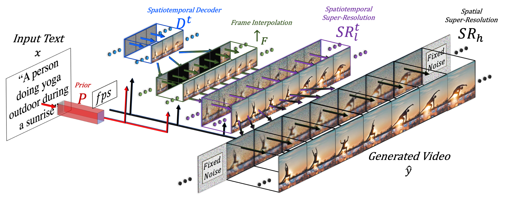

从左到右读这张图。用户输入文字 $x$ 后，CLIP text encoder 和文字 token 一起进入 prior $P$，得到一个 CLIP 图片 embedding。这个 embedding 不包含一段现成视频，而是先决定“这句话对应的画面在视觉语义上应当是什么”。spatiotemporal decoder $D^t$ 再以它和帧率条件为输入，从视频噪声中联合生成 16 帧、每帧 $64\times64$ 的低分辨率视频。

接下来的 $\uparrow_F$ 是 frame interpolation（帧插值）网络。它不是把相邻两帧像素简单取平均，而是一个知道视频运动规律的 Diffusion：输入已经生成的稀疏帧，把帧与帧之间的位置视作缺失内容，再生成合理的中间帧。论文使用它把 16 帧扩展到 76 帧。然后，时空超分模型 $SR_l^t$ 把每帧提升到 $256\times256$，同时跨帧交流，避免毛发和纹理在每一帧被独立“脑补”成不同形状。最后的 $SR_h$ 再把每帧放大到 $768\times768$。这一层由于高分辨率视频计算太贵，只做空间超分；为了减少各帧细节随机漂移，它会为不同帧使用相同的初始噪声。

整条推理链可以简洁写成

$$
\text{prompt}
\longrightarrow P
\longrightarrow D^t(16\times64^2)
\longrightarrow \uparrow_F(76\text{ 帧})
\longrightarrow SR_l^t(256^2)
\longrightarrow SR_h(768^2).
$$

这里“先生成稀疏低清视频，再补帧、再补像素”的分工与 Imagen 的级联思路相似。低分辨率主模型决定主体、场景与大运动；时间插值专门提高播放流畅度；空间超分则专心恢复画质。让一个模型同时从纯噪声决定故事、运动、帧率和每根毛发，会比三个目标明确的阶段更难训练。

> **Tips 为什么要做插帧，而不是直接生成？**
>
> 高帧率视频包含许多变化很小的相邻帧。若主模型从一开始就联合生成所有帧，大量显存会花在重复描述近乎相同的画面，能够覆盖的视频时长反而变短。低帧率模型先决定几次真正重要的状态变化，插帧模型再专门回答“状态 A 怎样平滑走到状态 B”。这和先生成低分辨率图再超分很像，只是被压缩和恢复的轴从空间换成了时间。

Make-A-Video 怎样把一套二维图像网络变成图中的 $D^t$ 和 $SR_l^t$？它没有把所有卷积直接换成昂贵的完整 3D 卷积，而是设计了下面两种 **Pseudo-3D（伪三维）** 模块。

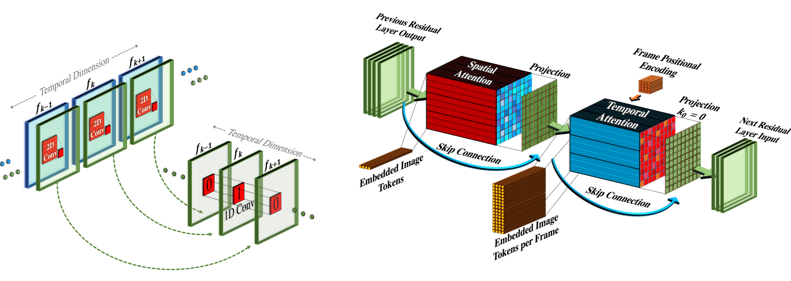

左图是伪三维卷积。蓝色的 spatial 2D convolution 先用原图像模型的卷积逐帧处理空间；黄色的 temporal 1D convolution 随后固定一个空间位置，沿帧轴卷积，让相邻时刻交换局部信息。二者串联以后，一个 block 既能利用原来学会的图像纹理，又能学习短时间内的连续变化，但参数和计算都小于一次完整三维卷积。

右图是伪三维 attention。上半部分先在每一帧内部做 spatial attention，下半部分再加入帧位置编码，并沿时间做 temporal attention。图中的 skip connection 很重要：时间分支的输出先经过一个初始化为零的投影，再加回空间分支。训练刚开始时，时间分支几乎不改变结果；随着视频训练进行，它才逐渐学会应该给原图像特征补上怎样的跨帧修正。

时间卷积也采用同样的平滑初始化：空间二维卷积继承图像模型参数，新加入的一维时间卷积初始化成恒等映射。因此，扩展完成的第一刻，网络近似等于“把原图像模型分别应用到每一帧”，至少不会立刻毁掉已经学好的画图能力；视频数据随后只需要教会新增模块怎样把这些帧连起来。这种先让新模块不捣乱、再逐渐学习运动的设计，后来反复出现在从图像模型迁移到视频模型的工作中。

> **Tips Pseudo-3D 为什么叫“伪”三维？**
>
> 真正的 $k_f\times k_h\times k_w$ 三维卷积会在一次运算里同时混合时间、高度和宽度。Pseudo-3D 把它拆成“先做 $1\times k_h\times k_w$ 的空间卷积，再做 $k_f\times1\times1$ 的时间卷积”。它最终也能让时空信息互相影响，只是通过两步完成，因此更容易复用二维权重，也更省参数。这里的“伪”不是说它没有时间能力，而是说它没有使用一个不可分解的完整三维卷积核。

它的数据分工也需要说准确。prior $P$ 在文字—图片对上学习文字到图片 embedding 的映射，而且之后不需要用视频微调；decoder 与超分模型先在图片上学会生成外观，再加入时间层，用无字幕视频进行视频化微调。无字幕视频本身就是去噪目标，所以不需要文字也能告诉时间层“真实运动长什么样”。推理时，文字仍然通过原来学好的 prior 产生图片语义条件，新时间层则把这份语义画成连续运动。

这不等于模型从无字幕视频里学会了每个动作词的精确含义。它学到的是图像语义与常见运动之间的统计联系：看到类似“狗、草地、奔跑姿态”的视觉条件时，怎样的腿部变化与背景移动更像真实视频。Make-A-Video 的真正突破点，是把**文字—视觉对齐**与**视觉—运动规律**拆到不同数据源中学习，再通过已经共享的图像表示把它们接起来。

### Imagen Video 与 Video LDM：把两套成熟图像系统搬到视频

VDM 从像素空间的图像 U-Net 出发，Make-A-Video 从 unCLIP 式系统出发。同一时期还有两条很自然的路线：Imagen Video[44](#ref-44)把 Imagen 的文字编码与级联生成完整迁移到视频；Video LDM[45](#ref-45)则把 Stable Diffusion 式的 latent diffusion 迁移到视频。它们都在复用图像模型，却把算力花在完全不同的位置。

#### Imagen Video：沿空间和时间两个方向逐级放大

我们在 Imagen 一节已经探讨过它的核心结构：冻结的 T5-XXL 负责读懂文字，$64\times64$ base model 决定画面内容，两级超分 Diffusion 再逐步补充像素。Imagen Video 保留这套分工，只是图片现在会沿两个方向变大：空间分辨率要提高，帧数与帧率也要提高。

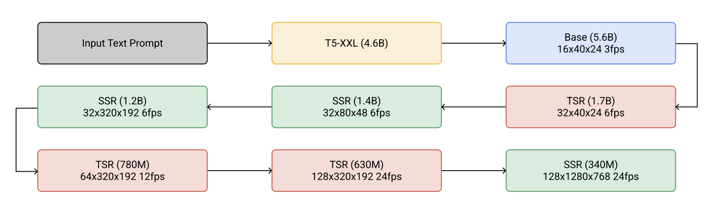

图中的尺寸统一按“帧数 $\times$ 宽 $\times$ 高”书写。用户输入 prompt 后，冻结的 T5-XXL 输出文字 token；右上角 base model 首先生成 $16\times40\times24$、每秒 3 帧的极低分辨率视频。它看起来很小，却已经要确定提示词对应的主体、构图、镜头和大致运动。

之后六个 Diffusion 依次接力。第一次 TSR 把 16 帧补成 32 帧，帧率从 3 fps 提高到 6 fps；两次 SSR 把每帧从 $40\times24$ 依次放大到 $80\times48$、$320\times192$；接着两次 TSR 把 32 帧补成 64 帧、再补成 128 帧，帧率依次提高到 12 fps 和 24 fps；最后一次 SSR 把每帧放大到 $1280\times768$。最终得到约 5.3 秒、128 帧、24 fps 的高清视频。base、三套 TSR 和三套 SSR 加起来，一共是七个独立训练的 Diffusion 模型。

> **Tips SSR、TSR 与 fps 分别是什么？**
>
> SSR 是 spatial super-resolution（空间超分辨率）：帧数不变，把每一帧的高和宽放大。例如 $32\times80\times48\rightarrow32\times320\times192$，视频时长和播放速度都没有改变，只是画面变清楚。
>
> TSR 是 temporal super-resolution（时间超分辨率）：高和宽不变，在已有帧之间生成新帧。例如 $16\times40\times24\rightarrow32\times40\times24$。fps 是 frames per second，即每秒播放多少帧；同样时长里帧数增加，运动看起来会更连续。TSR 与普通线性插值不同，它通过 Diffusion 学习条件分布，所以面对转身、遮挡或新区域出现时，可以生成像真实运动的中间状态，而不只是把两张图淡入淡出。

每个超分模型训练时都拿到两份视频：一份是目标分辨率上的带噪视频，另一份是从真实视频制造出的低空间分辨率或低时间分辨率条件。生成时，第二份条件换成上一级模型的输出。SSR 会先用普通 resize 把低清条件调整到目标空间尺寸，再与带噪目标沿通道拼接；TSR 则把稀疏帧重复到相应位置或在缺失位置填空，再与带噪视频拼接。网络由此很清楚哪些结构来自上一级、哪些细节需要自己去噪生成。

七个模型虽然各自训练，却都会读取同一份 T5 文字条件，而不只是 base model 读文字。原因和 Imagen 的超分模型相同：低清视频可能根本看不清小物体、材质和文字，后面的模型补细节时仍然需要 prompt 提醒。训练中还会给上一级条件随机加入少量噪声，并把噪声强度告诉当前模型；这是我们在 Imagen 中探讨过的 noise conditioning augmentation，用来缩小“训练时条件来自真实视频，推理时条件来自前一级生成结果”的差距。

七个模型内部仍然是 Video U-Net，但不同阶段不会机械地使用同样昂贵的模块。

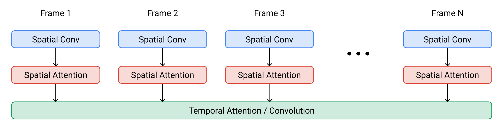

图中每一列代表一帧。蓝色 spatial convolution 和红色 spatial attention 都逐帧运行，并在所有帧间共享参数；底部绿色 temporal layer 再把各帧特征连接起来。base model 的分辨率最低，承担从纯噪声决定整体运动的任务，因此使用 temporal attention 捕捉较远帧之间的依赖。SSR 与 TSR 已经拿到一段具有明显时间相关性的条件视频，重点是局部补帧或补细节，于是用更便宜的 temporal convolution 保持邻近帧一致。在最高空间分辨率上，连 spatial attention 也会去掉，改成全卷积网络，否则对 $1280\times768$ 的每一帧做 attention 会非常昂贵。

Imagen Video 还统一使用 $v$-prediction。若带噪视频仍写成 $\mathbf x_t=\alpha_t\mathbf x_0+\sigma_t\boldsymbol\epsilon$，它让网络预测的是 $\mathbf v_t=\alpha_t\boldsymbol\epsilon-\sigma_t\mathbf x_0$。我们不需要重新推导它；只要知道给定 $\mathbf x_t$ 与 $\mathbf v_t$ 后仍能还原噪声或干净视频，因此采样逻辑不变。论文发现这种参数化在级联高分辨率视频中更稳定，也能减少颜色随时间漂移，并方便使用前面蒸馏一节讲过的 progressive distillation 压缩采样步数。

所以，Imagen Video 不是由一张巨型网络直接吐出高清视频。它先用一套低分辨率 Video U-Net 解决最难的语义与运动，再让六套条件 Diffusion 沿时间和空间交替补全。代价是系统非常庞大，七个模型都要训练和运行；好处是每一级任务清楚，最终可以把一个只有 $16\times40\times24$ 的视频骨架逐步扩成 128 帧高清结果。

#### Video LDM：在 latent 中生成运动，还要让解码器学会连续地还原

Imagen Video 的七套模型主要在像素空间工作，分辨率一高就非常昂贵。Video LDM 的起点是我们已经讲过的 LDM：先用 encoder 把图片压成较小的 latent，在 latent 中完成多次去噪，最后才用 decoder 回到像素。要把它改成视频模型，最自然的想法就是逐帧编码视频，再让 latent diffusion 获得跨帧能力。

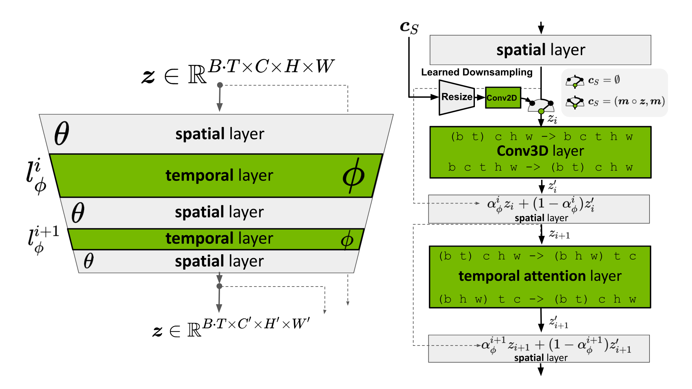

先看左半边。预训练图像 LDM 的每个 spatial layer 记作 $l_\theta^i$，参数属于图中的灰色图像主干 $\theta$；Video LDM 在这些空间层之间插入绿色 temporal layer $l_\phi^i$，构成时间主干 $\phi$。核心视频训练阶段会固定已经会生成图片的 $\theta$，主要训练新增的 $\phi$。这样，有限的视频数据不必重新教网络怎样画出高质量单帧，只需要教它怎样把这些单帧排成连续序列。

右半边把其中一小段放大了，也把“空间层与时间层怎样交替”画得更具体。原论文在图中用 $T$ 表示帧数；为了不和 Diffusion 的终点 $T$ 混淆，本文仍然把帧数写成 $F$，二者指的是同一个轴。进入这一段的特征 $\mathbf z_i$ 原本来自一段视频，但它的形状被整理成 $(B\!\times\!F)\times C\times H\times W$：$B$ 是一批视频的数量，$F$ 是每段视频的帧数，$C,H,W$ 是当前层的通道、高和宽。也就是说，时间轴暂时被并进了 batch，灰色 spatial layer 只会觉得自己一次收到了 $B\!\times\!F$ 张普通图片。它用原图像 LDM 的卷积或 attention 分别处理每一帧，输出空间特征 $\mathbf z_i$，此时不同帧仍然没有直接交流。

接下来进入第一类绿色时间层：3D convolution。模型先把形状从 $(B\!\times\!F)\times C\times H\times W$ 还原成 $B\times C\times F\times H\times W$，明确恢复出帧轴，再让 3D 卷积同时观察相邻帧和相邻空间位置。它适合学习局部运动，例如一个边缘怎样从这一帧移动到下一帧、局部纹理怎样连续变化。处理完成后，特征再变回图像主干熟悉的 $(B\!\times\!F)\times C\times H\times W$，记作 $\mathbf z_i'$。

图的下半部分是第二类绿色时间层：temporal attention。空间层处理完以后，模型把特征从 $(B\!\times\!F)\times C\times H\times W$ 重排成 $(BHW)\times F\times C$。这次每个空间位置都变成一条长度为 $F$ 的序列，temporal attention 沿这条序列读取整段视频。因此，3D 卷积主要连接附近几帧的局部变化，temporal attention 则允许相隔更远的帧直接交换信息。二者处理完都会恢复原来的形状，所以下一个灰色空间层仍然可以沿用图像 LDM 的参数。

> **Tips 图里的 $\mathbf c_S$ 是什么？每次生成都必须有吗？**
>
> 不需要。$\mathbf c_S$ 表示已经知道的 context frames（上下文帧），只在“根据开头继续生成”或“根据两端关键帧补中间帧”这类条件任务中使用。图中的 mask $\mathbf m$ 标出哪些帧已经给定，$(\mathbf m\odot\mathbf z,\mathbf m)$ 则同时把已知 latent 和位置标记交给网络；Resize 与 Conv2D 只是把它调整到当前 U-Net 层的空间大小，再送入 3D 卷积分支。普通 text-to-video 从纯噪声生成整段视频时没有已知帧，$\mathbf c_S$ 为空，文字条件仍按原图像 LDM 的方式进入网络。

时间层的输出也不会直接覆盖空间层结果。图中使用 $\alpha_\phi^i\mathbf z_i+(1-\alpha_\phi^i)\mathbf z_i'$ 把二者融合，$\alpha_\phi^i$ 是第 $i$ 个时间层学习的权重。当它接近 $1$ 时，网络主要保留原图像层的输出；接近 $0$ 时，时间修正占得更多。若把所有 $\alpha_\phi^i$ 都设为 $1$，绿色分支就被完全跳过，整套网络又退回原来的图像 LDM。这个可退回的接口很重要：模型不是为了学习运动，把原本已经会画的空间主干整个改写一遍，而是在每一级特征上学习“还要补多少时间信息”。

训练时，真实视频先由原来的 image encoder 逐帧压成干净 latent 视频，再随机选择扩散时刻并加入同形状噪声。带噪 latent 进入图中的时空网络，训练目标仍然是预测加入的噪声或对应的 $v$，与普通 LDM 没有另起一套损失。区别只在网络内部：灰色空间参数 $\theta$ 固定，绿色时间参数 $\phi$ 与融合权重负责从视频数据中学习跨帧关系。这样，一段训练视频既告诉模型每帧应当是什么内容，也借多帧共同出现的事实告诉它这些内容应当怎样连续变化。

> **Question 已经在 latent U-Net 中加入时间层，为什么还要改 VAE decoder？**
>
> 因为图像 LDM 的 decoder 只在独立图片上训练过。即使两帧 latent 很连续，它仍可能在逐帧解码时为头发、草地或墙面纹理选择略有不同的高频细节；单张看不出问题，播放起来就会闪烁。latent 生成器负责让“隐藏表示中的内容与运动”连续，decoder 则决定这些表示怎样变成最终像素。前一项做好了，不代表后一项会自动具备时间一致性。

Video LDM 因此还有第二处视频化改造。

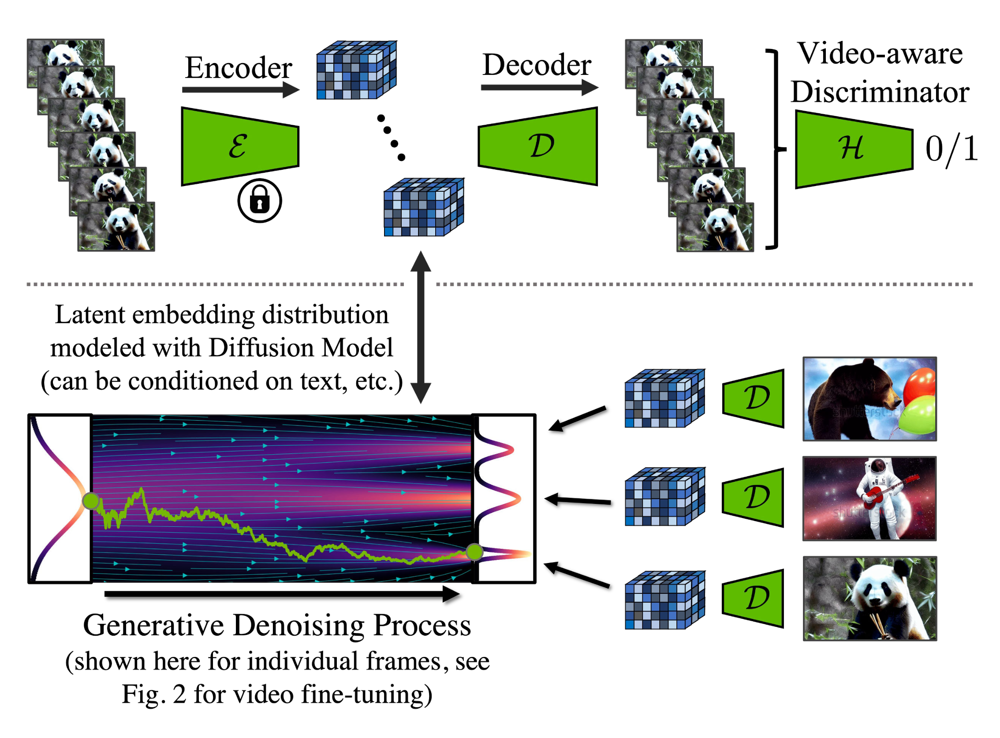

图上方是 autoencoder 的**训练流程**。输入确实是一段真实视频：冻结的 encoder $\mathcal E$ 逐帧把它压成 latent，加入时间层的 decoder $\mathcal D$ 再把整段 latent 重建成视频。decoder 不只接收某一帧的 latent，还能在还原像素时参考相邻帧，因此不必为每一帧分别猜测一套互不相关的头发、草地和墙面纹理。旁边的 video-aware discriminator（视频判别器）用 3D 卷积观察连续的时空小块，判断重建结果是否像真实视频；如果纹理在相邻帧无故跳变，它也会把这种不连续当作假。训练完成后保留下来的是视频化 decoder，判别器只负责提供训练信号，生成时不会出现。

虚线下方并不是上半部分的下一步，而是在回顾普通 LDM 的工作位置：Diffusion 不直接学习高清像素，而是在较小的 latent 空间中建模数据分布。图中熊、宇航员和熊猫是三个互不相关的图片例子，不是一段真实视频；论文也特意说明，这部分为了展示 LDM 原理而按独立图片绘制。Video LDM 真正新增的跨帧去噪结构，是第一张图中的 3D 卷积与 temporal attention；第二张图只是补充说明，去噪完成以后使用的 decoder 也必须获得时间能力。

生成时不再输入真实视频，encoder 和判别器也都不参与。系统先按目标帧数采样一整段高斯噪声 latent，记作 $\mathbf z_T$。在每个去噪步骤中，灰色空间层先让每一帧逐渐成为合理图片，绿色时间层再让不同帧的主体、位置和运动彼此协调；采样器据此把 $\mathbf z_t$ 更新为噪声更少的 $\mathbf z_{t-1}$，反复进行直到得到干净的 $\mathbf z_0$。最后，视频化 decoder 接收整段 $\mathbf z_0$，把它一次还原成连续像素帧。多次昂贵去噪都发生在小得多的 latent 网格上，只有最后一次解码回到高清像素，这就是 Video LDM 相对像素空间 Video U-Net 的主要效率来源。

回顾一下整体训练流程。第一步，先训练或直接取得一套成熟的 image LDM，其中空间去噪主干、encoder 和 decoder 都已经会处理单张图片。第二步，用真实视频训练第一张图中的时间层：视频经冻结 encoder 得到 latent，加噪以后送入时空 LDM；空间主干保持不动，只让时间层学习怎样联合去噪多帧。第三步，用真实视频微调加入时间层后的 decoder，让已经连续的 latent 被还原成像素时也保持连续。这两个视频训练任务解决的不是同一件事：前者负责 latent 中的内容与运动，后者负责最终像素中的纹理稳定。

完整推理还可以继续级联。key-frame LDM 先从噪声生成低帧率的稀疏关键帧，决定较大的语义与运动变化；同一套 latent frame interpolation 模型连续使用两次，把已有关键帧当作条件，在它们之间补出更多 latent 帧；视频 decoder 随后把整段 latent 解码到像素空间；若还需要更高分辨率，再运行经过时间微调的视频超分 Diffusion。这里的关键帧不是人为提供的动画草图，而是第一套生成模型采样出的低帧率视频骨架。

Video LDM 的价值因而不只是“在 Stable Diffusion 里塞几个时间 attention”。它把图像 LDM 的三块能力分别处理：冻结空间去噪主干，保留已有的单帧生成能力；训练时间层，让 latent 跨帧一致；微调 decoder，让 latent 被还原成像素时也不闪烁。只有这三件事接上，图像模型才真正变成一个可用的视频生成系统。

### Sora：把不同尺寸、时长的视频统一变成时空 patch

前面的模型虽然加入了时间层，主干仍然大多是 U-Net。Sora[46](#ref-46)沿用了 DiT 的另一条路线：先把视频压到 latent，再把 latent 切成 patch，最后用大规模 Transformer 做 Diffusion。它最重要的架构思想并不是某一种新去噪公式，而是建立一种能够统一表示不同时长、分辨率和宽高比视频的 token 接口。

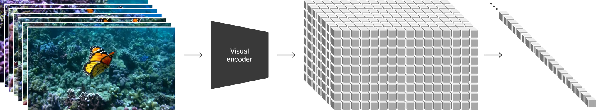

从左向右看这张图。训练视频首先进入一个 visual encoder。普通图像 LDM 的 VAE 主要压缩高度和宽度；Sora 的视频压缩网络同时压缩空间和时间，把像素视频变成更小的 latent 视频。图中间的大立方体就是压缩后的时空网格：两个方向对应空间，另一个方向对应帧的先后。与 Video LDM 逐帧编码再由时间层对齐不同，这个压缩表示本身就面向视频，在 latent 层面同时包含空间与时间信息。

接着，模型把这块 latent 切成 **spacetime patch（时空 patch）**。DiT 的一个 patch 只覆盖一小块高和宽；时空 patch 还会覆盖连续的几帧，因此它更像一小段“视频方块”。假设 latent 尺寸为 $F'\times H'\times W'$，每个 patch 覆盖 $p_f\times p_h\times p_w$，那么 token 数就是 $(F'/p_f)(H'/p_h)(W'/p_w)$。视频更长或画面更大时，token 会更多；短视频和小画面则产生更短的序列。

每个 patch 展平并线性投影后，就变成图右侧的一串视觉 token。随后，Diffusion Transformer 输入当前带噪的视觉 token、扩散时刻和文字条件，反复预测怎样把它们去噪。它的基本工作方式与 DiT 相同：self-attention 让远距离的时空区域直接交流，MLP 处理每个 token，文字条件告诉模型应该生成什么。采样结束后，再把 token 按原位置拼回 latent 网格，交给视频 decoder 还原成像素视频。

> **Tips frame、spacetime patch 与 token 不要混在一起**
>
> frame 是最终视频中的一整张画面；spacetime patch 是压缩 latent 中的一小块，它既覆盖部分空间，也可能覆盖连续几帧；token 是这块数据经过线性投影以后交给 Transformer 的向量。一个 token 不是一整帧，一帧也通常由许多 token 共同表示。扩散时刻则仍然只是“当前噪声有多大”，它与这三者都不是同一个概念。

这种表示带来一个重要能力：模型不必把所有训练视频强行裁成同一个正方形、同一个时长。图片可以看成只有一帧的视频，竖屏、横屏和不同分辨率的视频会形成不同形状的 patch 网格，不同时长则形成不同数量的时间 patch。它们最后都变成“视觉 token 序列”，可以交给同一套 Transformer 处理。训练时保留原始宽高比，也让模型学会画面尺寸本身怎样影响构图；推理时只要选择目标时空网格，就可以指定输出时长、分辨率和宽高比。

Sora 的文字条件还使用了 recaptioning。原始网络视频的标题常常很短、很含糊，未必会说明镜头、主体动作和背景细节。系统先用一个描述模型为训练视频生成更详细的 caption，再用这些描述训练文生视频模型；推理时也可以把用户的短 prompt 扩写成更接近训练 caption 的详细版本。这个步骤不负责生成像素，却改善了“哪段文字应该对应哪种视频”的监督质量，与 DALL·E 3 中使用详细合成描述的思路相同。

把 Sora 的生成过程串起来，就是先根据目标时长与画面尺寸确定一张时空 patch 网格，在这张网格上采样高斯噪声 token；Transformer 在文字条件下联合去噪整段 token；最终结果被还原为 latent 视频，再由 decoder 解压成像素视频。它依然遵守 Diffusion 的“从噪声逐步到数据”，变化的是数据表示与主干：像素变成压缩的时空 patch，U-Net 变成可扩展的 Transformer。

> **Thinking 为什么时空 patch 特别适合扩展大模型？**
>
> 图像、短视频和长视频在像素层面的形状不同，却都能被转换成同一种 token 接口；模型容量增加以后，也可以像语言模型和 DiT 一样继续加宽、加深 Transformer。self-attention 还允许相隔很远的画面区域直接建立联系，更适合学习镜头运动、物体重新出现和较长时间的一致性。代价同样明显：视频越长、分辨率越高，token 数越多，attention 的计算和显存会迅速增长。时空 patch 只是让问题能够被统一表达，并没有让长视频计算凭空消失。

Sora 的官方技术报告没有公开完整网络细节，包括每个 Transformer block 的精确结构、视频压缩器的具体层数以及完整训练配方。因此，这里能够确定的是“视频压缩—时空 patch—Diffusion Transformer—视频解码”这条公开主线，不应把未公开的内部实现写成确定事实。它展示的是视频生成从专用 3D U-Net 走向统一视觉 token 大模型的方向；再往后，怎样生成更长的视频、怎样避免每次都让全部时空 token 两两交流，则会在后面的前沿研究中引出自回归、KV cache 与长时记忆。

回看这几条路线，它们并不是简单的线性替代。VDM 建立了整段视频联合去噪和时空分解 U-Net；Make-A-Video 说明图文语义与视频运动可以从不同数据源学习；Imagen Video 用七级像素 Diffusion 沿时间与空间逐步放大；Video LDM 把主要计算搬进 latent，并把时间一致性一直补到 decoder；Sora 则把压缩视频统一成时空 token，交给 Transformer 扩展。它们共同回答的仍然是同一个问题：**既要让每一帧是一张好图片，又要让所有帧属于同一个连续世界。**

## IX 3D/4D Generation：从多视角重建到动态世界生成

图像模型生成一张固定视角的图片，视频模型生成一条固定镜头下的像素序列。它们可以把三维物体画得很逼真，却不一定真的保存了这个物体的三维结构。视频里出现一辆从左向右行驶的汽车，也不意味着我们可以突然把相机绕到汽车背后，继续得到与前面一致的画面；模型可能只生成了这条既定镜头中的二维帧。

3D 方法的目标不同。它最终要得到一份可以被反复查询的**场景表示**：给定任意相机位置和朝向，都能从中渲染一张新图片。4D 则在 3D 上再加入时间，要求系统同时接收“从哪里看”和“看哪个时刻”，输出动态场景在这个视角、这个时刻的画面。这里的第四维是时间，而不是第四个空间方向。

所以，本章中的架构通常不会直接输出最终像素。它先用 NeRF、3D Gaussian 等形式保存场景，再由渲染器把场景投影成图片。下面先把这套共同接口讲清楚，再分别看每种方法改变了哪一块。

### 在进入模型之前：重建、生成与渲染分别在做什么

先看 **3D reconstruction（3D 重建）**。它的输入通常是同一个静态场景的多张照片，以及每张照片对应的相机参数；输出是一份只描述这个场景的 3D 表示。训练完成以后，我们可以把虚拟相机移动到没有拍摄过的位置，渲染出 **novel view（新视角）**。NeRF 和 3D Gaussian Splatting 最初主要解决的都是这个问题。

**3D generation（3D 生成）** 的输入则可能只有一句文字或一张正面图片，输出仍然是一份 3D 表示。区别在于，提示词 “a corgi wearing sunglasses” 根本没有提供柯基背后的像素，模型必须依靠已经学到的图像或三维先验，把没有观察到的部分补出来。重建是在多份观测下还原这个场景，生成是在条件不完整时创造一个合理场景。二者的输出形式可以相同，监督来源却完全不同。

> **Tips Camera pose、camera ray 与 novel view**
>
> camera pose 描述相机在三维空间中的位置和朝向。相机拍下的每个像素，都可以想成从相机中心发出的一条射线：射线穿过这个像素对应的方向，进入三维场景。设相机中心为 $\mathbf o$、射线方向为 $\mathbf d$，那么射线上的点可以写成 $\mathbf r(s)=\mathbf o+s\mathbf d$，其中 $s$ 表示这个点离相机有多远。改变 camera pose，就等于换一个位置、朝另一个方向重新发射整组射线；novel-view synthesis 要做的，正是计算这些新射线最终应该呈现什么颜色。

一套 3D 架构因而至少有两块。第一块是 **representation（场景表示）**，输入空间位置等查询条件，回答哪里有物体、物体是什么颜色；第二块是 **renderer（渲染器）**，输入场景表示和相机参数，把大量三维查询组合成一张二维图片。记场景参数为 $\phi$、相机为 $\pi$，整个系统可以简写成 $\mathbf x=R_\phi(\pi)$：输入 $\pi$，输出该视角下的图片 $\mathbf x$；换一个 $\pi$，应该得到同一场景的另一个视角。

> **Question 什么叫可微渲染？为什么后面反复需要它？**
>
> 普通渲染只要求“给定场景，可以画出图片”；可微渲染还要求“图片画错以后，可以算出场景参数应该怎样修改”。如果渲染图 $R_\phi(\pi)$ 与目标图片不同，误差的梯度就能穿过渲染器回到 $\phi$，改变三维位置、颜色或密度。NeRF 和 3DGS 用真实照片提供这个误差，DreamFusion 则让预训练 Diffusion 提供修改方向；监督不同，从二维画面回到三维参数的通路是同一条。

### NeRF：把一个三维场景存进 MLP

NeRF[69](#ref-69)的目标是：输入同一静态场景的多张照片及相机位姿，学习一份可以合成新视角的场景表示。训练结果不是一张图片，而是一个只服务于当前场景的 MLP。渲染时再输入一台新相机，系统输出这台相机应该拍到的图片。

先把不同层级的输入输出分开。整个 NeRF 系统的输入是相机，输出是图片；但内部 MLP 的一次调用并不接收整张图片，而只接收一个三维位置 $\mathbf x=(x,y,z)$ 和观察方向 $\mathbf d$，输出该位置的密度 $\sigma$ 与颜色 $\mathbf c$，即 $F_\theta(\mathbf x,\mathbf d)=(\sigma,\mathbf c)$。一张图片有许多像素，一个像素的射线上又有许多采样点，所以渲染一张图需要反复调用这个 MLP，再把结果组合起来。

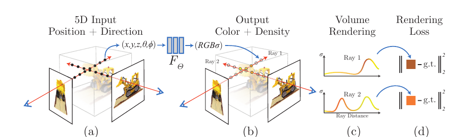

从左向右看这张图。第一块先根据相机确定某个像素的射线，并在射线上选择一串三维点。每个点的位置与观察方向经过位置编码后送入中间的 MLP。这里的密度 $\sigma$ 可以理解成“射线在这个位置遇到物体、被挡住的程度”：空气处接近零，物体表面附近较大；颜色 $\mathbf c$ 则回答，如果这个位置对像素产生贡献，它应该提供什么 RGB。

> **Tips NeRF 为什么还要做 positional encoding？**
>
> 直接把 $(x,y,z)$ 输入普通 MLP 时，网络更容易学到平缓变化，却不擅长表示栏杆边缘、细小纹理这类高频细节。NeRF 因此先用多组不同频率的正弦和余弦编码坐标，再交给 MLP。这里的 positional encoding 与 Transformer 中的位置编码形式相似，但职责不同：Transformer 用它区分 token 的顺序，NeRF 用它把同一个连续坐标展开成多种频率，让网络更容易拟合空间中的精细变化。它没有增加新的观测，只是换了一种更适合 MLP 学习的坐标表达。

MLP 内部也有明确分工。位置 $\mathbf x$ 先经过主干网络，输出密度和一份位置特征；观察方向 $\mathbf d$ 到后面才与这份特征合并，用来输出颜色。一个位置是否存在物体，不应随着观察者站在左边还是右边而变化，所以密度只依赖位置；镜面反光等外观会随视角变化，所以颜色还要读取观察方向。这正是 NeRF 架构的核心设计。

MLP 的输出还不是像素。图中的 volume rendering（体渲染）会把射线上的点按从近到远排列，根据密度决定每个点的颜色贡献，并让近处不透明的点遮住远处。把第 $i$ 个点的透明度记为 $\alpha_i$，射线穿过此前所有点的比例记为 $T_i$，那么像素颜色可以写成 $\hat{\mathbf C}(\mathbf r)=\sum_iT_i\alpha_i\mathbf c_i$。这条式子只是在说：没有被前面挡住、同时自身密度又足够大的点，才会明显影响最终像素。

> **Thinking 为什么一条射线要查询很多个点？**
>
> 我们一开始并不知道物体表面位于哪个深度，因此不能只问某一个点。NeRF 让射线沿途查询一串候选位置，再由密度决定颜色主要来自哪里。代价也正在这里：一张图片有很多像素，每个像素又要运行许多次 MLP，渲染会很慢。后续工作可以减少采样或跳过空区域，但原始 NeRF 的核心矛盾就是连续表示很精细，逐点查询却很昂贵。

训练时，系统从某张真实照片中选一个像素，根据这张照片的相机位姿发出射线，经过“沿射线采样—MLP 查询—体渲染”得到预测颜色，再与这个像素的真实颜色比较。体渲染可微，因此颜色误差能够回到 MLP 参数 $\theta$，同时修正密度和颜色。不同相机从不同方向反复观察同一片空间，最终共同约束出一份一致的三维场景。

训练结束后的使用过程则没有真实照片参与：给定一台新相机，沿每个像素发射射线，调用 NeRF 并进行体渲染，就能得到训练视角之外的新图片。NeRF 的核心思想因此可以概括成一句话：**不显式保存表面，而是学习一个“输入空间位置，输出这里有什么”的连续函数，再通过渲染把函数变成图片。**

这里一定要注意，原始 NeRF 是**逐场景优化的重建模型**。给它一组乐高挖掘机照片，它会用较长的优化过程记住这台挖掘机；换成另一间房间，通常需要重新训练一个 NeRF。它本身不会读一句 prompt 就立刻创造新物体，也没有学习跨场景的生成分布。DreamFusion 后面会把 Diffusion 先验接到这个可微表示上，才将“拟合已有照片”变成“从文字创造新场景”。

### 3D Gaussian Splatting：用许多柔软的椭球直接拼出场景

NeRF 能够重建出精细场景，但渲染一个像素要沿射线反复调用 MLP，速度较慢。3D Gaussian Splatting（3DGS）[70](#ref-70)的目标仍然是“输入多视角照片和相机位姿，输出一份可用于新视角合成的场景表示”，只是它希望这份表示能够被更快地渲染。

3DGS 不再用一个 MLP 隐式回答空间中有什么，而是直接保存许多个 3D Gaussian。每个 Gaussian 都有一组明确参数：中心位置 $\boldsymbol\mu$ 决定它在哪里，尺度与旋转决定它的形状和朝向，透明度决定它能遮住多少背景，颜色系数决定它从不同方向看起来是什么颜色。整个模型的输出就是这组优化完成的 Gaussian；渲染器的输入是 Gaussian 和相机，输出是一张图片。

> **Tips 这里的 Gaussian 不是扩散模型中的高斯噪声**
>
> “Gaussian”描述的是一个数值从中心向四周平滑衰减的空间小团。三维 Gaussian 通常不是一颗硬球，而是一只可以旋转、拉长和压扁的柔软椭球：中心决定它在哪里，协方差决定三个方向上有多宽以及朝向哪里，透明度决定它遮住后面的程度。它没有清晰边界，多个 Gaussian 可以自然重叠。3DGS 使用这种函数作为场景的基本积木，并不意味着每次渲染都要重新采一份随机高斯噪声。

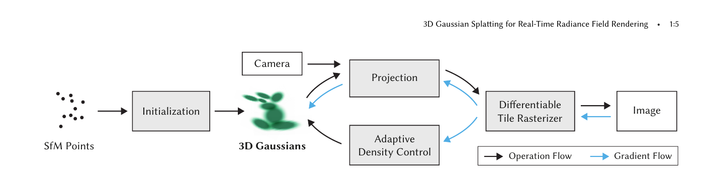

从左向右看架构。第一块 SfM Points 是一份稀疏三维点云，它为 Gaussian 提供初始位置；Initialization 把每个点扩成一个带位置、尺度、旋转、透明度和颜色的 Gaussian。中间的 Projection 接收当前 Gaussian 与相机参数，把三维椭球投影到二维屏幕。右侧的 Differentiable Tile Rasterizer 再把所有投影结果按深度和透明度混合，输出最终图片。

> **Tips SfM 为什么会出现在 3DGS 的输入端？**
>
> SfM 是 Structure from Motion（运动恢复结构）的缩写。它会在多张照片中寻找同一个角点或纹理，根据这些位置在不同照片中的变化，估计相机从哪里拍摄，并计算一批粗略的三维点。它给出的点云通常很稀疏，不是最终模型，只是告诉 3DGS“场景大概分布在哪里”。如果相机位姿和初始点云已经由数据集提供，就不需要在 3DGS 训练内部重新学习 SfM。

有了这些初始 Gaussian，接下来才进入真正的渲染过程：先确定每个三维椭球会落在屏幕上的什么位置，再把所有椭球合成最终像素。

> **Tips projection、splatting 与 rasterization 分别是什么？**
>
> projection（投影）负责把一个三维 Gaussian 变成屏幕上的二维椭圆；splatting 可以理解成把这个半透明椭圆像小印章一样盖到图像上；rasterization（光栅化）则负责判断每个椭圆覆盖哪些像素，并按照前后遮挡关系混合颜色。前两步回答“它落在屏幕哪里”，最后一步才真正产生像素。

3DGS 的核心思想就在这条渲染路径中：既然场景已经由一组明确存在的 Gaussian 表示，就不必像 NeRF 那样在每条射线上查询大量 MLP 点。渲染器只处理可能覆盖当前像素的 Gaussian，空旷区域没有网络查询，并且整套投影和光栅化很适合由 GPU 并行执行，因此可以做到实时的新视角渲染。

训练仍然遵循“渲染—比较—反传”。给定一张真实照片的相机位姿，系统先用当前 Gaussian 渲染预测图片，再与真实照片计算误差。由于投影和光栅化可微，误差会回传到每个 Gaussian 的位置、形状、透明度与颜色。图中的 Adaptive Density Control 还会调整 Gaussian 的数量：细节不足的区域复制或拆分出更多 Gaussian，几乎透明、没有贡献的 Gaussian 则被移除。训练结束后，输入任意新相机，就能直接渲染出该视角的图片。

NeRF 与 3DGS 的目标相同，都是用多视角照片重建一个可渲染场景，但保存方式不同。NeRF 像一本压缩过的函数说明书：输入坐标，运行网络才知道那里有什么；3DGS 更像一袋明确放在空间中的彩色椭球，renderer 可以直接把相关椭球投到屏幕上。前者的连续隐式表示很优雅，后者的显式结构更容易快速渲染和局部编辑。后面的 4D 方法也会沿着这两条路线分开发展：动态 NeRF 学随时间变化的函数，4D Gaussian 则让显式椭球随时间移动和变形。

### DreamFusion：让二维 Diffusion 充当三维模型的老师

NeRF 和 3DGS 都依赖多视角真实照片，可 text-to-3D 希望只输入一句文字，就得到一份可以从任意方向渲染的 3D 表示。DreamFusion[55](#ref-55)要解决的正是这个监督缺口：没有目标物体的多视角照片，怎样训练出它的 NeRF？

DreamFusion 的整体输入是一句 prompt，输出是一份针对这句 prompt 优化出来的 NeRF。它不是把文字送进一个网络，一次前向传播就输出 3D；而是先随机初始化一份 NeRF，再反复渲染、检查和修改。预训练的 text-to-image Diffusion 在这个过程中保持冻结，只负责判断当前渲染图应该向什么方向变化。

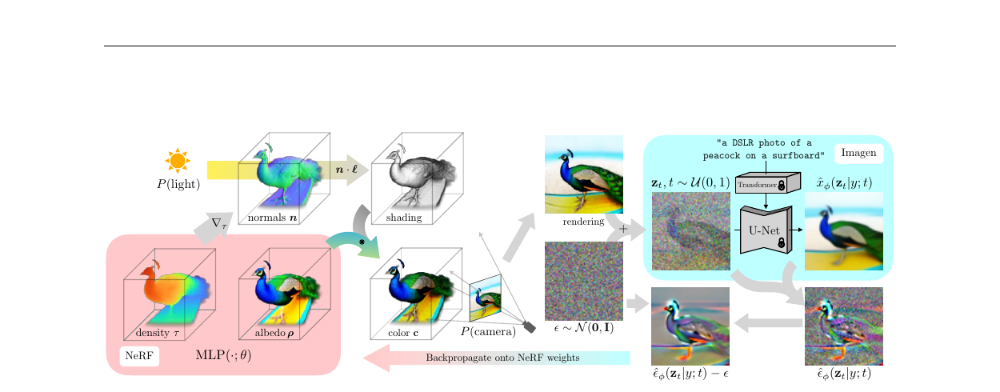

先看图左侧。红色区域是一份参数为 $\phi$ 的 NeRF，它输入空间位置，输出密度和物体本身的颜色；密度在空间中的变化还能计算表面法线，也就是表面朝向。系统再输入随机相机与随机光照，把密度、颜色和法线渲染成一张二维图片 $\mathbf x=R_\phi(\pi)$。随机光照很重要，因为阴影会暴露物体表面的朝向，模型较难只画一张正面纹理来假装自己学会了三维几何。

再看图右侧。当前渲染图先随机选择一个扩散时刻 $t$，加入一份已知噪声 $\boldsymbol\epsilon$，得到带噪图片 $\mathbf x_t$。冻结的 Imagen 接收三个输入：$\mathbf x_t$、时刻 $t$ 和文字 prompt；输出它预测的噪声 $\boldsymbol\epsilon_\theta(\mathbf x_t,t,y)$。预测噪声与实际噪声的差告诉系统，当前渲染图还需要怎样改变，才能更像 prompt 描述的自然图片。

这条二维修改方向还不是 NeRF 参数的梯度。图中底部的 Backpropagate on NeRF weights 表示，梯度会继续穿过可微渲染器，从图片颜色回到 NeRF 的密度与颜色参数。于是一次循环的输入是 prompt、随机相机、随机扩散时刻和随机噪声，输出则是一小步 NeRF 参数更新；反复循环以后，留下的是一份可以从不同角度渲染的 3D 表示。

> **Tips 什么是 Score Distillation Sampling（SDS）？**
>
> SDS 不是另一套 3D Diffusion。它把已经训练好的二维 Diffusion 当作一项可微的评价标准：给当前渲染图加上已知噪声，再比较 Diffusion 预测的噪声 $\boldsymbol\epsilon_\theta$ 与实际加入的 $\boldsymbol\epsilon$。二者的差负责指出图片应该怎样修改，可微渲染器再把修改方向传回三维参数。训练过程中 Diffusion 的参数不变，更新的是当前这份 NeRF。

所以，DreamFusion 的一次更新可以读成一条完整链路：NeRF 先从随机视角渲染图片，Diffusion 判断图片应该怎样改变，可微渲染器再把这个方向传回 NeRF。下面把这三步放在一起回顾一次。

> **Recap DreamFusion 到底是在“采样图片”还是“训练模型”？**
>
> 冻结的 Diffusion 不直接输出最终 3D，它只对当前渲染图给出修改方向；外层优化的才是这句 prompt 对应的 NeRF。换一个 prompt，通常要重新初始化并优化另一份场景。所谓 text-to-3D 的“生成”，在 DreamFusion 中是一段逐场景优化过程，而不是一次网络前向传播。

为什么必须每次随机换相机？如果永远只从正面问 Diffusion，NeRF 完全可以做成一张面向相机的“纸片”，只保证正面像柯基，背面和侧面全部混乱。随机相机把同一组参数放到不同视角下检查，迫使表示具有一定的三维一致性。但它仍有明显漏洞：二维 Diffusion 主要从独立图片中学习，并不知道这一轮的正面和上一轮的背面属于同一个物体。它可能认为每个视角都应该出现一张最典型的正脸，最后生成一个四周都有脸的物体。

> **Tips Janus problem**
>
> Janus 是罗马神话中拥有两张脸的神。text-to-3D 中的 Janus problem 指多个视角各自看起来合理，合在同一个 3D 物体上却互相矛盾，例如人物前后都有正脸、动物长出重复的眼睛。问题不一定来自 NeRF 表示能力不足，而常常来自二维先验只会评价“这一张图片像不像”，没有明确约束“这一组不同相机的图片是不是同一个物体”。

MVDream[56](#ref-56)改进的是右侧这位 Diffusion 老师。普通图像 Diffusion 的输入是一张带噪图片、文字和时刻，输出一张图片的噪声预测；MVDream 还接收一组相机位姿，并联合处理多个带噪视角，输出彼此有关联的多视角噪声预测。把它接入 SDS 后，左侧仍然优化 NeRF，但老师不再逐张判断图片，而是共同检查同一物体的几个视角，因此更能缓解 Janus problem。

这里要分清两块架构：NeRF 或 Gaussian 是最终保存 3D 的场景表示，普通图像 Diffusion 或 MVDream 则是训练时提供梯度的先验。MVDream 主要替换老师，并没有把 NeRF 换成另一种三维表示。

### 从 3D 重建到 4D 重建

静态 3D 的渲染器只接收相机 $\pi$，输出这个视角的图片；动态 4D 还要接收时间 $\tau$，接口变成 $R_\phi(\pi,\tau)$。相机决定从哪里看，时间决定场景正处于什么状态。只有把这两个输入分开，我们才能固定动作移动相机，或者固定相机观察动作。

> **Question 4D 场景与普通视频到底差在哪里？**
>
> 一段视频只记录一条已经选定的相机轨迹：第 10 帧长什么样是固定的，我们不能在第 10 帧突然绕到人物背后。4D 场景同时开放相机和时间两个变量。可以固定时间、绕着被冻结的动作看一圈；也可以固定相机，看物体从 $\tau=0$ 运动到 $\tau=1$；还可以自己设计一条训练视频中从未出现过的相机轨迹。视频是 4D 场景经过某台相机采样后得到的二维序列，不等于场景表示本身。

D-NeRF[71](#ref-71)的目标是重建动态场景。它的训练输入是一段动态视频，每帧对应的相机位姿和拍摄时间；输出是两套共同描述这个场景的 MLP。使用时输入任意相机与时间，系统输出该视角、该时刻的图片。

最直接的方案是把位置、方向和时间一起输入一个 NeRF，但这样每个时刻很容易被网络当成一份彼此独立的场景。D-NeRF 的核心思想是把问题拆成“物体本身是什么”与“物体此刻怎样变形”：用一套 canonical NeRF 保存标准状态，再用另一套 deformation network 保存不同时间相对标准状态的形变。

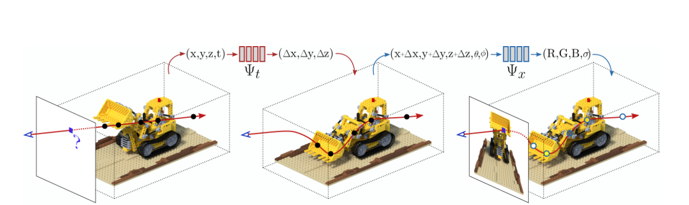

沿图中的箭头看一次查询。红色形变网络 $\Psi_t$ 的输入是当前时刻的空间点 $\mathbf x$ 和时间 $\tau$，输出这个点的位移 $\Delta\mathbf x$；二者相加得到标准空间中的位置 $\mathbf x_c=\mathbf x+\Delta\mathbf x$。蓝色 canonical network $\Psi_x$ 再接收 $\mathbf x_c$ 与观察方向 $\mathbf d$，输出密度 $\sigma$ 和颜色 $\mathbf c$。最后仍然沿相机射线查询许多点，再通过 NeRF 的体渲染得到像素。

> **Tips canonical space 不是另一个真实空间**
>
> 它只是模型选择的一份共同参照，并不是另一个真实世界。例如把站直的人规定为标准姿态，那么抬手时手臂附近的点会通过 deformation field（形变场）映射回站直姿态中的对应位置。canonical network 负责记“这个人由哪些部分构成”，deformation network 负责记“这些部分在当前时刻移动到哪里”。所有时刻都映射到同一份参照，外观与运动才不会被拆成互不相关的多套场景。

D-NeRF 的训练方式仍然来自像素重建。系统从视频中选一帧，读取它的时间与相机位姿；对某个像素发出射线，射线上的每个点先经过形变网络，再经过 canonical NeRF，最后渲染出预测颜色。预测颜色与这一帧的真实像素比较，梯度同时更新两套网络。形变网络逐渐学会“各时刻的点应该映射到哪里”，canonical NeRF 则学会“统一参照下的密度与颜色是什么”。

4D Gaussian Splatting（4D-GS）[72](#ref-72)解决同一个动态重建问题，只是把隐式 NeRF 换成显式 Gaussian。它保存一组基础 3D Gaussian，同时增加一套形变网络。形变网络输入 Gaussian 的空间特征和时间 $\tau$，输出这一时刻的位置、旋转与尺度变化；基础参数加上这些变化，得到当前时刻真正用于渲染的 Gaussian，再交给 3DGS 光栅化器输出图片。

4D-GS 的核心思想仍然是“共享一份场景，再单独描述运动”，但它的输出不是 canonical NeRF 中的密度和颜色，而是一组随时间变化的 Gaussian 参数。训练时选择视频帧及其相机和时间，变形 Gaussian、渲染图片、与真实帧比较，再更新基础 Gaussian 和形变网络。由于最后继续使用 3DGS 的显式光栅化，训练完成后可以快速渲染任意相机、任意时刻的画面。

D-NeRF 与 4D-GS 仍然主要属于**动态场景重建**：它们输入真实视频，输出这个视频对应的动态三维场景。它们回答了“怎样表示和渲染随时间变化的 3D”，却没有回答“怎样只凭一句文字创造外观、几何和运动”。text-to-4D 还需要像 DreamFusion 一样，引入能够补全未观测内容的生成先验。

### 4D生成，以 4D-fy 为例

text-to-4D 比 text-to-3D 多出的困难，不只是再加一个时间输入。一份结果必须同时满足三件事：单帧看起来真实，多视角看起来属于同一个物体，连续时间还要产生合理运动。普通 text-to-image Diffusion 擅长第一件事，多视角图像 Diffusion 更擅长第二件事，text-to-video Diffusion 能提供第三件事；单独依赖其中任何一个，都容易缺少另外两种能力。

4D-fy[57](#ref-57)的整体输入是一句 prompt，输出是一份 4D radiance field（动态辐射场）。给这份表示输入相机 $\pi$ 和时间 $\tau$，渲染器便能输出该视角、该时刻的图片；固定相机连续改变时间，就能得到视频。与 DreamFusion 相同，它也是针对每个 prompt 单独优化一份场景，而不是一次前向传播输出完整 4D。

> **Tips radiance field（辐射场）到底是什么？**
>
> 它不是某一种固定的网络，而是一类可以被空间坐标反复查询的场景表示。静态辐射场输入位置和观察方向，输出该处的密度与颜色；动态辐射场再增加时间输入，回答“这个位置在这个时刻有什么”。NeRF 用 MLP 实现辐射场，4D-fy 则用可查询的特征表加小型 MLP 实现。无论内部结构怎样变化，渲染器看到的接口都相似：沿相机射线查询密度与颜色，再把它们组合成像素。

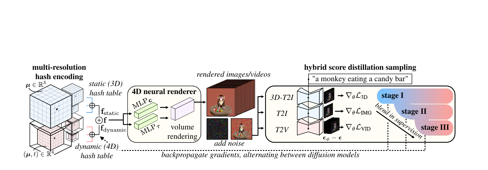

先看图左侧的 4D 表示。一次查询输入空间位置 $\boldsymbol\mu$ 和时间 $\tau$。空间位置进入 static 3D hash table，得到跨时间共享的静态特征 $\mathbf f_{\text{static}}$；空间位置与时间共同进入 dynamic 4D hash table，得到描述当前变化的动态特征 $\mathbf f_{\text{dynamic}}$。二者相加后交给两个小 MLP，一个输出颜色 $\mathbf c$，另一个输出密度。最后，体渲染器输入相机和这些颜色、密度查询，输出一张图片；连续输入多个时间，就能输出一段视频。

> **Tips hash table 在这里存的是什么？**
>
> 它不是用关键词查资料的普通字典，而是一张可以由空间坐标查询的特征表。模型把三维或四维空间划分成不同分辨率的网格，一个坐标落到某个网格位置后，就能取出附近保存的特征向量。多分辨率表示意味着粗网格负责大结构，细网格负责局部细节。静态表只按 $(x,y,z)$ 查询，保存不随时间变化的内容；动态表按 $(x,y,z,\tau)$ 查询，补充这一时刻的变化。真正的颜色和密度仍由后面的 MLP 解码。

图右侧是监督模块。渲染器产生的图片或视频会先加入噪声，再分别交给三种冻结的 Diffusion。3D-aware T2I 输入多视角带噪图片、相机和 prompt，输出强调三维一致性的 SDS 梯度；普通 T2I 输入单张带噪图片和 prompt，输出改善单帧外观的梯度；T2V 输入带噪视频和 prompt，输出改善运动的梯度。这三类梯度最后都沿图中的虚线回传到左侧同一份 4D 表示。

训练分三步，是因为场景还没有稳定几何时，直接要求它运动很容易把问题搅在一起。Stage I 先主要使用 3D-aware T2I 建立静态主体和多视角结构；Stage II 再加入普通 T2I，改善纹理与单帧真实感；Stage III 最后引入 T2V，让连续时间真正产生动作，同时继续保留图像和多视角监督，避免物体一动就丢失身份或几何。

4D-fy 的核心思想有两层。表示上，它把跨时间不变的主体与随时间变化的部分分开保存；监督上，它不要求一个 Diffusion 同时精通外观、三维和运动，而是让三位擅长不同任务的老师共同训练同一份 4D 场景。训练结束后，三位老师都不再需要，留下的 4D radiance field 就可以接受任意相机与时间进行渲染。

DreamGaussian4D[58](#ref-58)沿显式 Gaussian 路线完成类似目标。它的输入是一张参考图片，输出是一份动态 3D Gaussian。系统先建立静态 Gaussian，得到主体的基础几何和外观；形变网络再输入 Gaussian 特征与时间，输出各时刻的位置、旋转和尺度变化；预训练 image-to-video Diffusion 则为运动与时间纹理提供监督。它与 4D-fy 的主要区别不在“是否生成视频”，而在最终场景表示：4D-fy 保存可查询的动态辐射场，DreamGaussian4D 保存可快速光栅化的动态 Gaussian。

> **Recap 这一章真正需要分清的三层**
>
> 第一层是 **场景表示**：NeRF 用 MLP 隐式保存密度和颜色，3DGS 用显式 Gaussian 保存；加入时间以后，D-NeRF 增加形变网络，4D-GS 则让 Gaussian 随时间变化。第二层是 **渲染器**：它接收场景表示、相机和可选的时间，输出二维图片，并允许误差回传。第三层是 **监督来源**：重建方法使用真实照片，DreamFusion 使用单图 Diffusion 的 SDS，MVDream 提供多视角先验，4D-fy 再加入视频先验。读一篇新论文时，先问它替换了哪一层，架构会清楚很多。

从 2D 到 3D，增加的不是“图片厚度”，而是跨视角一致性；从视频到 4D，增加的也不只是更多帧，而是相机轨迹之外仍然存在一个可以自由观察的动态世界。Diffusion 在这里经常不是最终场景的容器，而是一位看过大量图片或视频的老师；真正承载结果的，仍然是可以被相机和时间反复查询的 3D/4D 场景表示。

## X Frontier Field: Diffusion 前沿研究

前面已经把 Diffusion 的方方面面基本讲的比较全面了，接下来我想简单探讨一下当下的 Diffusion 研究（特别是 VDM 研究，我的 research interest）的前沿研究。当然，研究内容非常丰富，想用一个章节把它讲透简直是天方夜谭，写一本综述都不一定说的过来。

一些比较经典的方向今日也有一些人在做，比如编辑模型、高分辨率生成、3D/4D生成。这里先列一份很不完整、但足以继续查阅的清单：

- **编辑模型**仍在从“控制某层 attention”走向能够理解视频、指令和时间关系的统一模型。AnyV2V[48](#ref-48)先编辑首帧，再把首帧的变化传播到整段视频；UniVideo[49](#ref-49)和 InstructX[50](#ref-50)把图片生成、视频生成与编辑放入同一套模型；VideoCoF[47](#ref-47)则先推理应该修改哪些时空区域，再真正生成编辑结果。
- **高分辨率生成**关心的已经不只是把输出 resize 得更大，而是怎样避免重复主体、局部拼接和全局结构崩坏。ScaleCrafter[51](#ref-51)调整卷积感受野，DemoFusion[52](#ref-52)逐级放大并在不同尺度之间传递结果，HiDiffusion[53](#ref-53)修改 U-Net 与 attention 的工作分辨率，HiFlow[54](#ref-54)则从 Flow Matching 的初始状态、方向和步长三个位置修正高分辨率采样轨迹。
- **3D/4D 生成**经常借助已经训练好的图像或视频 Diffusion 充当先验。DreamFusion[55](#ref-55)用图像 Diffusion 的 SDS 梯度优化 NeRF，MVDream[56](#ref-56)进一步提供多视角一致的 Diffusion 先验；4D-fy[57](#ref-57)联合图像与视频先验学习动态 3D，DreamGaussian4D[58](#ref-58)则把 4D Gaussian Splatting 和 image-to-video prior 结合起来，提高动态 3D 的优化速度。

但篇幅所限，我不可能全部讲完，只好挑我最感兴趣的，或者说我最看好的几个方向，探讨一下生成模型的前沿。

### i. 从双向视频模型到 AR 视频模型

前面介绍的 VDM、Imagen Video、Video LDM 和 Sora，基本都把一段视频作为一个整体去噪。以 Transformer 为例，同一层里的任意视频 token 都可以读取其他时间位置的 token：开头可以看结尾，结尾也可以看开头。这就是 **bidirectional video model（双向视频模型）**。它的好处很直观：模型修改某一帧时，能够同时参考前后文，因此很适合把一段固定长度的视频共同生成好。

问题在于，模型必须先拿到整段带噪视频，才能做这种双向交流。如果要把视频从 5 秒延长到 5 分钟，最直接的办法是把更多时空 token 一起塞进模型，可 token 越多，attention 的计算量和显存占用越大。也可以不断移动一个固定窗口来续写，但旧窗口中的特征无法像语言模型一样直接缓存下来，每生成一段都可能重新计算大量已经看过的内容。因此，双向模型并非绝对不能生成长视频，只是它的原生接口更适合“整段生成”，而不是“边生成、边播放、边接受新指令”。

AR 视频模型把视频拆成按时间排列的帧或小段。设 $\mathbf z^f$ 表示第 $f$ 个 latent chunk，$\mathbf c$ 表示文字条件，那么整段视频的概率可以写成

$$
p(\mathbf z^{1:F}\mid\mathbf c)
=\prod_{f=1}^{F}p(\mathbf z^f\mid\mathbf z^{<f},\mathbf c).
$$

这条公式与语言模型的自回归分解完全同源：先生成第一个 chunk，再根据已经生成的 $\mathbf z^1$ 生成 $\mathbf z^2$，不断向后延伸。区别是，语言模型的一步通常输出离散 token，AR 视频 Diffusion 的“一步”却不是直接吐出一帧。模型会先为当前 chunk 采一块高斯噪声，再在过去视频的条件下对它做若干次去噪，得到干净的 $\mathbf z^f$，随后才移动到下一个 chunk。

> **Tips 不要把两个“时间”混在一起**
>
> $f$ 是视频中的先后顺序，回答“正在生成第几帧或第几个 chunk”；$t$ 是 Diffusion 的噪声时刻，回答“当前这一个 chunk 还剩多少噪声”。AR 视频生成有内外两层循环：外层让 $f=1,2,\ldots$ 不断向后，内层则对每个 $\mathbf z^f_t$ 从大噪声走到小噪声。

为了保证第 $f$ 个 chunk 看不到未来，Transformer 会使用 causal attention mask：当前 chunk 可以读取自己和 $\mathbf z^{<f}$，却不能读取 $\mathbf z^{>f}$。一旦某个历史 chunk 生成完毕，它在各层产生的 K 和 V 也可以放进 KV cache。以后生成新 chunk 时，只需要为新 token 计算 Q/K/V，再读取缓存中的历史 K/V，不必把整段过去视频重新跑一遍。正是这种 **causal attention + KV cache + 顺序延伸** 的接口，让 AR 模型天然适合低首帧延迟、流式播放、可变长度生成和生成途中改变 prompt。

不过，“能够一直生成”不等于“能够一直生成好”。第一个 chunk 的小错误会进入第二个 chunk 的条件，第二个 chunk 的误差又会继续传给第三个。视频越长，人物身份、背景布局和运动方向越可能慢慢漂移。这条研究线真正困难的地方，便是怎样在获得 AR 接口以后，仍保住双向视频模型的质量。

#### CausVid：把双向教师蒸馏成因果学生

2024 年，MIT 的 William T. Freeman 团队提出 CausVid[27](#ref-27)，把一个多步、双向的视频 DiT 蒸馏成一个四步、因果的视频生成器。架构上的改变并不神秘：教师保留双向 attention，学生把跨 chunk 的 attention 换成 causal mask；同一个 chunk 内部仍可双向交流，以保证这一小段的局部连贯。这样既能继承预训练视频 DiT 的权重，又让学生在推理时按 chunk 顺序生成并使用 KV cache。

真正困难的是监督从哪里来。直接训练一个因果 Diffusion teacher，再把它蒸馏给因果 student，虽然结构一致，质量上限却可能被较弱的因果 teacher 卡住；可如果使用更强的双向 teacher，teacher 和 student 又不是同一种架构，逐层或逐输出硬对齐都不自然。CausVid 因此采用 **asymmetric DMD（非对称分布匹配蒸馏）**：teacher 可以双向看完整视频，student 只能因果看过去，两边不要求中间表示相同，只要求 student 最终生成的视频分布接近 teacher 所代表的数据分布。

回顾前面的 DMD，它并不规定“这一份噪声必须生成 teacher 的某一个固定视频”，而是比较两个 score：冻结的 teacher score 告诉 student 的样本应当怎样移动才更像真实数据；在线训练的 fake score 则描述 student 自己已经生成了什么。二者的差异给 student 提供更新方向。因为比较的是最终分布，双向 teacher 和因果 student 可以各用各的 attention mask，这就是“非对称”的意义。

CausVid 还先从双向 teacher 的 probability flow ODE 采出少量“带噪中间状态—干净视频”配对，用回归把因果 student 初始化到一个合理位置，再进行 DMD。这样做可以避免两个架构相差太大时直接训练不稳定。最终 student 每个 chunk 只需四次去噪，生成完成的历史又能进入 KV cache，于是“少步 Diffusion”与“时间上的 AR”被接在了同一套系统中。

但 CausVid 的训练条件仍没有完全复现真实推理。训练时，模型看到的历史主要来自数据或人为加噪的训练视频；推理时，它看到的却是自己刚才生成的、带有误差的历史。这就留下了经典的 **exposure bias（暴露偏差）**。

#### Self Forcing：训练时也吃自己的输出

把真实历史记作 $\mathbf z^{*<f}$，把模型自己生成的历史记作 $\hat{\mathbf z}^{<f}$，这种差异可以直接写成

$$
\text{训练： }p_\theta(\mathbf z^f\mid\mathbf z^{*<f},\mathbf c),
\qquad
\text{推理： }p_\theta(\mathbf z^f\mid\hat{\mathbf z}^{<f},\mathbf c).
$$

模型训练时总能参考没有瑕疵的标准答案，推理时却只能参考自己可能已经画歪的结果。它没有学过“人物的脸已经偏了一点时应该怎样拉回来”，于是微小误差很容易沿时间累积。Teacher Forcing 在 RNN 和语言模型中早已存在同样的问题，只是在视频里，一个错误不是错一个单词，而可能让后面几十帧的身份和几何结构全部漂移。

Self Forcing[28](#ref-28)的核心就是让训练过程真正执行一次 AR self-rollout：先由模型生成前面的 chunk，把这些生成结果写进 KV cache，再以它们为条件生成后面的 chunk。于是训练和推理看到的是同一种历史分布。模型不能再依赖永远正确的 ground-truth context，而必须学会识别并修补自己的小错误。

有了完整 self-rollout，损失也可以从“每一帧单独答对没有”升级成“整段视频的分布像不像真实视频”。Self Forcing 可以使用 DMD、SiD 或 GAN 等 holistic video-level loss；其中 DMD 仍然用强大的双向模型评价整段生成视频。这里的重点并非又做一次普通的步数蒸馏，而是让损失真正作用在 **模型推理时会走到的轨迹** 上。

串行 rollout 看起来很贵，因为后一段必须等待前一段生成完。Self Forcing 利用已经蒸馏过的少步模型和训练时的 KV cache 控制成本，并用 stochastic gradient truncation 只让梯度穿过部分 rollout 路径，不保存整段长视频的全部反向传播图。它还使用 rolling KV cache：缓存满了就丢弃最老的部分，只保留固定长度的最近历史，因此推理成本不会随着视频长度无限增长。

> **Question Self Forcing 既然吃自己的输出，为什么还需要 teacher？**
>
> “吃自己的输出”决定训练时的条件从哪里来，并不自动告诉模型什么视频才是好的。self-rollout 负责制造与推理一致的状态，双向 teacher 的 DMD score 则负责评价这批状态最后生成出的整段视频。前者解决 train-test gap，后者提供质量监督，两件事不能互相替代。

#### Causal Forcing：因果学生不能照抄双向教师的逐帧轨迹

Self Forcing 解决了 rollout context 的差异，却还保留了一个更隐蔽的问题：它在 DMD 以前，仍然使用双向 teacher 的 ODE 轨迹初始化因果 student。Causal Forcing[29](#ref-29)指出，这种做法在视频层面看似合理，拆到单帧却可能根本不存在确定答案。

原因是双向 teacher 在预测第 $f$ 帧时能够读取未来帧。假设因果 student 当前能看到的信息统称为 $\mathbf u$，双向 teacher 给出的干净目标记作 $\mathbf y$。对 student 来说完全相同的 $\mathbf u$，可能搭配不同的未来视频；teacher 看见不同未来以后，便会给出不同的 $\mathbf y$。可 student 根本看不到那部分未来信息，无法判断应该选哪一个目标。

如果仍然用 MSE 强迫它回归，最优答案只会是

$$
G^*(\mathbf u)=\mathbb E[\mathbf y\mid\mathbf u].
$$

这就是论文所说的 frame-level non-injectivity：同一个因果输入没有唯一的双向 ODE 目标。条件均值会把多个可能结果平均在一起，在图像上往往表现为模糊、动作变弱或动态塌缩。问题不在 student 容量不够，而在监督里含有 student 永远拿不到的信息。

> **Tips 这里的 injective 到底在要求什么？**
>
> 不必记住“单射”这个术语，只要记住 ODE 回归需要一张没有歧义的答题纸：给定 student 实际能看到的输入，应该只有一个对应目标。双向 teacher 的整段视频轨迹确实是一一对应的；可把它裁成一帧、同时拿走未来帧以后，这个对应关系就可能消失。

Causal Forcing 因此把不同 teacher 的职责分成三个阶段。第一阶段先用 teacher forcing 训练一个多步因果 Diffusion model：预测当前 chunk 时只看干净的过去，不看未来，因此它学到的映射符合因果信息限制。第二阶段用这个 **causal teacher** 产生 ODE 配对，把多步因果模型蒸馏成少步因果 student；teacher 和 student 看见的信息相同，逐帧轨迹不再有歧义。第三阶段再像 Self Forcing 一样执行 self-rollout，并用更强的 **bidirectional teacher** 做 asymmetric DMD，提高整段视频的分布质量。

所以，Causal Forcing 并不是说双向 teacher 没有用，而是要求它待在合适的位置：**因果 teacher 负责告诉 student 每一步沿哪条 ODE 轨迹走，双向 teacher 负责判断最终视频分布够不够好。** 前者需要输入—目标严格对齐，后者只比较分布，不要求 student 看见 teacher 的全部信息。

> **Recap 这三篇工作分别解决什么？**
>
> CausVid 证明了“强双向 teacher + 少步因果 student + KV cache”这条路线可以成立；Self Forcing 让训练也沿模型自己的 AR 轨迹展开，处理 ground-truth history 与 generated history 的差异；Causal Forcing 进一步检查 ODE 初始化的监督是否符合因果信息限制，用 causal teacher 教轨迹、bidirectional teacher 教分布。三者共同把问题从“把 attention mask 改成三角形”推进到了“架构、训练分布和蒸馏监督都必须与真实 AR 推理一致”。

AR 的确给长视频提供了正确的生成接口，却没有单独解决长期一致性。固定 KV cache 会忘记很早以前的内容，自回归误差也会持续累积；怎样在有限计算中保留真正重要的历史，便自然引出下一条研究线。

### ii. 效率与记忆

effenciency 和 memory 常常一体两面，这也是目前生成模型的关键问题。

不过，这里的两个词必须先分清。**Efficiency（效率）**关心模型生成得有多快、需要多少计算和显存；**Memory（记忆）**关心模型能否在很长的视频以后，仍然记得早先出现的人物、场景和事件。后者是模型的长时记忆能力，不是 GPU memory。本节因此分成两部分：先看怎样把视频生成跑得更快、更省，再看模型怎样记得更久。

#### Efficiency：怎样生成得更快、更省

效率不只取决于 DDIM 或 Flow Matching 使用多少个采样步。视频模型的每一次前向传播本来就要处理大量时空 token，所以还可以从三个位置节省成本：少算一些重复特征，把长序列分到多张 GPU 上并行计算，以及缓存已经计算过的历史，避免后来反复重算。

LongLive[30](#ref-30)展示的是 streaming（流式生成）思路。它用帧级 causal attention 顺序生成视频，刚完成的 chunk 可以立刻交给 decoder 和播放器，不必等整段视频全部完成；过去 chunk 的 K/V 被缓存下来，新 chunk 只计算新增部分。为了支持生成途中改变 prompt，它还会重新计算受到新 prompt 影响的缓存，即 KV recache。这样既降低了第一段视频出现以前的等待时间，也避免了每次生成新 chunk 时从头计算全部历史。

TeaCache[59](#ref-59)处理的是 Diffusion 内层去噪循环中的重复计算。相邻去噪时刻的输入只变化了一点，Transformer 某些中间输出也常常非常接近；如果每一步都完整计算，许多成本实际上花在重复结果上。TeaCache 用融合了 timestep embedding 的输入变化估计模型输出变化：变化小时复用缓存，变化大时才重新计算。这种方法不需要重新训练视频模型，但缓存得过于激进时，也可能跳过本应保留的细微运动。

LongLive-2.0[31](#ref-31)则从训练与部署系统上提高效率。训练时，它用 sequence parallelism 把长序列分到多张 GPU，并专门安排 clean history 与 noisy target，使并行布局仍然符合 teacher forcing；训练和推理又使用 NVFP4 低精度表示，推理时连 KV cache 也可以量化，从而减少计算和显存占用。这里没有改变 Diffusion 学习什么，而是改变同一套计算怎样被精度更低地表示、怎样被分配到多张卡，以及生成出的 latent 怎样与 VAE decoding 流水执行。

因此，效率至少包含两项指标：一项是 latency 和 throughput，也就是要等多久、每秒能生成多少帧；另一项是 resource cost，也就是需要多少计算和显存。一个方法可能减少显存却没有明显提速，也可能用额外 cache 换来更高速度，不能只看其中一个数字就说它更高效。

#### Memory：怎样让模型记得更久

长时记忆关心的是另一件事。假设一个人物在视频开头穿着红色外套，一分钟后重新出现时，模型能不能仍然生成同一个人、同一件外套？AR 模型虽然能够不断向后生成，但如果它只能读取最近几十帧，开头的信息离开窗口以后便相当于不存在；如果最近窗口里的人脸已经有一点漂移，后续生成还会把这份错误继续传下去。

最直接的办法是扩大 attention context，让新 chunk 读取更多历史。但历史 token 越多，attention 计算和 KV cache 占用的显存也越多。LongLive 选择保留短窗口，并设置 frame-level attention sink，让少量特殊历史位置持续被后续帧读取。窗口保证成本不会随视频长度无限增长，sink 则提供跨越较长时间的稳定锚点；代价是没有进入 sink、又已经离开窗口的细节仍然会被忘记。

FramePack[60](#ref-60)选择压缩历史，而不是简单截断历史。它按照时间距离、特征相似度等重要性，把很多历史帧压进固定长度的 context：近处或重要帧保留更丰富的表示，远处和重复帧使用更短的表示。这样，输入历史越来越长时，模型实际处理的 context 长度仍可保持固定。它还通过提前建立终点、调整采样顺序等办法减少 next-frame prediction 的 drift，说明长期一致性不只取决于“保存多少”，也取决于“以什么形式保存”。

LongLive-RAG[61](#ref-61)则把已经生成的 latent 视为一个可以检索的动态记忆库。生成新 chunk 时，模型不读取全部历史，而是根据当前内容提出 query，从很久以前的 latent 中取回最相关的少量片段，再把“最近窗口 + 检索结果”共同作为条件。Window Temporal Delta Loss 还会阻止检索器总是选到与当前窗口高度重复的邻近帧，使它更愿意找回真正有用的远期内容。

这两个方向构成一种 **trade-off**：模型若想记住更多历史，最直接的办法是保存更多 token、latent 或 K/V，可这会增加显存、计算量和延迟；模型若为了效率只保留很短的窗口，成本虽然固定，人物身份和早期事件却更容易被遗忘。因此，模型的长时记忆越强，资源开销通常越高；如果我们说的是“显存效率”，那么长时记忆越强，显存效率通常反而越低。

真正的目标因此不是只把某一边做到极致，而是在 efficiency 与 memory 之间找到 balance（平衡）：KV cache 用显存换取少算一次，量化让同样大小的显存容纳更长的 cache，滑动窗口用遗忘换取固定成本，FramePack 用压缩保存更长历史，LongLive-RAG 则用少量检索替代全历史 attention。它们都在尝试把同一条 trade-off 曲线向外推——**不要求模型记住所有细节，而是在有限计算和显存中，保留对未来生成最有价值的历史。**

### iii. 更大的故事：统一模型？世界模型？

生成模型能不能做理解呢？如果模型真的学会了怎样生成一只猫，它是否也应该知道猫在哪里、离镜头多远、怎样运动？过去我们常把生成与理解分成两套模型：生成模型输出图片，理解模型输出类别、mask 或深度。近期两个工作试图证明，大规模生成训练本身就可能是一种通用视觉预训练。

Image Generators are Generalist Vision Learners[32](#ref-32)把各种视觉任务的输出都改写成 RGB 图片。输入一张照片和“分割所有物体”的指令，模型生成一张彩色 segmentation map；输入“预测深度”，模型生成一张用颜色表示远近的 depth map。Vision Banana 只在 Nano Banana Pro 上混入少量视觉任务数据做 instruction tuning，就能完成 2D 与 3D 感知任务，同时保留原来的图像生成能力。它的关键不是让生成器额外接很多专用 head，而是把“理解答案”也变成它最熟悉的图像输出。

Video Generation Models are General-Purpose Vision Learners[33](#ref-33)把同一个想法推到视频。GenCeption 使用预训练视频 Diffusion backbone 作为 feed-forward perception model，再用文字告诉它当前要预测深度、表面法线、相机位姿、分割还是 3D 关键点。视频生成预训练为了还原运动，本来就必须学习物体形状、相机变化和跨帧对应；这些内部表示经过少量任务数据对齐以后，便可以转化成显式的视觉答案。

这两篇工作表达的趋势不是“所有生成模型天然都会理解”。未经对齐的生成器未必能按指定格式交出深度或分割结果；生成预训练提供的是丰富而通用的视觉表示，少量 instruction tuning 再把这些能力接到人类可读的任务接口上。它很像语言模型：next-token pretraining 学到大量语言结构，instruction tuning 决定模型怎样把知识作为答案说出来。

进一步，还可以有更统一的模型，就不只是生成和理解了：Cosmos 3[35](#ref-35)把语言、图片、视频、音频和动作都表示成可由同一系统处理的序列，通过 mixture-of-transformers 让不同模态使用适合自己的计算模块，同时保留跨模态交流。于是同一族模型既可以回答视觉问题，也可以生成视频、预测未来或输出动作。统一模型真正想统一的不是文件格式，而是条件与输出的组合：文字可以生成视频，视频可以导出动作，动作和过去画面又可以共同预测未来。

在 embodied AI 领域，WAM 是 **World Action Model（世界动作模型）**。普通 VLA 模型常直接学习“看到画面和指令以后该做什么”，WAM 则把环境怎样变化也纳入模型，同时预测未来状态与动作[62](#ref-62)。若 $\mathbf o$ 表示机器人看到的 observation，$\mathbf a$ 表示动作，那么三种任务的差别可以粗略写成

$$
\begin{aligned}
\text{视频生成：}&\quad p(\mathbf o_{t+1:t+H}\mid\mathbf o_{\le t},\mathbf c),\\
\text{动作条件世界模型：}&\quad p(\mathbf o_{t+1:t+H}\mid\mathbf o_{\le t},\mathbf a_{t:t+H-1},\mathbf c),\\
\text{WAM：}&\quad p(\mathbf o_{t+1:t+H},\mathbf a_{t:t+H-1}\mid\mathbf o_{\le t},\mathbf c).
\end{aligned}
$$

第一行只要续写一段合理视频；第二行必须回答“如果执行这些动作，世界会怎样变化”；第三行还要决定应该执行什么动作。WAM 可以是级联结构：VDM 先生成目标视频，inverse dynamics model 再从相邻画面反推出动作；也可以用一个联合模型交错地产生视频与 action token。

Vid2World[63](#ref-63)代表“把现成 VDM 改造成交互世界模型”的路线。它先把双向视频 Diffusion causalize，使模型能逐段预测未来，再加入 causal action guidance，让不同动作真正控制后续画面。Vidar[64](#ref-64)则把互联网规模视频 Diffusion 当作跨机器人的视觉先验，让它先想象任务应该怎样完成，再用 masked inverse dynamics model 关注与动作有关的像素，从生成的视频轨迹中恢复具体机器人的控制信号。前者强调“动作怎样进入视频动力学”，后者强调“一份通用视频先验怎样适配不同机器人身体”。

这也进一步构成了更大的概念：世界模型。虽然这个词的本意众说纷纭，但 VDM 在其中肯定发挥着重要作用。一个实用的最低标准是：模型不只生成看起来合理的视频，还能根据过去状态和候选动作预测未来，从而让 agent 在模型里尝试、规划和学习。DIAMOND[65](#ref-65)用 Diffusion 预测 Atari 环境的下一观察，并让 RL agent 在这个学出来的环境中训练，强调容易被离散压缩丢掉的视觉细节也会影响决策；Google DeepMind 的 Genie 2[66](#ref-66)则是 autoregressive latent Diffusion，输入过去 latent frame 和键鼠动作，逐帧生成可以交互的 3D 世界。

这不是少数论文临时创造的说法。OpenAI 把 Sora 的技术报告直接命名为 *Video Generation Models as World Simulators*[46](#ref-46)；Demis Hassabis、Satinder Singh 等参与的 Genie 2 工作也明确把 action-controllable Diffusion 称为 foundation world model。另一条路线 V-JEPA 2[34](#ref-34)不执着于生成每个像素，而是在 latent space 预测未来表示并用于规划。它们的实现不同，却都把“从过去预测可能的未来”视为理解物理世界和训练 agent 的重要基础。

> **Question 会生成逼真视频，就等于理解物理世界吗？**
>
> 不等于。文生视频只需生成一种看起来合理的未来，真正用于规划的世界模型却要区分不同动作造成的后果，还要在 agent 没有见过的状态上保持稳定。漂亮画面可以证明模型学到了一部分视觉规律，却不能单独证明动力学正确。VDM 的价值在于提供高保真的未来生成器和大规模视觉先验，动作可控性、长期一致性与可验证的预测准确度仍需要额外训练和评测。

从生成到理解、从理解到动作、再从动作到可交互未来，这几条路线正在逐渐汇合。统一模型关心“不同模态能否使用同一个接口”，世界模型关心“未来能否被预测和干预”，WAM 则进一步关心“模型能否一边想象未来，一边给出行动”。它们有重合，却不是三个可以随意互换的名字。

### iv. 经典概念的 diffusion 迁移

Diffusion 研究的另一种前沿，并不是继续修改图片或视频架构，而是把强化学习、策略蒸馏和语言建模等经典概念迁移到 Diffusion 上。难点通常不在概念本身，而在接口：传统 RL 怎样作用于一条连续去噪轨迹？多个单任务策略怎样合进同一个生成器？离散文字又怎样定义“加噪”和“去噪”？

#### Diffusion RL：把去噪过程看成一条决策轨迹

普通 Diffusion 训练回答“怎样还原训练数据”，却不直接优化审美、人类偏好、可压缩性或某个下游任务的成功率。Diffusion RL 则给最终样本一个 reward，再调整整条生成轨迹，使高奖励结果更容易出现。

DDPO[67](#ref-67)提供了最清楚的连接方式：把去噪写成一个有限步 MDP。状态是当前带噪样本 $\mathbf x_t$，动作是采样出的下一状态 $\mathbf x_{t-1}$，Diffusion 反向转移 $p_\theta(\mathbf x_{t-1}\mid\mathbf x_t,\mathbf c)$ 就是 policy，最终 $\mathbf x_0$ 获得奖励 $R(\mathbf x_0,\mathbf c)$。这样，每一步去噪的 log probability 都可以进入 policy gradient；即使 reward 来自一个不可求导的审美模型或人工反馈，也能训练生成模型。

DanceGRPO[68](#ref-68)把语言模型中常用的 GRPO 迁移到视觉生成。对同一个 prompt 生成一组图片或视频，分别计算 reward，再用组内相对高低构造 advantage：比同组平均更好的样本被提高概率，更差的样本被压低。它不必额外训练 critic，并且把同一套方法用于 Diffusion 与 Rectified Flow、图片与视频。趋势很明显：视觉生成的 post-training 正从单一偏好数据拟合，走向可以直接优化多种自动 reward 的在线 RL。

但 reward 只是人类目标的代理。只追求某个美学分数，模型可能学会饱和颜色或固定构图；只追求文字对齐，也可能牺牲自然度。因此 Diffusion RL 通常还要限制新 policy 不要离原模型太远，并同时观察多个质量指标。RL 能让模型主动寻找高分区域，也同样会主动寻找 reward model 的漏洞。

#### DiffusionOPD：先分别学好，再沿学生自己的轨迹合并

多任务 RL 有一个两难：把所有 reward 放在一起训练，不同任务会互相干扰，分数尺度更大的任务还可能压过其他任务；一个任务接一个任务地训练，又容易在学习新任务时忘掉旧任务。DiffusionOPD[37](#ref-37)不让一个模型从头同时探索所有目标，而是先独立训练多个 task-specific teacher，每个 teacher 只负责把一项能力学好，再把它们蒸馏进一个 unified student。

关键在 **on-policy distillation**。student 先沿自己的去噪过程生成 $\mathbf x_t$，到了某一步，再请相应 teacher 告诉它这个状态下一步应当怎样走。监督发生在 student 真正会访问的状态上，而不是 teacher 自己那条理想轨迹上，因此更能处理 student 已经产生的小偏差。论文进一步证明，对随机 SDE 和确定性 ODE，这种逐步策略 KL 都可以化成易于计算的 mean matching，不必对整条连续轨迹使用高方差的 PPO 式梯度。

这里可以把 RL 与蒸馏的职责分开：每个 teacher 的 RL 阶段负责探索“怎样在某个 reward 上取得高分”，OPD 阶段负责把已经得到的多种策略整合进一个 student。它与前面视频蒸馏的共同启发是，训练不只要看 teacher 给什么答案，还要看监督发生在哪一条状态分布上。

#### dLLM：Diffusion 进入离散语言以后，生成顺序也成了研究对象

语言 token 是离散的，不能像图片 latent 一样直接加一点高斯噪声。以 LLaDA[38](#ref-38)为代表的 diffusion language model（dLLM）使用 mask diffusion：前向过程逐渐把真实 token 替换成 `[MASK]`，反向过程则反复预测被遮住的位置，再选择其中一部分填回。传统 AR LLM 必须从左到右一次生成一个 token，dLLM 却可以在一次前向传播中同时预测许多位置，并按置信度或其他规则决定先填哪里。

这种 arbitrary-order generation 看起来严格更灵活：既然模型可以按任意顺序填词，左到右自然也包含在其中。但 The Flexibility Trap[39](#ref-39)指出，在数学和代码推理中，模型会利用这种自由绕开高不确定性 token。那些 token 往往恰好是需要探索的中间推理步骤；模型先填入容易且自信的结论或局部文字以后，剩余位置会被过早约束，解法覆盖范围反而塌缩。

论文提出的 JustGRPO 非常反直觉：RL rollout 时直接固定左到右解码顺序，然后使用标准 GRPO，不再为所有可能的填词顺序设计复杂的组合概率。这里左到右不是为了把 dLLM 永久改回 AR 模型，而是给推理训练加入一种稳定的顺序偏置；完成训练以后，模型在普通推理中仍然可以并行解码。

> **Thinking 为什么限制自由反而可能帮助推理？**
>
> “可以任意选下一步”只扩大了搜索空间，并不保证优化算法会探索更好的路径。置信度策略倾向先选择容易的 token，正好可能跳过最值得思考的分叉点。固定顺序减少了选择，却强迫模型依次经过中间步骤。这里真正重要的变量不是 AR 或 Diffusion 这个名称，而是训练时使用的生成顺序给模型施加了什么 inductive bias。

The Flexibility Trap 获得 ICML 2026 Outstanding Paper[40](#ref-40)，它的重要性也不只是一项 dLLM 技巧。它提醒我们：把经典概念迁移到 Diffusion 时，不能只看到 Diffusion 提供了更多自由度，还要检查这些自由度是否容易训练、是否与 reward 和推理目标一致。Diffusion RL、DiffusionOPD 与 dLLM 看似来自三个领域，背后其实共享同一个问题：**一条生成轨迹不只决定最后生成什么，也决定模型在训练中能够学到什么。**

## Reference

[1] I. Goodfellow et al., “Generative Adversarial Nets,” *NeurIPS*, 2014. [Paper](https://arxiv.org/abs/1406.2661)

[2] D. P. Kingma and M. Welling, “Auto-Encoding Variational Bayes,” *ICLR*, 2014. [Paper](https://arxiv.org/abs/1312.6114)

[3] A. van den Oord, N. Kalchbrenner, and K. Kavukcuoglu, “Pixel Recurrent Neural Networks,” *ICML*, 2016. [Paper](https://arxiv.org/abs/1601.06759)

[4] L. Dinh, D. Krueger, and Y. Bengio, “NICE: Non-linear Independent Components Estimation,” *ICLR Workshop*, 2015. [Paper](https://arxiv.org/abs/1410.8516)

[5] J. Ho, A. Jain, and P. Abbeel, “Denoising Diffusion Probabilistic Models,” *NeurIPS*, 2020. [Paper](https://arxiv.org/abs/2006.11239)

[6] J. Song, C. Meng, and S. Ermon, “Denoising Diffusion Implicit Models,” *ICLR*, 2021. [Paper](https://arxiv.org/abs/2010.02502)

[7] P. Dhariwal and A. Nichol, “Diffusion Models Beat GANs on Image Synthesis,” *NeurIPS*, 2021. [Paper](https://arxiv.org/abs/2105.05233)

[8] J. Ho and T. Salimans, “Classifier-Free Diffusion Guidance,” 2022. [Paper](https://arxiv.org/abs/2207.12598)

[9] Y. Song and S. Ermon, “Generative Modeling by Estimating Gradients of the Data Distribution,” *NeurIPS*, 2019. [Paper](https://arxiv.org/abs/1907.05600)

[10] Y. Song et al., “Score-Based Generative Modeling through Stochastic Differential Equations,” *ICLR*, 2021. [Paper](https://arxiv.org/abs/2011.13456)

[11] Y. Lipman et al., “Flow Matching for Generative Modeling,” *ICLR*, 2023. [Paper](https://arxiv.org/abs/2210.02747)

[12] T. Salimans and J. Ho, “Progressive Distillation for Fast Sampling of Diffusion Models,” *ICLR*, 2022. [Paper](https://arxiv.org/abs/2202.00512)

[13] Y. Song et al., “Consistency Models,” *ICML*, 2023. [Paper](https://arxiv.org/abs/2303.01469)

[14] T. Yin et al., “One-step Diffusion with Distribution Matching Distillation,” *CVPR*, 2024. [Paper](https://arxiv.org/abs/2311.18828)

[15] O. Ronneberger, P. Fischer, and T. Brox, “U-Net: Convolutional Networks for Biomedical Image Segmentation,” *MICCAI*, 2015. [Paper](https://arxiv.org/abs/1505.04597)

[16] R. Rombach et al., “High-Resolution Image Synthesis with Latent Diffusion Models,” *CVPR*, 2022. [Paper](https://arxiv.org/abs/2112.10752)

[17] A. Ramesh et al., “Hierarchical Text-Conditional Image Generation with CLIP Latents,” 2022. [Paper](https://arxiv.org/abs/2204.06125)

[18] C. Saharia et al., “Photorealistic Text-to-Image Diffusion Models with Deep Language Understanding,” *NeurIPS*, 2022. [Paper](https://arxiv.org/abs/2205.11487)

[19] W. Peebles and S. Xie, “Scalable Diffusion Models with Transformers,” *ICCV*, 2023. [Paper](https://arxiv.org/abs/2212.09748)

[20] P. Esser et al., “Scaling Rectified Flow Transformers for High-Resolution Image Synthesis,” *ICML*, 2024. [Paper](https://arxiv.org/abs/2403.03206)

[21] C. Meng et al., “SDEdit: Guided Image Synthesis and Editing with Stochastic Differential Equations,” *ICLR*, 2022. [Paper](https://arxiv.org/abs/2108.01073)

[22] A. Hertz et al., “Prompt-to-Prompt Image Editing with Cross Attention Control,” *ICLR*, 2023. [Paper](https://arxiv.org/abs/2208.01626)

[23] T. Brooks, A. Holynski, and A. A. Efros, “InstructPix2Pix: Learning to Follow Image Editing Instructions,” *CVPR*, 2023. [Paper](https://arxiv.org/abs/2211.09800)

[24] J. Ho et al., “Video Diffusion Models,” *NeurIPS*, 2022. [Paper](https://arxiv.org/abs/2204.03458)

[25] U. Singer et al., “Make-A-Video: Text-to-Video Generation without Text-Video Data,” *ICLR*, 2023. [Paper](https://arxiv.org/abs/2209.14792)

[26] X. Ma et al., “Latte: Latent Diffusion Transformer for Video Generation,” *TMLR*, 2025. [Paper](https://arxiv.org/abs/2401.03048)

[27] T. Yin et al., “From Slow Bidirectional to Fast Autoregressive Video Diffusion Models,” *CVPR*, 2025. [Paper](https://arxiv.org/abs/2412.07772)

[28] X. Huang et al., “Self Forcing: Bridging the Train-Test Gap in Autoregressive Video Diffusion,” 2025. [Paper](https://arxiv.org/abs/2506.08009)

[29] H. Zhu et al., “Causal Forcing: Autoregressive Diffusion Distillation Done Right for High-Quality Real-Time Interactive Video Generation,” *ICML*, 2026. [Paper](https://arxiv.org/abs/2602.02214)

[30] S. Yang et al., “LongLive: Real-time Interactive Long Video Generation,” 2025. [Paper](https://arxiv.org/abs/2509.22622)

[31] Y. Chen et al., “LongLive-2.0: An NVFP4 Parallel Infrastructure for Long Video Generation,” 2026. [Paper](https://arxiv.org/abs/2605.18739)

[32] V. Gabeur et al., “Image Generators are Generalist Vision Learners,” 2026. [Paper](https://arxiv.org/abs/2604.20329)

[33] L. Wang et al., “Video Generation Models are General-Purpose Vision Learners,” *ECCV*, 2026. [Paper](https://arxiv.org/abs/2607.09024)

[34] M. Assran et al., “V-JEPA 2: Self-Supervised Video Models Enable Understanding, Prediction and Planning,” 2025. [Paper](https://arxiv.org/abs/2506.09985)

[35] NVIDIA Cosmos Team, “Cosmos 3: Omnimodal World Models for Physical AI,” 2026. [Paper](https://arxiv.org/abs/2606.02800)

[36] C. Chi et al., “Diffusion Policy: Visuomotor Policy Learning via Action Diffusion,” *Robotics: Science and Systems*, 2023. [Paper](https://arxiv.org/abs/2303.04137)

[37] Q. Li et al., “DiffusionOPD: A Unified Perspective of On-Policy Distillation in Diffusion Models,” 2026. [Paper](https://arxiv.org/abs/2605.15055)

[38] S. Nie et al., “Large Language Diffusion Models,” 2025. [Paper](https://arxiv.org/abs/2502.09992)

[39] Z. Ni et al., “The Flexibility Trap: Why Arbitrary Order Limits Reasoning Potential in Diffusion Language Models,” *ICML*, 2026. [Paper](https://arxiv.org/abs/2601.15165)

[40] ICML, “Announcing the ICML 2026 Awards,” 2026. [Official announcement](https://blog.icml.cc/2026/07/05/announcing-the-icml-2026-awards/)

[41] J. Shin et al., “Exploring Multimodal Diffusion Transformers for Enhanced Prompt-based Image Editing,” 2025. [Paper](https://arxiv.org/abs/2508.07519)

[42] R. Mokady et al., “Null-text Inversion for Editing Real Images using Guided Diffusion Models,” *CVPR*, 2023. [Paper](https://arxiv.org/abs/2211.09794)

[43] L. Weng, “Diffusion Models for Video Generation,” *Lil’Log*, 2024. [Blog](https://lilianweng.github.io/posts/2024-04-12-diffusion-video/)

[44] J. Ho et al., “Imagen Video: High Definition Video Generation with Diffusion Models,” 2022. [Paper](https://arxiv.org/abs/2210.02303)

[45] A. Blattmann et al., “Align Your Latents: High-Resolution Video Synthesis with Latent Diffusion Models,” *CVPR*, 2023. [Paper](https://arxiv.org/abs/2304.08818)

[46] T. Brooks et al., “Video Generation Models as World Simulators,” OpenAI, 2024. [Technical report](https://openai.com/index/video-generation-models-as-world-simulators/)

[47] X. Yang et al., “VideoCoF: Unified Video Editing with Temporal Reasoner,” *CVPR*, 2026. [Paper](https://arxiv.org/abs/2512.07469)

[48] M. Ku et al., “AnyV2V: A Tuning-Free Framework For Any Video-to-Video Editing Tasks,” *TMLR*, 2024. [Paper](https://arxiv.org/abs/2403.14468)

[49] C. Wei et al., “UniVideo: Unified Understanding, Generation, and Editing for Videos,” 2026. [Paper](https://arxiv.org/abs/2510.08377)

[50] C. Mou et al., “InstructX: Towards Unified Visual Editing with MLLM Guidance,” 2025. [Paper](https://arxiv.org/abs/2510.08485)

[51] Y. He et al., “ScaleCrafter: Tuning-free Higher-Resolution Visual Generation with Diffusion Models,” *ICLR*, 2024. [Paper](https://arxiv.org/abs/2310.07702)

[52] R. Du et al., “DemoFusion: Democratising High-Resolution Image Generation With No \$\$\$,” *CVPR*, 2024. [Paper](https://arxiv.org/abs/2311.16973)

[53] S. Zhang et al., “HiDiffusion: Unlocking Higher-Resolution Creativity and Efficiency in Pretrained Diffusion Models,” *ECCV*, 2024. [Paper](https://arxiv.org/abs/2311.17528)

[54] J. Bu et al., “HiFlow: Training-Free High-Resolution Image Generation with Flow-Aligned Guidance,” 2025. [Paper](https://arxiv.org/abs/2504.06232)

[55] B. Poole et al., “DreamFusion: Text-to-3D using 2D Diffusion,” *ICLR*, 2023. [Paper](https://arxiv.org/abs/2209.14988)

[56] Y. Shi et al., “MVDream: Multi-view Diffusion for 3D Generation,” *ICLR*, 2024. [Paper](https://arxiv.org/abs/2308.16512)

[57] S. Bahmani et al., “4D-fy: Text-to-4D Generation Using Hybrid Score Distillation Sampling,” *CVPR*, 2024. [Paper](https://arxiv.org/abs/2311.17984)

[58] J. Ren et al., “DreamGaussian4D: Generative 4D Gaussian Splatting,” 2023. [Paper](https://arxiv.org/abs/2312.17142)

[59] F. Liu et al., “Timestep Embedding Tells: It's Time to Cache for Video Diffusion Model,” *CVPR*, 2025. [Paper](https://arxiv.org/abs/2411.19108)

[60] L. Zhang et al., “Frame Context Packing and Drift Prevention in Next-Frame-Prediction Video Diffusion Models,” 2025. [Paper](https://arxiv.org/abs/2504.12626)

[61] Q. Hu et al., “LongLive-RAG: A General Retrieval-Augmented Framework for Long Video Generation,” 2026. [Paper](https://arxiv.org/abs/2606.02553)

[62] S. Wang et al., “World Action Models: The Next Frontier in Embodied AI,” 2026. [Paper](https://arxiv.org/abs/2605.12090)

[63] S. Huang et al., “Vid2World: Crafting Video Diffusion Models to Interactive World Models,” 2025. [Paper](https://arxiv.org/abs/2505.14357)

[64] Y. Feng et al., “Vidar: Embodied Video Diffusion Model for Generalist Manipulation,” 2025. [Paper](https://arxiv.org/abs/2507.12898)

[65] E. Alonso et al., “Diffusion for World Modeling: Visual Details Matter in Atari,” *NeurIPS*, 2024. [Paper](https://arxiv.org/abs/2405.12399)

[66] J. Parker-Holder et al., “Genie 2: A Large-Scale Foundation World Model,” Google DeepMind, 2024. [Technical report](https://deepmind.google/blog/genie-2-a-large-scale-foundation-world-model/)

[67] K. Black et al., “Training Diffusion Models with Reinforcement Learning,” *ICLR*, 2024. [Paper](https://arxiv.org/abs/2305.13301)

[68] Z. Xue et al., “DanceGRPO: Unleashing GRPO on Visual Generation,” 2025. [Paper](https://arxiv.org/abs/2505.07818)

[69] B. Mildenhall et al., “NeRF: Representing Scenes as Neural Radiance Fields for View Synthesis,” *ECCV*, 2020. [Paper](https://arxiv.org/abs/2003.08934)

[70] B. Kerbl et al., “3D Gaussian Splatting for Real-Time Radiance Field Rendering,” *ACM Transactions on Graphics*, 2023. [Paper](https://arxiv.org/abs/2308.04079)

[71] A. Pumarola et al., “D-NeRF: Neural Radiance Fields for Dynamic Scenes,” *CVPR*, 2021. [Paper](https://arxiv.org/abs/2011.13961)

[72] G. Wu et al., “4D Gaussian Splatting for Real-Time Dynamic Scene Rendering,” *CVPR*, 2024. [Paper](https://arxiv.org/abs/2310.08528)

[73] L. Weng, “What are Diffusion Models?,” *Lil’Log*, 2024. [Blog](https://lilianweng.github.io/posts/2021-07-11-diffusion-models/)
